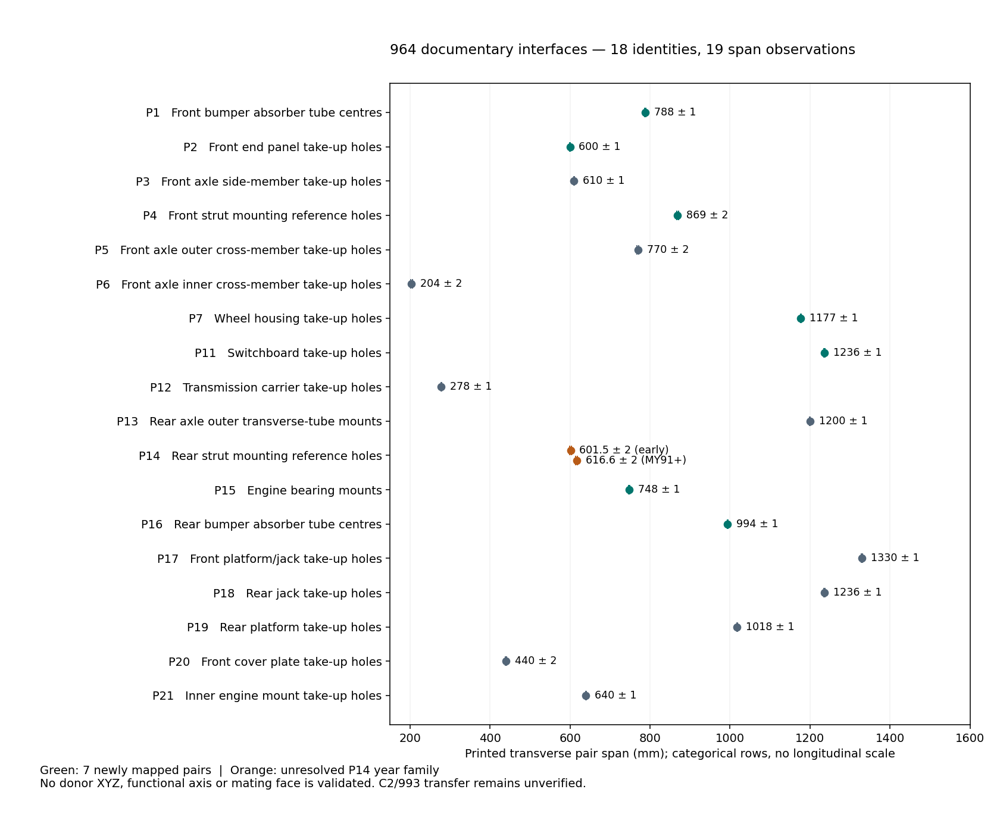

# 964 interface exploitation — 30 October 2026

**Current engineering admission: documentary scalar constraints only.**
The [contract](contract.json) supersedes the historical
`derived/monocoque-interface.json` for engineering use. Historical files and
their SHA-256 receipts are preserved. Their replay tests establish reproduction,
not renewed admission of their coordinates or uncertainty claims.

This execution maps seven previously unused transverse dimensions, bringing
coverage from **11 to 18 manual identities**. There are **19 span observations**
because P14 retains two year families. No donor XYZ, functional axis or mating
face is established. This is the complete exploitation of these reviewed pair
dimensions, not a complete vehicle interface inventory or finished monocoque.



## Source and new mappings

The [new catalogue record](../../../catalog/measurements/MEAS-MANUAL-964-INTERFACE-SPANS-20261030.json)
is a fresh visual transcription from the privately retained
[Porsche Volume V Body](http://p914-6info.net/964_Manuals/Vol%205%20-%20Body.pdf).
Its SHA-256 is
`0fcb2571d8c8d4227cbd1d88b394ec9127e962359b561629cfb769fb6ed4f00c`.
PDF pages 7–9 are plates 50-03, 50-05 and 50-05a. Printed numbers and arrow
endpoints were inspected on both assembly plates; no pixel scaling or generated
image supplies a dimension. Source pages and crops remain private.

| Newly mapped identity | Printed pair span | Interpretation retained |
|---|---:|---|
| P1 | 788 ± 1 mm | Front bumper absorber tube centres |
| P2 | 600 ± 1 mm | Front end panel take-up holes |
| P4 | 869 ± 2 mm | Reference holes in the front strut mounting patterns; not damper-axis spacing |
| P7 | 1177 ± 1 mm | Wheel housing take-up holes |
| P11 | 1236 ± 1 mm | Forward switchboard take-up holes; a distinct dimension from the equal P18 span |
| P15 | 748 ± 1 mm | Engine bearing mounts |
| P16 | 994 ± 1 mm | Rear bumper absorber tube centres |

P14 remains **601.5 ± 2 mm** on 50-05 and **616.6 ± 2 mm** on 50-05a,
explicitly from MY1991. The donor year is not selected. The **670 ± 0.5 mm**
front dimension stays unassigned: proximity to P3 in the drawing does not
override P3's explicitly tabulated **610 ± 1 mm**. P8–P10 are absent from the
source register; no identities are invented to complete the numbering.

The reviewed control pages are headed **Carrera 4**. The user-reported donor
is a **Carrera 2**. Common-looking dimensions and Celette's combined C2/C4
heading do not establish every interface's applicability. The catalogue keeps
that distinction, including for P12 and the inner engine mounts. Nothing here
selects a gearbox or transfers the network to a 993.

## Rear chain: a substantive correction to admission

The [executed calculation](chain-audit.json) reuses the original published
numbers but evaluates two interpretations separately. Both assume the same
front-chain construction, symmetric transverse offsets, and R as a longitudinal
separation. Neither is a measured-coordinate solution.

| Conditional interpretation | P12 behind drawing zero | P21 behind drawing zero | P5–P12 longitudinal span |
|---|---:|---:|---:|
| Unbracketed O/N, zero height difference | 1678.52 mm | 3098.16 mm | 1535.52 mm |
| Bracketed O/N treated as plan projections | 1637.12 mm | 3046.25 mm | 1494.12 mm |
| Difference | **41.40 mm** | **51.91 mm** | **41.40 mm** |

These are interpretation differences, not newly measured errors in the donor.
The roughly 0.1 mm difference from the historical displayed governing span
comes from rounding intermediate coordinates there.

The prior Monte Carlo calculation assigned ±2 mm to D215 and L, and ±1.5 mm
to P, although the source prints no tolerances for those dimensions. It also
limited rear height differences to 150 mm on O and 100 mm on N without a
measurement. Its reported `u95` therefore cannot be used as metrological
uncertainty or a fitment tolerance.

If the bracketed and unbracketed values describe the same endpoints as a plan
projection and direct length, respectively, Pythagoras instead gives:

| Diagonal | Conditional absolute height difference | Worst-case interval from printed ±3 mm limits | Prior assumed cap |
|---|---:|---:|---:|
| O | 379.48 mm | 352.01–405.09 mm | 150 mm |
| N | 172.45 mm | 109.07–218.14 mm | 100 mm |

Those caps are incompatible with **that interpretation**, even at the interval
extremes. This does not resolve the English manual's ambiguous wording about
bracketed dimensions. It establishes why choosing a branch from drawing/skin
proximity and then quoting a narrow uncertainty is insufficient. Heights from
this diagnostic are not inserted into the body contract.

The front paths still differ by 1.89 mm nominally. Agreement under shared
interpretations is useful consistency evidence, not an independently measured
uncertainty. Five drawing stations are retained separately: P1 −722 ± 2,
P3 −215 (no printed tolerance), P4 zero by definition, P5 +143 ± 2, and P16
3034.5 ± 6 mm (worst-case sum of the two printed tolerance bands). These
stations do not determine vehicle-frame XYZ.

## Fixture and tunnel exploitation

The [official Celette source receipts](../body-reference-research-20261030/manifest.json)
and the newly inspected Porsche C2 addendum impose useful configuration rules:

| Source / page | Usable observation | Consequence |
|---|---|---|
| Celette 564.320 p2, 425-D-4J, fig. 11 | C4: items 31/32 with spacer 33 on MZ080 | Preserve the C4 assembly as a separate configuration |
| Same sheet, fig. 12 | C2: items 31/32 with spacer 34 on MZ080 | Use the C2 configuration for the reported donor; spacer geometry remains unmeasured |
| Celette 564.320 p1, 425-D-4H | Through-MOD90 and MOD91 arrangements differ | Keep the year fork unresolved |
| Celette 564.307, 425-D-4K/L | 993 complement to 564.320 | Does not establish that 964 rear suspension interfaces fit a 993 |
| Porsche PDF p235–237, C2 addendum / 50-101–102 | Dimensioned local modifications concern conversion to Carrera RS | Do not treat RS weld-on details as this donor's factory geometry |
| Porsche PDF p259–260, 66-102–103 | C2 Tiptronic has separate front, middle, transmission and engine underbody claddings | An underside cover is not the structural tunnel wall; gearbox identity affects interpretation |

There is **no verified Celette-item-to-Porsche-point crosswalk** in these sheets.
Equal numbering is not a match. MZ080/140 tower references and bench station
numbers are not body Z/X coordinates. No fixture number enters the coordinate
contract. A tool-contact drawing or independently identified contact is still
needed for that conversion.

## Effect on the monocoque work

The seven added pairs now provide documentary targets for front/rear bumper,
bulkhead, wheelhouse, strut-pattern and engine support inspection. P15 is no
longer incorrectly described as lacking a published span. The new CSV includes
every identity, both P14 options and blank XYZ columns. It deliberately carries
no synthetic centre-plane coordinates.

The accepted scan-region and observed-boundary workspace remains useful as
observed surface evidence. No new shell, mold, layup or product FEA is released:
the interior/upper-cell surfaces, identified attachment faces and axes, moving
transmission envelope, composite allowables and process data are still absent.
The 18 manual references also omit many required seat, restraint, pedal,
steering and service attachments. The rejected whole-body geometry and its
historical S6 stiffness cannot qualify a new central cell.

The next admissible construction input is an identified interface/surface in
the existing scan or a measured common-frame interior/interface dataset. More
compute, Qwen-generated coordinates or an Omniverse render cannot supply that
missing observation. No paid compute was launched by this review.

## Reproduce and verify

```sh
python twins/964-chassis/interface-exploitation-20261030/build.py \
  --manual /private/path/vol5-body.pdf --output /private/path/new-review
python -m unittest discover -s tests -p 'test_964_interface_exploitation.py'
make check
```

The numerical/CSV build uses the standard library; the two standalone plots
use Matplotlib. The CLI requires the exact reviewed manual hash and a new
output directory. [run.json](run.json) binds source inputs and output bytes.
Its runtime versions describe this execution; plot bytes can vary between
Matplotlib versions even when the numerical tables reproduce exactly.
Tests exercise the dimension geometry independently, reject unknown heights,
preserve unknown donor fields and year alternatives, replay the numerical
outputs, and check provenance hashes. They do not certify the visual
transcription or the physical vehicle. The exported PNG was visually inspected;
the SVG is an editable vector plot of facts, not a copied workshop drawing.
