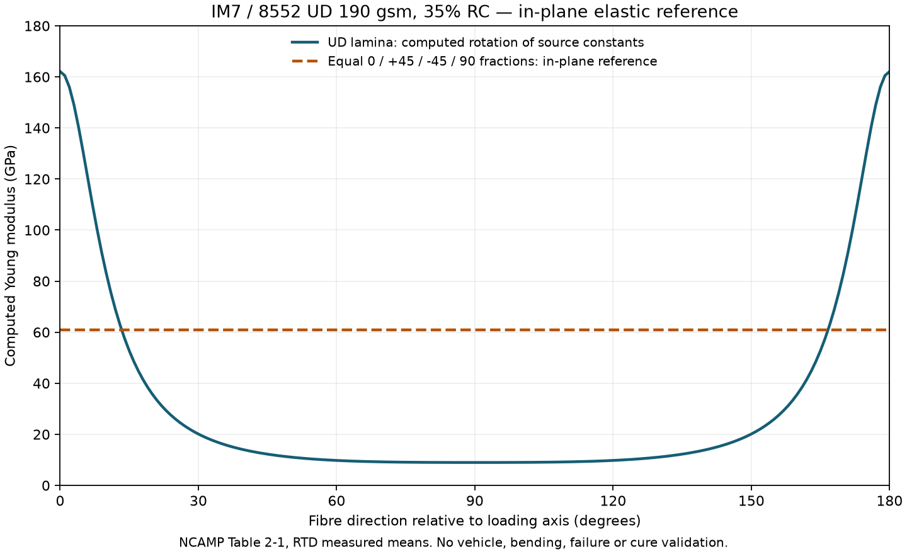

# Carbon elastic reference check

The existing [laminate implementation](../fea/laminate.py) passes a documented
plane-stress implementation check. This is a material-input preparation step;
the [body correspondence](../dimensional-correction-20261106/correspondence/README.md)
still has no qualified metric scan contact or body registration. No whole-body
analysis was run.

## Input and source boundary

[inputs.json](inputs.json) identifies the exact IM7/8552 UD 190 gsm, 35% resin
reference and four measured RTD means from
[NCAMP CAM-RP-2009-015 Rev B, Table 2-1](https://www.wichita.edu/industry_and_defense/NIAR/Documents/Qual-CAM-RP-2009-015-Rev-B-Hexcel-8552-IM7-MPDR-04.16.19.pdf).
These are not normalized properties or design allowables. The official web text
was independently checked; original PDF bytes and visual table alignment were
not captured. The PDF hash remains null. No manufacturing process is selected.

## Actual calculation

The completed local Linux run used Python 3.12.16 / NumPy 1.26.4, one CPU,
2 GiB and no network; it exited successfully in 2.95 seconds and its container
was removed. [runtime-receipt.json](runtime-receipt.json) and
[result.json](result.json) retain the actual hashes, settings and numbers.

Equal fractions at 0°, +45°, −45° and 90° give the following **computed
normalized extensional reference**:

| Quantity | Result |
|---|---:|
| E | 60,848.538 MPa |
| G | 23,133.281 MPa |
| Poisson ratio | 0.315173 |

This is the compliance of **A/h**, independent of physical thickness and stack
order. It does not specify coupling B, bending D or the free response of an
unsymmetric laminate. It is not the torsional rigidity of a chassis.

The checker reuses the existing helper without changing it. A separate
compliance inverse and stress/engineering-strain tensor rotation agree with the
helper. Isotropic rotation and invalid-input self-checks pass. An independent
60-digit Decimal calculation gives a maximum scalar relative difference of
2.97 × 10⁻¹⁶. This measures arithmetic agreement, not material uncertainty.
[verification.json](verification.json) binds the files and private reviews.



This original scientific plot is calculated from the four constants. It is not
a measured angle sweep, a photograph or an Omniverse screenshot. An editable
[SVG](media/elastic-reference.svg) and [plot receipt](media/plot-receipt.json)
are retained.

## Reproduce

From the repository root, with Python and NumPy installed, use a new output
directory. Run without Python's `-O` flag so the assertion self-checks execute.

```sh
python3 twins/964-chassis/material-reference-20261106/check_elastic_reference.py \
  --repo . \
  --inputs twins/964-chassis/material-reference-20261106/inputs.json \
  --inputs-sha256 5c79b4e15537cb8a76030d1cde4be08dd870e5a2dab781c649ef716a1fab1d36 \
  --output work/964-elastic-reference-replay
```

With Matplotlib installed, the frozen result can also be plotted to a new
directory:

```sh
python3 twins/964-chassis/material-reference-20261106/plot_reference.py \
  --result twins/964-chassis/material-reference-20261106/result.json \
  --result-sha256 6998f4323ecc1d0710fad7fd032c3b8b3b24808effd34212201f83570e75a72f \
  --output work/964-elastic-reference-plot-replay
```

Physical ply thickness, stacking, density, out-of-plane behaviour, joints,
strength/fatigue/damage allowables, cure kinetics, shrinkage and process
equivalency remain unselected. This check provides no mold, road/track,
whole-body or native Omniverse qualification.
