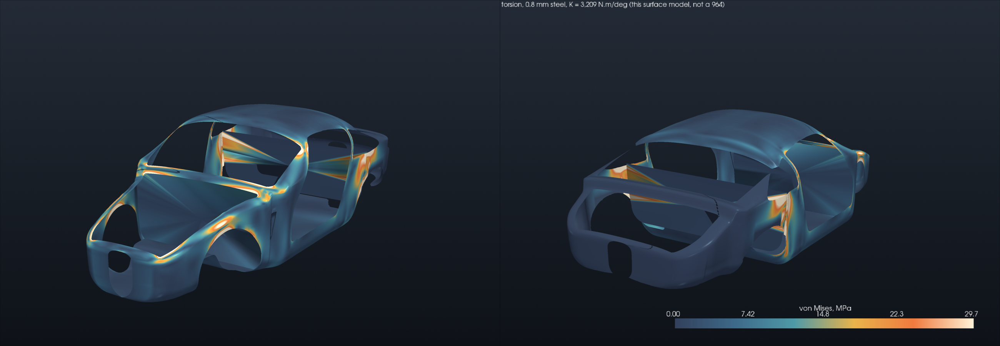
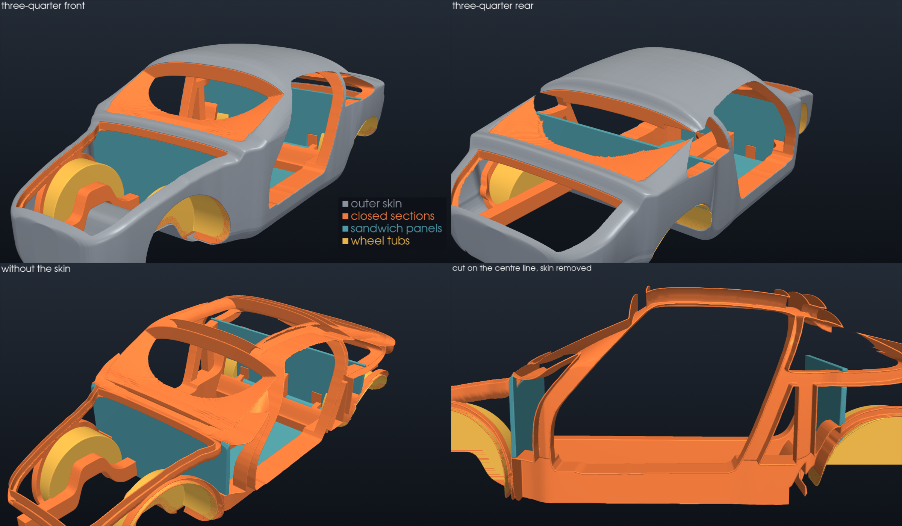
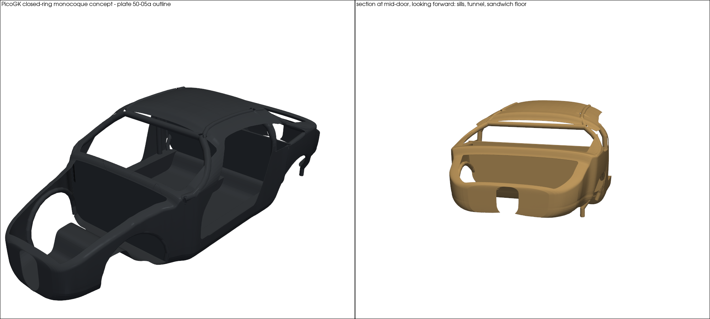
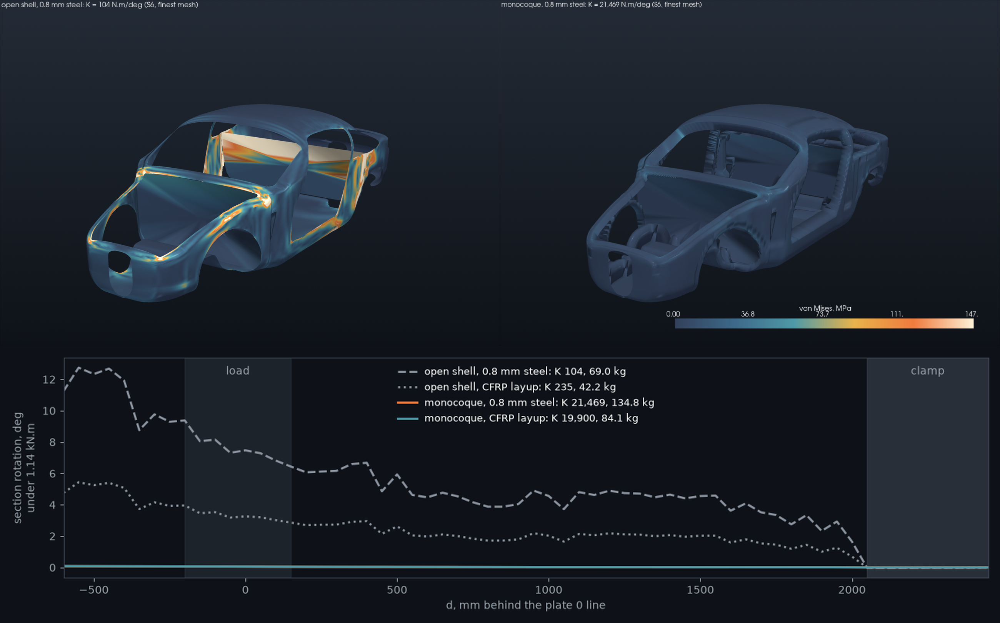
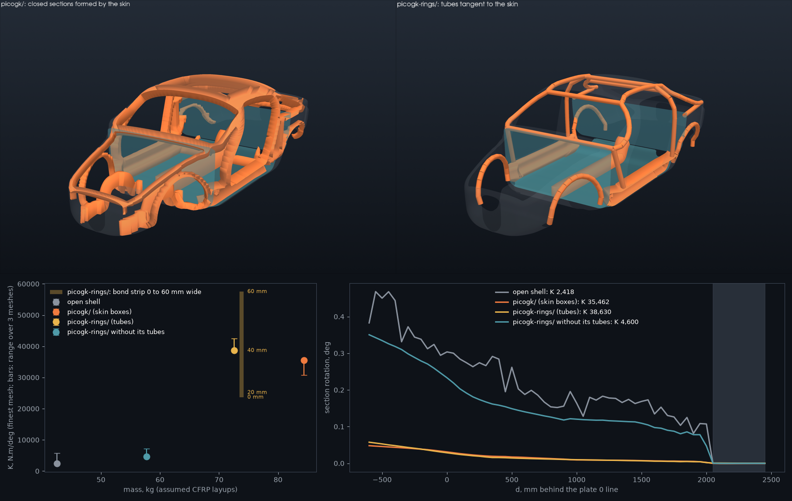
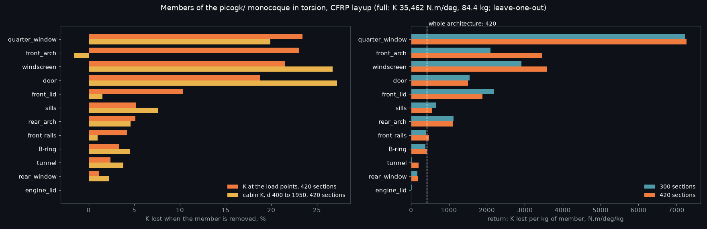
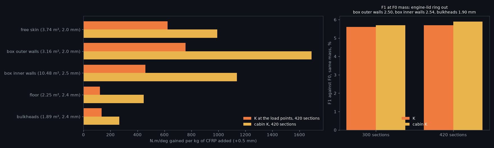
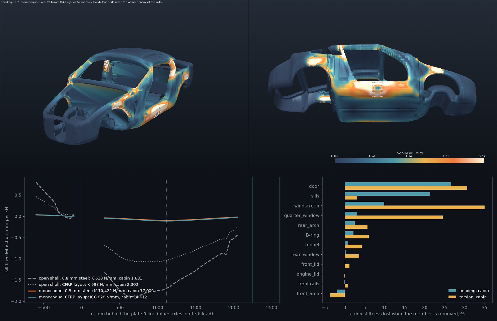
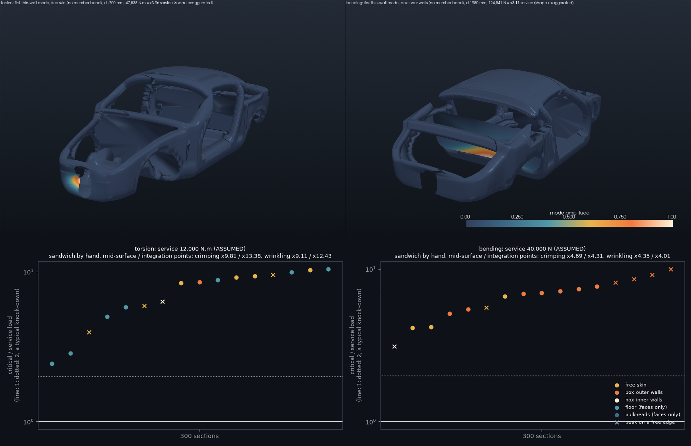

# 964 monocoque shell, from plate 50-05a

A 911-shaped body shell for the
[carbon monocoque programme](../../../docs/MONOCOQUE_964_993_PROGRAMME.md).
Until now the programme's only whole-body model was the box cell of
[`../fea/`](../fea/): good at relative questions, nothing like a 911. This
shell takes its outline from Porsche's own drawing.

The [2026-10-28 lattice replay](lattice-replay/README.md) retains four rejected
frame/resolution experiments and two raw grid-phase candidates that pass
independent topology and self-intersection screens. This resolves the observed
mesh degeneracy for those candidates; it does not validate the historical
S3-derived grading, define a fitted core or add a structural strength result.

The [OpenUSD review bundle](omniverse/README.md) preserves the complete
four-group architecture and includes verified local views and a turntable.
Omniverse RTX execution remains a separate pending step; the review bundle
does not establish fitment, composite strength or manufacturing readiness.

## S6 correction (2026-10-12): every stiffness redone

Every stiffness in this folder from #139 to #156 was computed with
CalculiX's S3 triangle, which this CalculiX expands into linear wedges.
Those lock in bending. [`source/element_check.py`](source/element_check.py)
runs the standard Scordelis-Lo roof (MacNeal and Harder, 1985),
triangulated like this shell ([result](derived/element-check.json)):

| share of the reference deflection | 8×8 | 16×16 | 32×32 |
|---|---|---|---|
| S3 | 0.067 | 0.115 | 0.206 |
| S6 | 0.815 | 0.978 | 0.996 |

[`../fea/`](../fea/README.md) had already found S3 too stiff; it was
missed here. Every study now runs in quadratic S6 shells, through
[`source/shell_s6.py`](source/shell_s6.py):

- the needles left by the aperture clip are collapsed first (shape quality
  under 0.1), or S6's expansion inverts on them;
- clamps also hold the mid-side nodes of their edges;
- SPOOLES runs on one thread. Several threads now and then returned a
  wrong solution on the same input (a K up to 60% high, a buckling factor
  of 0.6 against 15.5): that was the cause of the solver outliers of the
  [2026-10-11 corrections](#corrections-2026-10-11). One thread repeats
  exactly; two agreeing solves per value stay as a guard.

`source/torsion.py`, `torsion_monocoque.py` and `bending.py` are pinned by
SHA-256 in the [strength-audit receipt](derived/strength-audit-20261012.json)
and stay as audited, in S3. `shell_s6.py` swaps in the S6 solver at run
time and runs their entry points (see [Reproduce](#reproduce)); run
directly, they still give the S3 values.

Old against new, on the finest mesh (420 sections):

| model | S3, superseded | S6 |
|---|---|---|
| open shell, 0.8 mm steel | 3,209 N·m/deg | 104 |
| open shell, CFRP | 2,418 | 235 |
| `picogk/` boxes, 0.8 mm steel | 47,267 | 21,469 |
| `picogk/` boxes, CFRP | 35,462 | 19,900 |
| `picogk-rings/`, beam tubes, 40 mm bond, CFRP | 38,630 | 21,409 |
| `picogk-rings/` without its tubes, CFRP | 4,600 | 1,221 |
| `picogk-rings/`, shell tubes, line bond, CFRP (300 sections) | 29,607 | not redone: needs more than 6 GB |
| bending, `picogk/` boxes, CFRP: K / cabin K | 13,822 / 23,505 N/mm | 8,828 / 14,612 |
| bending, open shell, CFRP: K / cabin K | 3,131 / 5,767 N/mm | 998 / 2,302 |

What changed in the conclusions:

- **No monocoque value is converged.** S6 converges from below: the CFRP
  boxes give 12,647, 18,143 and 19,900 N·m/deg on the three meshes, still
  +9.7% on the last step (steel +7.9%). The finest values are lower
  bounds. In S3 the two finer meshes agreed within 2%: that was the
  locking, not convergence.
- **The boxes gain far more over the open shell:** ×45 to ×206 in torsion
  and ×5.7 to ×17 in bending, where S3 gave ×5 to ×15 and ×3.6 to ×4.4. The
  open shell keeps softening with the mesh, so these ratios are not
  results either. What holds is that the closed architecture is more than
  forty times stiffer than the open shell in torsion at every density.
- **Carbon pays more per kilogram:** ×1.46 to ×1.58 in specific stiffness
  against steel on the same architecture, not ×1.17 to ×1.20.
- **The cabin is carried by the windscreen frame and the door rings,**
  then the quarter windows; the door rings no longer lead alone.
- **The B-ring is no longer a weak member** (5 to 7% of K alone). Pruning
  the four weak members left costs 6 to 10% of K and 6 to 9% of the cabin
  K, about what they cost one by one.
- **The tube model bonded over a strip no longer converges** (+14% on the
  last step); the skin boxes still sit inside its bond bracket.
- **The shell-tube comparison is withdrawn, not redone.** In S3 the
  skin boxes led the tubes meshed as shells by ×1.18 per kg on the finest
  mesh; both sides of that ratio were locking S3 values. The S6 rerun was
  killed by the 6 GB memory limit already at 210 sections (2026-10-16), so
  the ranking of the two architectures with a physical bond is open again.
- **F1 gains more at the same mass:** +7.2 to +7.3% in K and +7.5 to +8.1%
  in cabin K.
- **Bending keeps its members:** the door rings and the sills lead the
  cabin's bending (27% and 21-29%), and the torsion pruning costs 0.2% of
  the cabin K there (300 sections only).

The [strength audit below](#numerical-and-stress-demand-audit--2026-10-12)
ran the same S3 model: its 35,461.55 N·m/deg, 13,821.88 N/mm and
integration-point stresses are values of a locking element, superseded
with the rest. Its receipt is left as recorded; its linearity, balance and
repeatability checks hold for the S3 model they were run on. The stress
demand exchanged by the [field-lattice study](field-lattice/README.md)
comes from that S3 audit too.

A [linear buckling screen](#buckling-a-screen-not-a-pass) of the thin
walls was added in S6.

## Numerical and stress-demand audit — 2026-10-12

*In S3, superseded as values by the [S6 correction](#s6-correction-2026-10-12-every-stiffness-redone);
kept as recorded.*

The preceding interface work was ported and merged in [PR #140](https://github.com/cluster2600/porscheparts/pull/140).
The current baseline also includes the bulkhead correction (#152), the tube
studies (#154/#155) and bending (#156). Do not merge the obsolete interface
branch over the corrected datum chain.

[`source/strength_audit.py`](source/strength_audit.py) reuses the **F0 skin-box
model**, not the old truss or a new geometry: 43,719 nodes, 89,608 S3 elements,
420 sections and assumed equivalent-isotropic carbon. It retains every input,
solver log, nodal result and integration-point stress. The machine-readable
[receipt](derived/strength-audit-20261012.json) includes their SHA-256 digests,
the source digests, all six runs and all 16 numerical checks.

| Serial run | Applied load | Response | Stiffness |
|---|---|---|---|
| torsion | 1,142.561 N·m | 0.032220° | 35,461.55 N·m/deg |
| torsion, doubled | 2,285.122 N·m | 0.064439° | 35,461.55 N·m/deg |
| bending | 2,000 N | 0.144698 mm | 13,821.88 N/mm |
| bending, doubled | 4,000 N | 0.289396 mm | 13,821.88 N/mm |

Reversing each load reverses its displacement and stress fields exactly at
the precision printed. The largest relative scaling discrepancy is 3.19e-7;
the external-force balance error is at most 1.86e-7 of the applied absolute
load. Prescribed translations are zero to numerical precision. These checks
reproduce the published finest-mesh stiffnesses; they do **not** establish
stress convergence, correct physical boundary conditions or vehicle safety.

### Parallel run rejected, not averaged away

On the same local ARM64 CalculiX 2.21 image, four-thread SPOOLES first returned
44,630.11 and 46,411.28 N·m/deg for opposite loads, then crashed on the doubled
load with `fatal error in SubMtx_denseInfo`. That is a failed numerical run,
not an alternative design result. Its physical input blocks are byte-identical
to the corresponding serial runs; only output requests changed. The serial
run reproduces main's 35,462 N·m/deg and passes the sign/scaling checks.

`torsion.run()` now defaults to **one thread**, retaining an explicit
`OMP_NUM_THREADS` override. The historical agreeing-pair selection remains for
compatibility, but is not a correctness proof. This observation does not
identify the precise upstream defect or qualify other solvers/platforms.
The rejected input and log hashes are in the
[execution record](derived/strength-audit-execution-20261012.json).

### Strength: stress demand is now available, no pass claimed

The old `OUTPUT=2D` stress images average through the shell thickness and
remove bending stresses. The new `*EL PRINT, GLOBAL=YES` output records all
179,216 integration points, including both thickness points of each S3.
This distinction follows the [CalculiX manual, sections 7.51–7.52](https://www.dhondt.de/ccx_2.22.pdf).
An independent cantilever test checks the through-thickness axial stress
against beam theory away from its clamp and load, with a 15% discretization
tolerance. It also confirms that the averaged plot omits most of this bending
stress (but retains transverse shear).

| Unit case | Largest principal tension | Largest principal compression | Maximum von Mises display scalar |
|---|---|---|---|
| torsion, 1,142.561 N·m | 21.655 MPa | −18.367 MPa | 16.771 MPa |
| bending, 2,000 N | 16.083 MPa | −34.490 MPa | 25.841 MPa |

These are integration-point peaks of the **equivalent isotropic model**,
not ply stresses, surface extrapolations or material allowables. Von Mises is
not a CFRP failure criterion. The two display peaks lie near
`X=-1725, Y=715, Z=871 mm`; local mesh/section details need investigation
before using a peak for design. No reserve factor is invented: allowable,
reserve factor and strength pass are explicitly `null`.

The requested 1,200 kg vehicle corresponds to 11,767.98 N of weight, but this
weight is **not** silently applied as the 2 kN bending load. Axle loads, mass
locations, suspension forces, inertial/aero cases and measured interfaces are
still required. Next: qualified ply/core/bond data and layup/orientation;
converged local and layered models; then buckling, fatigue, joints, physical
correlation and professional review. No crash, manufacturing or TÜV approval
is supplied by this audit. Status remains `prohibited_pending_engineering`.

Reproduce where the existing numerical dependencies and `ccx` are installed:

```sh
OMP_NUM_THREADS=1 python3 twins/964-chassis/monocoque/source/strength_audit.py \
  --output work/964-strength-new-run
python3 -m unittest discover -s tests -p test_964_strength_audit.py -v
```

The output directory must not exist. The solver witness skips unless `ccx`
is on PATH; it was **executed**, not skipped, for this audit. Generation ran
on the Mac and solving in a bounded local ARM64 Docker container, without
network or paid compute. Kali's previously recorded SSH addresses timed out.
Full raw results remain locally under `work/964-strength-serial-20261012/`;
they are not embedded in Git. Historical reports and figures are unchanged.


*Four views of `derived/monocoque-shell.ply`. Outline from the workshop
manual; sections, thickness and openings modelled. Not a part, not a ZESAD
geometry, nothing to manufacture.*

## Where the shape comes from

Plate 50-05a of volume V ("Dimensions for assembly - from Model 91 onward")
draws the body-in-white from the side and from above, to scale, with the front
wings, doors and lids off: the outline of a monocoque. Both views were
calibrated on the markers whose fore-aft positions are published
([datum chain](../README.md#the-longitudinal-chain-closed-from-plate-50-05a)),
1.1253 and 1.1287 mm per pixel at 400 dpi, and traced
(`source/trace_plate_50_05a.py`):

| traced | used for |
|---|---|
| side view, upper profile | front lid, windscreen, roof, rear deck |
| side view, lower profile | front apron, floor, rear structure |
| plan view, half width | body width along the car |
| door aperture, quarter window, rear wheel house | openings |

The plate is not in the repository. Its trace, one point every 13.5 mm, is
`data/profiles-50-05a.json`; heights are anchored on the published 964 height
of 1310 mm.

## What is modelled, not traced

`source/build_shell.py` builds one closed section every 11 mm and stitches
them:

- a rounded lower body with a barrel side, more swollen over the rear
  quarters, up to an **880 mm beltline** (the quarter-window bottom on the
  plate);
- above it a superellipse greenhouse to the roof, which gives the 911
  tumblehome; where the profile drops under the belt, a crowned lid;
- openings cut along continuous fields, so their edges stay smooth: doors and
  quarter windows from the plate, windscreen and rear window between the
  pillars, front-lid and engine-lid openings, open engine bay underside, both
  wheel arches;
- a front bulkhead under the scuttle, a rear bulkhead behind the seats, four
  cylindrical wheel houses.

Section shapes, beltline, glass and lid extents, wheel-house radii and
bulkhead heights are **modelling hypotheses**. No sheet thickness,
reinforcement or sill box section is drawn.

## A first whole-body calculation

`source/torsion.py` runs the box model's torsion load case on the structural
shell (shell and bulkheads, without the wheel houses, which are not connected
node to node): rear suspension area clamped, ±1000 N at the front wheel-house
tops, uniform 0.8 mm steel, in S6 shells since 2026-10-12
(`python3 source/shell_s6.py torsion`).



**K = 104 N·m/deg.** It is the stiffness of this surface model under this
load, not of a 964 body shell: the door and window apertures are open, there
is no glass, no boxed sill, no wheel house in the load path, and the mesh is
not converged. What holds is where the load goes: around the windscreen
frame, into the A-pillars and the corners of the door apertures, and across
the C-pillars, with the floor and the roof lightly loaded. The hot spots
around the front wheel-house tops are local: that is where the load is
applied. That is the open shell a monocoque has to close. (In S3 this
read 3,209, and 2,261 before the bulkheads were added: see the
[S6 correction](#s6-correction-2026-10-12-every-stiffness-redone) and the
[2026-10-11 corrections](#corrections-2026-10-11).)

## The monocoque inside it, in PicoGK

[`picogk/`](picogk/README.md) builds a ZESAD-type carbon monocoque in voxels
inside this shell, with the pinned PicoGK kernel. It has an outer skin, a
closed section around every aperture, boxed sills, a tunnel and rails,
sandwich floor and bulkheads, and wheel tubs. That closes the rings this open
shell leaves open. It is a design envelope, not a part.



## An independent closed-ring study, in PicoGK

[`picogk-rings/`](picogk-rings/README.md) is a second, independent PicoGK
study on the same shell: tubes tangent to the skin for the rings the torsion
case loads (windscreen frame and A-pillars, B-hoop, C-pillars, wheel arches),
boxed sills, a central tunnel with a C4-tube clearance check, solid sandwich
floor and bulkheads, drain holes, a thin-wall mass breakdown and an
independent mesh QA (one body, no sealed void). Study geometry only, same
`prohibited_pending_engineering` status.



## Torsion of the monocoque architecture

`source/torsion_monocoque.py` puts the members of [`picogk/`](picogk/README.md)
on the open shell's own mesh, as shells, and reruns its load case. The two
answers therefore differ by the architecture alone. Each closed section is
built from three parts:

- **outer wall:** a band of skin;
- **inner wall:** a copy of the band, offset inward by the section depth;
- **sides:** a wall along every free edge of the band, including a flange
  on the aperture edge.

Sizes come from the PicoGK report. There are four cases, solved in S6 at
three shell densities (210, 300 and 420 sections):

| case | mass | K, 210 / 300 / 420 sections |
|---|---|---|
| open shell, 0.8 mm steel | 69 kg | 159 / 124 / 104 N·m/deg |
| open shell, CFRP | 42 kg | 280 / 255 / 235 |
| **monocoque, 0.8 mm steel** | 135 kg | **12,808 / 19,898 / 21,469** |
| **monocoque, CFRP** | 84 kg | **12,647 / 18,143 / 19,900** |



*Top: von Mises stress on one colour scale, same steel, same load. Bottom:
rotation of each cross-section along the car under the 1.14 kN·m torque.*

What holds, and what does not:

- **The monocoque's K is not converged.** It rises with every refinement,
  as S6 should from below: +43 to +55%, then +8 to +10% on the last step.
  The finest values are lower bounds. The open shell's K keeps falling:
  with its apertures open, it is close to a mechanism. **The ratio between
  the two (×45 to ×206 depending on the mesh and material) is therefore not
  a result.** What remains is that the closed architecture is more than
  forty times stiffer than the open shell at any density tried.
- **The load path changes.** On the open shell, the stress collects at the
  windscreen frame, the A-pillars and the door corners. On the monocoque it
  spreads at a low level, and the twist builds up evenly from the clamp to
  the front instead of in steps at each aperture.
- **Carbon versus steel**, same architecture: 0.91 to 0.99 of the
  stiffness for 0.62 of the mass, ×1.46 to ×1.58 in specific stiffness.
  The ×1.25 found earlier on the box cell ([`../fea/`](../fea/README.md))
  was computed in S3 too. The architecture remains the bigger lever.

Limits that come on top of the shell's own:

- Doors, glass, joints and inserts are absent, and every member size is
  assumed. K is a value of this model, not of a car.
- The offset folds at the tightest curvatures. There the depth is cut back
  locally: 599 of 15,101 section vertices, to 0.66 of nominal on average.
- The sills are 140 mm deep, not 210. The rear rails and wheel tubs are
  left out.
- The sandwich panels count by their faces only, which is on the soft side.
- S6 needs the needles of the aperture clip collapsed first (shape
  quality under 0.1); without that it fails on inverted elements. A finer
  mesh than 420 sections has not been tried: splitting every triangle in
  four needed more than 12 GB for the direct solver already in S3.
- Multi-threaded SPOOLES now and then returned a K too high for the same
  input (+2% to +60%). It runs on one thread, which repeats exactly; every
  value is still the one two solves agree on, and all the solves are kept
  in the JSON.

## Two architectures, one load case

The repository holds a second PicoGK study on the same shell,
[`picogk-rings/`](picogk-rings/README.md). It closes the body with discrete
tubes, Ø50 to 70 mm, tangent to the skin from inside (windscreen frame and
A-pillars, B-hoop, C-pillars, roof rails, wheel arches), plus boxed sills
and a tunnel. `source/torsion_rings.py` runs it through the same mesh, the
same clamp and the same load:

- **sills and tunnel** are built as skin bands, as above;
- **each tube** is a beam carrying the tube's area, bending and torsion
  stiffness, tied by short stiff links to every skin node within 20 mm of
  its tangent point: a bonded strip about 40 mm wide (ASSUMED);
- **all members and paths** come from the study's own parameters and
  `prepare.py`.

Checked on a cantilever plate with a tube, in S3 before 2026-10-12, the
method was 12% stiffer than composite beam theory; that check has not been
redone in S6.

| CFRP layup, S6 | mass | K, 210 / 300 / 420 sections | K per kg, 210 / 300 / 420 |
|---|---|---|---|
| open shell | 42 kg | 280 / 255 / 235 | 6.6 / 6.0 / 5.6 |
| `picogk-rings/` without its tubes | 57 kg | 950 / 878 / 1,221 | 17 / 15 / 21 |
| **`picogk-rings/`, tubes, 40 mm bond** | 72 kg | **17,455 / 18,791 / 21,409** | **242 / 260 / 297** |
| **`picogk/`, skin boxes** | 84 kg | **12,647 / 18,143 / 19,900** | **150 / 216 / 237** |



**The tube result hinges on the bond.** Tied to the skin at a single node,
as first done, a tube sinks into the skin as the mesh is refined. Tied
over a strip, it no longer converges in S6 either: 18,791 then 21,409
(+14%). And K follows the strip width assumed
(`torsion_rings.py --bond-sensitivity`):

| bonded strip | K, 300 / 420 sections | against the skin boxes, per kg, 420 sections |
|---|---|---|
| a single node | 12,851 / 12,301 | ×0.72 |
| 20 mm | 13,256 / 13,166 | ×0.77 |
| **40 mm** | **18,791 / 21,409** | **×1.25** |
| 60 mm | 30,583 / 33,972 | ×1.99 |

A beam element has a rigid cross-section. Tying a skin strip rigidly to
it assumes that the tube never ovalizes and passes all the shear: the
wider the strip, the more stiffness the model invents. That makes the
strip ties an upper bound, while the point tie, which sinks, is a lower
bound. **The skin boxes, at 19,900, sit inside that bracket.**

**Tubes meshed as shells** *(S3, superseded and not redone: see below).*
`source/torsion_shell_tubes.py` gives every tube its own wall:

- shells refined with the skin (S3 when these values were computed; the
  script now runs S6);
- bonded along the line of tangency to the skin triangle beneath
  (translation ties);
- tied to each other where they meet.

On a cantilever plate carrying a tube, this bond converges to 9% softer
than composite beam theory. That is physical: the shell can ovalize. Tying
more lines around the tube was tried and rejected, because it came out
stiffer than the theory, which is impossible.

| CFRP layup, **S3, superseded** | K, 210 / 300 / 420 sections | against the skin boxes, per kg |
|---|---|---|
| `picogk-rings/`, shell tubes, line bond | 35,198 / 29,607 / 25,895 | ×0.75 / ×1.01 / ×1.18 |
| `picogk-rings/` without its tubes | 7,137 / 5,038 / 4,600 | |
| `picogk/`, skin boxes | 30,786 / 34,834 / 35,462 | 1 |

**These values are locking S3 values and were not redone in S6.** The S6
solve of this model does not fit the 6 GB container this host allows: the
210-section mesh (39,969 triangles, 25,968 of them in the tubes, with the
bond and joint ties) was killed by the memory limit on 2026-10-16, and on
2026-10-12 the 420-section one had not fitted SPOOLES in 12 GB.
[`derived/torsion-shell-tubes.json`](derived/torsion-shell-tubes.json) is
therefore still the S3 run of 2026-10-11. What follows is the S3 reading,
kept as a record. From S3 to S6 the skin boxes lost 44% of their K and
the open CFRP shell 90% (see the [S6 correction](#s6-correction-2026-10-12-every-stiffness-redone)):
the locking was not uniform, so neither the trend nor the ×1.18 can be
carried over.

What the S3 run read:

- **The tube model still does not converge** (−16%, then −13%). This time
  the bond is not the cause: the tubes are refined with the skin. The
  cause is the skin between the tubes. Bonded to the tubes along a line
  only, it stays an open skin, and its flexibility keeps growing as the
  mesh is refined, as the open shell's does. The beam tubes on strips
  seemed to converge only because their rigid strips stiffened that skin.
- **In the skin-box architecture the same skin is one wall of the closed
  sections,** and that model looked stable (in S6 it is not: +8 to 10% on
  the last step). On the finest mesh the boxes lead
  by ×1.18 per kilogram, and the gap grows with each refinement.
- **This was read as the design result:** a closed section formed with the skin
  puts the skin to work. Tubes added to the skin leave it open, unless
  their joint is a wide, stiff flange, which is then the part to design.
  The ranking now leans to the skin boxes with a physical bond. It is not
  a converged number: the tube model's absolute K is not known.
- **The tubes do work:** 5 to 6 times the model without them, for 15 kg.

Neither model is a design. The `picogk/` boxes are larger and heavier: its
members include rings around the lids and arches and a full B-ring, while
`picogk-rings/` frames the doors with Ø50-60 tubes only. Both stay
`prohibited_pending_engineering`.

## What each member is worth

`source/member_study.py` removes each member of `picogk/` in turn from the
CFRP shell model and measures what it costs. It reports two measures:

- **K at the load points**, as everywhere in this folder;
- **the cabin's own K**: the torque over the rotation difference between
  d = 400 and d = 1950 mm. It leaves out the load introduction at the front
  wheel houses and the clamped rear.

The study runs on two meshes (300 and 420 sections).



| member | mass | K lost | cabin K lost | reading |
|---|---|---|---|---|
| windscreen frame | 2.2-2.3 kg | 28-29% | 32-35% | carries the cabin |
| door rings | 4.4 kg | 24-26% | 31-34% | carries the cabin |
| quarter-window rings | 1.1-1.2 kg | 29-31% | 25-28% | best return: 4,800-5,200 N·m/deg per kg |
| sills | 3.4-3.8 kg | 3-8% | 3-10% | less on the finer mesh |
| B-ring | 2.9 kg | 5-7% | 6-9% | small alone |
| rear arches | 1.4-1.6 kg | 4-6% | 5-6% | small |
| tunnel, rear window, front rails | 0.8-4.2 kg each | 0-4% | 0-4% | small |
| front lid, front arches | 1.9-3.5 kg each | 14-53% | -4 to 2% | the load introduction, not the cabin |
| engine-lid ring | 1.6 kg | -0.1 to 0.1% | -0.1 to 0.1% | worth nothing in torsion |

*S6, ranges over the two meshes (300 and 420 sections). The windscreen
frame leads the cabin on the finer mesh, the door rings on the coarser
one. The architecture as a whole returns 228 to 237 N·m/deg per kg.*

**The weak members, removed together, cost about what they cost one by
one.** Below 5% of K and of cabin K each on both meshes, four are left in
S6: the engine-lid ring, the front rails, the rear-window ring and the
tunnel (the B-ring, 5-7%, no longer qualifies). Without them, the model
loses 6 to 10% of its K and 6 to 9% of the cabin K, for 8 to 12 kg; one at
a time the same four sum to 6 to 10% and 6 to 9%. (In S3, with the B-ring
among them, the five together cost more than one by one.)

What it means for the design:

- **The cabin is carried by the windscreen frame, the door rings and the
  quarter-window rings,** with the sills next. These closed sections
  deserve the effort: depth, wall, joints.
- **The front lid ring and the front arches stiffen the load introduction,
  not the cabin.** With the bulkheads in place, the cabin measure no longer
  sees them.
- **The engine-lid ring can go:** 1.6 kg for nothing measurable in torsion.
- **The other weak members are a trade, not a free gain.** Pruning them
  gains 4 to 5% in K per kg but loses 6 to 9% of the cabin's stiffness.
  And torsion is one load case: the B-ring is the roll-over and
  side-impact hoop, and the tunnel houses the C4 driveline. Neither is
  judged here.

## Where the carbon pays

`source/layup_study.py` keeps the members and moves the plies. Each family
of walls gets 0.5 mm more CFRP in turn, and the gain is measured per
kilogram added:



| family | area | F0 | cabin K per kg added |
|---|---|---|---|
| box outer walls (skin forming a closed section) | 3.0-3.2 m² | 2.0 mm | 1,010-1,170 |
| box inner and side walls | 9.4-10.5 m² | 2.5 mm | 750-790 |
| free skin | 3.7-3.9 m² | 2.0 mm | 500-540 |
| floor (sandwich faces) | 2.2 m² | 2.4 mm | 120-190 |
| bulkheads (sandwich faces) | 1.8 m² | 2.4 mm | 110 |

*S6, two meshes (300 and 420 sections).*

**F1, at the mass of F0** (fixed rule, see the script):

1. remove the engine-lid ring;
2. thin the bulkhead faces from 2.4 to 1.9 mm;
3. give the freed mass to the families in order of return: the skin that
   forms the boxes goes from 2.0 to 2.5 mm, the remainder to the inner
   walls (2.54-2.56 mm).

The result is **+7.2 to +7.3% in K and +7.5 to +8.1% in cabin K, for the
same mass**, on both meshes.

What it says:

- **The plies pay where the skin is part of a closed section**: six to
  eleven times more than in the floor or the bulkheads.
- The bulkheads and the floor matter for closing the body (see
  [Corrections](#corrections-2026-10-11)), but extra thickness in them
  returns little.

Limits:

- Torsion only, linear, S6. No strength, impact, joint or manufacturing
  check; buckling only as the [screen below](#buckling-a-screen-not-a-pass).
- F1 caps each family at +0.5 mm, so that each step stays within the
  sensitivity measured. The cap was first set because a thicker skin
  inverted S3 elements on the clipped aperture edges.

## Bending: the same members, other weights

`source/bending.py` asks whether the members that carry torsion also carry
the other global load case: the body as a beam between its axles. It uses
the same shell models, materials and meshes, with a different load:

- **supports:** the suspension patches of the torsion case, cut down to a
  strip of ±40 mm around each axle and held vertically (rollers at the
  front, pins at the rear, no clamp moment);
- **load:** 2 kN downward, spread over the skin of both sills within
  ±100 mm of mid-wheelbase. The load goes on the sills, not the floor,
  because the floor is modelled by its sandwich faces only;
- **two measures:** K, the force over the mean deflection of the loaded
  skin (N/mm), and the cabin's own sag, the mid-wheelbase deflection
  below the chord between d = 400 and 1950 mm. Deflections are read on
  the sill line, not on whole sections, which also distort.



| case | mass | K, three meshes | cabin K, three meshes |
|---|---|---|---|
| open shell, 0.8 mm steel | 69 kg | 603 / 730 / 610 | 1,651 / 2,066 / 1,631 |
| open shell, CFRP | 42 kg | 892 / 1,077 / 998 | 2,004 / 2,574 / 2,302 |
| `picogk/` boxes, 0.8 mm steel | 124-135 kg | 6,815 / 10,771 / 10,422 | 16,938 / 17,420 / 17,009 |
| `picogk/` boxes, CFRP | 77-84 kg | 6,422 / 8,862 / 8,828 | 14,371 / 14,549 / 14,612 |

*N/mm, S6, 210 / 300 / 420 sections. K at the load moves by up to 58%
between meshes and not in one direction: the support strips hold 24, 70
and 106 nodes. The boxes' cabin K holds within 3%; the open shell's moves
by up to 27%.*

**The boxes multiply the bending stiffness by ×7 to ×17 in K and ×5.7 to
×10 in cabin K**, on every mesh. In torsion the same boxes gain ×45 to
×206. The open shell carries some bending through its sides, roof and
floor; it carries almost no torsion without closed sections.

**Members** (`bending.py --members`, CFRP, 300 and 420 sections, same
leave-one-out as `member_study.py`):

| member | mass | bending: K lost | bending: cabin K lost | torsion: cabin K lost |
|---|---|---|---|---|
| door rings | 4.4 kg | 32-34% | 27% | 31-34% |
| sills | 3.4-3.8 kg | 22-29% | 21-29% | 3-10% |
| windscreen frame | 2.2-2.3 kg | 17-18% | 9-10% | 32-35% |
| quarter-window rings | 1.1-1.2 kg | 6% | 2-3% | 25-28% |
| front arches | 2.3-3.5 kg | 37-42% | -3 to -2% | -4 to 0% |
| rear arches | 1.4-1.6 kg | 12-15% | 3% | 5-6% |
| front lid ring | 1.9 kg | 4% | 0.1% | 1-2% |
| B-ring, engine lid, front rails, rear window, tunnel | 0.8-4.2 kg each | 0-2% | 0-2% | 0-9% |

**The torsion pruning, in bending** (`shell_s6.py bending --pruned --up-to 300`):
removing together the four members torsion finds weak (engine-lid ring,
front rails, rear-window ring, tunnel) costs 0.8% of K and 0.2% of the
cabin K, for 8.1 kg. On the 300-section mesh only: the 420-section S6
model did not fit the 6 GB container this host allows (2026-10-15).

What it says:

- **No new member is needed for bending.** The cabin members are the same,
  with other weights: the door rings and the sills lead in bending (27%
  and 21-29% of the cabin K; the sills first on the coarser mesh, the
  door rings on the finer). The windscreen frame and the quarter windows,
  decisive in torsion, count for less here.
- **Torsion decides the architecture and the pruning.** The pruning trade
  of [What each member is worth](#what-each-member-is-worth) costs under
  1% in bending (300 sections), against 6% of the cabin K in torsion on
  the same mesh, so its price is the torsion one.
- **The sills are where bending and the carbon meet.** Their outer wall is
  part of the "box outer walls" family, the one with the best return in
  [Where the carbon pays](#where-the-carbon-pays).
- **The front arches carry the front supports into the body:** 37-42% of
  K, nothing for the cabin, as in torsion.

Limits:

- One vertical load at mid-wheelbase, idealised supports. No doors, no
  glass, no suspension, no payload distribution, no strength check;
  buckling only as the [screen below](#buckling-a-screen-not-a-pass).
- The floor and bulkheads count by their faces only, so the floor's and
  the tunnel's bending roles are under-estimated.

## Buckling: a screen, not a pass

The layups of this folder are thin: 2.0 mm skin, 2.5 mm section walls,
1.2 mm sandwich faces, all ASSUMED. The stiffness studies cannot see
whether such walls buckle first. `source/buckling.py` asks the same S6
shell model (CFRP layup F0), under the two load cases already in place,
for its 16 lowest linear buckling factors (CalculiX `*BUCKLE`):

- each solve is run twice and the factors must agree within 0.01%;
- the static base state CalculiX writes before the modes is left out;
- the `*BUCKLE` path was first checked on a simply supported square plate
  in compression ([`element_check.py`](source/element_check.py)): its
  first two factors are 1.031 and 1.028 times plate theory (k = 4 and
  6.25), and repeat exactly.

The service loads are ASSUMED orders of magnitude, not a specification:
12 kN·m in torsion (a 2.85 kN front wheel load over a 1.4 m track, three
times) and 40 kN in bending (three times 1,350 kg). The sandwich floor and
bulkheads count by their faces only, as everywhere in this folder, so
their modes are a lower bound and are reported apart. The sandwich itself
is checked by hand from the stress the static run puts in its faces,
taking the smaller margin of the mid-surface stress and the
integration-point stress. That hand check uses foam formulas with an
ASSUMED isotropic foam core (E 50 MPa, ν 0.32, no source), which is
**not the core this folder models**: the mass estimate and
`torsion_monocoque.py` carry a 22.6 mm aramid honeycomb at 48 kg/m³. A
honeycomb has two transverse shear moduli and also fails by intracell
dimpling, which is not checked. The crimping and wrinkling margins below
are therefore those of a foam core, not of the modelled sandwich;
aligning them needs sourced honeycomb properties, which the repository
does not hold.



| 300 sections, ×service | torsion | bending |
|---|---|---|
| first thin-wall mode | ×3.96: free skin at the nose (d −700, a free edge) | ×3.11: box inner wall at the rear bulkhead (d 1980, a free edge) |
| first mode on a cabin member | ×8.5: door and windscreen ring | ×5.1: sills |
| first faces-only sandwich mode (a lower bound) | ×2.44: floor | none in 16 modes |
| sandwich face crimping, by hand, foam core (not the modelled honeycomb) | ×9.8 | ×4.3 |
| sandwich face wrinkling, by hand, foam core (not the modelled honeycomb) | ×9.1 | ×4.0 |

([result](derived/buckling.json), mode shapes in
`derived/buckling-modes.npz`.)

What it says, and what it does not:

- **No mode of this model falls below the assumed service load in this
  linear screen,** and the first modes are local: free edges at the nose and
  the rear bulkhead, and the floor plate counted without its core.
  The cabin rings and the sills come later.
- **That is not a pass.** Linear buckling of a perfect shell
  over-estimates the buckling of real thin composite shells, often by a
  factor of two or more. With that, ×3.1 to ×4.0 leaves little in hand,
  and the faces-only floor at ×2.44 none: the screen asks for the sandwich
  to be modelled as itself and for the free edges to be flanged, not for
  the walls to be declared adequate.
- **One mesh only.** The 420-section S6 model does not fit the 6 GB
  container this host allows (the static monocoque solve was killed by
  the memory limit on 2026-10-15), so whether the factors move with the
  mesh is not known.
- The loads, the core and the equivalent-isotropic ply are ASSUMED, and
  the hand-checked core is a foam, not the modelled honeycomb. No
  imperfection, no nonlinear (post-)buckling, no ply-level failure, no
  joint. Von Mises is not a CFRP criterion. The status stays
  `prohibited_pending_engineering`.

## Corrections (2026-10-11)

Three faults in this folder's shell model were found and fixed. All the
values above come from the corrected model. The values published from #139
to #147 (2026-10-08 to 2026-10-10) are superseded.

1. **The bulkheads were missing.** `build_shell.bulkhead()` placed them at
   exactly d = 380 and 1975 mm, a few millimetres from the section whose
   ring they used. They did not weld to the shell, and
   `connectivity("largest")` dropped them. Placed on their section, they
   weld. The open shell goes from 2,261 to 3,209 N·m/deg, and every
   torsion result changes.
2. **Needle walls.** Side walls under 0.5 mm wide, on cut-back edges, made
   the model 1-1.5% too stiff, and they inverted when thickened. They are
   now filtered.
3. **Solver outliers.** CalculiX now and then returns a K too high for the
   same input. Each value is now one two solves agree on.

What changed in the conclusions:

- **The comparison of the two architectures** (#144) claimed the skin boxes
  lead per kilogram "at all three meshes". That came from the tubes being
  tied to the skin at single nodes, which sink as the mesh is refined.
  Tied over a bonded strip, the tube model converges, and the ranking then
  depends on the strip width assumed (see above): it is not established.
- **The member ranking** (#147) holds for the members that carry the cabin.
  The front members no longer count on the cabin measure: their earlier
  weight there came from the missing front bulkhead.

## Reproduce

In the `cadsim` image (CalculiX 2.21), with shapely from the
print-simulation library folder, `OMP_NUM_THREADS=1`, from `source/`. The
torsion, monocoque and bending results go through `shell_s6.py`, which
runs the pinned S3 scripts' entry points in S6; the other study scripts
switch to S6 themselves:

    python3 trace_plate_50_05a.py page9-009.png   # only with the local plate
    python3 build_shell.py             # derived/monocoque-shell.ply and -structural.npz
    python3 element_check.py           # derived/element-check.json, S3 against S6, seconds
    python3 shell_s6.py torsion        # derived/torsion-snapshot.npz
    python3 shell_s6.py torsion_monocoque   # derived/torsion-monocoque.json, after ../picogk/
    python3 torsion_rings.py           # derived/torsion-rings.json, from picogk-rings/
    python3 torsion_rings.py --bond-sensitivity   # other tube-to-skin bond widths
    python3 torsion_shell_tubes.py     # tubes meshed as shells, line bond, two meshes (more than 6 GB)
    python3 member_study.py            # derived/torsion-members.json, hours
    python3 member_study.py --pruned   # the weak members removed together
    python3 layup_study.py             # derived/torsion-layup.json, hours
    python3 shell_s6.py bending        # derived/bending.json, vertical bending
    python3 shell_s6.py bending --members   # leave-one-out in bending
    python3 shell_s6.py bending --pruned --up-to 300   # the torsion pruning, in bending
    python3 buckling.py 300            # derived/buckling.json and buckling-modes.npz
    python3 figures.py                 # evidence/*.png
    python3 ../../fea/hero.py          # the home-page banner

Run directly, `torsion.py`, `torsion_monocoque.py` and `bending.py`
reproduce the superseded S3 values and overwrite the S6 outputs.

Not every committed output was produced by the committed code. Most S6
outputs were written on 2026-10-12 by code that was never committed (S6
inside an earlier `torsion.py`) and rescued with its outputs after a WSL
crash; the S6 machinery was then moved into `shell_s6.py` so that the
audited S3 sources stay byte-identical. The runs since 2026-10-15 were
single-threaded, in a container capped at 6 GB, which the 420-section S6
monocoque does not fit:

| output | produced by | re-run from the committed code |
|---|---|---|
| `element-check.json` | committed code, 2026-10-16 | yes, all of it |
| `torsion-snapshot.npz` | 2026-10-12 code | yes: `shell_s6.py torsion` gives it byte for byte |
| `torsion-monocoque.json` | 2026-10-12 code | 210- and 300-section values and the 420-section open shell reproduced (2026-10-15); the [420-section carbon monocoque was replayed twice with a 12 GiB cap](s6-replay-20261028/README.md) on 2026-10-28; finest steel remains pending |
| `torsion-monocoque-snapshot.npz` | 2026-10-12 code, finest mesh | no: written at the end of the run the 6 GB cap killed |
| `buckling.json`, `buckling-modes.npz` | committed code, 2026-10-16 | yes, 300 sections only (the torsion case also repeats the 2026-10-15 run) |
| `bending.json`, `pruned` block | committed code, 2026-10-16, 300 sections | yes; its fractions are taken against the full-model K of the 2026-10-12 `members` block |
| `bending.json`, `cases` and `members` blocks; `bending-snapshot.npz` | 2026-10-12 code | partial: [finest carbon `cases` entry replayed twice](s6-replay-20261028/bending/README.md) on 2026-10-28; other cases, members and the combined snapshot remain pending |
| `torsion-rings.json`, `torsion-rings-model.npz` | 2026-10-12 code | no |
| `torsion-members.json` | 2026-10-12 code | no |
| `torsion-layup.json` | 2026-10-12 code | no |
| `torsion-shell-tubes.json`, `-model.npz` | the superseded S3 run | no: its S6 solve was killed by the 6 GB cap already at 210 sections; the 420-section mesh did not fit SPOOLES in 12 GB either (2026-10-12) |

The rows marked "no" are what the 2026-10-12 code wrote; that the
committed code reproduces them is supported by the rows above, which
share the same shell model and solver path, but it was not checked.
Re-running them, and the 420-section S6 cases, needs more memory than
this host allows.

## Limits

The [native Mac field-to-lattice study](field-lattice/README.md) now exchanges
the retained serial torsion/bending demand through OpenVDB and uses ShapeKernel
and LatticeLibrary for two local geometric probes. Field exchange passed; the
graded raw STL was rejected by the independent surface screen. Neither probe
is a fitted core or a newly validated monocoque.

- The outline is Porsche's to the plate's drawing accuracy (about ±4 mm on
  the calibration markers); everything between outlines is modelled.
- The plate shows a 964 from model year 1991; the 993 shares the floor and
  the datum points, not the outer panels.
- No thickness, material or layup is proposed here. The shell carries the
  programme's `prohibited_pending_engineering` status: it is a design
  envelope, not a part.
