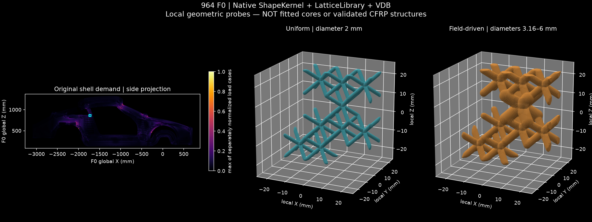

# Native Mac field-to-lattice study

This consumes the **accepted serial F0 torsion and bending audit**, without
changing its geometry, material, solver inputs or results. It actually executes
ShapeKernel, LatticeLibrary and PicoGK's native OpenVDB exchange on the Mac.
It does not use a language model as a solver.

## Result



| Check | Observed result |
| --- | --- |
| Inputs | 179,216 global integration points per load case, hash-verified |
| Mapping | 179,209 occupied 0.5 mm bins; maximum per bin, separately per load case |
| Position quantization | Maximum 0.429094 mm; theoretical bound 0.433013 mm |
| Peak float32 conversion | Maximum error 0.000000927 MPa |
| Native VDB roundtrip | All 537,627 scalar values, active counts and metadata preserved |
| Inactive / zero / signed-coordinate witness | Passed; missing data is not zero stress |
| ShapeKernel | `BaseBox` defines a 48 × 48 × 48 mm study region near the bending peak |
| LatticeLibrary | Nine occupied 12 mm BCC cells, uniform and graded variants |
| Uniform raw STL | 45,260 faces; one connected component; combinatorial surface screen passed |
| Graded raw STL | 81,996 faces; one connected component; **rejected: 32 exact zero-area faces** |
| Geometry VDB roundtrip | Both probes and the study envelope preserved exactly |

The skill-guided test plan separates mapping unit tests, native serialization
and rejection checks, and independent raw mesh screening. No faces were removed
or repaired. The graded probe must not be passed to manufacturing or FEA as an
accepted solid. A successful VDB roundtrip preserves defects as well as geometry.

## Contract and limits

- Frame: existing **F0 global X forward, Y left, Z up**, millimetres. No registration
  to a measured donor or scan is added. STL and VDB geometry remain in this frame;
  only the preview subtracts the study-region centre from its local panels.
- `demand.vdb.gz` decompresses to a native VDB with
  `torsion_vm_bin_max_MPa`, `bending_vm_bin_max_MPa`, and `integration_point_count`.
  PicoGK's VDB transform metadata uses metres; its query API and this contract use
  millimetres. Do not infer units from an external viewer's default display.
- Positions are rounded to the nearest 0.5 mm grid point, half ties towards
  positive infinity. Collisions retain **maximum von Mises display values**, not
  averaged tensors. The original signed stress tensors remain in the retained
  `shell.dat` files. There is **no interpolation** between active bins.
- The two load cases are separately normalized to their own peaks. Their maximum
  guides a display heuristic, **not a combined load case or failure criterion**.
  `diameter = 2 + 4 sqrt(normalized_demand)` mm is a deliberately bounded geometric
  probe rule, not a structural sizing law. Unknown cells generate no beams.
- Probe volumes are 2,067.078 and 7,611.897 mm³ at 0.5 mm voxel size. More volume
  is not evidence of more stiffness or a better design. The old shell's stiffness
  does not apply to these probes.
- This local network is **not fitted to the laminate, a production core, mould,
  insert, attachment or load path**. Applying it to tooling/core design requires
  measured interfaces and a separately validated material/process model.
- No new FEA, laminate failure, buckling, fatigue, delamination, crash, manufacturing
  simulation, 993 compatibility, physical tests or TÜV qualification was performed.
  Geometric intersections, shell nesting and voxel convergence remain untested.

Next: localize the 32 rejected faces and compare a finer/local-frame voxel run
without silently deleting faces. Only after a clean geometry and an explicit
core/laminate/interface contract should a new structural comparison be attempted.

## Reproduce

Use .NET 9 and the existing PicoGK 2.3 native Mac runtime. Dependencies are
read-only: [ShapeKernel](https://github.com/leap71/LEAP71_ShapeKernel) at
`554bce4791d2676ed00bd6704f6eb010111a7fd3` and
[LatticeLibrary](https://github.com/leap71/LEAP71_LatticeLibrary) at
`81c3c7b2064c19e573c38d76ac09bf1cd2f562d5`, both Apache-2.0.
The scalar-field exchange API follows the upstream
[SimulationExample](https://github.com/leap71/PicoGK_SimulationExample);
none of its source files is copied here. Exact local binaries, compiled source
hashes, commands and artifact hashes are in [execution.json](evidence/execution.json).

From the repository root, set `PICO` to the existing directory containing
`dotnet/dotnet` and `picogk-bin/PicoGK.dll`, and `LEAP` to the parent of the two
source checkouts. Use fresh output directories; existing outputs are rejected.

```sh
STUDY=twins/964-chassis/monocoque/field-lattice
python3 "$STUDY/prepare.py" --run-dir work/964-strength-serial-20261012 --output work/field-input
"$PICO/dotnet/dotnet" build "$STUDY/FieldLattice.csproj" \
  -p:LeapSources="$LEAP" -p:PicoGKAssembly="$PICO/picogk-bin/PicoGK.dll" \
  -p:BaseIntermediateOutputPath="$PWD/work/field-build/obj/" -o work/field-build/bin
DYLD_LIBRARY_PATH="$PICO/picogk-bin" "$PICO/dotnet/dotnet" \
  work/field-build/bin/FieldLattice.dll work/field-input/samples.json work/field-native
python3 "$STUDY/preview.py" work/field-input/samples.json work/field-native work/field-inspection
FIELD_LATTICE_DLL="$PWD/work/field-build/bin/FieldLattice.dll" DOTNET="$PICO/dotnet/dotnet" \
  python3 -m unittest discover -s tests -p 'test_964_field_lattice.py' -v
```

Python needs NumPy and Matplotlib. The preview reuses the repository's independent
`audit_surface_topology.py`; it screens the original triangles without repairing
them. Its exit code indicates execution, **not acceptance**: read `topology.json`.
The raw solver outputs stay under the retained serial-run work directory; the
published mapping receipt links their hashes to the earlier audit. Downloadable
VDB/STL artifacts here are study outputs, not a manufacturing release.
