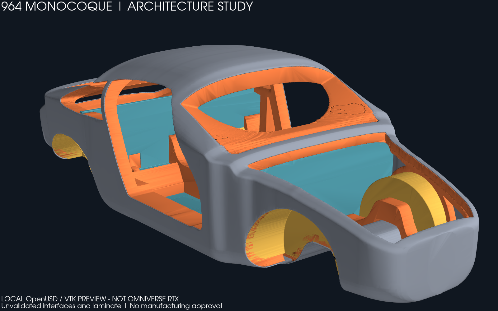

# 964 monocoque: OpenUSD review and Omniverse handoff

**Geometry decision after the native capture:** the
[reference comparison](../shape-review-20261029/README.md) rejects this retained
whole-body envelope as the requested product baseline. Reconstruct the central
cell before another paid product review. The framing correction below remains a
software preparation step; it cannot repair the architecture mismatch.

The complete retained architecture is now a portable OpenUSD review bundle.
It contains **422,816 triangles in four separately selectable groups**: outer
skin, closed sections, sandwich panels and wheel tubs. The existing closed
sections include the central tunnel, sills, opening frames and B-pillar ring.
This is the existing PicoGK design envelope, not a newly measured body shell.

**Status on 29 October 2026:** native OVRTX produced three PNGs and a
120-frame MP4 on the rented RTX PRO 6000. The [native review report](native-review-20261029/README.md)
contains the original media, hashes, observed defects and verified rental cleanup.
Kit transmitted its loading editor, but the interactive model review was
interrupted. Corrected camera framing is checked locally and awaits GPU replay.
The project goal remains open. Manufacturing, strength and 964/993 fitment are
not validated.



These images are computed views, not photographs of a manufactured part.
The [rear view](media/local-001/rear.png), [tunnel/interior close-up](media/local-001/interior.png)
and [five-second, 120-frame turntable](media/local-001/turntable.mp4) were rendered
by VTK **from the reopened USD**. They are explicitly labelled as local previews.
The [capture receipt](media/local-001/capture.json) records source and media hashes.

## Bundle and traceability

Open [monocoque.usda](bundle-001/monocoque.usda) for the complete body, or
[interior.usda](bundle-001/interior.usda) to hide the outer skin. Keep the entire
`bundle-001` directory together. Its dependencies are relative and self-contained.

| Layer | Content | Authority |
|---|---|---|
| `geometry.usdc` | Four retained display meshes, unchanged triangle coordinates | `derived/zesad-monocoque.vtp`; already decimated, not an analysis or manufacturing mesh |
| `display.usda` | Group colours and surface appearance | Display only; no mechanical material assignment |
| `results.usda` | Historical torsion/bending stiffness sequences, loads and report hashes | Original S6 study reports, with explicit incomplete validation |
| `presentation.usda` | Three inspection cameras, 120 orbit samples, lights and render products | Review presentation |
| `monocoque.usda` | Composition, millimetres, Z-up, unreleased status | Review assembly |

Coordinates retain the source convention: X forward (`X = -d`), Y left and Z up,
with millimetres. They must not be silently equated with a different scan or
vehicle frame. No suspension, drivetrain, seat, belt or crash attachment has
been invented. In particular, the visible tunnel does not prove C4 shaft or
gearbox-linkage clearance. On 29 October 2026 the user identified the scanned
964 as a Carrera 2; model year and gearbox remain unknown. This user-reported
identity scopes the next [interface survey](../../interface-measurement-plan.md)
but validates no mounting or clearance. C4 and 993 compatibility require
separate interface evidence.

The [validation receipt](bundle-001/validation.json) records a fresh relocated
copy, strict Apple `usdchecker` 0.25.11 validation and component counts. Six
native tests also verify every triangle coordinate against its original group,
reject corrupt arrays, changed units and release flags, and reject overwriting
an existing bundle. Two additional tests exercise RTX input hash admission.

The Python `usd-core` 25.11 wheel lacks the shader resources needed by its
Python compliance checker. That attempt failed; the builder now invokes the
complete installed `usdchecker --strict`. No shader check was disabled.

## Interpretation of the calculations

The carbon S6 torsion sequence is **12,647 / 18,143 / 19,900 N.m/deg** for the
three retained mesh densities. The last increment is about 9.7% relative to
the preceding result; convergence has not been established. A subsequent
[two-repeat replay of the finest carbon case](../s6-replay-20261028/README.md)
returned 19,899.782469 N.m/deg from the committed S6 runner. The
[finest carbon bending case](../s6-replay-20261028/bending/README.md) also
reproduced twice at 8,828.496848 N/mm. The finest steel case and other historical
bending cases still need replay; see the existing
[reproducibility table](../README.md#reproduce).

These are results of assumed equivalent-isotropic materials and synthetic
support/load patches. The 1,200 kg vehicle target has not been applied as a
complete vehicle load case. The visual and analysis geometries differ in sill
depth, front rails, rear rails and wheel tubs. Therefore this bundle attaches
the original reports and scalar sequences, **without mapping stress fields onto
the visual shell**. The bundle retains the historical scalar reports; the
subsequent replay evidence is linked above.

## Steps to the requested twin

| Step | State | Required evidence / next action |
|---|---|---|
| Preserve inputs and current study | Executed | Existing sources and reports retained; bundle and media hashes recorded |
| Portable whole-body OpenUSD | Executed | Four groups, coordinate equality, relocated strict validation |
| Local review media | Executed | Three PNG views and a 120-frame MP4 from the reopened stage |
| Omniverse RTX review | Executed, framing correction pending | [Actual PNGs, MP4 and native receipt](native-review-20261029/README.md); initial views clip the body, corrected overlay needs GPU replay |
| Omniverse/application screenshots | Partial | Kit startup and 26 decoded loading frames observed; complete viewport inspection, save/reopen and reconnection still required |
| Source-reproducible structural model | Partial | Finest carbon torsion and bending replayed twice each; other cases and convergence remain open |
| Exact 964/993 interfaces | Blocked by missing measurements | Validated XYZ datums, variant identity and drivetrain travel/clearance envelopes |
| Composite strength and manufacturing | Incomplete | Measured laminate/process data, bonded joints/inserts, delamination/buckling/fatigue and mould/process studies |
| Physical correlation and road/circuit acceptance | Incomplete | Donor torsion test, coupons, component tests and professional review under the programme gates |

The capture adapter was corrected on 29 October 2026 to convert the orbit's
USD timecodes to seconds before calling OVRTX. The retained stage uses
24 timecodes/second; its 120 updates now span 0 to 119/24 seconds rather than
0 to 119 seconds. The pinned upstream [stage-time test](https://github.com/NVIDIA-Omniverse/ovrtx/blob/556ceb6a41e4bf6f4ff7b4526943a9366386543c/tests/docs/python/test_base.py#L125)
explicitly documents the seconds contract. A regression test exercises the
complete adapter with a mocked renderer and encoder; it failed before the fix
and passes afterwards. This is an adapter contract check, not native RTX
execution or an assertion that a GPU-rendered video has been produced.

The [programme](../../../../docs/MONOCOQUE_964_993_PROGRAMME.md) phases M0–M7
remain applicable. The visual review can proceed with known gaps; it does not
close the physical metrology, test or approval phases. The current geometry is
not sufficient to release moulds or manufacture a self-supporting vehicle body.

## Reproduce locally

Use an isolated Python 3.12 environment with NumPy 2.2.6, VTK 9.5.2, PyVista
0.46.4 and `usd-core` 25.11, plus the complete `usdchecker` and FFmpeg tools.
From the repository root:

```sh
python twins/964-chassis/monocoque/omniverse/build_twin.py work/964-review-new
python -m unittest discover -s tests -p test_964_omniverse_bundle.py -v
python -m unittest discover -s tests -p test_964_rtx_capture_inputs.py -v
python twins/964-chassis/monocoque/omniverse/preview.py work/964-review-new work/964-preview-new
```

Use new output directories. Existing outputs are never overwritten. The build
script, capture adapter and tests are new; the historical PicoGK generator,
solver sources, evidence files and container recipes remain byte-identical.

## Bounded RTX session: historical proposal and executed attempt

The proposal below was approved and one attempt executed on 29 October.
The original engine-twin profile had no available offer; the existing
validation-only profile supplied the same immutable image through the
[review guard](../../../../deploy/vast/monocoque-review/README.md).
Its actual rate was USD 1.89259/hour. The guard ended the rental early and
verified destruction; see the [session report](native-review-20261029/README.md).
The following proposal numbers describe preparation, not a fresh approval.

The [rental proposal](rental-proposal.json) specifies the existing qualified
image by digest, one RTX Pro 6000 and a **proposed USD 5 budget / 90-minute
deadline**, including startup and cleanup. The observed compatible offer costs
USD 2.24444/hour including allocated storage; the conservative calculation
with 40 GB download, 15 GB upload and USD 1 cleanup reserve is USD 4.53.
Availability and price must be reread immediately before launch. The public
image digest and its 34.62 GB compressed download were verified anonymously.
No Qwen weights need to be downloaded for rendering this prepared scene.
The [native application review preparation](kit-review.md) adds 3.18 GB of
hash-verified Kit layers for the editor screenshots; it retains the same
proposed budget and deadline. This runtime addition is not GPU-qualified yet.

Use the existing OpenBao wrapper, `engine-twin-v1` compute profile and external
deadline guard. After budget approval, create a fresh private manifest with the
proposed bounds, arm its guard, verify a supported driver, and run the upstream
minimal example before the prepared capture job. The adapter targets OVRTX
0.3.0, matching the retained image and the inspected upstream
[v0.3.0 example](https://github.com/NVIDIA-Omniverse/ovrtx/blob/v0.3.0/examples/python/minimal/main.py)
at `556ceb6a41e4bf6f4ff7b4526943a9366386543c`; it does not mix in the newer
OVStage API. Check the current
[NVIDIA driver requirements](https://github.com/NVIDIA-Omniverse/ovrtx/blob/main/docs/driver_requirements.rst).

```sh
/opt/ovrtx-runtime/bin/python capture_rtx.py /workspace/bundle /workspace/rtx-output-new
```

Collect the actual PNGs, MP4, logs, GPU/driver identity and capture receipt;
compare their hashes on the Mac; destroy the exact rented instance and verify
its absence. A failed job, incompatible driver or failed collection must not
extend the rental beyond its approved deadline. `capture_rtx.py` now has
native execution evidence for the original bundle. The later
[framing overlay and preparation](native-review-20261029/README.md#framing-correction-prepared-after-the-run)
remain locally verified only; preserve that distinction during replay.
