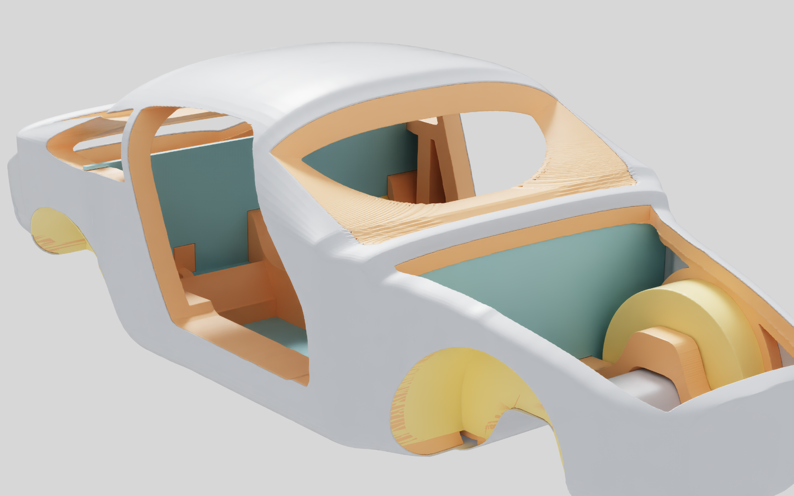

# Native Omniverse review — 29 October 2026

The retained 964 design envelope ran in **NVIDIA OVRTX 0.3.0 on an RTX PRO
6000 Blackwell WS with driver 595.71.05**. Three original PNGs and a five-second
H.264 turntable were collected and their SHA-256 hashes checked on the Mac.
The [execution receipt](session.json), original [capture receipt](rtx/capture.json)
and [video probe](video-probe.json) distinguish this execution from the earlier
VTK previews. This is a rendering milestone; the requested validated digital
twin is **not complete**.



The [rear view](rtx/rear.png), [interior view](rtx/interior.png) and
[120-frame turntable](rtx/turntable.mp4) are the original native outputs,
1600 × 1000 pixels, with the video at 24 frames/s. They are computed images,
not photographs of a manufactured body. Visual inspection covered all three
stills and orbit frames 0, 30, 60 and 90; the quarter-turn views differ as
expected. No image was retouched to conceal the geometry or framing defects.

## Runtime and the first failure

The first upstream example failed at Vulkan initialization. NVIDIA's GLX
library loaded but its `vk_icdGetInstanceProcAddr` returned no `vkCreateInstance`
entry point. The same driver's EGL implementation returned that entry point.
A separate runtime ICD JSON changed only `library_path` from
`libGLX_nvidia.so.0` to `libEGL_nvidia.so.0`, retaining the advertised API version.
Both `VK_ICD_FILENAMES` and `VK_DRIVER_FILES` pointed to this new file.
The [adaptation receipt](icd-adaptation.json) retains both fingerprints;
the system ICD and driver were unchanged. NVIDIA documents EGL as a Vulkan
ICD for environments without the usual X11 client setup in its
[driver component documentation](https://download.nvidia.com/XFree86/Linux-x86_64/570.86.16/README/installedcomponents.html).
The exact cause of GLX's failure beyond the observed missing entry point was
not established.

The unmodified upstream v0.3.0 minimal example then exited successfully in
100.85 seconds. Its robot/atrium PNG was inspected and retained privately
with the upstream licence; its image and log hashes are in the receipt.
The monocoque capture subsequently exited successfully in 32.16 seconds.
The immutable compute image and separately retained Kit layers were used;
no Qwen weights or Content Agents were started.

## Native Kit: partial observation, not acceptance

Kit 110.2.0 started, selected one Vulkan GPU at PCI bus 1, reported the scene
opened and sent **26 decoded frames at 1920 × 1080** through the bounded SSH
media relay. The observed editor showed the monocoque stage tree and an
`RTX Loading` viewport. The [sanitized client observation](kit/client-observation.json)
records those counters. A loading screen does not establish that the body
was successfully displayed in the interactive viewport.

The rental ended before whole-body framing, closed-section selection,
outer-skin hiding, save/reopen and reconnection could be demonstrated.
The complete remote Kit log and a post-edit bundle hash check were not
collected. The saved [end-of-session screenshot](kit/stream-ended.jpg) shows
the disconnected client; it is explicitly not a completed model inspection.

## Rental cleanup and its unresolved trigger

The user approved USD 5 total and 90 minutes maximum. One instance,
`58294028`, was created at USD 1.8925925925925926/hour, with zero quoted
transfer tariffs. The full-duration calculation including a USD 1 cleanup
reserve was USD 3.838888888888889. These are planned costs, not a final invoice.

The external guard terminated this instance early with
`contract_or_cost_guard` and verified its absence. A subsequent provider
inventory independently confirmed its absence; see [cleanup.json](cleanup.json).
An unrelated `mesh-cfd` rental was present in that inventory and was left
untouched. The frozen parent guard stops its own session when inventory
contains more than one instance. This is a plausible explanation of the
interruption, but the triggering inventory/prices were not retained, so an
exact root-cause claim is not supported.

The review guard now logs the nonexclusive instance IDs and rejected cost
fields, without changing ownership or cost decisions. Its executed source
hash remains recorded separately from this later diagnostic improvement.
A subsequent attempt requires account coordination and a new bounded
authorization; this receipt does not reset the spent attempt.

## Framing correction prepared after the run

Native output exposed clipping that the earlier VTK preview did not catch.
The frozen presentation had a 50 mm lens with implicit USD aperture defaults.
The new [camera overlay](../camera-framing.usda) declares a 36 × 22.5 aperture
for the 1600 × 1000 products and uses 32 mm for the interior camera. It keeps
the existing exterior focal lengths, camera transforms, orbit and all geometry.

[prepare_framed_review.py](../prepare_framed_review.py) makes a new portable
copy, adds this overlay to the two roots, runs strict validation on both views,
checks the unchanged geometry hash and publishes the copy only after success.
It refuses an existing output directory. The frozen `bundle-001` is unchanged.
The [preparation receipt](framing-preparation.json) records the new copy.

Three native local tests passed: all original source files and geometry remain
unchanged, overwrite is rejected, and every vertex lies within 90% of each
camera's half-frame over all **123 camera samples**. This is a projection check.
**The corrected framing has not yet been rendered on a GPU.**

```sh
python twins/964-chassis/monocoque/omniverse/prepare_framed_review.py \
  twins/964-chassis/monocoque/omniverse/bundle-001 work/964-framed-review-new
python -m unittest discover -s tests -p test_964_review_framing.py -v
# During the next approved native session, with its verified EGL ICD:
/opt/ovrtx-runtime/bin/python capture_rtx.py /workspace/framed-review /workspace/rtx-output-new
```

## Remaining acceptance work

1. Coordinate the shared Vast account, retain a diagnostic inventory and arm
   a fresh guard under the authorized total cost and deadline before launch.
2. Render the corrected copy and inspect complete-body framing throughout the
   orbit. Preserve the original and corrected output identities separately.
3. Complete the [native Kit protocol](../kit-review.md): actual body viewport,
   component selection, tunnel view, save/reopen, reconnection and bundle hashes.
   Collect logs and screenshots incrementally while the guard remains active.
4. Continue the engineering gates in the [programme](../../../../../docs/MONOCOQUE_964_993_PROGRAMME.md).
   Stair-stepped/overlapping display surfaces, incomplete measured interfaces,
   equivalent-isotropic studies and missing physical correlation remain open.
   No composite strength, manufacturing process, mould, 964/993 fitment,
   road/circuit safety or approval has been validated by these renders.
