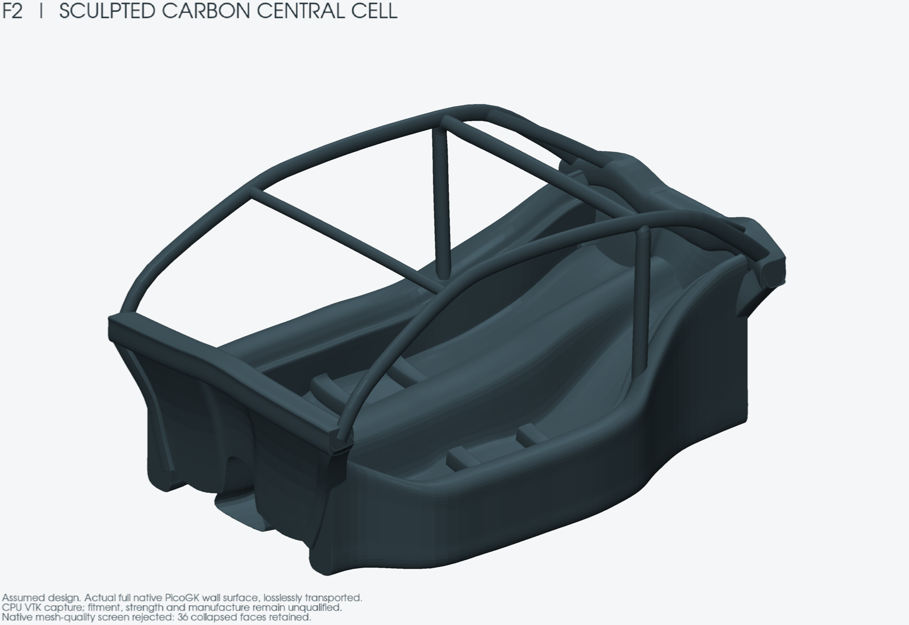

# F2 sculpted carbon central cell

[Watch the turntable](media/turntable.mp4) · [Interior](media/inside.png) · [Rear](media/rear.png) · [Top](media/top.png) · [Packaging context](media/assembly.png)

F2 is a new clean-sheet design iteration following the owner's nine reference
images. It replaces the rectangular F1 tub as the shape-development direction.
Its dimensions, carbon architecture and structural fixtures are explicit design
hypotheses. F2 is an iteration name, not a physical digital-twin fidelity level.

The design scope is the central load-bearing cell: shaped paired floor bays,
a varying integrated tunnel, deep sills with door-entry returns, scuttle and
A-pillar feet, raised rear shoulders, and connected raked upper load paths.
Front/rear modules and wheels are separate packaging proxies. They supply
neither measured suspension geometry nor complete functional attachments.

The featured images are **unqualified geometry diagnostics**. The authored CAD
passes its recorded surface checks, but the independent native mesh screen
[rejects 36 collapsed triangles](native-quality-rejection.json): their native
indices differ while two float32 positions coincide. All native triangles,
including those defects, remain in the display transport. No face is removed,
welded or hidden to obtain a pass. The original STL also contains 21 nonfinite facet normals, all among those
collapsed faces; the [independent native audit](native-surface-checks.json)
records that additional rejection. Native geometry quality and the final
digital twin remain unadmitted.

## Implemented architecture and editable CAD

The [canonical model](canonical-model.json) contains 32 independently authored
curved components. [geometry.py](geometry.py) and [parameters.json](parameters.json)
define their control surfaces: paired floor bays, an integrated varying tunnel
and lower return, stepped hollow sills with end closures, front/rear walls and
closed return beams, pillar feet, four seat-support regions and six upper ribs.
The lower sill line stays flat while the rear cabin floor rises internally.
The front and rear lower plan narrows around the declared wheel reservations.

| Design control | Authored value, not a Porsche measurement |
|---|---:|
| Floor station range | X = 0–2,100 mm |
| Maximum floor half-width at control stations | 625 mm |
| Maximum sill outer half-width at control stations | 790 mm |
| Sill lower datum | Z = −65 mm |
| Tub / upper-member nominal laminate thickness | 3 / 4 mm |
| Seat-support stations | X = 900 and 1,250 mm |

Download the [editable CAD midsurfaces](cad/sculpted-cell-midsurfaces.step).
The [CAD checks](cad-checks.json) retain 32 valid faces and zero solids before
and after STEP export/reopen, with matching bounds. This is a surface model;
the thickness values are metadata. It must not be used as a physical-wall solid
or a manufacturing file. The exact Catmull–Rom conversion is in [bezier.py](bezier.py).
Unreliable physical-offset/property results on small CAD controls are retained
privately and have not been promoted to a solid STEP or mass claim.

Two normal-offset display samplings, at three and five subdivisions per
canonical span, contain 64,540 and 173,828 triangles. The source model is
byte-identical between them. Complete-triangle checks against the four fixed
wheel cylinders find no intersection at either sampling, after earlier genuine
interferences were corrected. [audit_wheel_clearance.py](audit_wheel_clearance.py)
clips faces to each lateral wheel slab and checks their full projected area;
a vertex-only check had missed the remaining front-foot collision. Five
synthetic controls include a face crossing with every vertex outside the wheel.
The [packaging receipt](packaging-checks.json) binds both actual runs. At the
finer sampling the frame is 1,281.11 mm above the assumed ground, 1,590.92 mm
wide and has 125.70 mm static ground clearance. The 1,290 / 1,600 / 120 mm
budgets are authored design constraints informed by the nominal brochure table;
none supplies the donor-to-design registration.

The [profile gate](profile-checks.json) checks 368 control rows and U-midpoints:
no algebraic within-cubic loop or stationary derivative, and no crossing or
overlap in the declared finite planar screen. Earlier source loops and an
over-height candidate are explicitly rejected under `reviews/`; their native
results are historical controls. The profile gate is not a continuous proof of
whole-surface injectivity.

These tests do not establish continuous CAD clearance, steering/travel space,
tolerances, solid containment or actual vehicle fitment.

## Native geometry and display transport

PicoGK executed the 32-component source with literal 3 / 4 mm normal-offset
walls at a 1.5 mm voxel size. The native output has 31,982,356 triangles and
15,991,380 indexed vertices. The [input checks](native-input-checks.json) bind
both source samplings and their float32 checks; the [lossless transport check](transport-equality.json)
compares the complete VTP point/index arrays against the original native arrays.
The re-extracted STL is byte-identical to the original native STL. This
establishes transport equality, including the retained defects; it does not
turn the failed mesh-quality screen into a pass.

The nominal minimum wall spans only two voxels. Neither the native Boolean
union nor the software checks establish wall convergence, material continuity,
reliable volume/mass or structural junction completeness. The
[native boundary audit](native-surface-checks.json) keeps those questions separate
from boundary-index connected components and signed integrals.

[Front footwell cut](media/section_x350.png) · [Seat-support cut](media/section_x900.png) · [Seat-bay cut](media/section_x1050.png) · [Rear-transition cut](media/section_x1750.png) · [Longitudinal tunnel cut](media/longitudinal_y0.png)

## Executed USD software transport

[export_native_usd.py](export_native_usd.py) rejects the current zero-area
triangles in its default strict mode. Its separately selected raw diagnostic
mode preserves every original point and triangle, records the failed quality
state in stage metadata and authors no normals. Original STL normal attributes
are deliberately excluded; no replacement normal field or geometry repair is
claimed.

The [actual full-field receipt](native-usd-checks.json) records binary USDC
authoring and flattening, complete ordered point/index readback equality,
matching bounds and the official OpenUSD compliance checker with no reported
errors or warnings on both files. An independent readback also checks the
rejection metadata. These are software-format results on rejected geometry,
not mesh-quality, SimReady, GPU/Kit or native Omniverse validation.

Both approximately 235 MB binary stages remain private under
`work/964-sculpted-cell-f2-20261106/native-usd-export-001/export-001/`.
The exact native field, arrays and solver bytes also remain outside Git.

## Reference interpretation

The [reference ledger](reference-ledger.json) records all nine privately reviewed
images by hash, their qualitative observations and the checked primary sources.
The [independent visual contract](visual-acceptance.json) requires raw cell-only
views and literal cuts before a polished rendering can be accepted. The
[actual independent review](visual-review.json) finds the intended macro-shape
features, while V03 (continuous passage evidence) and V09 (wall/junction
integrity) remain partial. The full visual contract is not accepted; these
images are diagnostic evidence, not photo-equivalence or product superiority.

The [ZESAD product page](https://zesad.com/product/porsche-964-and-993-carbon-fiber-monocoque-for-restomods/)
describes a carbon tub and offers a version with a steel window frame. Our
all-carbon upper structure is the owner's design intent and needs its own joint
and laminate verification. Black reference surfaces do not identify materials.
The 65 kg text in one screenshot is a seller claim with unknown weighing and
inclusion scope; it is not an accepted mass or performance comparison.

The references establish no continuous surface coordinates, thicknesses,
laminate schedule, mounting patterns or homologation. Their image bytes remain
private. No proprietary CAD or pixel-scaled geometry is used.

## Relationship to the acquired Porsche data

The [owner-supplied frame packet](../owner-frame-data-20261105/README.md) and
[source-contact registration diagnostic](../contact-registration-20261106/README.md)
remain authoritative for their documentary and scan evidence. The F2 design
frame does not replace those source frames. No donor transform is admitted.
The owner identifies the donor as Carrera 2; year and gearbox remain unknown.
The 993 and Carrera 4 require separate interface evidence.

The approximately 1,200 kg vehicle mass is a programme input. It does not define
the shell mass, load distribution, suspension forces or road/track load spectrum.
The full programme's [open engineering gates](../contact-registration-20261106/goal-ledger.json)
remain open until their own evidence exists.

## Executed calculation-method controls

The [method receipt](method-controls.json) retains a split verdict. Five S6
displacement controls agree with independent beam formulae: isotropic, rigidly
rotated isotropic, eight-ply isotropic, and rotated UD 0°/90°. Their largest
displacement difference is 0.270%; isotropic and eight-ply isotropic results
coincide at printed precision. Integrated load resultants and moments are
checked independently of the solver's reaction output.

**The complete shell benchmark does not pass.** Original-node and expanded
reaction-force outputs fail the rotated-shell equilibrium controls. CalculiX
documents that RF omits forces induced by multipoint constraints; whether that
fully explains this observed failure remains an inference. Subtracting applied
loads from RF does not reconstruct omitted constraint forces. These outputs
must not be described as verified physical support reactions.

A separate rotated, explicitly layered solid coupon uses 320 C3D20R elements
and 1,989 nodes, without the shell rotation constraints. Its displacement differs
by 0.324% from the Euler–Bernoulli formula, which omits shear deformation. Its
force and moment residuals pass the declared 10⁻⁴ numerical screen. This is a
synthetic coordinate, material and fixture control, not a result for the cell.
The receipt preserves the unsuccessful attempts and corrected serialization
and postprocessing separately from actual solver execution.

There is no whole-F2-cell mesh or structural solve. The separate
[generic meshing control](controls/README.md) passes with 8,464 S6 elements,
but it supports untrimmed tensor patches only. It does not resolve the full
cell's trimmed structural junctions. The [admission ledger](mesh-admission.json)
retains the failed alternatives and the exact passing method/input hashes.

The next numerical step requires a complete-edge mesh for those junctions
before two coarse displacement diagnostics. Refinement and nonlinear campaigns
require another review. Neither coupon controls nor a completed solve establish
global reaction equilibrium for F2.

## Calculation and release scope

[Analysis assumptions](analysis-assumptions.json) declare the exploratory carbon
card and fixture definitions. Perfectly continuous numerical joins do not prove
a moulded or bonded physical joint. A scalar mesh comparison does not establish
laminate strength, buckling, fatigue, crash resistance or physical correlation.

The [F1 study](../assumed-cell-20261106/README.md) remains a separate frozen
numerical reference. Its rectangular geometry, fixture results and renders do
not validate this curved cell. No road, track, manufacturing or TÜV release is
claimed for either revision.

## Executed tooling-motion screen

[screen_tooling.py](screen_tooling.py) finds continuous collision counterexamples
for two prescribed rigid axial core pulls. A tool containing the declared tunnel
centreline points meets the lower return during a +X translation of 1,277.41 mm,
and the tunnel roof during a −X translation of 541.22 mm. The
[recorded witnesses](tooling-screen.json) are interior intersections with the
authored midsurfaces, found by a signed bracket and bisection; they are not
first-contact distances or sampled animation frames.

This rejects these two simple axial withdrawals for that tool hypothesis. It
does not establish a complete core's initial clearance, reject all rotations or
tooling alternatives, or create a mould. Mould splits, access, core strategy, draping, cure distortion, inserts and joint manufacturing still need their own
geometry, process inputs and simulation.
