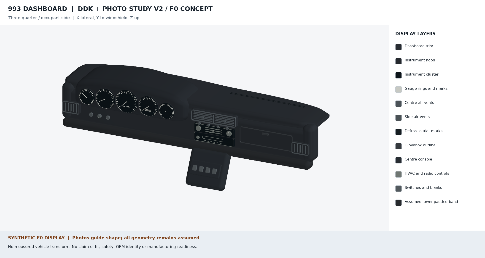
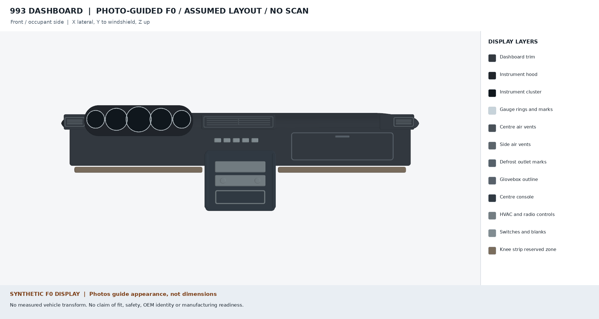
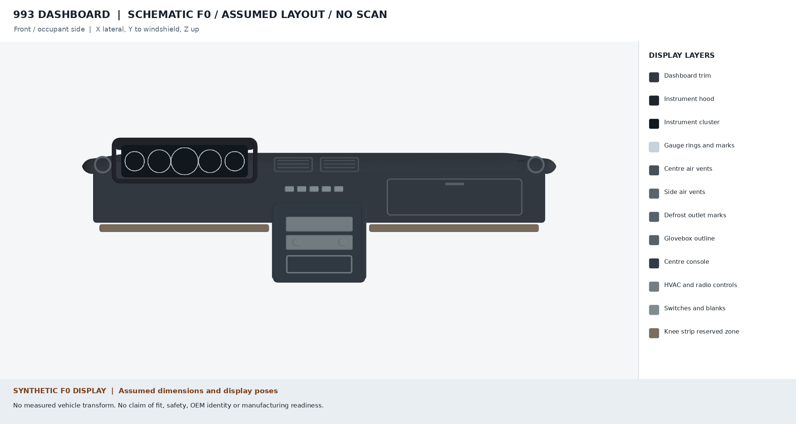

# Porsche 993 complete dashboard — F0 scope

This workstream contains **schematic PicoGK visual scenes of the complete dashboard** and an evidence inventory for a left-hand-drive Porsche 993 targeting option M564. All F0 scenes use an invented display frame. Component sizes and positions are artistic assumptions, not vehicle measurements or assembly transforms. The intended vehicle, its option label, and its restraint configuration have not been checked. All component transforms and assembly geometry remain `null` in [assembly.json](assembly.json).

## DDK-informed F0 iteration

The [DDK study](ddk-study-v2/README.md) introduces a parametric upper pad and cowl, detailed dial faces, lower side vents with vertical blades, fascia-mounted HVAC/radio, a shallow glovebox and a separate sloped console. Its [photo audit](ddk-study-v2/ddk-observations.md) traces the installed and removed component views. The [dimension research](ddk-study-v2/dimension-research.md) records published product sizes and the still-missing measurements. DDK attachment descriptions guide future inspection; they supply no target-variant mounting coordinates. [Editable PicoGK source](ddk-source-v2/README.md), [references](ddk-study-v2/references.json), [scene receipt](ddk-study-v2/scene-report.json) and [render receipt](ddk-study-v2/render-report.json) preserve the distinction between improved appearance and measured geometry.

## Photo-guided F0 iteration

The [photo study](photo-study-v1/README.md) revises the visible brow, five gauge faces, and centre and side vents using linked public photographs and replacement-part listings. Its [reference register](photo-study-v1/references.json) records provenance, licence, published size leads, and why none supplies installed geometry. The [photo-guided scene](source/scene-photo-v1.json), [scene receipt](photo-study-v1/scene-report.json), [renderer](source/render_photo_scene.py), and [render receipt](photo-study-v1/render-report.json) make this F0 appearance study reproducible. The [front](photo-study-v1/dashboard-front.png) and [three-quarter](photo-study-v1/dashboard-three-quarter.png) views do not establish fit, safety, or manufacturing readiness.

## Original schematic F0 iteration

The [front](dashboard-front.png) and [three-quarter](dashboard-three-quarter.png) views show twelve separately generated display layers: the dashboard trim, instrument hood, generic five-gauge cluster and gauge marks, centre and side vents, defrost marks, glovebox, centre console, HVAC/radio face, switch marks, and a reserved knee-strip zone. The [scene specification](source/scene.json), [PicoGK source](source/Program.cs), [scene report](scene-report.json), [renderer](source/render_scene.py), and [render provenance](render-report.json) make the illustration reproducible. No steering component, airbag, attachment, mating face or load-bearing knee protection is modelled. The image is not a fitted or printable dashboard assembly.

The earlier [isolated trim preview](preview.png) is a component study. The raw PicoGK trim STL has 28 degenerate faces; an in-memory cleanup yields one watertight body, but no cleaned mesh has been published. The private scene STL for the side vents has 40 zero-area triangles omitted from the render, as recorded in the [render report](render-report.json). Neither result supports fit or manufacturing.

The trim layer reuses the repository's [dashboard trim generator](../../parts/picogk-catalog/body/DashboardTrim.cs), rebuilt with the [F0 concept builder](../../parts/993-int-dashboard-trim-0001/source/build_picogk_concept.py) and [concept parameters](../../parts/993-int-dashboard-trim-0001/source/picogk.json). Its isolated [18,000-triangle visual mesh](dashboard-trim-f0-visual.stl) has separate [QA and provenance](dashboard-trim-f0-visual.json). Its size, vents, instrument opening, and ribs are estimated; it has no measured vehicle transform and establishes no fit. Full-resolution and multilayer PicoGK STLs are local, ignored `work/` outputs; the tracked visual STL is not an assembly component or a release mesh.

## Included zones

| Zone | Current evidence | Missing before a spatial assembly |
| --- | --- | --- |
| Body-shell dashboard panel | Identity `993 502 027 02` in the [trim record](../../catalog/parts/993-int-dashboard-trim-0001.json) | Structure, mounts, datums, usable scan |
| Visible trim | Catalogue record and isolated PicoGK concept | Correct M564 part number, fitted/removed scan, reverse-side attachments |
| Instrument hood and five-gauge cluster | Product/source leads only | Exact variant, dimensions, axes, supports, wiring clearance |
| Centre/side vents and defrost ducts | Zones named in the trim record and measurement plan | Apertures, retainers, duct/seal interfaces |
| Glovebox and centre console | Adjacent zones and commercial source leads | Exact variant, supports, motion envelope, junctions |
| HVAC/radio controls and switches | Switch-blank concept and [local switch twin](../../catalog/twins/twin-993-cabin-dashboard-switch-0001.json) | Host identity, openings, clips, wiring and service clearances |
| Knee protection strip | Separate original part, to be retained | Exact M564 identity, original anchors and occupant-impact load path |
| Steering column and airbag zones | Safety/configuration boundaries | Vehicle-specific restraint state and clearances |

The PET [assembly skeleton](../../catalog/reference/993-assembly-skeleton.json) contains illustration labels, not coordinates. Commercial product dimensions and the 1/8-scale dashboard model in `catalog/sources/` do not supply OEM attachment geometry or redistribution rights. The repository has no physical dashboard measurements; the existing switch measurements are declared, conflicting leads.

## Variant gate

The target is **M564, left-hand drive**, pending a redacted vehicle option label and direct inspection. The passenger side must show no deployment flap or module. The trim part number remains **unresolved** in the [catalogue record](../../catalog/parts/993-int-dashboard-trim-0001.json). The [PET variant audit](../../docs/reports/993-dashboard-variant-audit-20261106.md) finds `993 552 055 00` on both a passenger-airbag plate and an RS no-passenger-airbag plate; neither proves the non-RS M564 identity. M561, M562, and Carrera RS variants need separate decisions and assemblies.

The machine-readable [PET identity matrix](../../parts/993-int-dashboard-trim-0001/evidence/pet-identity.md) (#566) records the plate, page and position for every candidate variant and registers the conflict as CTR-0019. Its E1–E5 same-specimen protocol must pass, and independent reviewers must record the admission, before any reading is entered.

The [external same-specimen intake package](intake/README.md) provides an empty, blocked template for a lawful outside contributor covering this complete dashboard; it contains no vehicle data or measurements.

## Interface contracts

[interface-contracts.json](interface-contracts.json) (#567) holds the independent measurement contract for each of the 13 interfaces, covering all four load paths. See [INTERFACE_CONTRACTS.md](INTERFACE_CONTRACTS.md) for a readable summary. Every value is `null`.

The F0 checker keeps physical evidence admission empty and all datum values, frame coordinates, attachment geometry and tolerances unset. It also keeps every interface at `missing_data`. A later intake gate must verify the same specimen, measurement records, hashes, rights and independent reviewers before any of these fields can be populated. Merely listing an existing repository file does not admit a reading.

## Required interface and load-path evidence

[assembly.json](assembly.json) lists each unresolved connection and the data needed to close it. The capture must establish:

1. The body-shell panel and dashboard trim mounting pattern: clip nuts, self-tapping screws, hole axes, mating faces, datums, fastener specification, and tolerances.
2. Instrument hood, cluster, vent, duct, glovebox, console, switch and control retention, including movement and service clearances.
3. Original knee-strip anchors and an independently reviewed path for occupant-impact loads to the body structure. The strip stays original.
4. Steering-column clearance and restraint configuration; no steering or airbag design is generated here.
5. Windshield-base and pillar gaps, fitted/removed shape change, temperature, UV, and reflection requirements.

The existing [trim measurement plan](../../parts/993-int-dashboard-trim-0001/evidence/measurement-plan.md) defines D01–D14 and fitted/removed capture, but it does not cover the complete assembly. Each new component needs an exact variant and independent interface contract before it can be positioned. Model compilation or a watertight mesh is not inspection evidence.

## Route beyond F0

The [dashboard work packages](https://github.com/cluster2600/porscheparts/issues/566)
start with PET/variant identity, then [interface contracts](https://github.com/cluster2600/porscheparts/issues/567),
[lawful same-specimen measurements](https://github.com/cluster2600/porscheparts/issues/568),
[measured PicoGK assembly](https://github.com/cluster2600/porscheparts/issues/569),
[independent physical correlation](https://github.com/cluster2600/porscheparts/issues/570)
and [bounded operational observations](https://github.com/cluster2600/porscheparts/issues/571).
