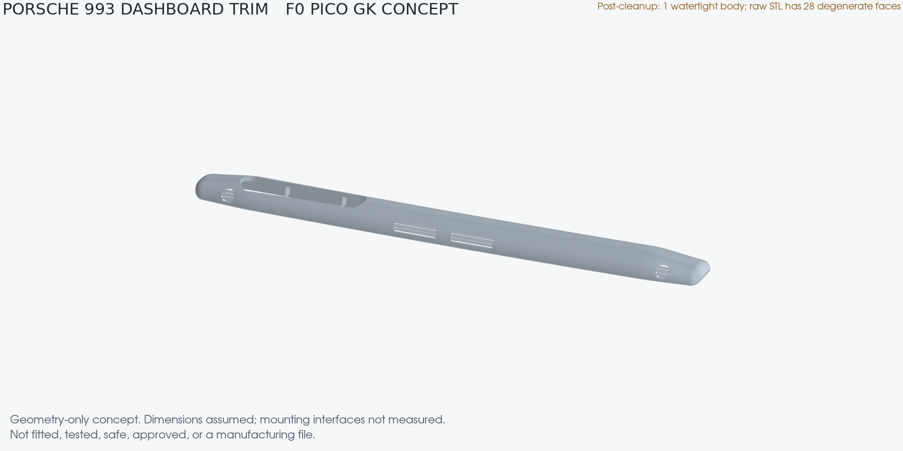

# Porsche 993 complete dashboard — F0 scope

This is an evidence inventory for the **complete dashboard zone** of a left-hand-drive Porsche 993 targeting option M564. It is not an assembled CAD model. The intended vehicle, its option label, and the absence of airbags have not been checked. All component transforms and assembly geometry are `null` in [assembly.json](assembly.json).

The image shows the isolated full-width trim, not the complete dashboard assembly. The raw PicoGK STL has 28 degenerate faces; an in-memory cleanup yields one watertight body, but no cleaned mesh has been published. Neither result supports fit or manufacturing.

The only linked PicoGK geometry is the repository's [dashboard trim generator](../../parts/picogk-catalog/body/DashboardTrim.cs), rebuilt with the [F0 concept builder](../../parts/993-int-dashboard-trim-0001/source/build_picogk_concept.py) and [concept parameters](../../parts/993-int-dashboard-trim-0001/source/picogk.json). It can be viewed as an isolated [18,000-triangle visual mesh](dashboard-trim-f0-visual.stl), with its [QA and provenance](dashboard-trim-f0-visual.json). Its size, vents, instrument opening, and ribs are estimated; it has no measured vehicle transform and establishes no fit. The full-resolution PicoGK STL is a local, ignored `work/` output; the tracked visual STL is not an assembly component or a release mesh.

## Included zones

| Zone | Current evidence | Missing before a spatial assembly |
| --- | --- | --- |
| Body-shell dashboard panel | Identity `993 502 027 02` in the [trim record](../../catalog/parts/993-int-dashboard-trim-0001.json) | Structure, mounts, datums, usable scan |
| Visible trim | Catalogue record and isolated PicoGK concept | Correct M564 part number, fitted/removed scan, reverse-side attachments |
| Instrument hood and five-gauge cluster | Product/source leads only | Exact variant, dimensions, axes, supports, wiring clearance |
| Centre/side vents and defrost ducts | Zones named in the trim record and measurement plan | Apertures, retainers, duct/seal interfaces |
| Glovebox and centre console | Adjacent zones and commercial source leads | Exact variant, supports, motion envelope, junctions |
| HVAC/radio controls and switches | Switch-blank concept and [local switch twin](../../catalog/twins/twin-993-cabin-dashboard-switch-0001.json) | Host identity, openings, clips, wiring and service clearances |
| Knee protection strip | Separate original part, to be retained | Exact M564 identity, original anchors and occupant-impact load path |
| Steering column and airbag zones | Safety/configuration boundaries | Vehicle-specific restraint state and clearances |

The PET [assembly skeleton](../../catalog/reference/993-assembly-skeleton.json) contains illustration labels, not coordinates. Commercial product dimensions and the 1/8-scale dashboard model in `catalog/sources/` do not supply OEM attachment geometry or redistribution rights. The repository has no physical dashboard measurements; the existing switch measurements are declared, conflicting leads.

## Variant gate

The target is **M564, left-hand drive**, pending a redacted vehicle option label and direct inspection. The passenger side must show no deployment flap or module. The trim part number remains **unresolved**: the [catalogue record](../../catalog/parts/993-int-dashboard-trim-0001.json) includes `993 552 055 00`, while its PET note attributes that number to an illustration for cars *with* a passenger airbag. Do not assign that number to M564 from this inventory. M561, M562, and Carrera RS variants need separate decisions and assemblies.

## Required interface and load-path evidence

[assembly.json](assembly.json) lists each unresolved connection and the data needed to close it. The capture must establish:

1. The body-shell panel and dashboard trim mounting pattern: clip nuts, self-tapping screws, hole axes, mating faces, datums, fastener specification, and tolerances.
2. Instrument hood, cluster, vent, duct, glovebox, console, switch and control retention, including movement and service clearances.
3. Original knee-strip anchors and an independently reviewed path for occupant-impact loads to the body structure. The strip stays original.
4. Steering-column clearance and restraint configuration; no steering or airbag design is generated here.
5. Windshield-base and pillar gaps, fitted/removed shape change, temperature, UV, and reflection requirements.

The existing [trim measurement plan](../../parts/993-int-dashboard-trim-0001/evidence/measurement-plan.md) defines D01–D14 and fitted/removed capture, but it does not cover the complete assembly. Each new component needs an exact variant and independent interface contract before it can be positioned. Model compilation or a watertight mesh is not inspection evidence.

## Route beyond F0

The [dashboard work packages](https://github.com/cluster2600/porscheparts/issues/566)
start with PET/variant identity, then [interface contracts](https://github.com/cluster2600/porscheparts/issues/567),
[lawful same-specimen measurements](https://github.com/cluster2600/porscheparts/issues/568),
[measured PicoGK assembly](https://github.com/cluster2600/porscheparts/issues/569),
[independent physical correlation](https://github.com/cluster2600/porscheparts/issues/570)
and [bounded operational observations](https://github.com/cluster2600/porscheparts/issues/571).
