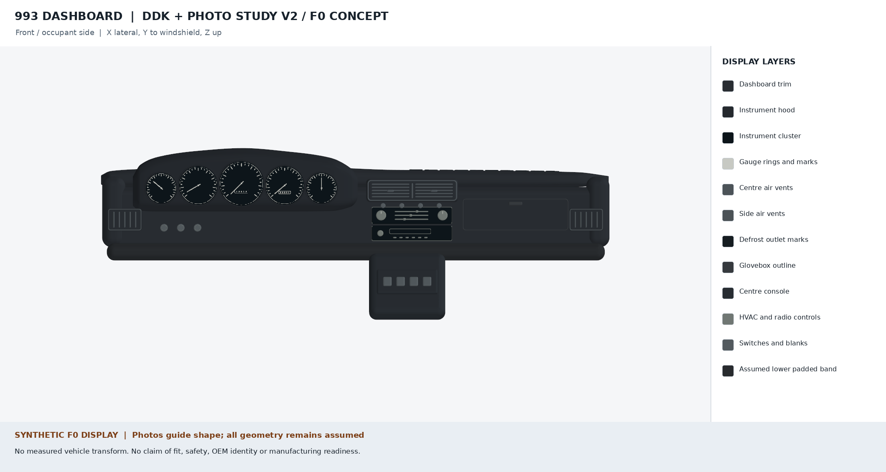

# DDK-informed dashboard appearance study, v2

This iteration uses photographs of an owner-restored 993 interior to improve
the complete visible dashboard concept. The editable geometry is generated by
PicoGK in [ddk-source-v2](../ddk-source-v2/). It is an F0 display in an invented
coordinate frame, with no admitted physical dimensions or vehicle transforms.
The target remains an unresolved M564 LHD scenario; the DDK car is RHD and is
not proof of that variant.

The [three-quarter view](dashboard-three-quarter.png) shows the depth and
segmentation. The earlier [photo study](../photo-study-v1/README.md) and all of
its hash-bound sources and receipts are retained.

## What changed

- A new parametric upper pad and rising instrument cowl replace the old flat
  fascia and masked trim mesh. Curves are artistic reconstructions, not scans.
- Five dial faces have visible tick marks and needles. Their layout and
  indicated values are illustrative, without a calibrated instrument scale.
- The centre vent has a recessed divided face with horizontal louvers; the
  side vents sit in the lower fascia with vertical blades, as observed in the
  installed DDK interior.
- The long shallow glovebox face, rounded lower band, fascia-mounted HVAC and
  radio, and separate sloping console follow the visible panel relationships.

The [reference register](references.json) separates licensed photo metadata,
commercial references and owner-post observations. The [DDK observation
audit](ddk-observations.md) identifies the specific photos and excludes images
the poster explicitly borrowed from other sites. External pixels and raw
PicoGK meshes remain outside tracked files.

## What DDK contributes to the interfaces

The dismantling account is useful for planning independent inspection: it
describes four lower-dashboard studs and attachment access behind trim and
vents. Its 8 mm and 10 mm figures are tool sizes. Neither those values nor the
photos establish a hole pattern, axis, thread, tolerance or target-variant
attachment count. No mounting coordinates are inferred from the RHD car.

The [independent interface contracts](../INTERFACE_CONTRACTS.md) and
[assembly inventory](../assembly.json) keep all physical geometry and
transforms null. The padded lower band is a visual placeholder, not a design
for occupant protection.

## Dimensions and the next acquisition step

The [dimension research](dimension-research.md) records each published value
with its actual component and variant. Product envelopes and replacement
bezel sizes provide scale comparisons; they do not close the missing
same-specimen measurements. The memo also records rejected wrong-generation
leads and the next useful source checks.

Continue acquisition through [issue #568](https://github.com/cluster2600/porscheparts/issues/568)
and the existing [external intake package](../intake/README.md). It accepts a
lawful outside contribution only after identity, rights and independent review
are established; no physical task is assigned to the repository owner.

## Reproduction and review

See the [source recipe](../ddk-source-v2/README.md) for the capped local PicoGK
run and render commands. [scene-report.json](scene-report.json) records the
generator inputs and private mesh hashes; [render-report.json](render-report.json)
binds the public PNGs to the scene, renderer and reference register. These
receipts demonstrate software provenance only. They do not establish fit,
physical correlation, manufacturing readiness or achieved twin fidelity.
