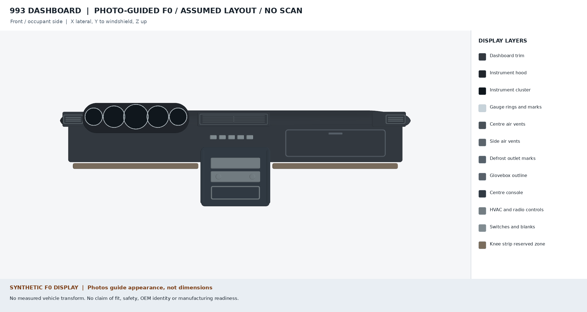

# 993 dashboard photo study v1 — visual F0

This iteration moves the [complete dashboard F0 scene](../README.md) closer to the appearance of a photographed Porsche 993. It remains an **invented display scene** built in PicoGK. The reference images establish visible feature types and rough proportions only; no photographed car has a verified M564 option label, and no vehicle dimensions, mounting interfaces, or assembly transforms have been acquired. The [assembly contract](../assembly.json) therefore continues to leave geometry and transforms unresolved.



The [front](dashboard-front.png) and [three-quarter](dashboard-three-quarter.png) PNGs are original project renders of twelve separately generated display layers. The [scene specification](../source/scene-photo-v1.json), [PicoGK generator](../source/Program.cs), [scene receipt](scene-report.json), [renderer](../source/render_photo_scene.py), and [render receipt](render-report.json) identify their inputs and hashes. Raw layer STLs stay in ignored `work/`; none is a qualified manufacturing model.

## Observations and changes

The [reference register](references.json) records each photograph or product page, its origin, stated licence, the observation taken from it, and whether image pixels are included. No external image is committed. The [Wikimedia 1995 GT2 interior photograph](https://commons.wikimedia.org/wiki/File:1995_Porsche_911_GT2_Interior.jpg) is CC BY-SA 4.0 and shows five separate dials under a rounded brow and one elongated centre vent. It is a GT2, so its exact trim and restraint arrangement cannot establish the target M564 configuration. [Sierra Madre's side vent](https://sierramadrecollection.com/products/porsche-dashboard-air-vent-911-89-98-9645722610001c) and [centre vent](https://sierramadrecollection.com/products/porsche-center-air-vent-911-89-98-9645720510001c) listings show rectangular louvered side faces and a single, internally divided centre housing. Their photographs have no stated reuse licence and are linked only.

The new scene gives the five gauges individual faces and a softer brow; it draws rectangular side vent faces and one divided centre vent face. Display masks cover round side openings and two centre slots inherited from the earlier [visual trim](../dashboard-trim-f0-visual.stl). These overlays correct the **rendered appearance** only: they do not redesign the underlying trim, define apertures, or establish a fitted assembly.

## Published size leads and admission decision

| Published item | Value | Use in this scene |
| --- | --- | --- |
| [FVD replacement 964/993 LHD upper dashboard](https://www.fvd.net/en-us/shop/dashboard-964-993-leatherette-black-left-hand-drive-99355205500eq-993552055007ae~p311677) | Product envelope 1270 × 190 × 120 mm | Order-of-magnitude lead only. Its measurement method, tolerance and M564 mapping are unknown; the envelope is not imposed on the complete scene. |
| FVD replacement bezels: [small](https://www.fvd.net/en-us/shop/instrument-bezel-964-993-clock-fuel-o-80-mm-black-fvd641605015eq~p262310), [medium](https://www.fvd.net/en-us/shop/instrument-bezel-964-993-speedometer-oil-o-100-mm-black-fvd641605016~p237601), [large](https://www.fvd.net/en-us/shop/instrument-bezel-964-993-tachometer-o-115-mm-black-fvd641605017~p237602) | Nominal Ø80, Ø100, Ø115 mm | Relative dial-ring size ordering only. These are bezel descriptions, not instrument openings or mounting diameters. |
| [MiniTools replacement gauge faces](https://store.minitools.com/en/gauge-face-for-porsche-911-964-993-rev-counter-7600-rpm-with-display-sep-fa002f.html) | Item-specific face diameters in the [register](references.json) | Cross-check of relative sizes only; a face diameter is distinct from the bezel or dashboard aperture. |
| [PorscheFanatics 993 owner measurements](https://porschefanatics.com/owner-measurements/993/) | Reported 8 and 10 mm wrench/socket sizes around dashboard removal | Excluded from geometry. Tool sizes are not fastener shank diameters, hole patterns, locations, or dashboard dimensions. |

None of these sources admits a measured dashboard interface. The PET [variant audit](../../../docs/reports/993-dashboard-variant-audit-20261106.md) also leaves the non-RS M564 trim identity unresolved. This scene must not be described as dimensionally accurate, fitted, tested, safe, or ready to manufacture.

## Reproduce the scene

Use the native Linux checkout and PicoGK environment described in the [source instructions](../source/README.md). On the qualified host, run from the repository root with a fresh private output directory:

```sh
source /home/maxime/picogk/env.sh
dotnet build twins/993-dashboard-f0/source/DashboardVisualScene.csproj -c Release -p:PicoGKAssembly=/home/maxime/picogk/smoke/bin/PicoGK.dll -v:q
python3 - <<'PY'
from runpy import run_path
import subprocess

catalogue = run_path('parts/picogk-catalog/tools/run_part.py')
catalogue['acquire']()
try:
    subprocess.run([
        '/home/maxime/picogk/run-capped.sh', '-m', '8G', 'dotnet',
        'twins/993-dashboard-f0/source/bin/Release/net9.0/DashboardVisualScene.dll',
        'twins/993-dashboard-f0/source/scene-photo-v1.json',
        'work/993-dashboard-photo-f0-new',
    ], check=True)
finally:
    catalogue['LOCK'].unlink(missing_ok=True)
PY
python3 twins/993-dashboard-f0/source/render_photo_scene.py \
  --report work/993-dashboard-photo-f0-new/scene-report.json
```

The renderer checks the scene receipt against the source and reference-register hashes before writing images. Use another fresh `work/` name if the example directory exists. The checked-in PNGs and receipts preserve one specific run; the private STL layers are not tracked.
