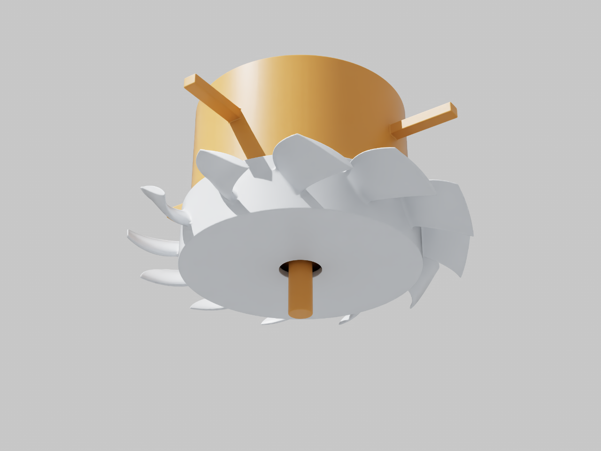
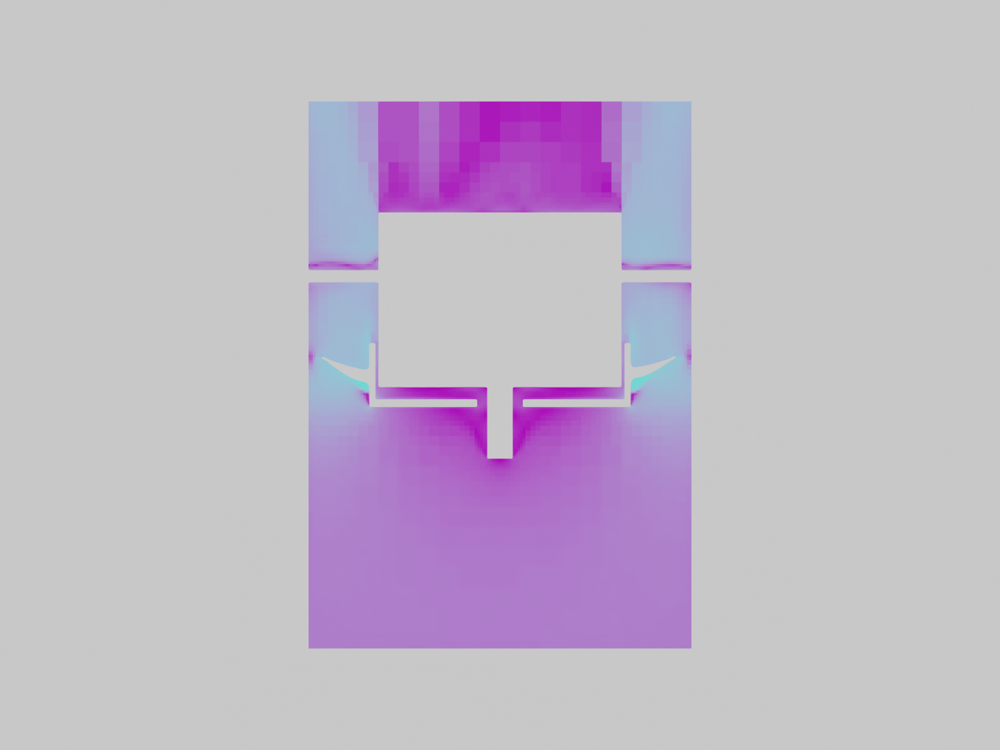
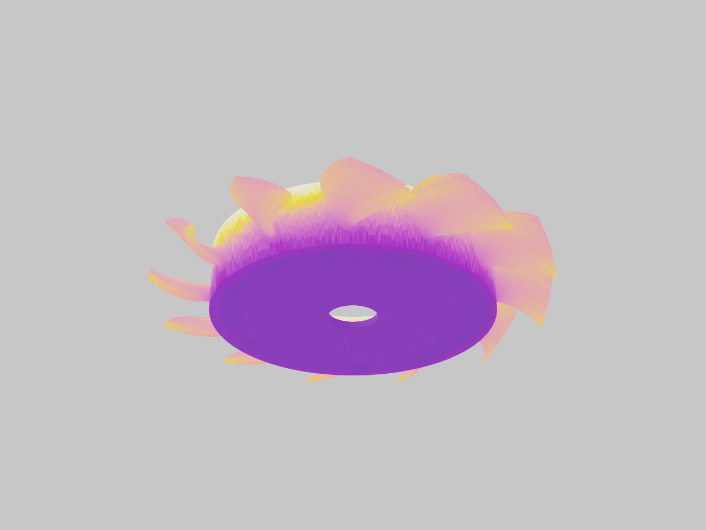
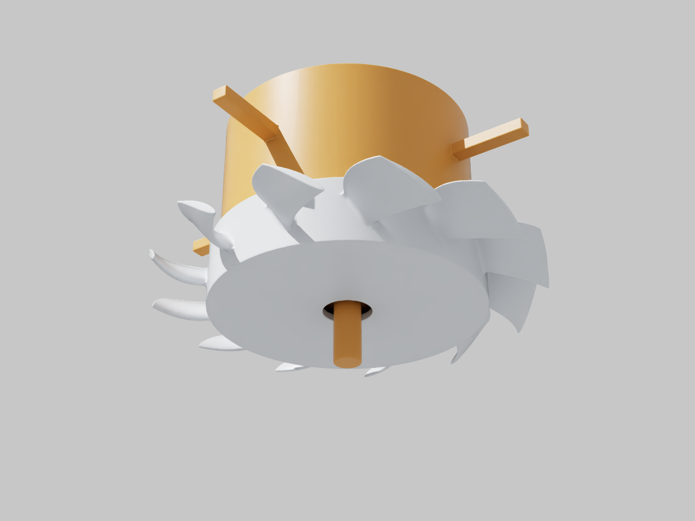

# Calculation demonstrator — fan geometry rejected
> **Correction of 28 September 2026: this model is not a faithful
> representation of the 964/993 fan.** The review of the four photographic references
> provided by the user invalidates its use as a basis for design or
> optimisation of the real fan. The images and calculations below are
> kept to trace what was run on this simplified geometry.
> The solver checks do not validate the geometry. A [separate partial reconstruction](REFERENCE_REBUILD.md) is now
> available; it takes over none of the old flow results.

## Deviations to correct before continuing the calculations

| Element | Published model | What the references show and required correction |
|---|---|---|
| Rotor hub | Flat, solid annular base, drilled with a single bore | Pressed/dished hub, ventilation openings, boss and pulley interface to distinguish |
| Blades | Parametric profiles chosen without reconstructing the reference rotor | First reconstruct the number, chord, twist, camber and blending of the identified variant |
| Fixed housing | Absent from the assembly render; the four arms end on no housing | Annular housing with inlet, supports/fixed vanes and alternator seat distinct from the rotor |
| Alternator | Solid substitute cylinder with shaft merged into the fixed parts | Ventilated body, mountings and shaft separate; do not attribute the AS-PL dimensions to the PMB 240 A |
| Axial mounting | Pulleys, spacers, bearing and rear cone not modelled | Reconstruct the stack and its seats before claiming integration |

The solid cylindrical volume also closes off air passages: the old
CFD results therefore do not allow conclusions on the cooling of
the real alternator. The printing calculation also concerns a part
that does not yet reproduce the expected rotor.

### Reading of the four references

1. **Photo 1, Design911 exploded view**: informs the separation of the components and
   their assembly order; it is not a dimensioned drawing.
2. **Photo 2, Classic Retrofit assembly**: useful reference for the
   housing/alternator/rotor morphology. Its title states **175 A**; our target remains
   the requested **240 A**, whose dimensions must not be deduced from this image.
3. **Photo 3, A0534S data sheet**: the visible title mentions **997** and the table
   **150 A**. This sheet is not a source of dimensions for the PMB 240 A
   nor an identification of the 993 mounting. [AS-PL data sheet](https://as-pl.com/en/p/A0534S).
4. **Photo 4, rotor alone**: shows the openings, ribs and blends
   absent from the model; its exact identification remains to be established before
   copying a number of blades or proportions.

The [Classic Retrofit 993 instructions](https://classic-retrofit.com/forum/index.php?/topic/2521-993-alternator-install/)
confirm the importance of the spacer compensating the recessed bearing,
the adjustment spacers and the rear cone distributing the loads.
The [240 A data sheet](https://www.classicretrofit.com/en-us/products/porsche-964-993-240a-high-output-alternator)
recommends a multi-groove belt with tensioner. These components must be
part of the reference definition, not only of the list of limits.
The photographs received are not republished: they serve as visual
references, with no established redistribution licence.

### Resumption criterion

Build an identifiable reference assembly, with front, rear,
section and exploded views, fixed/moving parts separated and each dimension
tied to its source or explicitly left unknown. Compare these views
with the references before modifying the blades. Flow tests and
optimisation can qualify the real fan only after this
geometry correction and the definition of the air circuit.

---

## Archive of the initial demonstrator

[Download the USDZ demonstrator rejected as a geometric reference](results/omniverse/fan-twin.usdz) · [Numerical results](results/omniverse/)

Research publication: exploratory geometry and calculations, with no manufacturing authorisation.
The `work/` paths below designate the local calculation archives, not published.

## Scope

The twin assembles the current PicoGK geometry, its historical alternator
obstacle, the OpenFOAM CFD section and the ZRapid printing thermal field.
It has no physical sensors. The target alternator is the PMB /
Classic Retrofit 240 A, but its precise geometry is not available:
the 160 mm AS-PL substitute is explicitly identified in the scene.
The rear cone, the spacers and the pulley remain interfaces with no
invented mesh. The PMB dimensions remain to be measured before validating its integration.

## OpenUSD deliverable

The scene is in `work/fan-aerodynamics/omniverse-twin/`:

- `fan-twin.usda`: assembly, metadata and variants;
- `components.usdc`: surfaces and numerical fields, referenced locally;
- `viewer.usda`: visualisation layer, camera and lighting;
- `viewer-flow.usda`, `viewer-print_thermal.usda`, `viewer-newton_coastdown.usda`: reproducible capture layers;
- `fan-twin.usdz`: standalone package with scene, data, camera and lighting;
- `build-report.json` and `validation.json`: provenance and checks;
- `newton/`: parameters, rotation history and analytical check.

Open `viewer.usda` in an OpenUSD-compatible Omniverse application.
Select `/World`, then its `studyView` variant:

| View | Data presented |
|---|---|
| `assembly` | Rotor and historical stationary obstacle, in metres |
| `flow` | Section y = 1 mm, velocity 0–60 m/s, MRF iteration 1200, 3,000 rpm |
| `print_thermal` | Homogenised LPBF thermal maximum, scale 30–47 °C |
| `newton_coastdown` | Rotation of an isolated rotor slowing under drag |

The printing temperatures are not engine temperatures. Their
projection takes the solid cell closest to the centre of each face,
with the build plate frame restored and the 6 mm of
elevation removed. The report keeps the projection distances. The CFD field
remains steady and exploratory: it is not animated as a transient
flow. No installed flow or converged gain is claimed.

## Use of the libraries in the photo

| Building block | Role and state |
|---|---|
| OpenUSD | Portable assembly, units, fields and animation; checks run |
| Newton 1.6.0 | Featherstone solver, one ideal rotation axis; run on CPU |
| Warp 1.17.0 | Aerodynamic torque kernel and Newton calculation; run on CPU |
| PhysicsNeMo | Surface audits and pressure integration from the previous campaign; the CFD is solved by OpenFOAM |
| PhysX / ovphysx 0.4.13 | Free rotation then slowdown with drag; run on CPU in the local Linux container |
| Omniverse RTX / ovrtx 0.3.0 | GPU renders run on RTX PRO 6000; captures kept |
| NuRec | Visual reconstruction of the real assembly; blocked by the absence of photographs of the component |

These libraries do not have the same role. Newton and PhysX do not replace
a blade fatigue simulation; NuRec does not produce a toleranced mechanical
drawing from a photograph on the NVIDIA page.

The [NuRec mono camera](https://docs.nvidia.com/nurec/robotics/neural_reconstruction_mono.html)
documentation describes a COLMAP then 3DGUT chain: sharp, overlapping views of the same
assembly, at several heights, with stable exposure and focus.
For this project, independent dimensional references will also be needed
to check the scale. The visual reconstruction will remain distinct from
the PicoGK geometry used for the calculations. No NuRec training of the
fan has been run and no screen image is used as
evidence of its geometry.

## Newton / Warp calculation run

The closed rotor mesh, converted from mm to m, gives the mass and the inertia
tensor for an assumed density of 2,670 kg/m³. The rotor is
hinged to an ideal support about z. The drive is removed and
`couple = -k × omega × abs(omega)` is applied, with k deduced from the single exploratory CFD point
at 3,000 rpm. This is a quadratic drag assumption, not a new
CFD curve. The torque and inertia of the PMB, the belt, the bearings and the
elastic vibrations are not included.

The calculated duration is 0.1 s; the main step is 0.1 ms, compared with 0.2 ms.
The speed is checked against `omega(t) = omega0 / (1 + k omega0 t / Izz)`.
The maximum relative error is about 7.86 × 10⁻⁷. This check demonstrates
the numerical consistency of the simplified case, not the physical validity of its
drag law. The USD animation covers 0–100 timecodes at 1,000 timecodes/s;
reduce the playback speed to inspect the rotation without temporal aliasing.

## PhysX verification run

A second case also removes the drag: conservation of speed on an
ideal bearing, without collision. The full inertia tensor is diagonalised
and its principal axes are passed to PhysX. After 200 steps of 10 µs,
the expected angle is 0.628318531 rad and the observed angle 0.628351450 rad,
i.e. 0.00189° of deviation. The parasitic displacement remains below 10⁻⁵ m.
The result is in `physx-summary.json` and the scene in `physx-spin.usda`.
This first test does not validate the real bearing.

A second test then imposes the same initial condition of 3,000 rpm
and the same quadratic drag as Newton, for 1,000 steps of 0.1 ms.
PhysX gives **2,932.191 rpm**, against **2,930.977 rpm** for Newton:
a deviation of **1.214 rpm**. The maximum relative error of PhysX against the
analytical solution is **0.0405 %**, below the 0.1 % criterion.
The speed is explicitly reset between the two trials: the
projection of the bearing during the free trial produces a small drift
(314.18924 rad/s instead of 314.15927 rad/s). The logs keep the
initial diagnostics and the corrected rerun. The wrench format used
by ovphysx 0.4.13 has nine components: force, torque, point of application.
This comparison concerns only the rigid dynamics of the isolated rotor.

The local container run is
`sha256:79e76882a8f493012eb4cc9ab061bce0ca2d075cd505d6e33a5200e7e1e9b126`,
Linux amd64 under emulation on the arm64 Mac. The first trial revealed
the absolute time parameter required by this version; the corrected rerun
finished normally. The OVRTX 0.3.0 runtime of this image uses its standalone
scene API, prior to the OVStage attachment of recent versions.

## Local reproduction

These commands reuse the campaign's `work/` archives (meshes,
VTK and thermal fields), kept locally and not included in this
publication. The USDZ package is standalone for viewing the twin.

```sh
PY=work/fan-aerodynamics/physicsnemo-venv/bin/python
SRC=twins/993-engine-cooling-fan-system-f0/source
OPENBLAS_NUM_THREADS=1 "$PY" "$SRC/run_fan_newton.py" \
  --output work/fan-aerodynamics/omniverse-reproduction/newton
OPENBLAS_NUM_THREADS=1 "$PY" "$SRC/build_fan_digital_twin.py" \
  --output work/fan-aerodynamics/omniverse-reproduction
```

The working venv contains `usd-core==26.8` and `newton==1.6.0`, added to the
campaign's dependencies. The geometric masters and previous results
are not modified. The builder refuses to overwrite an existing scene.
The checks verify the four views, the mesh indices, the finite
values, the metric diameter of the rotor and the animation limited to its variant.

For the PhysX check, after the local build:

```sh
"$PY" "$SRC/run_fan_physx.py" work/fan-aerodynamics/omniverse-reproduction --prepare-only
docker run --rm --platform linux/amd64 \
  --entrypoint /opt/ovphysx-runtime/bin/python \
  -v "$PWD/work/fan-aerodynamics/omniverse-reproduction:/job" \
  -v "$PWD/$SRC/run_fan_physx.py:/run_fan_physx.py:ro" \
  ghcr.io/cluster2600/3dprinting993-simready-workflow@sha256:79e76882a8f493012eb4cc9ab061bce0ca2d075cd505d6e33a5200e7e1e9b126 \
  /run_fan_physx.py /job
```

Rendering requires the OVRTX 0.3.0 runtime of the NVIDIA image and an RTX GPU.
`source/render_fan_ovrtx.py viewer.usda assembly.png` loads the wrapper,
performs 48 render steps and rejects a uniform image. The GPU renders were run with driver 570.211.01; the final
captures use a 35 mm focal length to include the alternator substitute.

## Remote run

Vast rental 53186186 uses an RTX PRO 6000 WS 96 GB, 24 effective cores,
190,818 MB of RAM and 500 GB of storage. The offer advertises 1.55852 USD/h,
plus 0.00390625 USD/GB of transfer in each direction. This rate is not a
final invoice. The SimReady image is pinned to the digest
`sha256:5a69a6805a275ef708e264600cb933663159a2846b069eafe0459c28e5f69699`.
Start-up uses the existing OpenBao wrapper, with no new secret
extraction. The logs and deletion confirmations are kept with the
local results.

The first rental was deleted automatically after an SSH refusal;
its absence was verified. A second attempt, instance 53187079 in
Vietnam, uses the same image on RTX PRO 6000 WS, for 1.36556 USD/h
advertised with storage. It is tracked separately in
`vast-launch-retry.log`; its SSH access and the renders were verified.
After retrieval of the results, it was deleted:
`vast-destroy.json` confirms `destroyed: true` and `verified_absent: true`.
The final inventory `vast-final-inventory.json` contains neither of the two
instances of this study. Another rental, created by other work,
was left intact.


The second host confirmed SSH access and the RTX PRO 6000 Blackwell with
driver 570.211.01. The first OVRTX launch failed with
`ERROR_INCOMPATIBLE_DRIVER`. The `strace` diagnostic of `vulkaninfo` identified
the absence of `libEGL.so.1`; installing `libegl1` in the ephemeral
container allowed `vulkaninfo --summary` to recognise the GPU.
The pinned image and the repository's Dockerfiles were not modified.
To reproduce on this image, install `libegl1` before rendering;
`vulkan-tools` and `strace` were used only for diagnosis.


## RTX render captures

Raw images from the OVRTX `LdrColor` output, 1,280 × 960 pixels, after
48 render steps. These are captures from the headless engine,
not generative illustrations. The gold colour identifies the historical
alternator substitute; it does not represent its real material.
The light grey of the rotor is also a visualisation convention.

### Assembly



### CFD section



Velocity scale: dark purple = 0 m/s, yellow = 60 m/s (viridis palette). The front capture hides the solids and removes the lighting on the field
to make the palette readable; this image does not prove an installed flow.
The interactive `flow` variant keeps the solids overlaid.

### LPBF printing



Scale: black-purple = 30 °C, light yellow = 47 °C (inferno palette). Volume-averaged thermal field,
with no resolution of the melt pool and no validated prediction of distortion.

### Newton rotation




The rotor turns; the alternator substitute remains fixed. The animation comes
from the Newton calculation, with an initial speed of 3,000 rpm and quadratic drag.
The visible shaft belongs to the stationary substitute: it is not
a model of the PMB's transmission.


To reproduce the captures, from the output directory copied to the RTX host:

```sh
/opt/ovrtx-runtime/bin/python render_fan_ovrtx.py viewer.usda assembly.png
/opt/ovrtx-runtime/bin/python render_fan_ovrtx.py viewer-flow.usda flow.png
/opt/ovrtx-runtime/bin/python render_fan_ovrtx.py viewer-print_thermal.usda print_thermal.png
/opt/ovrtx-runtime/bin/python render_fan_ovrtx.py viewer-newton_coastdown.usda rotation-0ms.png --time-code 0
/opt/ovrtx-runtime/bin/python render_fan_ovrtx.py viewer-newton_coastdown.usda rotation-17ms.png --time-code 17
```

The capture layers are written by `build_fan_digital_twin.py` and
checked by the OpenUSD validators. The structured results and digests
are in [omniverse-twin-results.json](omniverse-twin-results.json).
The targeted checks of this extension were run; the `make check` result is given in the pull request.
This publication is not a manufacturing validation.


The visual check also rejected a black CFD capture: the camera was looking at
the back face of the plane, whose emission was not rendered by this runtime.
The final camera is on the positive y side, facing the normals of the section.
The script now also checks for the presence of coloured pixels to reject
this defect. The intermediate archives remain diagnostics; only the
images linked above are the retained captures.


Capture summary: five PNGs retained, all at 1,280 × 960 pixels;
57,168 pixels change by more than 10 levels between positions 0 and 17 ms.
The pixel checks detect an empty or colourless output, and a
visual inspection verifies the framing. They do not validate the physics.
The palettes are subject to RTX colour processing: to read
a value, use the USD numerical fields, not the colour of a pixel.
