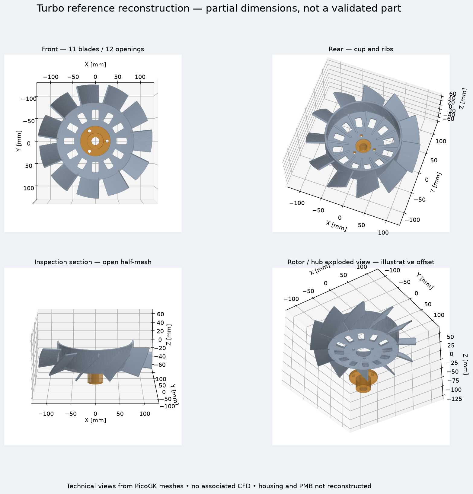

# Fan rework from the part references

Research and reconstruction of 28 September 2026. Retained target: **993 Turbo
M64.60 with PMB / Classic Retrofit 240 A alternator**. The four photographs
mix variants; they do not define a single assembly.

[See the four technical views](results/reference/reference-review.png) ·
[Download the OpenUSD reference](results/reference/reference.usdz) ·
[Register of sources and unknowns](reference-research.json) ·
[Editable PicoGK parameters](source/picogk-reference/reference.json)



## What was restarted

The rotor is reconstructed separately from the rejected model: **11 blades**, cup
open at the rear, **12 ventilation windows**, floor ribs and three
mounting holes. The bearing hub is a separate part. The numbers
of blades and windows are observations from the FVD photographs, not
dimensions taken from a drawing. The Porsche ORIGINALE catalogue also distinguishes
the Turbo and Carrera rotors.

The C# source produces two PicoGK volumes. The OpenUSD scene carries their identities
and keeps explicitly unreconstructed components for the housing,
the PMB alternator, the cone, the small impeller and the drive. It incorporates
**no old CFD or thermal field**. This is a partial reference
reconstruction, not yet the complete twin requested.

The 245 mm nominal working diameter is an interpretation of the FVD commercial
envelope. The cup depth, pitch, chords, thicknesses,
radii, centre distances and fits remain visible assumptions
in the parameter file. The internal interfaces of the bearing are
not reproduced. The published total depth of 87 mm does not on its own
give the blade depth: it was not used as such.

## Identification and parts list

The Porsche PET, illustration **105-00**, PDF pages **77–78**, distinguishes:

| Variant | Rotor | Housing |
|---|---|---|
| Carrera | 96410601531 | 99310666701 / 99310666703 |
| Turbo M64.60 | 96410601521 / 96410601522 | 99310666750 |

References from the PET plate relevant to the Turbo installation, to be confirmed according to
the vehicle version and the drive finally retained. Old and
new references are not presented as parts to be stacked together.

| PET position | Reference(s) | Function / published information |
|---|---|---|
| 1 | 99310603500 | sensor |
| 2 | 96410631502 | bracket |
| 3 | 99907200509 / 99907200501 | two M6 × 12 fasteners, titled hexagon nut in PET |
| 4 | N0147432 / 90006701203 | M6 × 30 screw |
| 5 | 99310666750 | Turbo housing |
| 6 | 99310625150 | Turbo strap |
| 7 | 90006715202 | M8 × 55 screw |
| 8 | 96410627300 / 96410627301 | two dowels |
| 9 | 96410601522 | Turbo rotor, old suffix 21 |
| 10 | 99310650950 / 99310651050 | Turbo fan pulley halves |
| 11 | 96410651701 | shims |
| 12 | 90097600401 | three M6 × 30 screws |
| 13 | 99919234350 | belt 9.5 × 760 |
| 14 | 99919237350 | belt 9.5 × 753; old 37250 at 757, note 7/97 |
| 15 | 99310626800 / 99310626801 | alternator pulley halves |
| 16 | 96410626830 / 96410626832 | 0.5 / 0.7 mm shims depending on installation |
| 17 | 96410651530 | bush |
| 18 | 96410621132 | two bushes |
| 19 | 93060304101 | rear cone |
| 20 | N01152427 | four A6.4 washers |
| 21 | 90091001009 | four VM6 nuts |
| 22 | 90003401302 | BM16 × 1.5 nut |
| 23 | 92860304501 | small alternator impeller |
| 24 | 90003400302 | BM10 nut |
| 25 | 96410605131 | bearing hub, old suffix 30 |

The small impeller **92860304501**, the cone **93060304101** and the hub
**96410605131** are part of the original system. Their retention and their
interfaces with the new alternator must be verified; the PET alone does not
prove the compatibility of a modification.

**Discrepancy found on the hub:** [Patrick Motorsports](https://patrickmotorsports.com/products/eng96410605131)
explicitly excludes the 993 Turbo for 96410605131, whereas FVD lists it and
this PET plate carries no explicit exclusion at position 25.
The reconstructed hub remains a reference to be verified, with no attested Turbo
compatibility. This discrepancy will have to be resolved by the Porsche reference applicable
to the exact installation before purchase or fixing of its fits.

## Dimensions found and their real scope

| Published information | Source | Correct use |
|---|---|---|
| Turbo rotor: 245 × 245 × 87 mm; 0.9 kg | FVD rotor | Commercial envelope without tolerances; not a manufacturing drawing |
| Hub: 64 × 64 × 35 mm; 0.26 kg | FVD hub | Commercial envelope; neither bore nor centre distance attested |
| Three M6 × 30 screws; BM16 × 1.5 nut | PET | Fastener designations; not the associated fits |
| 0.5 and 0.7 mm shims | PET | References depending on installation; quantity to be determined |
| WOSP spacers: 7, 17, 2 mm | WOSP instructions | RS: 7; double pulley: 24; old 964 Turbo: 26 mm |
| Recessed spacer against the bearing | WOSP / Classic Retrofit | To be kept; thickness not published in these instructions |
| AS-PL A01345S: F.1 160 mm, L.1 256 mm, 115 A | AS-PL | Different alternator; not reused as PMB dimensions |

The **WOSP 26 mm is not a generic 993 Turbo dimension**. The initial spacer
against the bearing is distinct from the stacks indicated. The instructions
concern LMA339/LMA498; the exact correspondence of the PMB product must still be
confirmed. The WOSP flyer gives LMA339 at 240 A and LMA498 at 180 A: do not
confuse this designation with the Classic Retrofit 175 A sheet in the photo.

## Other information found, not to be turned into certainties

The [PorscheFanatics record](https://porschefanatics.com/parts/porsche-ag-eng96410601531/)
points to the **Carrera 96410601531** reference. Its "All models" label is
broader than the PET distinction; it does not prove its use on the Turbo.
This record gives neither a manufacturing process nor functional dimensions.

The repository registers also contain three leads on tightening torques
(page 61 of the manual, OCR transcription **not verified**): strap 8 N·m,
alternator pulley 50 N·m and small impeller 14 N·m. The model is not
specified there. These values are recorded to find the primary page again; they
are not Turbo / PMB installation instructions.

## 240 A alternator and drive

PMB identifies its product as the Classic Retrofit 240 A. The manufacturer announces
a six-phase Denso base with hairpin conductors, a specific 964/993 housing
and more than 100 A at idle. These are the manufacturer's commercial data,
not a thermal map nor a measurement made in this project.

PMB and Classic Retrofit recommend a **multi-groove belt with tensioner**
for the 240 A and their 175 A unit for double-pulley / RS installations.
The replacement therefore does not come down to increasing the diameter available in
the rotor. The definition of the chosen drive kit, the respective
speeds, the seats and the stack are missing. The alternator shaft must not be
merged with the fixed housing in the simulation. The bearing hub and the two
drives of the original installation prevent arbitrarily imposing a common
rotation on all parts.

The Classic Retrofit instructions also stress the role of the rear cone in
distributing the nut loads. The commercial claim of compatibility
with the 964/993 housings does not replace a dimensioned interference check.

## Material, flow and printing

No document consulted here gives a complete set of material properties for the
Turbo rotor with grade, process, treatment and fatigue curves. One cannot
choose an "optimal" material from the appearance of a photograph alone.
AlSi10Mg remains the candidate of the previous study, **not a validated material**
for this reconstruction. The final choice must compare mass, fatigue,
stiffness, LPBF defects, blade finish, machining of the seats and balancing.

The new model does not yet have a reconstructed housing or PMB air path.
It therefore does not allow a representative engine flow to be recomputed.
The old figures are archived and are not transferred. Optimisation
will resume with a complete reference, then a comparison at identical speed and
pressure drop: flow, pressure, absorbed torque, alternator temperature
and mechanical margins. PhysicsNeMo must use relevant CFD data;
Omniverse serves to assemble and inspect, its visualisation does not validate the flow.

## Checks run

The C# generation includes checks of the central passage, the twelve openings,
the presence of each of the eleven blades and of the cup. The Python check
verifies the exported meshes: closure, orientation, single component,
positive volume and volume conservation after reduction for the review.
The centres of the twelve windows are also verified in the reduced mesh.
The scene and its USDZ package are opened and submitted to the OpenUSD validators.

`make check` passes: main suite of 3,184 tests (148 skipped), complementary
checks and 0 broken links in 566 Markdown documents.

The exact results are in [validation.json](results/reference/validation.json).
The four images are **technical views of computed meshes**, produced
locally; they are not RTX captures, nor wind-tunnel results.
No GPU rental was launched for this geometric rework.

## Reproduction

With the local PicoGK runtime already installed, the .NET 9 SDK and the existing
Python environment of this study, from the repository root:

```sh
docker run --rm \
  -v "$PWD/twins/993-engine-cooling-fan-system-f0/source/picogk-reference:/src:ro" \
  -v "$PWD/work/fan-aerodynamics/runtime/PicoGK.dll:/app/PicoGK.dll:ro" \
  -v "$PWD/work/fan-aerodynamics/reference-rebuild/build:/out" \
  mcr.microsoft.com/dotnet/sdk:9.0 \
  dotnet build /src/Reference.csproj -o /out -p:BaseIntermediateOutputPath=/tmp/obj/ -c Release
cp work/fan-aerodynamics/runtime/fan/*.dylib work/fan-aerodynamics/reference-rebuild/build/
work/fan-aerodynamics/runtime/dotnet/dotnet \
  work/fan-aerodynamics/reference-rebuild/build/Reference.dll \
  twins/993-engine-cooling-fan-system-f0/source/picogk-reference/reference.json \
  work/fan-aerodynamics/reference-rebuild/geometry-new
work/fan-aerodynamics/physicsnemo-venv/bin/python \
  twins/993-engine-cooling-fan-system-f0/source/build_reference_review.py \
  --source work/fan-aerodynamics/reference-rebuild/geometry-new \
  --output work/fan-aerodynamics/reference-rebuild/review-new
```

The output directories must be new to preserve the trials. The
SDK compiles the C#; execution uses the existing native PicoGK macOS kernel.
These commands are not a portable installer for the PicoGK kernel.

## Sources consulted and research limits

- **pet**: [Porsche PET 993, illustration 105-00, PDF pages 77–78](https://a.storyblok.com/f/332100/7be45d4171/kat517-usa-911-98-katalog.pdf).
- **originale**: [Porsche ORIGINALE 05, PDF page 7 / printed 83](https://a.storyblok.com/f/332100/d50d3473a6/originale-05-ww.pdf).
- **rotor**: [FVD 96410601522, commercial dimensions and ten product views](https://www.fvd.net/fr/shop/turbine-965-993-turbo-96410601522~p252068).
- **hub**: [FVD 96410605131, commercial envelope](https://www.fvd.net/en-us/shop/fan-hub-964-993-for-engine-cooling-fan-96410605131~p247931).
- **pmb**: [PMB 240 A alternator chosen by the user](https://pmbperformance.com/products/high-output-240a-alternator-for-porsche-964-and-993-90-99).
- **cr240**: [Classic Retrofit 240 A, drive recommendations](https://www.classicretrofit.com/en-us/products/porsche-964-993-240a-high-output-alternator).
- **install**: [Classic Retrofit 993 installation, spacers and cone](https://classic-retrofit.com/forum/index.php?/topic/2521-993-alternator-install/).
- **wosp**: [WOSP LMA339/LMA498 Spacer Instructions, single page](https://wosperformance.co.uk/ClientArea/files/Downloads/LMA339%20LMA498%20Spacer%20Instructions.pdf).
- **wosp_flyer**: [WOSP Porsche alternator flyer, LMA339 240 A / LMA498 180 A](https://www.wosperformance.co.uk/clientarea/files/downloads/Porsche%20911%20WOSP%20Alternator%20Flyer.pdf).
- **rothsport**: [Rothsport RS-079, single-belt conversion](https://rothsport.com/products/964-993-rs-single-belt-conversion-hub).
- **aspl**: [AS-PL A01345S, 115 A, F.1 160 mm / L.1 256 mm](https://as-pl.com/fi/p/A01345S).
- **design911**: [Turbo housing 99310666750, pos. 5](https://www.design911.co.uk/p/engine-fan-housing-porsche-993-turbo-1994-98-99310666750/).

The research covers the Porsche catalogues, the identified supplier records
and the public installation instructions. It is not a guarantee of exhaustiveness
across the Internet. No complete manufacturing drawing of the PMB or of the Turbo rotor/housing was
found in these sources. The catalogues, product photos and user
photographs remain external references; they are not redistributed.
The digests of the consulted PDFs are kept in the JSON register.

To complete the dimensional twin, the seats/centre distances,
axial profiles, geometry of the stator vanes and of the PMB, and the multi-groove kit
remain to be obtained. The new reconstruction allows the morphology to be reviewed now;
it does not close these interfaces and authorises neither manufacture nor engine installation.
