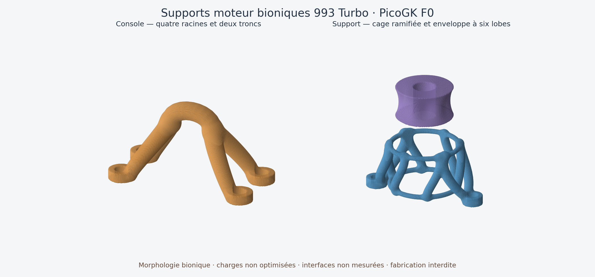

# 993 bionic engine mounts — PicoGK F0 study

This directory adds a parametric **central bracket** and **engine mount
housing** to the work already started on the Turbo crossmember. It represents
the compliant envelope of the mount separately: no monolithic metal block
is presented as a functional rubber bush mount.



## Parts and variants

| Part number | Role | Treatment |
| --- | --- | --- |
| 993 115 021 53 | Turbo crossmember, PET 17 | R9 and its evidence kept outside this scene |
| 993 115 103 52 | Central bracket, PET 18 | Skeleton with four roots, two trunks and a curved crown |
| 993 375 049 05, quantity 2 | Engine mounts, PET 21 | Branched cage and separate six-lobe envelope |
| 993 115 021 90 | Carrera/Carrera 4/S/4S crossmember | Identity already recorded; geometry not produced here |
| 993 115 021 41 | RS crossmember | Identity already recorded; geometry not produced here |

The Turbo identity and the quantities come from the
[reviewed PET requirements](../../parts/993-eng-carrier-0001/source/pet-redo/requirements.json).
The two other crossmembers are distinct variants, not automatic
replicas of the Turbo model. No suffix change is evidence of
dimensional compatibility.

## What is integrated

The generator reuses the PicoGK 2.3.0 kernel and the curves and implicits of the
repository. **All the new shapes are bionic**:

- The bracket is an open skeleton. Four flanges branch into two
  curved trunks and a crown, with progressive sections and smoothed
  junctions. Its four holes remain hypothetical positions.
- The mount is an open cage with six curved branches and four roots
  bifurcating from two body-side flanges. The circular crowns
  bound a hypothetical receiving volume; there is no solid cup.
- The separate compliant envelope has a waisted middle and six lobes.
  Its internal mechanism, material, stiffness and damping remain unknown.

“Bionic” here describes a morphology inspired by branching in living organisms,
**not a validated topological or mechanical optimisation**. No solver has
justified the distribution of material. The old plates, uprights, solid
cup and straight F1 crossmember no longer appear in the exports of this family.
The local flange surfaces around the holes remain flat to
represent study interfaces; they do not constitute a load-bearing plate.

The HelixHeatX heat exchanger, the gyroids and the impeller models are not
incorporated into the load path. They bring no mechanical justification
to this mount. No proprietary Noyron code or OEM drawing is copied.

The two new parts are recorded in the catalogue records
[bracket](../../catalog/parts/993-eng-bracket-0001.json) and
[mount](../../catalog/parts/993-eng-mounting-0001.json), status `concept`.
The shared [C#](../../parts/picogk-catalog/engine/EngineMounts.cs) master and the
three [parameter sets](source/) remain editable.

## Check and missing data

The [independent contract](interface-contract.json) keeps the centres,
axes, diameters, faces, datums, tolerances and measurement evidence unknown as
`null`. The number of engine-side fastenings of the bracket is also unknown.
The load path is qualitative: engine → bracket → four crossmember
fastenings → crossmember → two mounts → four body fastenings.

Normal generation is blocked; `--shape-study` is mandatory for the
incomplete exercise. This flag never authorises manufacture.
The [report](derived/study-report.json) links inputs, native exports and retained
exports by SHA-256. Only faces of **exactly zero** area are removed.
The native STLs are kept under `derived/native/`, then an independent check
verifies closed edges, consistent orientation, positive volume and a single component.
This check does not detect all self-intersections and proves neither fit,
nor strength, nor fatigue resistance.

The [OpenUSD scene](derived/assembly.usda) uses millimetres and an
**illustrative exploded pose**, with five instances: bracket, two cages and two
compliant envelopes. It does not define the real placement on a 993. The R9
crossmember stays in its original directory; no archived straight model is
substituted for this crossmember in the bionic scene.

The runner's density is set to zero to disable its estimate:
its “mass 0” output is **not** a physical mass. No material is
selected or qualified by this study.

## Checks of the bionic revision

The exports must pass the independent check of the three meshes and of
their digests. The geometry tests also check the recesses that
replace the plate and the solid wall, the holes and the six-lobe
waist. This check concerns the shapes produced, not their performance.

The C# compilation and the three native generations pass. The ten tests of
this family and five invalid native cases rejected without STL were verified;
the scene was read back with OpenUSD 26.5. The Python suite on Linux arm64 passes
without failure: 3,605 tests, of which 187 skipped for optional dependencies. The
global `make check` then stops at `917-manufacturing-f37-lpbf-audit-check`,
because Docker is absent from the validation container. The subsequent global targets
are not confirmed; no physical validation or manufacturing
acceptance is obtained.

## Reproduce

Build the existing project with the PicoGK checkout pinned by
[sources.lock](../../containers/m64-leap71/sources.lock):

```sh
dotnet build parts/picogk-catalog/engine/Engine.csproj \
  -p:UpstreamRoot=/chemin/vers/upstream -o work/engine-mounts/bin
# Installer les bibliothèques natives de la même révision dans ce dossier.
python3 twins/993-engine-mount-system-f0/source/build_study.py \
  --shape-study --engine-dll work/engine-mounts/bin/Engine.dll \
  --output-dir work/engine-mounts/new-run
make engine-mount-study-check
```

The output must be new. An interrupted or rejected execution has
no completion `study-report.json`. The verification of the retained files
and the Python tests do not require the PicoGK runtime.

## Next engineering gate

1. Measure together the crossmember, bracket and mounts of the exact variant;
   establish the engine-side and body-side interfaces.
2. Measure the characteristics of the compliant mounts, then determine the
   allowable loads, preloads, contacts and movements.
3. Rework the shapes around these data and have them inspected
   independently before converged computation, fatigue and professional review.
4. Select a qualified material and process; define the physical
   validation plan before any fitting or functional manufacture.
