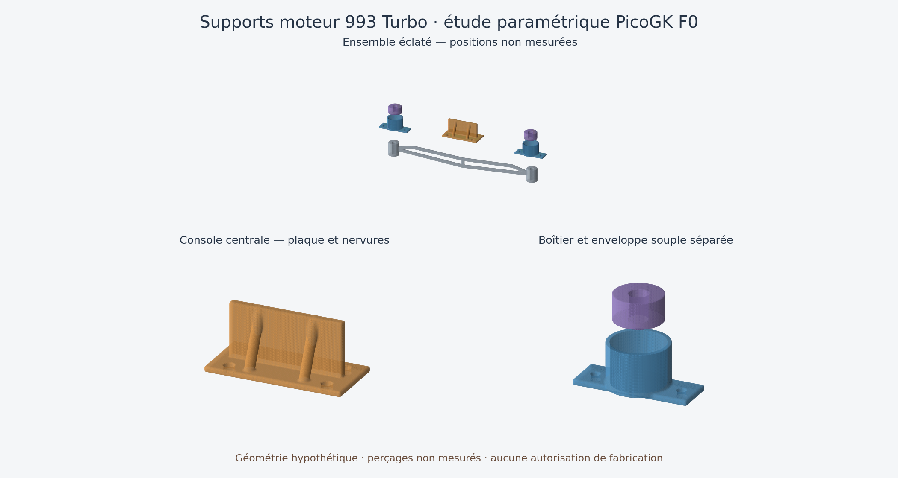

# Supports moteur 993 — étude PicoGK F0

Ce dossier ajoute une **console centrale** et un **boîtier de support moteur**
paramétriques au travail déjà commencé sur la traverse Turbo. Il représente
séparément l'enveloppe souple du support : aucun bloc métallique monolithique
n'est présenté comme un silentbloc fonctionnel.



## Pièces et variantes

| Référence | Rôle | Traitement |
| --- | --- | --- |
| 993 115 021 53 | Traverse Turbo, PET 17 | Référence visuelle F1 archivée ; R9 et ses preuves conservés |
| 993 115 103 52 | Console centrale, PET 18 | Nouvelle étude à plaque, nervures et congés |
| 993 375 049 05, quantité 2 | Supports moteur, PET 21 | Nouveau boîtier et enveloppe souple distincte |
| 993 115 021 90 | Traverse Carrera/Carrera 4/S/4S | Identité déjà relevée ; géométrie non produite ici |
| 993 115 021 41 | Traverse RS | Identité déjà relevée ; géométrie non produite ici |

L'identité Turbo et les quantités viennent des
[exigences PET relues](../../parts/993-eng-carrier-0001/source/pet-redo/requirements.json).
Les deux autres traverses sont des variantes distinctes, pas des répliques
automatiques du modèle Turbo. Aucun changement de suffixe n'est une preuve de
compatibilité dimensionnelle.

## Ce qui est intégré

Le générateur réutilise le noyau PicoGK 2.3.0 et les helpers d'implicites du
dépôt. La console comporte des transitions adoucies entre plaque, montant et
nervures ; ses quatre perçages sont des **positions d'étude hypothétiques**.
Le boîtier conserve une cavité ouverte et deux perçages d'étude côté caisse.
L'enveloppe souple est un volume d'occupation annulaire indépendant ; sa matière,
son mécanisme interne, sa raideur et son amortissement restent inconnus.

L'échangeur HelixHeatX, les gyroïdes et les modèles d'impellers ne sont pas
incorporés au chemin de charge. Ils n'apportent pas de justification mécanique
à ce support. Aucun code propriétaire Noyron ou dessin OEM n'est copié.

Les deux nouvelles pièces sont enregistrées dans les fiches catalogue
[console](../../catalog/parts/993-eng-bracket-0001.json) et
[support](../../catalog/parts/993-eng-mounting-0001.json), statut `concept`.
Le maître partagé [C#](../../parts/picogk-catalog/engine/EngineMounts.cs) et les
trois [jeux de paramètres](source/) restent éditables.

## Contrôle et données manquantes

Le [contrat indépendant](interface-contract.json) conserve les centres,
axes, diamètres, faces, datums, tolérances et preuves de mesure inconnus à
`null`. Le nombre de fixations côté moteur de la console est également inconnu.
Le chemin de charge est qualitatif : moteur → console → quatre fixations de
traverse → traverse → deux supports → quatre fixations caisse.

La génération normale est bloquée ; `--shape-study` est obligatoire pour
l'exercice incomplet. Cet indicateur n'autorise jamais la fabrication.
Le [rapport](derived/study-report.json) lie entrées, exports natifs et exports
retenus par SHA-256. Seules les faces d'aire **exactement nulle** sont retirées.
Les STL natifs sont conservés sous `derived/native/`, puis un contrôle indépendant
vérifie arêtes fermées, orientation cohérente, volume positif et composante unique.
Ce contrôle ne détecte pas toutes les auto-intersections et ne prouve ni montage,
ni résistance, ni tenue en fatigue.

La [scène OpenUSD](derived/assembly.usda) utilise des millimètres et une
**pose éclatée illustrative**, avec deux instances du support. Elle ne définit
pas le placement réel sur une 993. La traverse F1 archivée omet encore la fixation
de console ; la représentation ne corrige pas cette lacune par inférence.
La présentation R9 demeure dans son dossier d'origine.

La densité du runner est réglée à zéro pour désactiver son estimation :
sa sortie « masse 0 » n'est **pas** une masse physique. Aucun matériau n'est
sélectionné ou qualifié par cette étude.

## Vérifications du 10 octobre 2026

- Compilation C# : zéro erreur et zéro avertissement ; trois exports PicoGK.
- Refus natif vérifié pour un statut qualifié, des trous hors enveloppe,
  une paroi non résolue et une densité non nulle ; aucun STL produit dans ces cas.
- Quatre maillages retenus fermés ; scène relue avec OpenUSD 26.5 : six
  instances, aucune erreur de composition et topologie valide. Image inspectée.
- Suite Python sous Linux arm64 : 3 603 tests, zéro échec, 187 tests optionnels
  ignorés. Les huit tests spécifiques et les contrôles catalogue passent également.
- `make check` global a été interrompu sur
  `917-manufacturing-f37-lpbf-audit-check` : son Docker imbriqué n'est pas
  disponible dans le conteneur de validation. Les autres cibles globales après
  cet arrêt ne sont pas déclarées réussies. La PR reste en brouillon.

## Reproduire

Construire le projet existant avec le checkout PicoGK épinglé par
[sources.lock](../../containers/m64-leap71/sources.lock) :

```sh
dotnet build parts/picogk-catalog/engine/Engine.csproj \
  -p:UpstreamRoot=/chemin/vers/upstream -o work/engine-mounts/bin
# Installer les bibliothèques natives de la même révision dans ce dossier.
python3 twins/993-engine-mount-system-f0/source/build_study.py \
  --shape-study --engine-dll work/engine-mounts/bin/Engine.dll \
  --output-dir work/engine-mounts/new-run
make engine-mount-study-check
```

La sortie doit être nouvelle. Une exécution interrompue ou rejetée ne possède
pas de `study-report.json` de complétion. La vérification des fichiers retenus
et les tests Python ne nécessitent pas le runtime PicoGK.

## Prochaine porte d'ingénierie

1. Mesurer ensemble traverse, console et supports de la variante exacte ;
   établir les interfaces côté moteur et caisse.
2. Mesurer les caractéristiques des supports souples, puis déterminer les
   charges, précharges, contacts et mouvements admissibles.
3. Reprendre les formes autour de ces données et les faire inspecter
   indépendamment avant calcul convergé, fatigue et revue professionnelle.
4. Sélectionner un matériau et un procédé qualifiés ; définir le plan de
   validation physique avant tout montage ou fabrication fonctionnelle.
