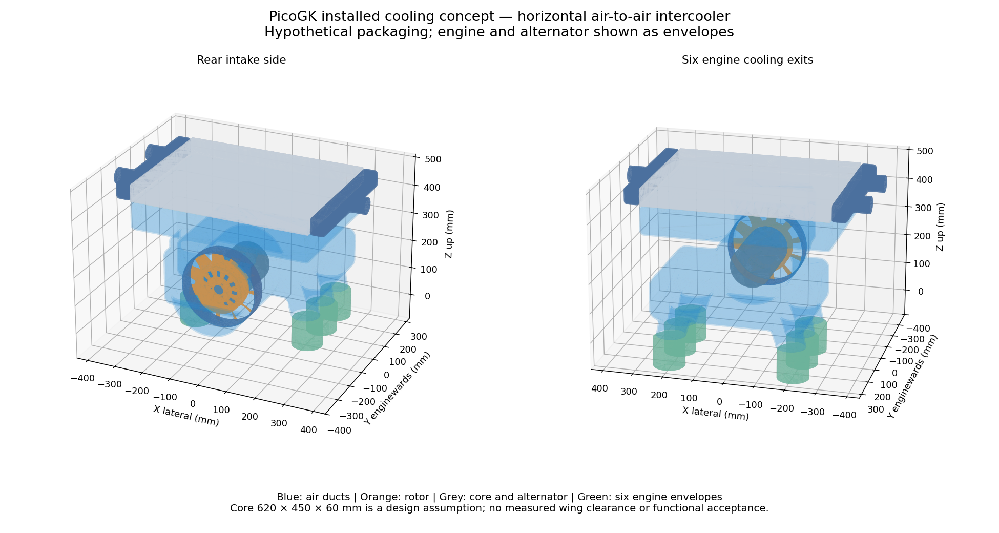
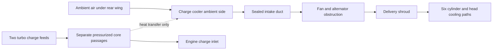

# 993 Turbo installed cooling assembly — PicoGK F1

This is a new **parametric packaging and airflow study**, not a measured Porsche
assembly or a manufacturing release. It adds the installed-system context that
was absent from the earlier isolated-fan CFD. The user confirmed an air-to-air
charge cooler mounted horizontally under the rear wing, above the fan.



Open the [interactive assembly](derived/assembly.glb) in a GLB viewer. Review meshes
use metres; the [full native STL exports](derived/native/) use millimetres and are
gzip-compressed. Editable [PicoGK C#](source/Program.cs) and [parameters](study.json)
remain the geometry source. This is a local engine study coordinate frame, not
an OEM vehicle datum or an established engine-bay fit.

## 750 metric hp continuation

The user subsequently confirmed a 750 metric hp target. The [thermal sizing and metal-print study](../993-intercooler/750-hp/README.md) supersedes the provisional cooler envelope as a sizing basis. It retains all earlier geometry and CFD evidence unchanged; the resulting core and warmed engine-inlet air are not accepted for installation.

## What was built

- Horizontal 620 × 450 × 60 mm charge-cooler core **envelope**, two hollow headers,
  two feed ports and one outlet port. These are layout hypotheses; fins, tube
  stack, brazing, pressure containment and thermal capacity remain undesigned.
- Hollow intake shroud from the cooler underside to the fan entrance.
- Fan housing, an **alternator envelope**, delivery shroud and six open cooling
  exits. The six cylinders shown below are engine **envelopes**, not measured
  heads, fins or CFD heat-transfer walls. Alternator internals, mounting feet,
  pulley, shaft and drive are not designed by the envelope.
- Three PicoGK rotor candidates using the existing cup/airfoil generator:
  unchanged section angles and tip-stagger shifts of −4° and +4°, interpolated
  from zero at the hub. This retains the F1 aero-section family, but does not
  reproduce the separate topology-optimized bionic web. The original admitted
  impeller and its metallic print evidence remain untouched.
- A separate closed delivery-fluid volume for meshing. It subtracts the assumed
  alternator obstruction and has one inlet plus six outlet ports.

All seventeen exported bodies pass the independent single-body, positive-volume,
watertight and winding checks after removal of duplicate/degenerate triangles.
That cleanup does not fill holes; the volume change is constrained below 1e-7.
The [geometry receipt](derived/geometry-review.json) records source/output hashes.
The decimated GLB is for review, not the analysis or manufacture master.

The core bottom is at local Z = 430 mm; the assembled headers and charge ports widen the package beyond the 620 mm core face. Only the core size is quoted above, not the complete installation envelope. An earlier 380 mm position overlapped the
fan delivery envelope; it was rejected before final publication. Raising the
core and separating the upper elbow removes that intended-flow overlap. The
assembly still needs a full collision/clearance audit against the actual engine,
wing, engine lid, charge hoses, pulleys and fasteners. The 8 mm gap between the
cooling exits and the illustrative engine envelopes awaits measured seals.

## Independent interfaces and requirements

[The interface contract](interface-contract.json) lists the required attachment
geometry and load paths independently of the CAD. Measurements remain null;
the CAD is not permitted to approve its own fit. The required inputs are in
[measurements.csv](measurements.csv): wing/lid clearance, installed fan datum,
selected alternator, cylinder/head fin passages, charge-air duty, core loss/UA
maps and the allowed fan shaft power. No bolt patterns are invented to close
these gaps.



A larger cooler must be assessed against ambient-side pressure loss and air
warming upstream of the engine, as well as charge temperature and charge-side
pressure loss. The envelope alone does not establish that it is large enough.
No pressure-loss or heat-transfer data from an unrelated cooler is treated as
calibration for this assembly.

## First numerical experiment: 18 network cases

[The retained screen](results/flow-screen.json) combines the existing F1
blade-element/cascade model with six parallel quadratic branch resistances and
an assumed common duct/core resistance. It is **not a 3D CFD result**, and it does
not extract losses from the PicoGK shapes. Loss coefficients, engine thermal
load, fan duty and temperatures are not measured.

The cases cross three tip-stagger choices, three core face envelopes
(500 × 360, 620 × 450, 700 × 500 mm), and unequal versus hypothetically equalised
branch resistances. Core thickness stays 60 mm. Only the 620 × 450 layout is
exported as a complete assembly; the other areas are sizing sensitivities.

At the assumed 10,000 rpm, the 620 × 450 baseline estimates 2.383 m³/s and 10.33 kW.
The −4° case estimates 2.487 m³/s but requires 11.90 kW. Its equal-power affinity
estimate falls to 2.372 m³/s, below the baseline. Increasing flow at the expense
of shaft power is therefore not accepted as an efficiency improvement.
A common assumed air density of 1.18 kg/m³ is used in this screen. These absolute numbers are uncalibrated model outputs, not engine specifications.

With the baseline sections and core, replacing the assumed unequal resistances
with equal ones raises the weakest branch from about 0.359 to 0.396 m³/s while
total flow slightly decreases. This is a resistance-network lesson, not proof
that the present shroud achieves that redistribution. The imposed 20 kW core
heat-rejection scenario would warm the baseline engine inlet by about 7.08 K;
it is an energy-balance sensitivity, not a predicted cooler rating.

## CFD and physical-test acceptance

The local OpenCFD 2406 pilot uses the actual PicoGK delivery volume, a stationary
alternator obstruction, fixed 2.285 m³/s inlet and six free-discharge outlets.
It isolates **shroud distribution**. It contains no moving fan, intercooler,
engine fin resistance or heat transfer. Its prescribed inlet is an independent test boundary, not a fan operating-point prediction. Even a converged pilot cannot establish
installed engine cooling performance. Results and failed gates are retained in
[the CFD receipt](results/cfd/receipt.json).

The [experiment plan](experiment-plan.json) keeps the previous strict criteria:
standard and extended mesh checks, mass balance, flow-history stability, residuals,
mesh refinement and experimental correlation. Failed meshes never start a solver.
No tolerance is relaxed to produce a successful-looking result.

Six meshing attempts completed. The retained 5 mm reference case fails one extended check
with three concave cells; no flow solver was started. The failure is retained,
not reclassified as convergence. Fixing those cells, then demonstrating mesh
independence, is the next numerical gate. The full rotating, thermal assembly
remains beyond this stationary-duct pilot.

### Upstream audit of the rejected mesh (2026-11-10, #452)

The six attempts changed mesh settings; none audited the surface being meshed.
[`source/audit_mesh_admission.py`](source/audit_mesh_admission.py) does that,
read-only. It rebuilds the fluid domain's constructive surfaces from
`Program.cs` and checks them against the surface first: they reproduce the
native surface to a median of 0.002 mm (99th percentile 0.04 mm). Results are in
[`results/cfd/audit-20261110/`](results/cfd/audit-20261110/runtime.json).

- **Reproduction.** Attempt 5 was re-meshed from its retained inputs with the
  amd64 build of the same OpenCFD 2406 image (the attempts ran the arm64 build).
  Every parsed `checkMesh` metric is identical: 254,917 cells, 30 concave-angle
  faces, 3 concave cells, 1 failed check.
- **Where the cells are.** All three concave cells lie within one cell diagonal
  of an edge that `Program.cs` makes sharp. One is at the alternator envelope's
  rear rim, where it meets the plenum top and the fan cylinder's end. One is on
  the hard union seam between the fan cylinder and the plenum box, and one is on
  a branch outlet rim. The 30 concave-angle faces sit on the same
  kinds of edge: 12 at outlet rims, 5 on the union seam, and 13 where the branch
  cones blend into the plenum.
- **What the geometry carries.** The union seam (`MathF.Min` of cylinder and
  box) and the alternator subtraction leave unblended re-entrant edges. On the
  analysis surface they total 882 mm along the seam, 426 mm along the
  alternator rear rim and 21 mm on other alternator edges. The exact solution is singular at
  such an edge, and no mesh setting removes that (AGENTS.md).
- **What the preparation added.** `prepare_duct_cfd.py` decimates the
  918,136-triangle voxel surface by 90 %. On the result, 1,007 creases over 30°
  (6.9 m) lie on smooth constructive faces, mostly the six branch cones (592)
  and the plenum box (318). The undecimated native surface has none. The
  decimation also left 3,761 triangles with an angle under 5° and edges up to
  413 mm. The native surface has neither: its edges run from 0.25 to 2.6 mm.

**Verdict:** the attempt-5 input is not admissible for a mesh-settings sweep,
so attempts 1–6 tuned settings on a defective input. No mesh is admitted and no
solver has run.

The smallest correction that the audit supports has three parts. None of them
has been executed:

1. Stop decimating, or replace decimation with a surface that this auditor finds
   free of creases off constructive edges. This is a new preparer revision; the
   old preparer hash stays in the attempt receipts.
2. Blend the two hard re-entrant joins with the generator's own polynomial
   blend, which the branch cones already use. Both joins are unmeasured layout
   hypotheses. The r = 70 mm alternator envelope is not the 240 A alternator
   chosen in #454, for which no dimensioned drawing exists. Blending therefore
   contradicts no measurement, but it is a new geometry revision regenerated
   with PicoGK. The blend radius must be fixed before meshing.
3. Keep the inlet and outlet rims sharp, because they are patch boundaries. Give
   snappyHexMesh their region-boundary edges as explicit features. Attempt 6's
   implicit feature snapping raised the concave-cell count to 26.

A new mesh trial counts only once the auditor reports
`input_admissible_for_settings_sweep: true` on the revised surface. Mesh
independence then follows the [experiment plan](experiment-plan.json).

### Geometry revision R2 and its admission audit (2026-11-12, #452)

The three corrections above were carried out as additions. `source/Program.cs`,
`prepare_duct_cfd.py`, `audit_mesh_admission.py` and every earlier receipt are
unchanged. Results are in
[`results/cfd/r2-admission-20261112/`](results/cfd/r2-admission-20261112/runtime.json).

- **Generator.** [`source-r2/Program.cs`](source-r2/Program.cs) regenerates the
  delivery fluid domain only. It reads two optional blend keys from the study
  card and applies RotKit's polynomial blend, the one the branch cones use.
  Without the keys it reproduces the R1 surface byte for byte (`5914107a…`, the
  surface that attempts 1–6 meshed). [`study-r2a.json`](study-r2a.json) blends
  the union seam and the alternator's rear rim. [`study-r2b.json`](study-r2b.json)
  also blends the alternator's subtraction from the duct, because the
  alternator's rear plane is the fan cylinder's end plane. Every other value is
  that of `study.json`.
- **The blend radius is a hypothesis.** Both blends use 12 mm, the value the
  cones already use, chosen for numerical admissibility. The joins are unmeasured
  layout hypotheses, and the r = 70 mm envelope is not the 240 A alternator
  chosen in #454. The owner may veto the radius.
- **Preparer.** [`source/prepare_duct_cfd_r2.py`](source/prepare_duct_cfd_r2.py)
  meshes the cleaned PicoGK surface without decimation. It labels each port up
  to the voxel chamfer at its rim. On the R2 surfaces, the R1 rule would leave
  1,465 mm² of the six outlet openings labelled as wall. The eight port rims are
  written as explicit feature edges, rebuilt from the constructive model and
  checked to lie within 1.8 mm of the surface's region boundaries. Implicit
  feature snapping stays off.
- **Auditor.** [`source/audit_mesh_admission_r2.py`](source/audit_mesh_admission_r2.py)
  loads the R1 auditor by its pinned hash and swaps in the R2 constructive model
  only. Faces, junction names, thresholds and the admission rule are unchanged.
  A sharp edge on a blend therefore counts either as an edge at a hard junction
  or as a crease, and both reject. Applied to the retained R1 report, the rule
  returns the R1 verdict (tested).

| Surface | Re-entrant sharp edge at hard junctions | Creases off constructive edges | Triangles under 5° | Admissible |
|---|---:|---:|---:|---|
| R1, undecimated native surface | 1,089.5 mm | 0 | 0 | no |
| R1, attempt 5 (90 % decimated) | 1,328.9 mm | 1,007 | 3,761 | no |
| R2a: 12 mm on the seam and the rim | 14.2 mm | 0 | 99 | no |
| R2b: R2a plus 12 mm on the subtraction | 8.0 mm | 0 | 0 | no |

The remaining edges are located; their cause is read from sections, not proven.
R2a keeps 18 short edges on the alternator's rear plane (y ≈ −5 mm, z 232–244 mm).
The sections show thin cusps there: blending the alternator's rim alone pulls it
off a plane the duct wall shares. R2b keeps four edges near x = 53, y ≈ −5,
z ≈ 224 mm. There the alternator's rim, that shared plane and the plenum top
meet, and two pairwise blends do not round a corner of three surfaces.

Sections and software-rendered views of R1, R2a and R2b were inspected and not
retained. All three are closed, consistently wound single bodies. The blends
sit only at the seam and the alternator's rear end.

**Verdict:** neither R2 surface is admissible under the unchanged rule. No
mesh trial, mesh-independence study or flow solver was run, and the criterion
was not relaxed.

Clearing the last 8 mm needs an owner decision. None of these has been run:

- move the alternator's rear plane off the fan cylinder's end plane, which
  changes an unmeasured dimension (`alternator_rear_y_mm`);
- revise the generator to blend the three-surface corner at once rather than
  in pairs;
- or allow a residual length of hard re-entrant edge. That changes the
  2026-11-10 rule, so it must be fixed before any trial, not after one.

### Geometry revision R2c: the corner blended in one step (2026-11-18, #452)

The owner chose the second option on 2026-11-18. The 12 mm radius stays an
unmeasured layout hypothesis, the alternator's rear plane stays where it is, and
the rule stays as it is. Results are in
[`results/cfd/r2c-admission-20261118/`](results/cfd/r2c-admission-20261118/runtime.json).

- **Generator.** [`source-r2c/Program.cs`](source-r2c/Program.cs) is the R2
  generator plus one key, `three_surface_corner_blend_mm`. The R2 file is
  pinned by the R2a and R2b receipts, so it was not edited. RotKit's blend
  `SMin(a, b, k)` is exactly the mean of `min(a + t, b)` for `t` uniform in
  `[-k, k]`. R2c takes that mean once over the hard Boolean of the three
  surfaces, with `t` the position of the shared plane, and integrates it
  exactly. On each two-surface edge of that plane the mean equals the R2b
  blend. The R2 union is kept beside it, so the fan cylinder's rear edge and its
  corners with the plenum stay as in R2b. Given `study.json`, `study-r2a.json`
  and `study-r2b.json`, this generator writes the R1, R2a and R2b surfaces byte
  for byte.
- **Card.** [`study-r2c.json`](study-r2c.json) is `study-r2b.json` plus
  `three_surface_corner_blend_mm: 12`. R2c requires one radius for the three
  blends and the shared plane at y = −5 mm.
- **Audit.** The surface was prepared by the unchanged R2 preparer. The R2c
  model gives the same walls at its eight port rims (largest difference
  below 1e-13 mm). [`source/audit_mesh_admission_r2c.py`](source/audit_mesh_admission_r2c.py)
  loads the R2 auditor by its pinned hash and swaps in the R2c constructive
  model only.

| Surface | Re-entrant sharp edge at hard junctions | Normal angles of counted edges | Creases off constructive edges | Triangles under 5° | Admissible |
|---|---:|---:|---:|---:|---|
| R2b | 8.0 mm (4 edges) | 30.8–48.2° | 0 | 0 | no |
| R2c: R2b with the corner blended in one step | 5.1 mm (3 edges) | 31.8–34.9° | 0 | 0 | no |

R2c differs from R2b only around the alternator's rear end, within x ±66,
y −16 to 7 and z 213 to 260 mm. The union seam no longer counts. The three remaining
edges are all at the alternator, near x = ±53, y ≈ −5, z ≈ 224 mm, the same
two corners as before.

The cause is read from the analytic field, not proven. The smallest radius of
the constructive surface there rises from 2.7 mm (R2b) to 4.3 mm (R2c); the
plain 12 mm seam blend has 8.5 mm. It sits on the line where the alternator's
side meets the plane of the plenum top. That line lies on the hard boundary for
every position of the shared plane, so averaging over the plane cannot move
it, and the surface twists about it instead. A marching-cubes check of the
analytic field at 1.5 mm had predicted at most 26° there; the PicoGK voxel
surface shows 31.8–34.9°.

Sections and views of R2b and R2c were drawn without a GPU, inspected and not
retained. Both are closed, consistently wound single bodies.

**Verdict:** R2c is not admissible under the unchanged rule. No mesh trial,
mesh-independence study or flow solver was run, and the criterion was not
relaxed.

What could clear the last 5.1 mm is again an owner decision; none has been run:

- extend the one-step mean to the alternator's side as well, so that the line
  itself moves. That is a further generator revision with the same 12 mm radius;
- raise the corner's blend radius above 12 mm, which reverses today's decision;
- or regenerate at a finer voxel. That lowers the angles on the same geometry,
  so the 30° threshold would then accept a tighter radius. It changes what the
  rule measures and needs deciding like a rule change.

Next, after the baseline is admissible: vary duct turns and branch sections;
then clearance, section twist, sweep and a matched stator as separate factors.
Use equal shaft power, minimum branch mass flow, distribution, core pressure
loss and engine/charge temperatures as objectives. Do not rank by total flow or
visual appearance alone. A guarded bench, calibrated flow and pressure devices,
shaft torque/speed and repeated baseline/variant runs remain necessary.

## Research basis

The [source register](research/references.json) distinguishes abstracts from full
text and records the inference being used:

- [Li and Stefko, NASA, 1984](https://ntrs.nasa.gov/citations/19840017539): spanwise
  twist optimisation with an experimentally checked propeller analysis. Here it
  motivates controlled twist comparisons, without transferring aircraft gains.
- [Mort, NASA ducted-fan tests](https://ntrs.nasa.gov/citations/19660015325): study
  tip clearance and duct/fan coupling together.
- [Jin et al., 2010](https://doi.org/10.1243/09544062JMES1813): compare forward and
  backward skew off design; retain noise and stable operating range as outputs.
- [Pretorius and Van der Spuy, 2023](https://arxiv.org/abs/2309.13195): successful
  baseline correlation did not ensure correct predictions for modified tips.
  Variant-specific testing and mechanical deformation matter.
- [Cuevas et al., 2011](https://orbi.uliege.be/handle/2268/95813): characterise both
  thermal and hydraulic performance of an intercooler across operating points.

## Reproduction

Use the same PicoGK 2.3 runtime and native library as the existing local
catalogue tooling. The generator reuses the repository SDF and rotor helpers;
no new library is introduced. Serialise native runs using
`parts/picogk-catalog/tools/run_part.py`'s existing machine-wide lock.

```sh
dotnet build twins/993-installed-cooling-f1/source/Cooling.csproj -c Release \
  -p:PicoGKAssembly=/path/to/PicoGK.dll -o work/cooling/bin
# Place that runtime's native libraries and dependencies beside Cooling.dll.
dotnet work/cooling/bin/Cooling.dll twins/993-installed-cooling-f1/study.json \
  "$PWD" work/cooling/native
python3 twins/993-installed-cooling-f1/source/build_review.py \
  --native work/cooling/native --output work/cooling/review
python3 twins/993-installed-cooling-f1/source/screen_flow.py --output work/cooling/flow
python3 twins/993-installed-cooling-f1/source/prepare_duct_cfd.py \
  --native work/cooling/native/delivery-fluid-domain.stl \
  --output work/cooling/cfd --flow 2.285161488875746
python3 -m unittest discover -s tests -p test_993_installed_cooling_f1.py -v
```

R2 regenerates the fluid domain only. Run each step under a memory cap
([host setup, section 3](../../docs/LOCAL_HOST_SETUP.md)); `generate.py` takes
the PicoGK lock and renders in software.

```sh
python3 twins/993-installed-cooling-f1/source-r2/generate.py \
  --picogk /path/to/PicoGK.dll --native /path/to/native-libraries \
  --study twins/993-installed-cooling-f1/study-r2b.json \
  --bin work/cooling-r2/bin --output work/cooling-r2/native
python3 twins/993-installed-cooling-f1/source/prepare_duct_cfd_r2.py \
  --native work/cooling-r2/native/delivery-fluid-domain.stl \
  --study twins/993-installed-cooling-f1/study-r2b.json \
  --output work/cooling-r2/case-5mm --flow 2.285161488875746
python3 twins/993-installed-cooling-f1/source/audit_mesh_admission_r2.py \
  --case work/cooling-r2/case-5mm \
  --native work/cooling-r2/native/delivery-fluid-domain.stl \
  --study twins/993-installed-cooling-f1/study-r2b.json --output work/cooling-r2/audit.json
```

R2c uses its own generator and auditor with the same preparer:

```sh
python3 twins/993-installed-cooling-f1/source-r2c/generate.py \
  --picogk /path/to/PicoGK.dll --native /path/to/native-libraries \
  --study twins/993-installed-cooling-f1/study-r2c.json \
  --bin work/cooling-r2c/bin --output work/cooling-r2c/native
python3 twins/993-installed-cooling-f1/source/prepare_duct_cfd_r2.py \
  --native work/cooling-r2c/native/delivery-fluid-domain.stl \
  --study twins/993-installed-cooling-f1/study-r2c.json \
  --output work/cooling-r2c/case-5mm --flow 2.285161488875746
python3 twins/993-installed-cooling-f1/source/audit_mesh_admission_r2c.py \
  --case work/cooling-r2c/case-5mm \
  --native work/cooling-r2c/native/delivery-fluid-domain.stl \
  --study twins/993-installed-cooling-f1/study-r2c.json --output work/cooling-r2c/audit.json
```

Python geometry/review uses the already installed NumPy, trimesh, PyVista and
matplotlib. The resistance screen and its analytical checks use the standard
library. Output directories must be new; rejected attempts are preserved under
`work/installed-cooling/`, with public diagnostics retained in the CFD receipt.
