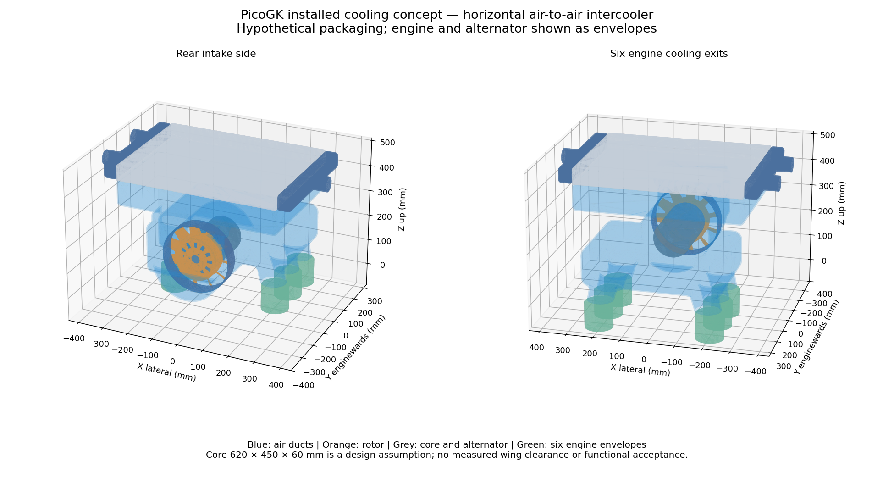
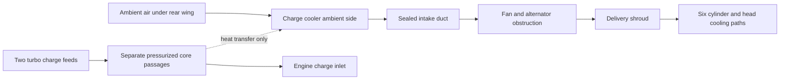

# 993 Turbo installed cooling assembly — PicoGK F1

This is a new **parametric packaging and airflow study**, not a measured Porsche
assembly or a manufacturing release. It adds the installed-system context that
was absent from the earlier isolated-fan CFD. The user confirmed an air-to-air
charge cooler mounted horizontally under the rear wing, above the fan.



Open the [interactive assembly](derived/assembly.glb) in a GLB viewer. Review meshes
use metres; the [full native STL exports](derived/native/) use millimetres and are
gzip-compressed. Editable [PicoGK C#](source/Program.cs) and [parameters](study.json)
remain the geometry source. This is a local engine study coordinate frame, not
an OEM vehicle datum or an established engine-bay fit.

## 750 metric hp continuation

The user subsequently confirmed a 750 metric hp target. The [thermal sizing and metal-print study](intercooler-750/README.md) supersedes the provisional cooler envelope as a sizing basis. It retains all earlier geometry and CFD evidence unchanged; the resulting core and warmed engine-inlet air are not accepted for installation.

## What was built

- Horizontal 620 × 450 × 60 mm charge-cooler core **envelope**, two hollow headers,
  two feed ports and one outlet port. These are layout hypotheses; fins, tube
  stack, brazing, pressure containment and thermal capacity remain undesigned.
- Hollow intake shroud from the cooler underside to the fan entrance.
- Fan housing, an **alternator envelope**, delivery shroud and six open cooling
  exits. The six cylinders shown below are engine **envelopes**, not measured
  heads, fins or CFD heat-transfer walls. Alternator internals, mounting feet,
  pulley, shaft and drive are not designed by the envelope.
- Three PicoGK rotor candidates using the existing cup/airfoil generator:
  unchanged section angles and tip-stagger shifts of −4° and +4°, interpolated
  from zero at the hub. This retains the F1 aero-section family, but does not
  reproduce the separate topology-optimized bionic web. The original admitted
  impeller and its metallic print evidence remain untouched.
- A separate closed delivery-fluid volume for meshing. It subtracts the assumed
  alternator obstruction and has one inlet plus six outlet ports.

All seventeen exported bodies pass the independent single-body, positive-volume,
watertight and winding checks after removal of duplicate/degenerate triangles.
That cleanup does not fill holes; the volume change is constrained below 1e-7.
The [geometry receipt](derived/geometry-review.json) records source/output hashes.
The decimated GLB is for review, not the analysis or manufacture master.

The core bottom is at local Z = 430 mm; the assembled headers and charge ports widen the package beyond the 620 mm core face. Only the core size is quoted above, not the complete installation envelope. An earlier 380 mm position overlapped the
fan delivery envelope; it was rejected before final publication. Raising the
core and separating the upper elbow removes that intended-flow overlap. The
assembly still needs a full collision/clearance audit against the actual engine,
wing, engine lid, charge hoses, pulleys and fasteners. The 8 mm gap between the
cooling exits and the illustrative engine envelopes awaits measured seals.

## Independent interfaces and requirements

[The interface contract](interface-contract.json) lists the required attachment
geometry and load paths independently of the CAD. Measurements remain null;
the CAD is not permitted to approve its own fit. The required inputs are in
[measurements.csv](measurements.csv): wing/lid clearance, installed fan datum,
selected alternator, cylinder/head fin passages, charge-air duty, core loss/UA
maps and the allowed fan shaft power. No bolt patterns are invented to close
these gaps.



A larger cooler must be assessed against ambient-side pressure loss and air
warming upstream of the engine, as well as charge temperature and charge-side
pressure loss. The envelope alone does not establish that it is large enough.
No pressure-loss or heat-transfer data from an unrelated cooler is treated as
calibration for this assembly.

## First numerical experiment: 18 network cases

[The retained screen](results/flow-screen.json) combines the existing F1
blade-element/cascade model with six parallel quadratic branch resistances and
an assumed common duct/core resistance. It is **not a 3D CFD result**, and it does
not extract losses from the PicoGK shapes. Loss coefficients, engine thermal
load, fan duty and temperatures are not measured.

The cases cross three tip-stagger choices, three core face envelopes
(500 × 360, 620 × 450, 700 × 500 mm), and unequal versus hypothetically equalized
branch resistances. Core thickness stays 60 mm. Only the 620 × 450 layout is
exported as a complete assembly; the other areas are sizing sensitivities.

At the assumed 10,000 rpm, the 620 × 450 baseline estimates 2.383 m³/s and 10.33 kW.
The −4° case estimates 2.487 m³/s but requires 11.90 kW. Its equal-power affinity
estimate falls to 2.372 m³/s, below the baseline. Increasing flow at the expense
of shaft power is therefore not accepted as an efficiency improvement.
A common assumed air density of 1.18 kg/m³ is used in this screen. These absolute numbers are uncalibrated model outputs, not engine specifications.

With the baseline sections and core, replacing the assumed unequal resistances
with equal ones raises the weakest branch from about 0.359 to 0.396 m³/s while
total flow slightly decreases. This is a resistance-network lesson, not proof
that the present shroud achieves that redistribution. The imposed 20 kW core
heat-rejection scenario would warm the baseline engine inlet by about 7.08 K;
it is an energy-balance sensitivity, not a predicted cooler rating.

## CFD and physical-test acceptance

The local OpenCFD 2406 pilot uses the actual PicoGK delivery volume, a stationary
alternator obstruction, fixed 2.285 m³/s inlet and six free-discharge outlets.
It isolates **shroud distribution**. It contains no moving fan, intercooler,
engine fin resistance or heat transfer. Its prescribed inlet is an independent test boundary, not a fan operating-point prediction. Even a converged pilot cannot establish
installed engine cooling performance. Results and failed gates are retained in
[the CFD receipt](results/cfd/receipt.json).

The [experiment plan](experiment-plan.json) keeps the previous strict criteria:
standard and extended mesh checks, mass balance, flow-history stability, residuals,
mesh refinement and experimental correlation. Failed meshes never start a solver.
No tolerance is relaxed to produce a successful-looking result.

Six meshing attempts completed. The retained 5 mm reference case fails one extended check
with three concave cells; no flow solver was started. The failure is retained,
not reclassified as convergence. Fixing those cells, then demonstrating mesh
independence, is the next numerical gate. The full rotating, thermal assembly
remains beyond this stationary-duct pilot.

Next, after the baseline is admissible: vary duct turns and branch sections;
then clearance, section twist, sweep and a matched stator as separate factors.
Use equal shaft power, minimum branch mass flow, distribution, core pressure
loss and engine/charge temperatures as objectives. Do not rank by total flow or
visual appearance alone. A guarded bench, calibrated flow and pressure devices,
shaft torque/speed and repeated baseline/variant runs remain necessary.

## Research basis

The [source register](research/references.json) distinguishes abstracts from full
text and records the inference being used:

- [Li and Stefko, NASA, 1984](https://ntrs.nasa.gov/citations/19840017539): spanwise
  twist optimization with an experimentally checked propeller analysis. Here it
  motivates controlled twist comparisons, without transferring aircraft gains.
- [Mort, NASA ducted-fan tests](https://ntrs.nasa.gov/citations/19660015325): study
  tip clearance and duct/fan coupling together.
- [Jin et al., 2010](https://doi.org/10.1243/09544062JMES1813): compare forward and
  backward skew off design; retain noise and stable operating range as outputs.
- [Pretorius and Van der Spuy, 2023](https://arxiv.org/abs/2309.13195): successful
  baseline correlation did not ensure correct predictions for modified tips.
  Variant-specific testing and mechanical deformation matter.
- [Cuevas et al., 2011](https://orbi.uliege.be/handle/2268/95813): characterize both
  thermal and hydraulic performance of an intercooler across operating points.

## Reproduction

Use the same PicoGK 2.3 runtime and native library as the existing local
catalogue tooling. The generator reuses the repository SDF and rotor helpers;
no new library is introduced. Serialize native runs using
`parts/picogk-catalog/tools/run_part.py`'s existing machine-wide lock.

```sh
dotnet build twins/993-installed-cooling-f1/source/Cooling.csproj -c Release \
  -p:PicoGKAssembly=/path/to/PicoGK.dll -o work/cooling/bin
# Place that runtime's native libraries and dependencies beside Cooling.dll.
dotnet work/cooling/bin/Cooling.dll twins/993-installed-cooling-f1/study.json \
  "$PWD" work/cooling/native
python3 twins/993-installed-cooling-f1/source/build_review.py \
  --native work/cooling/native --output work/cooling/review
python3 twins/993-installed-cooling-f1/source/screen_flow.py --output work/cooling/flow
python3 twins/993-installed-cooling-f1/source/prepare_duct_cfd.py \
  --native work/cooling/native/delivery-fluid-domain.stl \
  --output work/cooling/cfd --flow 2.285161488875746
python3 -m unittest discover -s tests -p test_993_installed_cooling_f1.py -v
```

Python geometry/review uses the already installed NumPy, trimesh, PyVista and
matplotlib. The resistance screen and its analytical checks use the standard
library. Output directories must be new; rejected attempts are preserved under
`work/installed-cooling/`, with public diagnostics retained in the CFD receipt.
