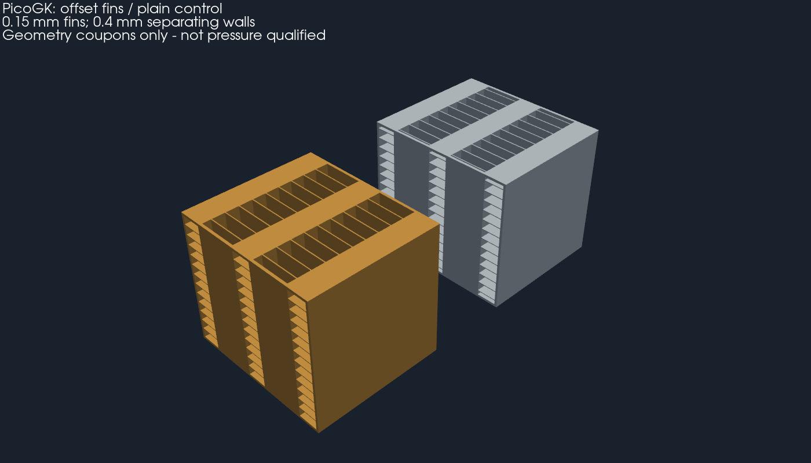

# Échangeur air-air pour 750 ch : dimensionnement et fabrication

Le besoin confirmé est **750 ch**, avec un échangeur horizontal sous l'aileron.
Cette étude calcule la charge thermique, compare deux familles d'ailettes et
propose des éprouvettes PicoGK. Elle ne valide pas un échangeur complet pour la
voiture. Le précédent volume de 620 × 450 × 60 mm reste un ancien concept ; il
n'est pas une taille approuvée pour 750 ch.

## Besoin thermique

750 ch métriques représentent 551,6 kW. On suppose une puissance au vilebrequin
et un moteur essence : ce point, le carburant, la pression réelle et la carte des
turbos doivent être confirmés. La première approximation Garrett donne environ
0,533–0,589 kg/s d'air moteur. On retient 0,53/0,56/0,62 kg/s ; la dernière valeur
est une marge exploratoire, pas une mesure.

Les hypothèses sont dans [requirements.json](requirements.json). Air extérieur
35 °C, air entrant au compresseur 40 °C, cible après échangeur 60 °C. Les rapports
de compression sont **absolus**, pas des pressions de suralimentation mesurées
au collecteur. La perte de charge entre compresseur et admission doit être
incluse lors de la sélection définitive des turbos.

| Scénario | Débit moteur | Rapport compresseur / rendement | Entrée échangeur | Chaleur à retirer pour 60 °C | UA requis à 2,5 kg/s côté froid |
|---|---:|---:|---:|---:|---:|
| Bas | 0,53 kg/s | 2,2 / 75 % | 145,5 °C | 45,8 kW | 933 W/K |
| Central | 0,56 kg/s | 2,6 / 70 % | 180,4 °C | 68,1 kW | 1 212 W/K |
| Haut | 0,62 kg/s | 3,0 / 65 % | 217,6 °C | 98,7 kW | 1 594 W/K |

Calcul : température de compression avec rendement isentropique, puis
`Q = débit massique × cp × (T entrée − T cible)`. Le débit de refroidissement
**2,5 kg/s est une condition imposée**, non une capacité démontrée du ventilateur.
Aucune puissance de ventilateur ni vitesse de véhicule ne garantit ce débit ici.

## Optimisation exécutée

[8 748 candidats](results/sweep.csv) : 3 888 à ailettes droites et 4 860 à
ailettes interrompues décalées. Le balayage varie face, profondeur, hauteur des
passages, pas, épaisseur des ailettes et longueur des segments. Les parois
séparatrices restent à 0,8 mm. L'objectif est la masse minimale parmi les
candidats qui passent les trois scénarios avec transfert diminué de 25 % et
frottement distribué doublé. Ces facteurs sont des essais de sensibilité, **pas
une incertitude statistique ni une calibration de rugosité**.

Contraintes provisoires : perte côté charge ≤ 10 kPa, côté air extérieur ≤ 500 Pa,
sortie charge ≤ 60 °C, domaine de corrélation filtré, Mach < 0,3. Les cas hors
domaine ne peuvent pas gagner. Douze candidats passent ces contraintes
algébriques. Aucun n'est qualifié physiquement.

Le candidat de masse minimale dans ce balayage est :

- **800 × 545,2 × 150 mm**, cœur seul, hors collecteurs, raccords et supports.
- **42,7 kg** de métal selon les volumes analytiques ; masse encore approximative
  pour les bords des rangées décalées, sans surépaisseur de fabrication.
- AlSi10Mg, ailettes 0,3 mm, parois 0,8 mm, pas 3 mm, espaces libres 2,7 mm.
- Passages chauds de 3 mm, froids de 6 mm ; segments de 20 mm, décalés d'un demi-pas.

| Scénario | Sortie charge avec facteurs dégradés | Perte côté charge | Perte côté froid | Air transmis au moteur |
|---|---:|---:|---:|---:|
| Bas | 46,0 °C | 6,10 kPa | 480 Pa | 56,2 °C |
| Central | 50,7 °C | 6,04 kPa | 487 Pa | 64,1 °C |
| Haut | 58,3 °C | 6,67 kPa | 498 Pa | 74,6 °C |

C'est un **candidat de calcul, pas la conception retenue pour la voiture** : la
masse, l'encombrement et la faible marge côté froid sont défavorables. Un modèle
indépendant en cellules à UA constant donne 59,69 °C au scénario haut ; le passage
80² → 160² cellules change ce résultat de 0,002 °C et conserve l'énergie. Cela
vérifie la résolution du bilan thermique idéalisé, pas une CFD de l'écoulement.

Le mélange transversal est une autre limite : la borne « deux fluides totalement
mélangés » donne **67,1 °C** avec le même UA dégradé, donc échoue à la cible.
Les ailettes décalées produisent une dispersion réelle qu'il reste à déterminer.
La formule des fluides non mélangés ne constitue pas une preuve que cette
architecture atteint 60 °C.

À seulement 1,5 kg/s d'air froid, même sans facteurs dégradés, le scénario haut
sort à 61,4 °C et l'air transmis au moteur atteint 99,8 °C. Avec les mêmes ailettes,
l'ancien format 620 × 450 × 60 mm donne environ 93,1 °C côté charge au scénario
haut. Ces comparaisons rejettent une validation par simple volume extérieur.

## Piste avancée : ailettes fines et deux demi-cœurs parallèles

Un second balayage de **6 912 candidats**, conservé dans
[thin-sizing.json](results/thin-sizing.json) et [thin-sweep.csv](results/thin-sweep.csv),
évalue des ailettes de 0,15–0,20 mm, des parois de 0,4–0,6 mm et un ou deux bancs
parallèles côté charge. Les contraintes et facteurs dégradés restent identiques.
Quarante-huit candidats passent le filtre algébrique. Une démonstration publique
sur EOS M290 motive la piste 150 µm ; elle ne qualifie pas notre géométrie.

Le minimum de masse trouvé dans cette seconde famille est **800 × 542,8 × 90 mm**,
**17,3 kg de cœur seul**, soit environ 60 % de métal en moins que le candidat
à ailettes de 0,3 mm. Les deux demi-cœurs sont alimentés en parallèle, chacun
sur un trajet chaud de 400 mm ; le débit est supposé réparti également. Leur
réunion, les collecteurs, raccords, fixations et interfaces ne sont pas inclus
à la masse ou aux dimensions. Une répartition inégale remet le calcul en cause.

| Paramètre | Valeur du candidat avancé |
|---|---:|
| Ailette / paroi séparatrice | 0,15 / 0,4 mm |
| Hauteur passage charge / air froid | 3 / 6 mm |
| Pas charge / air froid | 1,5 / 2 mm |
| Largeur libre charge / air froid | 1,35 / 1,85 mm |
| Longueur interrompue | 10 mm, décalage d'un demi-pas |
| Sortie charge, cas haut dégradé | 56,2 °C par ε-NTU ; 57,60 °C par cellules |
| Perte charge / air froid, cas haut dégradé | 4,25 kPa / 449 Pa |
| Air destiné au moteur, cas haut dégradé | 75,2 °C |

Le modèle en cellules donne un écart inférieur à 0,003 °C entre 80² et 160²
cellules. La borne de mélange transversal complet remonte néanmoins à **65,8 °C**.
Ce candidat est donc **une piste à éprouver**, pas une validation à 750 ch.
L'effet du vieillissement, la répétabilité des ailettes de 150 µm et le dépoudrage
sur 400 mm doivent être établis par le fabricant. Les limites de corrélation
ne deviennent pas une preuve d'imprimabilité.

Chaque demi-cœur incliné occupe environ **347 × 543 × 347 mm**, avant supports et
collecteurs : une machine nominale de 600 mm fournit une piste d'encombrement.
Un découpage supplémentaire pour une machine de 400 mm imposerait de nouveaux
raccordements et une nouvelle vérification thermique et mécanique.

Les nouvelles éprouvettes PicoGK utilisent ces ailettes de 0,15 mm et ces parois
de 0,4 mm, sur **20 × 23,4 × 20 mm**, avec voxel numérique de 0,0375 mm. Ce voxel
est une résolution de CAO, **pas une épaisseur de couche ni une recette LPBF**.
La carte de reproduction est [coupon-input.json](coupon-input.json). Les grands
cœurs complets et leurs collecteurs ne sont pas générés ni qualifiés.

## Éprouvettes natives conservées



Les deux solides natifs ont été contrôlés : un corps fermé chacun, orientation
cohérente des faces, volume positif. Les exports de revue conservent la fermeture
et le volume à moins de 0,5 %. Les réductions trop grossières qui ouvraient les
maillages ont été rejetées ; leurs diagnostics restent dans le
[reçu d'inspection](derived/review.json).

- [Vue 3D GLB, unités mètres](derived/coupons.glb).
- [Ailettes décalées, STL millimètres compressé](derived/offset-fin-coupon.stl.gz).
- [Témoin à ailettes droites, STL millimètres compressé](derived/plain-fin-control.stl.gz).
- [Source PicoGK éditable](source/picogk/Program.cs) et [carte d'entrée](coupon-input.json).

Les STL de revue sont simplifiées ; les STL natifs complets restent conservés
localement et sont identifiés par SHA-256. Le contrôle échantillonne 305 points
sur des trajets ouverts et un point dans la paroi séparatrice, sur les maillages
de revue. Il ne vérifie pas tous les vides et ne constitue pas une preuve de
dépoudrage, d'étanchéité ou de tenue en pression.


## Forme et choix du matériau

La forme étudiée est un cœur à flux croisés : charge pressurisée suivant X,
air extérieur suivant Z, tubes et intervalles empilés suivant Y. Les circuits
restent séparés. Les collecteurs devront répartir le débit entre toutes les
rangées ; leur perte locale `K = 2` est actuellement une hypothèse.

AlSi10Mg est le candidat de référence : faible densité, filière LPBF existante,
conductivité compatible avec cette fonction. La fiche LaserForm donne à 20 °C
120–130 W/(m·K) sans traitement et 160–170 pour son état SR1. Ce sont des valeurs
inférées de résistivité sur des éprouvettes spécifiques, pas des propriétés
certifiées de nos ailettes chaudes. Le scénario haut atteint 218 °C côté charge à l'entrée ; tenue à chaud, vieillissement et contraintes thermiques exigent leurs propres données. Le calcul emploie 120 et balaie 100–300.
Passer de 120 à 300 W/(m·K) ne réduit ici la sortie charge que d'environ 0,17 °C :
la résistance convective domine. Un matériau beaucoup plus conducteur ne résout
pas le problème d'alimentation en air. WE43, titane et inox ne sont pas retenus
par défaut pour ce cœur ; aucune recette de l'impeller n'est transférée.

## Voie de fabrication métal

1. **Qualifier les deux éprouvettes**, avec leurs vrais passages et ailettes,
   sur le couple machine/poudre/recette du fabricant. La paire de référence mesure 40 × 25,8 ×
   40 mm ; la paire avancée mesure 20 × 23,4 × 20 mm. Elles servent d'abord à vérifier finesse et dépoudrage. Deux segments
   ne reproduisent pas les pertes d'un cœur long. Une éprouvette longue et des
   adaptateurs de banc sont nécessaires avant calibration du cœur.
2. Construire par LPBF, avec direction de croissance proposée `(X+Z)/√2` :
   les principales surfaces internes sont verticales ou inclinées à 45°.
   Cette analyse nominale ne prouve pas l'absence de supports internes, ni
   l'imprimabilité des amorces et arêtes décalées. Les supports extérieurs restent
   nécessaires selon le plan du fabricant et doivent être accessibles.
3. Prévoir une évacuation de poudre par les deux extrémités de **chaque circuit**,
   avant fermeture des collecteurs. Les passages décalés ne sont pas droits sur
   toute la longueur ; inspection, protocole de nettoyage et mesure de poudre
   résiduelle sont indispensables. Une STL fermée ne prouve pas ce nettoyage.
4. Le cœur de référence à ailettes de 0,3 mm, incliné, occupe environ
   **672 × 545 × 672 mm**, hors supports :
   il ne tient pas dans une enveloppe nominale de 600 mm. Une piste est deux
   modules en série côté charge, chacun 400 × 545 × 150 mm, inclinés dans environ
   389 × 545 × 389 mm ; autre piste, six modules pour une machine de 400 mm.
   Pour la piste avancée à ailettes de 0,15 mm, les deux demi-cœurs sont
   parallèles côté charge et occupent chacun environ 347 × 543 × 347 mm inclinés.
   Ce sont des études de découpage. Leurs collecteurs, joints et redistribution
   doivent être dimensionnés et vérifiés ; les pertes locales restent supposées.
5. Détensionner et traiter selon la recette qualifiée, usiner les interfaces,
   inspecter la géométrie et la porosité. Qualifier toute soudure/brasure entre
   modules ; ne pas supposer que l'assemblage conserve les propriétés du brut.
6. Établir les pressions de service, transitoire, épreuve et rupture avec le
   concepteur responsable. Vérifier parois, collecteurs, joints, dilatation,
   vibrations et fatigue thermique ; réaliser fuite, épreuve et cyclage sur banc
   protégé. Le simple calcul de flexion d'une bande de paroi dans le JSON ne
   remplace aucune de ces vérifications.

Les interfaces d'installation restent celles du
[contrat indépendant](../interface-contract.json) : enveloppe de l'aileron,
appuis/châssis porteur, embouts des turbos et de l'admission, jeux avec ventilateur,
joints et étanchéité des conduits. Les 17,3 kg du candidat avancé, comme les
42,7 kg de référence, nécessitent un chemin de charge vérifié avec les collecteurs
et les efforts dynamiques ; aucune fixation n'est inventée.

## Conséquence pour le refroidissement moteur

Refroidir la charge à 60 °C rejette 46–99 kW dans l'air extérieur. Pour limiter
son réchauffement à **15 K**, il faudrait environ **3,0–6,5 kg/s** à travers
l'échangeur. Cette limite de 15 K est un exemple de bilan, pas une exigence moteur
mesurée. La taille de l'échangeur ne peut pas supprimer cette chaleur.

La prochaine architecture à comparer doit donc comporter **une alimentation
fraîche du moteur séparée, ou un bypass correctement dimensionné**, avec une
évacuation de l'air chaud de l'échangeur qui évite sa réaspiration. Il faudra
mesurer pressions sous aileron, courbe débit-pression du ventilateur, débit de
chaque branche et températures culasses/charge. Un cœur conventionnel à feuilles
brasées avec collecteurs imprimés constitue aussi un témoin de masse et de
performance ; il n'est pas déclaré supérieur sans comparaison à besoin thermique égal.

## Méthodes, limites et reproduction

Le [registre de sources](references.json) indique ce qui a réellement été lu.
Les [résultats](results/sizing.json) conservent entrées, hashes et sensibilités.
Les outils utilisent des dépendances déjà installées.

```sh
python3 twins/993-installed-cooling-f1/intercooler-750/source/size_core.py --output work/new-sizing
python3 twins/993-installed-cooling-f1/intercooler-750/source/explore_thin_fins.py --output work/new-thin-sizing
python3 -m unittest discover -s tests -p test_993_intercooler_750.py -v
```

La génération C# réutilise le SDF du catalogue et PicoGK, sous le verrou existant
`parts/picogk-catalog/tools/run_part.py`. Compiler `source/picogk/Core.csproj` avec
`-p:PicoGKAssembly=/path/to/PicoGK.dll`, placer les bibliothèques natives de ce
runtime à côté du binaire, puis lancer `Core.dll coupon-input.json new-output` pour les éprouvettes avancées.
Les sorties doivent être nouvelles ; aucun résultat rejeté n'est écrasé.

Les ailettes droites utilisent les lois de conduite rectangulaire développée
et Gnielinski, avec exclusion de la transition. Les ailettes décalées utilisent
Manglik–Bergles, filtrées sur Re 300–5000 et les rapports s/h, t/l, t/s. L'enveloppe
complète des données originales et les effets d'échelle du procédé ne sont pas
confirmés. Les pertes d'entrée sont supposées ; rugosité, encrassement, distribution,
conduction longitudinale, humidité et cartographie réelle du ventilateur restent
non calibrés. Les coefficients sont recalculés aux températures moyennes ; le
modèle n'est ni un calcul CHT résolu ni une simulation de fabrication LPBF.

## Suite avec hypothèses autorisées

La [comparaison des architectures](architecture/README.md) couple des courbes
de ventilateurs supposées aux pertes des circuits, prend en compte leur
échauffement et ajoute des collecteurs PicoGK avec deux enveloppes de cœur.

La [suite à 45 °C](hot-weather/README.md) corrige la température d’entrée du
compresseur, étudie une ventilation en aval avec réglage indépendant et ajoute
une variante PicoGK de collecteurs raidis avec contrôles de pression simplifiés.
