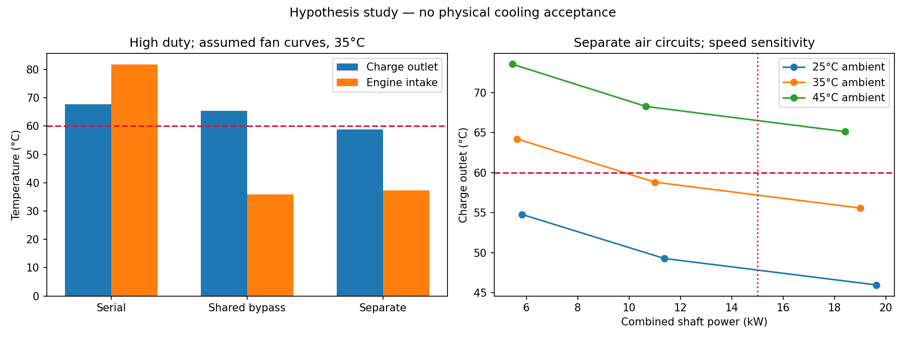

# Architecture avec hypothèses — 750 ch

Cette suite utilise les hypothèses autorisées par l'utilisateur. Elle compare
le point de fonctionnement des ventilateurs et produit des collecteurs PicoGK
pour étudier l'encombrement. Les mesures manquantes restent inconnues dans le
[dossier initial](../README.md) ; elles ne sont pas remplacées par des mesures fictives.

## Hypothèses de travail

La [carte d'hypothèses](assumptions.json) fixe une enveloppe de 1 100 × 700 × 300 mm,
35 °C à l'extérieur, une cible de charge de 60 °C et 1 °C de marge de calcul.
Les trois scénarios compresseur précédents restent inchangés : rapports absolus
2,2 / 2,6 / 3,0, rendements 75 / 70 / 65 %, débits 0,53 / 0,56 / 0,62 kg/s.
La puissance de 750 ch reste supposée au vilebrequin.

Aucune pression dynamique liée à la vitesse du véhicule n'est créditée. Les
ventilateurs sont supposés **en amont**, dans l'air frais. Leurs courbes sont
paraboliques et entièrement hypothétiques :

| Branche | Pression à débit nul | Débit libre | Rendement supposé |
|---|---:|---:|---:|
| Échangeur indépendant | 1 800 Pa | 4,4 m³/s | 60 % |
| Moteur ou ventilateur commun | 2 500 Pa | 4,0 m³/s | 65 % |

Ces extrémités ne sont pas un point de fonctionnement simultané. Le solveur
cherche l'intersection entre courbe de ventilateur et pertes du circuit, avec
correction de densité et lois de similitude. La démarche est décrite par
[l'AMCA](https://www.amca.org/educate/articles-and-technical-papers/amca-inmotion-articles/straightening-out-fan-curves.html).
Aucun ventilateur réel ni profil de pale n'est encore démontré capable de tenir
ces courbes. Le travail à l'arbre est ajouté, par hypothèse conservative, comme
échauffement de l'air en amont de l'échangeur. Le moteur d'entraînement et sa
chaleur propre ne sont pas dimensionnés.

Le circuit moteur est représenté par 1 000 Pa à 2 kg/s ; le débit minimal de
2 kg/s et la limite d'entrée de 50 °C sont des **critères supposés**, pas des
exigences Porsche établies. Le budget total est 15 kW à l'arbre. Les conduits
extérieurs d'échangeur représentent K = 3 sur 0,15 m² ; K = 2 côté charge reste
la perte locale supposée des collecteurs. Leur dessin n'est pas sa calibration.
L'ancienne limite isolée de 500 Pa côté froid est remplacée dans cette suite
par la courbe complète et le budget de puissance ; elle n'a pas été respectée
silencieusement par le nouveau candidat.

## Résultats et choix provisoire

Voir les [résultats numériques](results/comparison.json) et le
[balayage](results/sweep.csv). Le filtre retient uniquement les géométries
entrant dans l'enveloppe avec les réservations de collecteurs. Les modèles de
transfert et de frottement du dossier précédent sont réutilisés sans modification.
Le bilan thermique emploie la borne des deux fluides mélangés, aux UA et pertes
issus de l'itération historique non mélangée. Les effets de ce choix sur les
propriétés restent une approximation ; ce n'est pas une CHT résolue. Le réseau
moteur indépendant conserve une résistance ramenée à la densité extérieure ;
l'effet des quelques degrés d'échauffement du ventilateur sur cette résistance
n'est pas réitéré. La CFD et les mesures devront lever ces approximations.

**240 variantes** passent le filtre d'encombrement ; deux satisfont les trois
charges avec la marge demandée. Le minimum de masse de cœur est **800 × 542,8 ×
180 mm, 30,9 kg**. Il utilise des ailettes de 0,15 mm, des séparations de 0,4 mm,
un pas chaud de 1,5 mm et froid de 3 mm, et des interruptions de 10 mm. Les
collecteurs portent l'enveloppe à **1 070 × 542,8 × 180 mm**, sans les conduites
extérieures, fixations et conduits d'air.

| Architecture, charge haute à 35 °C | Sortie charge | Entrée moteur | Débit moteur | Puissance totale à l'arbre |
|---|---:|---:|---:|---:|
| En série | 67.7 °C | 81.7 °C | 2.11 kg/s | 5.59 kW |
| Bypass commun | 65.5 °C | 36.0 °C | 1.69 kg/s | 3.72 kW |
| Air séparé | 58.8 °C | 37.3 °C | 2.60 kg/s | 11.00 kW |

Dans la branche indépendante, le point haut demande environ **2,94 kg/s** à
**1 186 Pa** au total, dont 681 Pa dans le cœur. Les trois sorties charge sont
47,8 / 52,3 / 58,8 °C. Les 11 kW sont une demande à l'arbre, pas une puissance
électrique ni une preuve que l'alternateur existant suffit.

La piste séparée passe donc le filtre **à 35 °C**, mais échoue à 45 °C au régime
nominal et à 35 °C lorsque le régime chute de 20 %. Augmenter le régime peut
également dépasser les 15 kW autorisés. La marge de 1 °C est un filtre de
conception, pas une incertitude statistique ou une qualification climatique.




## Géométrie PicoGK


[Vue GLB en mètres](derived/layout.glb), [source éditable](source/picogk/Program.cs),
[reçu de contrôle](derived/review.json). Les STL compressées de revue sont en mm.
Les grands blocs gris sont des **enveloppes de cœur**, sans ailettes résolues.
Les éprouvettes fines restent celles de l'étude précédente, avec un pas froid
de 2 mm contre 3 mm ici. Il faudra régénérer et imprimer les éprouvettes de ce
nouveau pas avant de calibrer ce candidat ; aucun essai précédent ne le qualifie.

Deux admissions latérales de diamètre intérieur 80 mm alimentent chacune un
demi-cœur. Un collecteur central commun reçoit les deux flux et possède un
orifice d'environ 113 mm, de section égale à la somme des deux entrées. Cette
égalité de section ne garantit ni répartition uniforme ni faibles pertes.
Les parois de collecteur sont supposées à 3 mm ; ce n'est pas un calcul de tenue.
Les grandes faces planes ne sont pas dimensionnées pour la pression : formes
bombées ou raidisseurs, contraintes et déformations restent à calculer.
Le volume des trois collecteurs donne environ **4.4 kg** de métal, soit
environ **35.4 kg cœur et collecteurs**, hors renforts et interfaces finales.
Les ouvertures de raccord sont au nu des faces : les conduites extérieures et
leur rayon de courbure ne sont pas inclus dans l'enveloppe annoncée.

Les bouches vers les cœurs sont ouvertes sur l'enveloppe globale. Les interfaces
individuelles avec les tubes chauds, leurs séparations d'avec les rangées d'air
extérieur, les joints et le procédé d'assemblage restent à dessiner. **La scène
n'est donc pas un échangeur étanche complet.** La fermeture de chaque maillage
signifie que sa matière possède une surface fermée, pas que ses circuits de
fluide sont bouchés ou qualifiés en pression.

## Fabrication et essais à poursuivre

La piste reste AlSi10Mg LPBF, deux demi-cœurs construits séparément puis assemblés
à des collecteurs accessibles au nettoyage. Les ailettes de 0,15 mm, séparations
à 0,4 mm, supports et traitement thermique exigent toujours une recette qualifiée.
Chaque demi-cœur de 400 × 543 × 180 mm occuperait environ
410 × 543 × 410 mm incliné à 45°, avant supports : piste de machine de 600 mm,
pas une recette confirmée. Le collecteur ne doit pas condamner le dépoudrage
avant nettoyage et inspection.

1. Mesurer les courbes de perte/transfert sur des éprouvettes longues, droites et
   décalées, puis remplacer les corrélations et les facteurs de sensibilité.
2. Vérifier le volume sous aileron, les axes des raccords et le chemin de charge
   avant de créer les fixations. La masse de cœur ne comprend pas les conduits,
   ventilateurs, actionnements et supports.
3. Comparer les ventilateurs réels aux points débit/pression/puissance demandés.
   Un profil d'hélice seul n'établit pas une courbe de ventilateur en conduit.
4. Dessiner les alimentations d'air séparées et l'évacuation chaude, puis mesurer
   la réaspiration et les pressions sous aileron. L'absence de réaspiration dans
   ce calcul est une hypothèse favorable.
5. Résoudre et vérifier les collecteurs, les interfaces de tubes et les efforts
   de pression/thermiques ; ensuite éprouver fuite, pression et fatigue.

La sensibilité à 45 °C et à −20 % de régime doit rester visible : le candidat
n'est pas homologué pour toute condition ambiante ou toute vitesse moteur.
Les comparaisons ne sont pas à puissance égale : les deux circuits séparés
mobilisent deux ventilateurs et consomment davantage. L'étude choisit la masse
minimale de cœur sous les contraintes supposées, pas l'optimum véhicule global.

## Reproduction et contrôles

```sh
python3 twins/993-installed-cooling-f1/intercooler-750/architecture/source/compare.py --output work/new-architecture
python3 -m unittest discover -s tests -p test_993_intercooler_architecture.py -v
```

Compiler `source/picogk/Layout.csproj` avec le runtime PicoGK existant et ses
bibliothèques natives. Sous le verrou du catalogue, lancer
`Layout.dll results/comparison.json new-native-output`, puis
`source/review.py --native new-native-output --output new-review-output` avec
l'environnement numérique existant. Les outils refusent les sorties déjà présentes.
Le rendu contrôle les solides natifs avant de simplifier les fichiers de revue ;
les sources et sorties sont identifiées par SHA-256.
