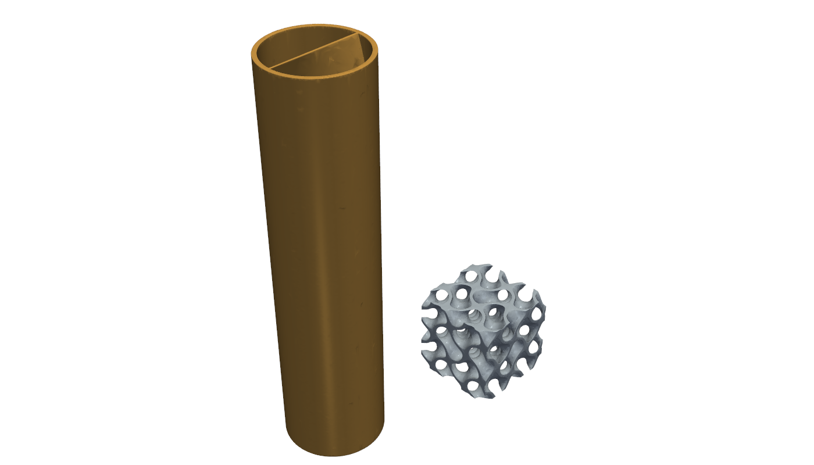

# 750 hp intercooler: comparing three core families

This study asks whether a printed core can beat the Secan- or Marston-style
offset-strip core already retained in this study. It compares that offset-strip
core with two printed alternatives:

- a transposition of the LEAP 71
  [HelixHeatX](https://github.com/leap71/LEAP71_HelixHeatX) helical exchanger;
- a two-network gyroid.

All three are compared under the same assumptions. The study is a screen. It
qualifies no core, no pressure rating and no installation.

The OEM part `993 110 330 53` is context only. Its flanges, inlet and outlet
axes and mounts are not measured in this repository, so none is used or
invented. Interfaces stay those of the
[independent contract](../../interface-contract.json).

## Common basis

The scenarios, budgets and stress factors come unchanged from
[requirements.json](../requirements.json):

- 35 °C ambient air and 40 °C at the compressor inlet;
- a 60 °C charge outlet target;
- 2.5 kg/s of cooling air, which is imposed;
- a 10 kPa charge budget and a 500 Pa ambient budget;
- heat transfer multiplied by 0.75 and friction multiplied by 2.

Faces are the same as in the witness thin-fin sweep, with depth extended to
150 mm. Family parameters and correlation domains are in
[assumptions.json](assumptions.json).

The witness is the lightest thin-fin offset-strip core. It measures
800 × 542.8 × 90 mm, weighs **17.3 kg** and has two parallel charge banks.
Replaying it through the original `size_core.evaluate` reproduces the retained
stress outlets exactly: 44.8, 49.1 and 56.2 °C.

## Results

| Family | Candidates | Pass on admitted correlations | Lightest pass | Evidence |
|---|---:|---:|---|---|
| Offset strip (witness) | 6 912 (earlier sweep) | 48 | 17.3 kg | Manglik–Bergles 1995, in domain |
| Helical web tubes | 3 840 | **0** | none | Manglik–Bergles 1993 twisted tape plus Zukauskas/Jakob bank |
| Two-network gyroid | 384 | not admissible | none (analogue) | no admitted correlation |

The full results are in [screen.json](results/screen.json) and
[screen-sweep.csv](results/screen-sweep.csv).

### HelixHeatX transposed: rejected

HelixHeatX is a liquid–liquid exchanger. Two twisted voids carry the fluids,
and thin internal fins guide the flow. Transposed to air-air crossflow, the
charge runs in printed round tubes, each with a helical internal web. The
cooling air crosses a staggered bank of those tubes.

The web raises the charge-side coefficient. The bottleneck is the cooling-air
side: a bare tube bank has far less area density than plate fins.

- **In domain and within both budgets:** the best candidate reaches only
  **136.1 °C** at the charge outlet, against the 60 °C target. It uses 8 mm
  tubes with a 0.2 mm web and y = 4.5, in a bank of 31 × 8 tubes. It weighs
  6.5 kg, with a 9.9 kPa charge loss and a 457 Pa ambient loss.
- **Ignoring the correlation domains:** 3 mm tubes reach 40.7 °C. Their ambient
  loss is then 22.3 kPa, 44 times the budget, and their charge Reynolds number
  is about 2 500, outside the turbulent twisted-tape domain.

Rejection counts over the 3 840 helical candidates (one candidate can fail
several ways):

| Failure | Candidates |
|---|---:|
| Ambient loss over budget | 3 696 |
| Charge outlet above target | 3 551 |
| Charge Reynolds below 10 000 | 2 812 |
| Charge loss over budget | 1 434 |

The transferable part of HelixHeatX is its **counterflow**, not the helix.
At the witness UA (1 760 W/K in the high stress case), ideal counterflow lowers
the high-case outlet from 56.2 to **52.1 °C**. Reaching 60 °C needs 1 456 W/K
instead of 1 594 W/K, **8.6 % less UA**. This bound ignores the losses of
turning both air streams in the headers, which make air-air counterflow
difficult.

### Gyroid: a measurement requirement, not a result

A sheet gyroid separates two interpenetrating networks. That fits a two-fluid
core. No correlation for this geometry is admitted here, so the screen does two
things:

- It reports a **plain-duct analogue**: Nusselt number 4 and Darcy f·Re of 64
  on the network hydraulic diameter. With it, the best candidate within budget
  reaches only 102.5 °C. That analogue is not a gyroid prediction.
- It solves for the **break-even Nusselt number**: the equal Nusselt number on
  both sides that would meet all three stress cases at the analogue friction.

| Break-even candidate | Mass | Required Nu (before the ×0.75 stress factor) | Charge / cooling Re | Charge / ambient loss |
|---|---:|---:|---:|---:|
| Cell 5 mm, wall 0.3 mm, 800 × 550 × 150 | 32.8 kg | 9.0 | ~1 900–2 100 / ~1 860–1 900 | 1.4 kPa / 489 Pa |
| Cell 4 mm, wall 0.3 mm, 800 × 550 × 60 | **16.4 kg** | **13.6** | ~3 850–4 160 / ~1 490–1 520 | 6.7 kPa / 416 Pa |

The second row is the only gyroid lighter than the witness. It beats the
witness only if bench coupons show **Nu ≥ 13.6 with Darcy f·Re ≤ 64 at those
Reynolds numbers**, on both sides. Gyroids usually show higher friction than a
plain duct, so the friction condition is as demanding as the Nusselt one.

The gyroid also has a header problem, which remains unsolved. Each network
opens on every face of the core, so crossflow headers need transition zones
that close one network at each face. Those zones are not designed or credited
here.

## Native PicoGK coupons and independent measurement



[Cells](source/picogk/Program.cs) reads its parameters from `screen.json`. It
generates the metal and each fluid domain at a 0.0375 mm voxel:

- a gyroid cube of 2 × 2 × 2 cells, using the 16.4 kg candidate (cell 4 mm,
  wall 0.3 mm);
- one helical-web tube, the closest in-domain candidate, over one 180° twist.

[measure.py](source/measure.py) then measures the meshes with trimesh,
independently of the screen formulas. The results are in
[coupon-measurement.json](results/coupon-measurement.json).

| Quantity | Screen formula | Measured on the voxel geometry |
|---|---:|---:|
| Gyroid metal fraction | 0.2319 | 0.2277 |
| Gyroid network porosity | 0.3841 | 0.3856 / 0.3856 |
| Gyroid hydraulic diameter | 1.988 mm | 2.067 mm |
| Gyroid area density × cell | 3.092 | 2.985 |
| Helical metal volume | 437.61 mm³ | 437.58 mm³ |
| Helical passage volume, two halves | 1 751.96 mm³ | 1 751.79 mm³ |

The measured wetted area is 3.5 % below the screen value. The break-even
Nusselt number therefore rises by roughly the same fraction.

Each gyroid network is one connected domain. Two charge-side and six
cooling-side fragments are cut off by the coupon window. All of them open on
the cut faces, so the coupon holds no sealed void. In a full core, a solid side
wall would seal such fragments into powder traps, so the edge treatment must be
designed.

An earlier window aligned on the lattice corners left two loose metal slivers
of 0.001 mm³. That window was rejected and the coupon was shifted by an eighth
of a cell.

The review meshes keep one closed body each, with less than 0.12 % volume
change ([review.json](derived/review.json), [GLB in metres](derived/coupons.glb)).
The native STL files are identified by SHA-256 and not committed.

## What would make a better core

1. **Keep the offset strip as the reference.** It is the only family that
   passes on admitted correlations.
2. **Test gyroid coupons on a bench.** Measure Nu and f·Re against Reynolds
   number on both networks, over Re 1 500–4 200. Only those measurements can
   decide the 16.4 kg route.
3. **Study counterflow headers for the offset-strip core.** About 8.6 % of UA
   is available if the turning losses fit the budgets.
4. **Do not pursue a helical tube bank** unless plate fins are added on the
   cooling side. That would be a tube-fin core, a different family that needs
   its own screen.

## Reproduction

```sh
python3 twins/993-installed-cooling-f1/intercooler-750/core-comparison/source/screen.py --output work/new-screen
dotnet build twins/993-installed-cooling-f1/intercooler-750/core-comparison/source/picogk/Cells.csproj -c Release -p:UpstreamRoot=/path/to/upstream
Cells work/new-screen/screen.json work/new-coupons
python3 twins/993-installed-cooling-f1/intercooler-750/core-comparison/source/measure.py --screen work/new-screen/screen.json --generated work/new-coupons --output work/new-measurement.json
python3 twins/993-installed-cooling-f1/intercooler-750/core-comparison/source/review.py --native work/new-coupons --output work/new-review
python3 -m unittest tests.test_993_intercooler_core_comparison -v
```

The retained run used PicoGK 2.3.0 with native runtime 26.2 on Windows x64
(.NET 9.0.318). Outputs must be new directories; no earlier result is
overwritten.

## Limits

- **Correlation transcription.** The helical correlations are transcribed from
  secondary textbook forms. They must be checked against Manglik and Bergles
  (1993), Zukauskas and Jakob before any decision. On the charge side the web
  is treated as a non-conducting insert, and the worse of two flow-area
  conventions is kept.
- **Crossflow formula.** All families use the unmixed crossflow formula. The
  fully mixed bound of the earlier study still applies.
- **Excluded from mass.** Headers, joints, mounts and the gyroid transition
  zones are excluded from every mass.
- **No physical acceptance.** No pressure, fatigue, powder-removal, LPBF recipe
  or installed-fit acceptance is granted. All four acceptance fields remain
  `false`.
