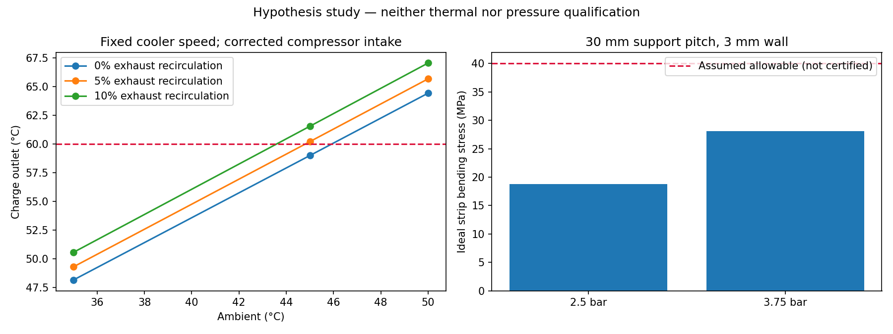
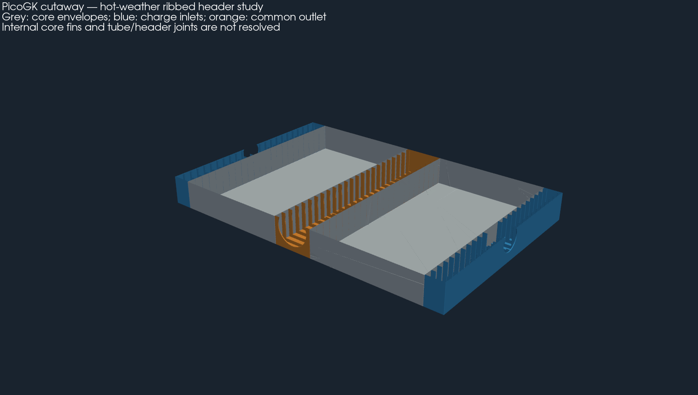
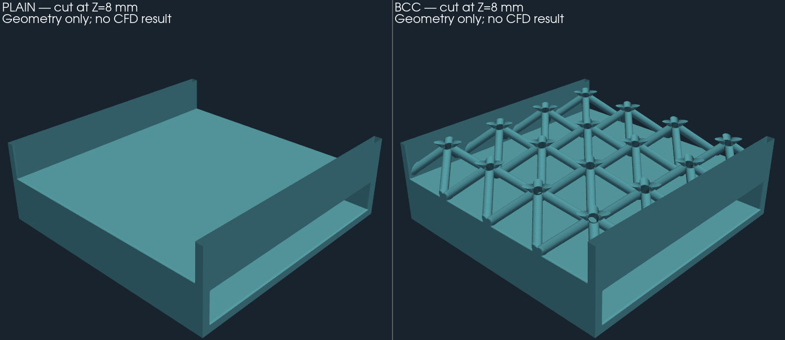

# Échangeur 750 ch — poursuite à 45 °C et collecteurs raidis

Cette étude prolonge la [comparaison des architectures](../architecture/README.md),
sur une nouvelle branche issue de `main`. Les preuves précédentes restent intactes.
Elle dimensionne une demande de ventilation et génère une variante de collecteurs ;
elle ne valide ni une machine d'impression, ni une pièce montée sur la voiture.

## Hypothèses corrigées

À 45 °C extérieur, l'entrée du compresseur vaut maintenant **50 °C** (+5 K
supposés). Le cas haut à rapport absolu 3,0 et rendement 65 % donne **233,3 °C**
à l'entrée de l'échangeur. Les anciens essais à 45 °C conservaient 40 °C à
l'entrée du compresseur ; ils étaient donc plus favorables sur ce point.

Les [hypothèses](assumptions.json) conservent la cible de charge à 60 °C, avec
un dimensionnement à 59 °C, et un budget global de 15 kW à l'arbre. Aucun effet
de vitesse du véhicule n'est crédité. Le ventilateur moteur garde son régime
propre. Le ventilateur d'échangeur peut varier indépendamment : on compare sa
position en amont ou en aval et des conduits de 0,15 / 0,25 / 0,35 m².

Le calcul inverse cherche le débit nécessaire, puis le régime relatif qui
fournirait la pression demandée sur la **courbe hypothétique précédente**.
La densité à l'entrée du ventilateur est celle de l'air chaud lorsqu'il est
placé après l'échangeur. Son échauffement est alors rejeté en aval. Le mélange
d'une fraction de cet air avec l'admission est réitéré. Le modèle de transfert
reste la borne des fluides mélangés à UA issu du calcul historique non mélangé.

## Résultat à 45 °C

**288 cas**, dont deux passent le filtre nominal sans réaspiration. Le minimum
de masse parmi eux est :

| Paramètre | Résultat de calcul |
|---|---:|
| Cœur seul | 800 × 699,6 × 150 mm |
| Masse de cœur analytique | 33,27 kg |
| Enveloppe avec collecteurs | 1 070 × 699,6 × 150 mm |
| Ailettes / parois de séparation | 0,15 / 0,4 mm |
| Pas chaud / froid, segments | 1,5 / 3 mm, segments de 10 mm |
| Ventilateur échangeur | En aval, aspiration à travers le cœur |
| Section de référence des conduits | 0,35 m² |
| Débit froid | 4,88 kg/s |
| Point demandé au ventilateur échangeur | 4,71 m³/s à 1 154 Pa |
| Régime relatif échangeur | 1,361 fois la courbe de référence |
| Puissance échangeur / moteur | 9,05 / 5,74 kW à l'arbre |
| Total | 14,79 kW à l'arbre |
| Sortie charge / rejet d'air froid | 59,0 / 69,1 °C |
| Puissance thermique rejetée | 109,2 kW |

Ce point est une **spécification hypothétique à confronter à un ventilateur
réel**, pas une performance démontrée de l'impeller existant. Le budget ne laisse
que 0,21 kW de marge. L'enveloppe de 700 mm ne laisse que 0,4 mm de différence
avec la hauteur calculée ; ce n'est pas un jeu d'installation acceptable démontré.
Tuyaux, conduits de rejet, ventilateurs et supports sont exclus de cette enveloppe.

À 35 °C, maintenir le même régime gaspille de la puissance et dépasse légèrement
15 kW. Le calcul inverse ramène le régime relatif échangeur à **0,803** pour
59 °C en sortie charge, avec **7,88 kW** au total. Le moteur reste refroidi par
son circuit indépendant. À 50 °C, la cible de 59 °C n'est pas atteinte dans la
plage cherchée de 1 à 7 kg/s ; ce n'est pas une preuve d'impossibilité universelle.

| Réaspiration du rejet | Sortie charge à 45 °C, régime fixé |
|---|---:|
| 0 % | 59,00 °C |
| 5 % | 60,21 °C |
| 10 % | 61,55 °C |

La séparation physique des admissions et des rejets est donc indispensable à
étudier. Le [JSON](results/study.json) conserve aussi les cas à 35 et 50 °C,
la recherche de régime et les [288 lignes de comparaison](results/sweep.csv).
Aucun champ d'acceptation physique n'est activé.



## Pression : ce qui change et ce qui manque

Hypothèses exploratoires : pression de service **2,5 bar relatifs**, cas d'épreuve
numérique **3,75 bar relatifs**, module chaud 50 GPa et contrainte admissible
supposée 40 MPa. Ces valeurs ne sont ni une recette d'épreuve autorisée, ni un
admissible AlSi10Mg certifié à 233 °C.

Le contrôle est une bande de largeur unité simplement appuyée sous pression :
`sigma = 0,75 p (L/t)²`, `flèche = 5 p L⁴ / (32 E t³)`. Il suppose des appuis
continus rigides. Pour la portée plane historique de 180 mm et t = 3 mm, la
flèche sort largement du domaine des petites déformations : ses contraintes
élastiques ne sont pas des contraintes physiques prédites après plastification.
Cette géométrie ne peut pas être retenue sur ce modèle.

Avec des appuis idéaux espacés de **30 mm**, la bande de 3 mm donne **28,1 MPa**
et **0,035 mm** au cas 3,75 bar. La variante PicoGK ajoute des cloisons
transversales ajourées, de 3 mm d'épaisseur, avec des bords de 12 mm.
**Le calcul de bande ne vérifie pas la rigidité de ces cloisons**, leur pied,
les ouvertures de raccord, les arrondis, la fatigue, les assemblages ni les
contraintes thermiques. Il ne constitue pas une FEA du collecteur.

Chaque interface de demi-cœur doit reprendre environ **39,4 kN** au cas
3,75 bar ; une cellule de 30 mm correspond à environ **1,69 kN** de charge
tributaire. Les interfaces mesurées et leur chemin de charge restent requis
avant conception fonctionnelle des fixations et jonctions.

Les raidisseurs réduisent aussi le passage : environ **49 % de section libre**
dans une cloison d'entrée. Une estimation à prélèvement uniforme réparti, avec
K supposé par cloison et pertes des orifices 80 / 113 mm, donne :

| K supposé par cloison | Perte totale côté charge |
|---|---:|
| 0,5 | 6,40 kPa |
| 1 | 8,27 kPa |
| 2 | 12,02 kPa — dépasse le budget de 10 kPa |

Ces K ne sont pas calibrés. Le filtre thermique nominal ne valide pas les pertes
réelles des cloisons : CFD et banc devront mesurer répartition, séparation et
pertes. C'est le compromis à résoudre entre raidissement et circulation d'air.

## Géométrie et fabrication



[GLB complet en mètres](derived/layout.glb), [reçu géométrique](derived/review.json),
[source PicoGK](source/picogk/Program.cs), [entrée reproductible](layout-input.json).
La masse calculée des collecteurs raidis vaut **8,01 kg**,
soit environ **41,28 kg avec le cœur**, hors accessoires.
La coupe concerne seulement l'image : les fichiers STL de revue restent des
solides fermés. Les blocs de cœur sont des enveloppes ; les interfaces tube par
tube restent absentes. Les fichiers ne sont pas un échangeur complet étanche.

La [carte d'éprouvette mise à jour](coupon-input.json) reprend le pas froid de
3 mm et peut être utilisée avec le générateur d'éprouvettes existant. Elle n'a
pas encore donné lieu à une nouvelle génération native ou à une impression.

La [fiche officielle EOS AlSi10Mg](https://www.eos.info/metal-solutions/data-sheets/all-processes-and-materials?id=eos-aluminium-alsi10mg),
consultée le 12 octobre 2026, donne notamment une paroi minimale de **0,4 mm**
pour M290 à couches de 30 µm. Elle ne qualifie donc pas nos ailettes de 0,15 mm.
Les propriétés mécaniques y sont données à température ambiante ; elles ne
fournissent pas nos admissibles de paroi chaude. Le lien PDF trouvé par recherche
retournait 404 ; la page fabricant a été consultée directement.

Le cœur haut de 699,6 mm complique aussi le procédé : l'orientation à 45° dans
X/Z de chaque demi-cœur donne environ **389 × 700 × 389 mm**, hors supports,
au-delà du plateau de 600 mm envisagé précédemment. Un découpage supplémentaire,
ou une autre machine et orientation, devra être conçu avec nouveaux bilans
thermiques, jonctions et accès de dépoudrage. Le dimensionnement thermique ne
vaut pas approbation d'une impression monolithique.

## Vérification et suite

### ShapeKernel, LatticeLibrary et échange VDB exécutés sur Mac

Le [générateur d'éprouvettes](source/lattice/Program.cs) utilise effectivement
`ShapeKernel.BaseBox` pour les enveloppes et passages, et
`LatticeLibrary.BodyCentreLattice` / `CuboidCell` pour seize cellules BCC.
Les sources installées sous `~/Developer/PicoGK` sont compilées sans modification ;
leurs versions et empreintes figurent dans le [reçu](results/lattice-runtime.json).
Les deux bibliothèques sont Apache-2.0 ; aucun code tiers ni runtime n'est redistribué.



Deux variantes de **24 × 24 × 11,4 mm** sont générées : passage froid lisse
et passage froid à treillis BCC, avec parois et diamètre de barres de **0,8 mm**,
cellules de 6 mm. Le passage chaud de 3 mm est séparé du passage froid de 6 mm.
Ce sont des éprouvettes comparatives, **pas les ailettes de 0,15 mm du cœur
dimensionné** : aucun résultat thermique du grand cœur n'est transféré au treillis.

À voxels de 0,1 mm, par rapport à l'éprouvette lisse :

| Mesure géométrique | Variante BCC |
|---|---:|
| Surface au contact de l'air froid, bouchons numériques exclus | +89,5 % |
| Volume libre côté froid | −8,4 % |
| Volume de métal total | +15,7 % |
| Variation de volume solide entre voxels de 0,2 et 0,1 mm | 1,19 % |

Une surface supplémentaire ne prouve pas une meilleure dissipation : efficacité
des barres, pertes de charge et répartition du débit restent inconnues. Deux
résolutions donnent une sensibilité géométrique, pas une convergence CFD.
Les barres inclinées, les plafonds, le dépoudrage et la tenue sous pression
nécessitent une étude de fabrication propre à ces éprouvettes.

Chaque fichier contient **sept champs nommés** : solide, fluide chaud, fluide froid,
deux températures initiales en K et deux vitesses initiales en m/s. Les coordonnées
PicoGK sont en mm : une conversion explicite vers les mètres est requise côté solveur.
Les températures initiales valent 506,47 K / 318,15 K ; les vitesses uniformes
de 1 m/s servent uniquement à préparer l'échange de données, sans lien avec le
débit du grand échangeur. Les trois domaines se relisent identiques, et toutes
les valeurs actives d'origine des champs scalaires/vectoriels ont été relues et
comparées. La présence éventuelle de valeurs actives supplémentaires dans la
copie n'est pas vérifiée. Aucun solveur thermique ou hydraulique n'a été exécuté.

Fichiers VDB compressés : [BCC 0,1 mm](lattice/bcc-0.1-fields.vdb.gz),
[BCC 0,2 mm](lattice/bcc-0.2-fields.vdb.gz), [lisse 0,1 mm](lattice/plain-0.1-fields.vdb.gz),
[lisse 0,2 mm](lattice/plain-0.2-fields.vdb.gz). Décompresser avant lecture VDB.
Les [STL BCC](lattice/bcc-solid.stl.gz) et [lisse](lattice/plain-solid.stl.gz)
sont des exports complets ; seule l'image est coupée.

Le [contrôle indépendant des exports](lattice/review.json) conserve les défauts
bruts : à 0,1 mm, 1 680 faces dégénérées/dupliquées sont retirées du solide BCC
et 2 160 du domaine froid. Les surfaces nettoyées sont fermées, à une composante,
avec variation de volume inférieure à 10⁻⁷. **L'acceptation du maillage brut reste
fausse** ; ce nettoyage ne qualifie ni l'étanchéité réelle ni un maillage solveur.

```sh
~/Developer/PicoGK/sdk/dotnet build twins/993-installed-cooling-f1/intercooler-750/hot-weather/source/lattice/Coupon.csproj -c Release -o work/lattice-bin
# Exécuter sous le verrou PicoGK partagé de parts/picogk-catalog/tools/run_part.py.
~/Developer/PicoGK/sdk/dotnet work/lattice-bin/Coupon.dll twins/993-installed-cooling-f1/intercooler-750/hot-weather/results/study.json work/new-lattice 0.1 bcc
```

### Contrôles du dossier

Les tests contrôlent conservation d'énergie, inversion de courbe de ventilateur,
lois de flexion, domaine de petite déformation, rejets des entrées invalides et
empreintes des résultats. Les maillages natifs sont inspectés avant les exports
simplifiés ; les STL sont en mm et le GLB en mètres.

```sh
python3 twins/993-installed-cooling-f1/intercooler-750/hot-weather/source/study.py --output work/new-hot-weather
python3 -m unittest discover -s tests -p test_993_intercooler_hot_weather.py -v
```

Priorités suivantes : conduit séparant réellement admission et rejet, contrôle
indépendant du régime, courbes de ventilateurs mesurées, FEA des cloisons et des
interfaces avec les tubes, puis éprouvettes thermiques/hydrauliques et recette
LPBF spécifique. Les hypothèses permettent de poursuivre le dessin ; elles ne
remplacent pas ces validations.
