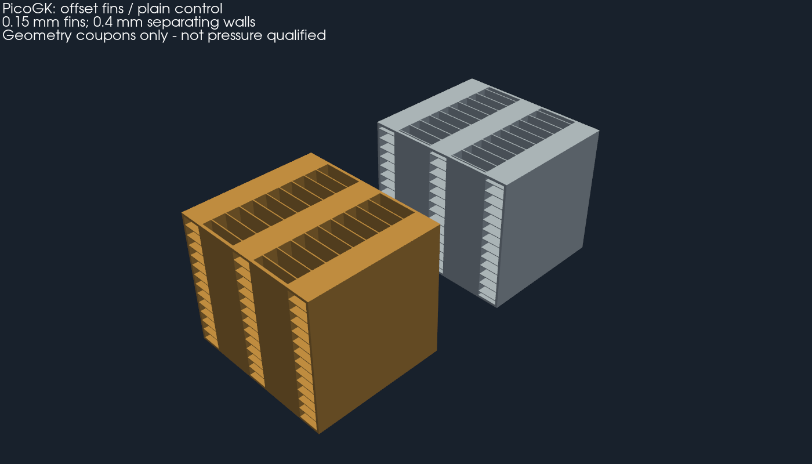
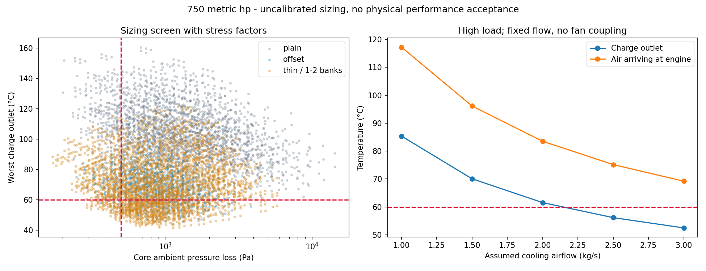

# Air-to-air intercooler for 750 hp: sizing and manufacturing

The confirmed requirement is **750 hp**, with a horizontal intercooler under
the rear wing. This study calculates the heat load, compares two fin families
and proposes PicoGK coupons. It does not validate a complete intercooler for
the car. The previous 620 × 450 × 60 mm volume remains an old concept; it is
not an approved size for 750 hp.

## Thermal requirement

750 metric hp represent 551.6 kW. Crankshaft power and a petrol engine are
assumed: this point, the fuel, the actual pressure and the turbo maps must be
confirmed. The first Garrett approximation gives about 0.533–0.589 kg/s of
engine air. We retain 0.53/0.56/0.62 kg/s; the last value is an exploratory
margin, not a measurement.

The assumptions are in [requirements.json](requirements.json). Outside air
35 °C, air entering the compressor 40 °C, target after the intercooler 60 °C.
The compression ratios are **absolute**, not boost pressures measured at the
manifold. The pressure drop between compressor and intake must be included
when the turbos are finally selected.

| Scenario | Engine flow | Compressor ratio / efficiency | Intercooler inlet | Heat to remove for 60 °C | UA required at 2.5 kg/s cold side |
|---|---:|---:|---:|---:|---:|
| Low | 0.53 kg/s | 2.2 / 75 % | 145.5 °C | 45.8 kW | 933 W/K |
| Central | 0.56 kg/s | 2.6 / 70 % | 180.4 °C | 68.1 kW | 1,212 W/K |
| High | 0.62 kg/s | 3.0 / 65 % | 217.6 °C | 98.7 kW | 1,594 W/K |

Calculation: compression temperature with isentropic efficiency, then
`Q = débit massique × cp × (T entrée − T cible)` (mass flow × cp × (inlet T −
target T)). The cooling flow of **2.5 kg/s is an imposed condition**, not a
demonstrated fan capacity. No fan power or vehicle speed guarantees this flow
here.

## Optimisation run

[8,748 candidates](results/sweep.csv): 3,888 with straight fins and 4,860 with
offset strip fins. The sweep varies face, depth, passage height, pitch, fin
thickness and segment length. The separating walls stay at 0.8 mm. The
objective is minimum mass among the candidates that pass the three scenarios
with heat transfer reduced by 25 % and distributed friction doubled. These
factors are sensitivity tests, **not a statistical uncertainty or a roughness
calibration**.

Provisional constraints: charge-side loss ≤ 10 kPa, outside-air side ≤ 500 Pa,
charge outlet ≤ 60 °C, filtered correlation domain, Mach < 0.3. Out-of-domain
cases cannot win. Twelve candidates pass these algebraic constraints. None is
physically qualified.

The minimum-mass candidate in this sweep is:

- **800 × 545.2 × 150 mm**, core only, excluding tanks, fittings and brackets.
- **42.7 kg** of metal from the analytical volumes; mass still approximate for
  the edges of the offset rows, without manufacturing allowance.
- AlSi10Mg, 0.3 mm fins, 0.8 mm walls, 3 mm pitch, 2.7 mm free gaps.
- Hot passages of 3 mm, cold of 6 mm; 20 mm segments, offset by half a pitch.

| Scenario | Charge outlet with degraded factors | Charge-side loss | Cold-side loss | Air delivered to the engine |
|---|---:|---:|---:|---:|
| Low | 46.0 °C | 6.10 kPa | 480 Pa | 56.2 °C |
| Central | 50.7 °C | 6.04 kPa | 487 Pa | 64.1 °C |
| High | 58.3 °C | 6.67 kPa | 498 Pa | 74.6 °C |

This is a **calculation candidate, not the design chosen for the car**: the
mass, the packaging and the small cold-side margin are unfavourable. An
independent constant-UA cell model gives 59.69 °C in the high scenario; going
from 80² to 160² cells changes this result by 0.002 °C and conserves energy.
This verifies the resolution of the idealised heat balance, not a CFD of the
flow.

Cross-mixing is another limit: the "both fluids fully mixed" bound gives
**67.1 °C** with the same degraded UA, and therefore fails the target. The
offset fins produce a real dispersion that remains to be determined. The
unmixed-fluids formula does not constitute proof that this architecture
reaches 60 °C.

At only 1.5 kg/s of cold air, even without degraded factors, the high scenario
exits at 61.4 °C and the air delivered to the engine reaches 99.8 °C. With the
same fins, the old 620 × 450 × 60 mm format gives about 93.1 °C on the charge
side in the high scenario. These comparisons rule out a validation based on
outer volume alone.

## Advanced path: thin fins and two parallel half-cores

A second sweep of **6,912 candidates**, kept in
[thin-sizing.json](results/thin-sizing.json) and [thin-sweep.csv](results/thin-sweep.csv),
evaluates fins of 0.15–0.20 mm, walls of 0.4–0.6 mm and one or two parallel
banks on the charge side. The constraints and degraded factors remain the
same. Forty-eight candidates pass the algebraic filter. A public demonstration
on an EOS M290 motivates the 150 µm path; it does not qualify our geometry.

The minimum mass found in this second family is **800 × 542.8 × 90 mm**,
**17.3 kg for the core only**, about 60 % less metal than the 0.3 mm fin
candidate. The two half-cores are fed in parallel, each over a 400 mm hot
path; the flow is assumed to split equally. Their joining, the tanks,
fittings, mountings and interfaces are not included in the mass or the
dimensions. An unequal split calls the calculation into question.

| Parameter | Value for the advanced candidate |
|---|---:|
| Fin / separating wall | 0.15 / 0.4 mm |
| Charge / cold-air passage height | 3 / 6 mm |
| Charge / cold-air pitch | 1.5 / 2 mm |
| Charge / cold-air free width | 1.35 / 1.85 mm |
| Strip length | 10 mm, offset by half a pitch |
| Charge outlet, degraded high case | 56.2 °C by ε-NTU; 57.60 °C by cells |
| Charge / cold-air loss, degraded high case | 4.25 kPa / 449 Pa |
| Air for the engine, degraded high case | 75.2 °C |

The cell model gives a difference of less than 0.003 °C between 80² and 160²
cells. The full cross-mixing bound nevertheless rises to **65.8 °C**. This
candidate is therefore **a path to be tested**, not a validation at 750 hp.
The effect of ageing, the repeatability of 150 µm fins and powder removal over
400 mm must be established by the manufacturer. The correlation limits do not
become proof of printability.

Each tilted half-core occupies about **347 × 543 × 347 mm**, before supports
and tanks: a nominal 600 mm machine gives a packaging path. A further split
for a 400 mm machine would require new joints and a new thermal and
mechanical check.

The new PicoGK coupons use these 0.15 mm fins and 0.4 mm walls, over
**20 × 23.4 × 20 mm**, with a numerical voxel of 0.0375 mm. This voxel is a
CAD resolution, **not a layer thickness or an LPBF recipe**. The reproduction
card is [coupon-input.json](coupon-input.json). The large complete cores and
their tanks are neither generated nor qualified.

## Native coupons kept



The two native solids were checked: one closed body each, consistent face
orientation, positive volume. The review exports keep closure and volume to
within 0.5 %. Reductions that were too coarse and opened the meshes were
rejected; their diagnostics remain in the
[inspection receipt](derived/review.json).

- [3D GLB view, units in metres](derived/coupons.glb).
- [Offset fins, compressed STL in millimetres](derived/offset-fin-coupon.stl.gz).
- [Straight-fin control, compressed STL in millimetres](derived/plain-fin-control.stl.gz).
- [Editable PicoGK source](source/picogk/Program.cs) and [input card](coupon-input.json).

The review STLs are simplified; the complete native STLs are kept locally and
are identified by SHA-256. The check samples 305 points on open paths and one
point in the separating wall, on the review meshes. It does not check every
void and does not constitute proof of powder removal, leak-tightness or
pressure strength.



## Shape and choice of material

The shape studied is a cross-flow core: pressurised charge along X, outside
air along Z, tubes and gaps stacked along Y. The circuits remain separate.
The tanks will have to distribute the flow across all the rows; their local
loss `K = 2` is currently an assumption.

AlSi10Mg is the reference candidate: low density, existing LPBF supply chain,
conductivity compatible with this function. The LaserForm data sheet gives at
20 °C 120–130 W/(m·K) untreated and 160–170 in its SR1 condition. These are
values inferred from resistivity on specific coupons, not certified
properties of our hot fins. The high scenario reaches 218 °C on the charge
side at the inlet; hot strength, ageing and thermal stresses require their own
data. The calculation uses 120 and sweeps 100–300.
Going from 120 to 300 W/(m·K) here reduces the charge outlet by only about
0.17 °C: convective resistance dominates. A much more conductive material does
not solve the air supply problem. WE43, titanium and stainless steel are not
retained by default for this core; no impeller recipe is transferred.

## Metal manufacturing route

1. **Qualify the two coupons**, with their real passages and fins, on the
   manufacturer's machine/powder/recipe combination. The reference pair
   measures 40 × 25.8 × 40 mm; the advanced pair measures 20 × 23.4 × 20 mm.
   They serve first to check fineness and powder removal. Two segments do not
   reproduce the losses of a long core. A long coupon and bench adapters are
   needed before the core is calibrated.
2. Build by LPBF, with proposed growth direction `(X+Z)/√2`: the main
   internal surfaces are vertical or inclined at 45°. This nominal analysis
   does not prove the absence of internal supports, nor the printability of
   the starts and offset edges. External supports remain necessary according
   to the manufacturer's plan and must be accessible.
3. Provide powder evacuation through both ends of **each circuit**, before the
   tanks are closed. The offset passages are not straight over their whole
   length; inspection, a cleaning protocol and measurement of residual powder
   are essential. A closed STL does not prove this cleaning.
4. The reference core with 0.3 mm fins, tilted, occupies about
   **672 × 545 × 672 mm**, excluding supports:
   it does not fit in a nominal 600 mm envelope. One path is two modules in
   series on the charge side, each 400 × 545 × 150 mm, tilted within about
   389 × 545 × 389 mm; another path is six modules for a 400 mm machine.
   For the advanced path with 0.15 mm fins, the two half-cores are in
   parallel on the charge side and each occupy about 347 × 543 × 347 mm when
   tilted. These are splitting studies. Their tanks, joints and
   redistribution must be sized and verified; the local losses remain assumed.
5. Stress-relieve and heat-treat according to the qualified recipe, machine
   the interfaces, inspect geometry and porosity. Qualify any weld/braze
   between modules; do not assume that the assembly keeps the properties of
   the as-built material.
6. Establish the service, transient, proof and burst pressures with the
   responsible designer. Check walls, tanks, joints, thermal expansion,
   vibration and thermal fatigue; carry out leak, proof and cycling tests on a
   protected bench. The simple bending calculation of a wall strip in the JSON
   replaces none of these checks.

The installation interfaces remain those of the
[independent contract](../../993-installed-cooling-f1/interface-contract.json): rear wing envelope,
supports/load-bearing chassis, turbo and intake end fittings, clearances with
the fan, seals and duct sealing. The 17.3 kg of the advanced candidate, like
the 42.7 kg of the reference, require a load path verified with the tanks and
the dynamic loads; no mounting is invented.

## Consequence for engine cooling

Cooling the charge to 60 °C rejects 46–99 kW into the outside air. To limit
its temperature rise to **15 K**, about **3.0–6.5 kg/s** would be needed
through the intercooler. This 15 K limit is an example balance, not a measured
engine requirement. The size of the intercooler cannot remove this heat.

The next architecture to compare must therefore include **a separate fresh
air supply for the engine, or a correctly sized bypass**, with evacuation of
the intercooler's hot air that avoids its re-ingestion. Pressures under the
rear wing, the fan flow-pressure curve, the flow of each branch and the
cylinder head/charge temperatures will have to be measured. A conventional
brazed-plate core with printed tanks also forms a mass and performance
witness; it is not declared superior without comparison at equal thermal
requirement.

## Methods, limits and reproduction

The [source register](references.json) states what was actually read.
The [results](results/sizing.json) keep inputs, hashes and sensitivities.
The tools use dependencies that are already installed.

```sh
python3 twins/993-intercooler/750-hp/source/size_core.py --output work/new-sizing
python3 twins/993-intercooler/750-hp/source/explore_thin_fins.py --output work/new-thin-sizing
python3 -m unittest discover -s tests -p test_993_intercooler_750.py -v
```

The C# generation reuses the catalogue SDF and PicoGK, under the existing lock
`parts/picogk-catalog/tools/run_part.py`. Compile `source/picogk/Core.csproj`
with `-p:PicoGKAssembly=/path/to/PicoGK.dll`, place the native libraries of
that runtime next to the binary, then run
`Core.dll coupon-input.json new-output` for the advanced coupons.
The outputs must be new; no rejected result is overwritten.

The straight fins use the developed rectangular duct and Gnielinski laws,
with the transition excluded. The offset fins use Manglik–Bergles, filtered on
Re 300–5000 and the ratios s/h, t/l, t/s. The complete envelope of the
original data and the scale effects of the process are not confirmed. The
inlet losses are assumed; roughness, fouling, distribution, longitudinal
conduction, humidity and the real fan map remain uncalibrated. The
coefficients are recalculated at the mean temperatures; the model is neither
a resolved CHT calculation nor an LPBF manufacturing simulation.

## Continuation with authorised assumptions

The [architecture comparison](architecture/README.md) couples assumed fan
curves with the circuit losses, takes their heating into account and adds
PicoGK tanks with two core envelopes.

The [45 °C continuation](hot-weather/README.md) corrects the compressor inlet
temperature, studies downstream ventilation with independent control and adds
a PicoGK variant of stiffened tanks with simplified pressure checks.

The [core family comparison](core-comparison/README.md) screens a HelixHeatX
helical-web transposition and a two-network gyroid against the offset-strip
witness under the same assumptions, with native PicoGK coupons measured
independently. The [counterflow-pass study](counterflow-passes/README.md) then
splits the charge into passes against the cooling air and charges the return
tanks to the budgets.

## Continuation: pressure strength of the coupons

[Comparison with 0, 2 and 4 hot ribs](pressure-coupon/README.md): twelve
local CalculiX runs, two PicoGK generations, an exploratory hydraulic cost,
and explicitly recorded non-converged root stresses. A follow-up study draws assumed 0.2 and 0.4 mm
root fillets: their peaks converge (12.8 and 9.3 MPa at 3.75 bar, plane strain),
while the sharp root keeps growing; no pressure strength is qualified.
