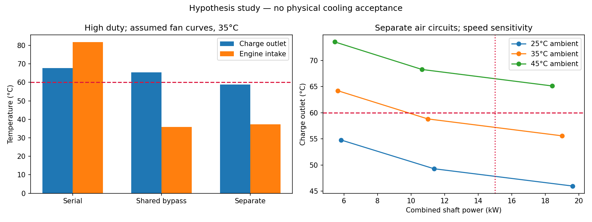
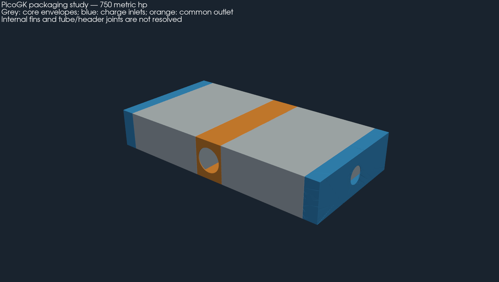

# Architecture under assumptions — 750 hp

This suite uses the assumptions authorised by the user. It compares
the operating point of the fans and produces PicoGK manifolds
to study packaging. The missing measurements remain unknown in the
[initial dossier](../README.md); they are not replaced by fictitious measurements.

## Working assumptions

The [assumption map](assumptions.json) sets an envelope of 1,100 × 700 × 300 mm,
35 °C ambient, a charge target of 60 °C and 1 °C of calculation margin.
The three previous compressor scenarios remain unchanged: absolute ratios
2.2 / 2.6 / 3.0, efficiencies 75 / 70 / 65 %, flows 0.53 / 0.56 / 0.62 kg/s.
The 750 hp power remains assumed at the crankshaft.

No dynamic pressure from vehicle speed is credited. The
fans are assumed **upstream**, in the fresh air. Their curves are
parabolic and entirely hypothetical:

| Branch | Pressure at zero flow | Free flow | Assumed efficiency |
|---|---:|---:|---:|
| Independent exchanger | 1,800 Pa | 4.4 m³/s | 60 % |
| Engine or common fan | 2,500 Pa | 4.0 m³/s | 65 % |

These end points are not a simultaneous operating point. The solver
seeks the intersection between the fan curve and the circuit losses, with
density correction and similarity laws. The approach is described by
[AMCA](https://www.amca.org/educate/articles-and-technical-papers/amca-inmotion-articles/straightening-out-fan-curves.html).
No real fan or blade profile has yet been shown capable of holding
these curves. The shaft work is added, as a conservative assumption, as
heating of the air upstream of the exchanger. The drive motor and its
own heat are not sized.

The engine circuit is represented by 1,000 Pa at 2 kg/s; the minimum flow of
2 kg/s and the inlet limit of 50 °C are **assumed criteria**, not established
Porsche requirements. The total budget is 15 kW at the shaft. The external
exchanger ducts represent K = 3 over 0.15 m²; K = 2 on the charge side remains
the assumed local loss of the manifolds. Their drawing is not their calibration.
The old isolated limit of 500 Pa on the cold side is replaced in this suite
by the complete curve and the power budget; it was not silently
met by the new candidate.

## Results and provisional choice

See the [numerical results](results/comparison.json) and the
[sweep](results/sweep.csv). The filter keeps only the geometries
fitting in the envelope with the manifold allowances. The transfer and
friction models of the previous dossier are reused without modification.
The heat balance uses the bound of both fluids mixed, with the UA and losses
from the historical unmixed iteration. The effects of this choice on the
properties remain an approximation; this is not a resolved CHT. The independent
engine network keeps a resistance referred to the external density;
the effect of the few degrees of fan heating on this resistance
is not iterated. CFD and measurements will need to remove these approximations.

**240 variants** pass the packaging filter; two satisfy all three
loads with the required margin. The minimum core mass is **800 × 542.8 ×
180 mm, 30.9 kg**. It uses 0.15 mm fins, 0.4 mm separators,
a hot pitch of 1.5 mm and a cold pitch of 3 mm, and 10 mm interruptions. The
manifolds bring the envelope to **1,070 × 542.8 × 180 mm**, without the external
pipes, mountings and air ducts.

| Architecture, high load at 35 °C | Charge outlet | Engine inlet | Engine flow | Total shaft power |
|---|---:|---:|---:|---:|
| In series | 67.7 °C | 81.7 °C | 2.11 kg/s | 5.59 kW |
| Common bypass | 65.5 °C | 36.0 °C | 1.69 kg/s | 3.72 kW |
| Separate air | 58.8 °C | 37.3 °C | 2.60 kg/s | 11.00 kW |

In the independent branch, the high point requires about **2.94 kg/s** at
**1,186 Pa** in total, of which 681 Pa in the core. The three charge outlets are
47.8 / 52.3 / 58.8 °C. The 11 kW is a shaft demand, not an electrical
power nor evidence that the existing alternator is sufficient.

The separate route therefore passes the filter **at 35 °C**, but fails at 45 °C at nominal
speed and at 35 °C when the speed drops by 20 %. Increasing the speed can
also exceed the 15 kW allowed. The 1 °C margin is a design
filter, not a statistical uncertainty or a climatic qualification.




## PicoGK geometry



[GLB view in metres](derived/layout.glb), [editable source](source/picogk/Program.cs),
[check receipt](derived/review.json). The compressed review STLs are in mm.
The large grey blocks are **core envelopes**, with no resolved fins.
The thin test specimens remain those of the previous study, with a cold pitch
of 2 mm against 3 mm here. The specimens of this new pitch will need to be
regenerated and printed before calibrating this candidate; no previous test qualifies it.

Two lateral inlets of 80 mm internal diameter each feed one
half-core. A common central manifold receives both flows and has an
orifice of about 113 mm, with a cross-section equal to the sum of the two inlets. This
equality of cross-section guarantees neither uniform distribution nor low losses.
The manifold walls are assumed at 3 mm; this is not a strength calculation.
The large flat faces are not sized for pressure: domed shapes
or stiffeners, stresses and deformations remain to be calculated.
The volume of the three manifolds gives about **4.4 kg** of metal, i.e.
about **35.4 kg core and manifolds**, excluding reinforcements and final interfaces.
The fitting openings are flush with the faces: the external pipes and
their bend radius are not included in the stated envelope.

The mouths to the cores are open onto the overall envelope. The individual
interfaces with the hot tubes, their separation from the external air
rows, the seals and the assembly process remain to be drawn. **The scene
is therefore not a complete sealed exchanger.** The closure of each mesh
means that its material has a closed surface, not that its fluid
circuits are sealed or pressure-qualified.

## Manufacturing and tests to pursue

The route remains AlSi10Mg LPBF, two half-cores built separately then assembled
to manifolds accessible for cleaning. The 0.15 mm fins, 0.4 mm
separators, supports and heat treatment still require a qualified recipe.
Each 400 × 543 × 180 mm half-core would occupy about
410 × 543 × 410 mm tilted at 45°, before supports: a 600 mm machine lead,
not a confirmed recipe. The manifold must not prevent depowdering
before cleaning and inspection.

1. Measure the loss/transfer curves on long, straight and
   offset specimens, then replace the correlations and sensitivity factors.
2. Verify the volume under the wing, the fitting axes and the load path
   before creating the mountings. The core mass does not include the ducts,
   fans, actuators and supports.
3. Compare real fans with the requested flow/pressure/power points.
   A propeller profile alone does not establish a ducted fan curve.
4. Draw the separate air supplies and the hot exhaust, then measure
   recirculation and the pressures under the wing. The absence of recirculation in
   this calculation is a favourable assumption.
5. Resolve and verify the manifolds, the tube interfaces and the pressure/thermal
   loads; then test leakage, pressure and fatigue.

The sensitivity at 45 °C and at −20 % speed must remain visible: the candidate
is not approved for every ambient condition or every engine speed.
The comparisons are not at equal power: the two separate circuits
use two fans and consume more. The study chooses the minimum
core mass under the assumed constraints, not the global vehicle optimum.

## Reproduction and checks

```sh
python3 twins/993-intercooler/750-hp/architecture/source/compare.py --output work/new-architecture
python3 -m unittest discover -s tests -p test_993_intercooler_architecture.py -v
```

Compile `source/picogk/Layout.csproj` with the existing PicoGK runtime and its
native libraries. Under the catalogue lock, run
`Layout.dll results/comparison.json new-native-output`, then
`source/review.py --native new-native-output --output new-review-output` with
the existing numerical environment. The tools refuse outputs already present.
The render checks the native solids before simplifying the review files;
the sources and outputs are identified by SHA-256.
