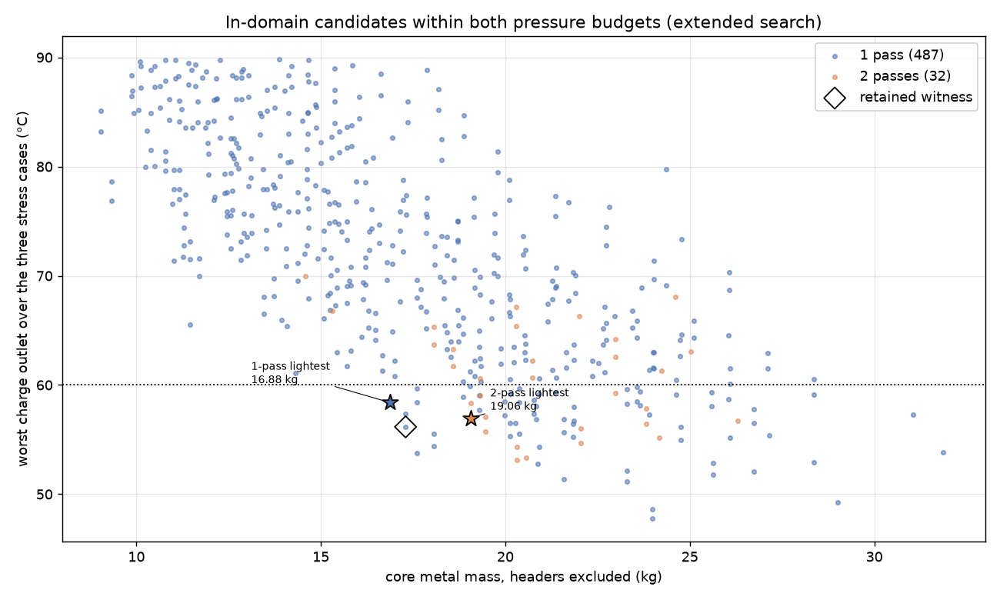

# 750 hp intercooler: counterflow charge passes

The [core-family comparison](../core-comparison/README.md) found that the part
of HelixHeatX worth transferring is its counterflow, not its helix. At the
witness UA, ideal counterflow lowers the high-case charge outlet from 56.2 to
52.1 °C, which is 8.6 % less UA for the 60 °C target. That bound ignored the
cost of headers.

This study charges that cost. The offset-strip core keeps its single cooling-air
pass. The charge makes N passes along the core width and steps forward against
the cooling air: it enters the rear pass group, turns in return tanks at the
tube ends, and leaves through the front group. Every turn, every pass and every
divider is charged to the same budgets as before.

The study is a screen. It qualifies no core, header, pressure rating or
installation. The flanges and mounts of OEM part `993 110 330 53` stay open, as
in the [independent contract](../../../993-installed-cooling-f1/interface-contract.json).

## Model

- **Common basis.** [passes.py](source/passes.py) is `size_core.evaluate` with
  the charge split into passes. It uses the same correlations, stress factors
  (heat transfer ×0.75, friction ×2), scenarios and budgets from
  [requirements.json](../requirements.json). For one pass it is the retained
  model: the witness replays its three stress outlets and pressure losses to
  1e-9.
- **Dividers.** Each pass boundary costs one charge channel and adds a solid
  divider of tube-wall thickness across the charge gap.
- **Return tanks.** Each turn costs K = 2 on the channel velocity. That is the
  same value as the inlet-plus-outlet header loss of the requirements. It is an
  assumption, not a correlation, so K = 1 and K = 4 are also reported.
- **Thermal arrangement.** Each pass is unmixed-unmixed crossflow with an equal
  share of UA. The passes combine in the overall counterflow series relation,
  with both streams mixed between passes.
- **Independent check.** A cell grid keeps the cooling air unmixed through all
  passes and mixes the charge only in the tanks. It is used to rank the
  candidates a second, conservative way. For one pass it reproduces
  `size_core.crossflow_grid`.
- **Search.** The thin-fin offset-strip search of the earlier study is run
  again for 1 to 4 passes. A wider charge-side search follows (charge gaps
  2–5 mm, pitches 1.5–4 mm), because multi-pass cores need more open charge
  passages. That wider search is applied to the single-pass reference too, so
  the comparison stays fair. Parameters are in
  [assumptions.json](assumptions.json).

## Results


**Splitting the witness core alone does not work.** It is the same 17.3 kg core
with the same fins, only split into passes:

| Passes | Mass | High-case outlet, formula / grid | Worst charge loss | High-case UA |
|---:|---:|---:|---:|---:|
| 1 | 17.30 kg | 56.2 / 57.6 °C | 4.3 kPa | 1 760 W/K |
| 2 | 17.44 kg | 49.2 / 49.3 °C | 26.6 kPa | 2 015 W/K |
| 3 | 17.58 kg | 46.6 / 46.4 °C | 81.9 kPa | 2 151 W/K |
| 4 | 17.73 kg | 45.3 / 45.0 °C | 184.4 kPa | 2 238 W/K |

Counterflow and the higher charge velocity together lower the outlet by up to
11 K. The charge loss, however, grows roughly as N^2.6 to N^2.7: velocity and
path length both scale with N, and offset-strip friction falls only slowly with
Reynolds number. Already at two passes the loss is 2.7 times the 10 kPa budget.



**Resized cores do not win either.** To fit the charge budget, a multi-pass core
must open its charge passages, which removes charge-side area. The core then
has to grow in depth, until the 500 Pa ambient budget binds.

| Search | Passes | Passing candidates | Lightest | Its core | Worst outlet, formula / grid | Charge / ambient loss |
|---|---:|---:|---:|---|---:|---:|
| thin (6 912 per pass count) | 1 | 48 | **17.30 kg** | the witness | 56.2 / 57.6 °C | 4.3 kPa / 449 Pa |
| thin | 2 | 1 | 19.30 kg | 800 × 542.8 × 120, gap 3, pitch 3 | 59.1 / 58.9 °C | 9.9 kPa / 374 Pa |
| extended (18 432 per pass count) | 1 | 65 | **16.88 kg** | 800 × 544.8 × 90, gap 4, pitch 1.5 | 58.4 / 59.8 °C | 2.8 kPa / 486 Pa |
| extended | 2 | 15 | 19.06 kg | 800 × 548.6 × 120, gap 5, pitch 2 | 57.0 / 56.9 °C | 6.2 kPa / 499 Pa |
| both | 3 and 4 | 0 | none | | | |

Charge "gap" and "pitch" are in millimetres. All cores have two parallel charge
banks, 0.15 mm fins, a 6 mm cooling gap and 0.4 mm walls. The lightest core of
each row is also the lightest one that the conservative grid accepts, so the
ranking does not depend on the mixing assumption.

Return-tank sensitivity:

- The extended two-pass core still passes at K = 4, with 6.4 kPa.
- The thin-search two-pass core fails at K = 4, with 10.4 kPa.

### Conclusions

1. **Do not adopt counterflow charge passes for this core.** The ideal 8.6 %
   UA gain is smaller than the charge-side area lost to meet the charge budget.
   The best two-pass core is 2.0 to 2.2 kg heavier than the best single-pass
   core in the same search.
2. **The wider charge-side search gives a slightly lighter single-pass core**
   (16.88 kg, 4 mm charge gap). Its margin is thin: 59.8 °C on the conservative
   grid against a 60 °C target. It is reported, not retained. The retained
   witness stays the 17.3 kg core until the correlations are calibrated.
3. Counterflow would pay only with a lower-friction charge side, or with a
   larger charge budget. Both would need their own evidence.

## Native PicoGK topology coupon


[Passes](source/picogk/Program.cs) reads the two-pass candidate from
`passes.json` and generates, at a 0.0375 mm voxel, one charge tube of it:

- the real local dimensions: 5 mm charge gap, 2 mm pitch, 0.15 mm offset strips
  10 mm long, and a 0.4 mm wall and divider;
- five channels per pass instead of 29;
- an assumed 8 mm return tank.

The inlet end is cut open. It is a topology coupon, not a core segment.

[coupon.py](source/coupon.py) checks the meshes with trimesh, independently of
the generator. The results are in
[coupon-measurement.json](results/coupon-measurement.json):

- The metal is one closed body.
- The charge domain is one connected domain. Without the tank it splits into
  exactly two pass groups of equal volume, so the passes are joined only
  through the return tank and the divider leaks nowhere.
- The metal and charge volumes close on the coupon envelope.

The review meshes and the GLB are in [derived/](derived/). The native STL files
are identified by SHA-256 and not committed.

## Reproduction

```sh
python3 twins/993-intercooler/750-hp/counterflow-passes/source/passes.py --output work/new-passes
python3 twins/993-intercooler/750-hp/counterflow-passes/source/review.py --output work/new-passes-figures
dotnet build twins/993-intercooler/750-hp/counterflow-passes/source/picogk/Passes.csproj -c Release -p:UpstreamRoot=/path/to/upstream
Passes work/new-passes/passes.json work/new-passes-coupon
python3 twins/993-intercooler/750-hp/counterflow-passes/source/coupon.py --generated work/new-passes-coupon --measurement work/new-coupon/coupon-measurement.json --derived work/new-coupon/derived
python3 -m unittest tests.test_993_intercooler_counterflow_passes -v
```

The retained run used PicoGK 2.3.0 with native runtime 26.2 on Windows x64
(.NET 9.0.318). Outputs must be new directories; no earlier result is
overwritten.

## Limits

- **Return tanks.** The tank loss is assumed, not measured. Flow maldistribution
  between channels after a turn is not modelled.
- **Header geometry.** Headers, tanks and their mass are excluded, as in every
  earlier study. The inlet header must also split the rear group from the front
  group, which is not designed here.
- **Correlations.** The offset-strip correlation and its domain are those of the
  retained study. Both the formula and the grid treat UA as uniform.
- **No physical acceptance.** No pressure, fatigue, powder-removal, LPBF recipe
  or installed-fit acceptance is granted. All four acceptance fields remain
  `false`.
