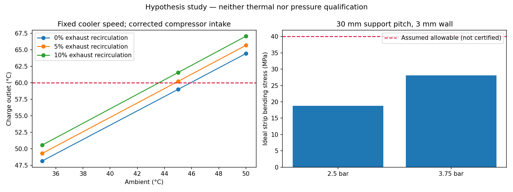
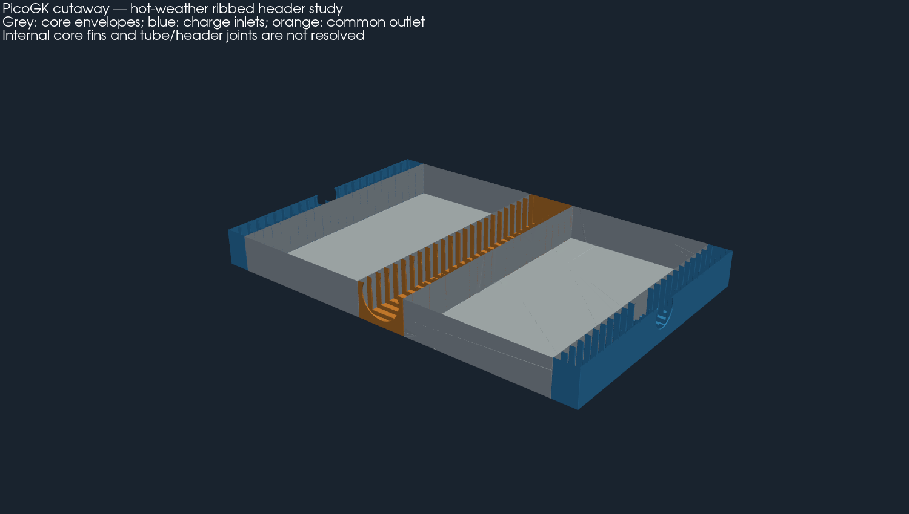
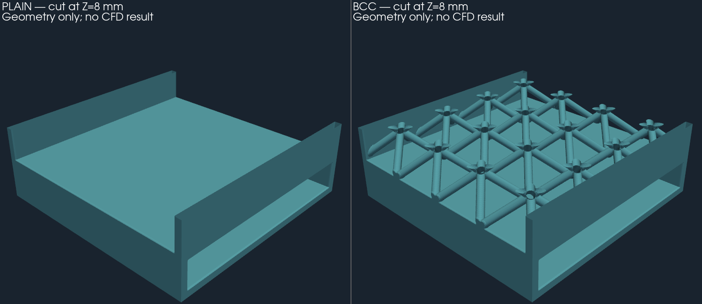

# 750 hp intercooler — continuation at 45 °C and stiffened manifolds

This study extends the [architecture comparison](../architecture/README.md),
on a new branch taken from `main`. The previous evidence remains intact.
It sizes a cooling-fan demand and generates a manifold variant;
it validates neither a printing machine nor a part fitted to the car.

## Corrected assumptions

At 45 °C ambient, the compressor inlet is now **50 °C** (+5 K
assumed). The high case at absolute pressure ratio 3.0 and 65 % efficiency gives **233.3 °C**
at the intercooler inlet. The old 45 °C runs kept 40 °C at
the compressor inlet; they were therefore more favourable on this point.

The [assumptions](assumptions.json) keep the charge target at 60 °C, with
sizing at 59 °C, and an overall budget of 15 kW at the shaft. No vehicle-speed
effect is credited. The engine fan keeps its own
speed. The intercooler fan can vary independently: its position
upstream or downstream and ducts of 0.15 / 0.25 / 0.35 m² are compared.

The inverse calculation finds the required flow, then the relative speed that
would deliver the required pressure on the **previous hypothetical curve**.
The density at the fan inlet is that of the hot air when it is
placed after the intercooler. Its temperature rise is then rejected downstream. The mixing
of a fraction of this air with the intake is iterated. The transfer model
remains the mixed-fluid bound with a UA taken from the historical unmixed calculation.

## Result at 45 °C

**288 cases**, of which two pass the nominal filter without recirculation. The minimum
mass among them is:

| Parameter | Calculation result |
|---|---:|
| Core alone | 800 × 699.6 × 150 mm |
| Analytical core mass | 33.27 kg |
| Envelope with manifolds | 1,070 × 699.6 × 150 mm |
| Fins / separating walls | 0.15 / 0.4 mm |
| Hot / cold pitch, segments | 1.5 / 3 mm, 10 mm segments |
| Intercooler fan | Downstream, drawing through the core |
| Reference duct section | 0.35 m² |
| Cold flow | 4.88 kg/s |
| Point required from the intercooler fan | 4.71 m³/s at 1,154 Pa |
| Intercooler relative speed | 1.361 times the reference curve |
| Intercooler / engine power | 9.05 / 5.74 kW at the shaft |
| Total | 14.79 kW at the shaft |
| Charge outlet / cold-air rejection | 59.0 / 69.1 °C |
| Heat rejected | 109.2 kW |

This point is a **hypothetical specification to be checked against a real
fan**, not a demonstrated performance of the existing impeller. The budget leaves
only 0.21 kW of margin. The 700 mm envelope leaves only 0.4 mm of difference
from the calculated height; this is not a demonstrated acceptable installation clearance.
Pipes, rejection ducts, fans and brackets are excluded from this envelope.

At 35 °C, keeping the same speed wastes power and slightly exceeds
15 kW. The inverse calculation brings the intercooler relative speed down to **0.803** for
59 °C at the charge outlet, with **7.88 kW** in total. The engine remains cooled by
its independent circuit. At 50 °C, the 59 °C target is not reached within the
searched range of 1 to 7 kg/s; this is not proof of universal impossibility.

| Recirculation of rejected air | Charge outlet at 45 °C, fixed speed |
|---|---:|
| 0 % | 59.00 °C |
| 5 % | 60.21 °C |
| 10 % | 61.55 °C |

Physical separation of the intakes and the rejected air is therefore essential to
study. The [JSON](results/study.json) also keeps the 35 and 50 °C cases,
the speed search and the [288 comparison rows](results/sweep.csv).
No physical acceptance field is enabled.



## Pressure: what changes and what is missing

Exploratory assumptions: working pressure **2.5 bar gauge**, numerical proof
case **3.75 bar gauge**, hot modulus 50 GPa and assumed allowable stress
40 MPa. These values are neither an authorised proof-test procedure nor a
certified AlSi10Mg allowable at 233 °C.

The check is a simply supported strip of unit width under pressure:
`sigma = 0,75 p (L/t)²`, `flèche = 5 p L⁴ / (32 E t³)` (flèche = deflection). It assumes rigid continuous
supports. For the historical flat span of 180 mm and t = 3 mm, the
deflection lies far outside the small-deformation range: its elastic
stresses are not physical stresses predicted after yielding.
This geometry cannot be retained on this model.

With ideal supports spaced **30 mm** apart, the 3 mm strip gives **28.1 MPa**
and **0.035 mm** in the 3.75 bar case. The PicoGK variant adds perforated transverse
bulkheads, 3 mm thick, with 12 mm edges.
**The strip calculation does not verify the stiffness of these bulkheads**, their root,
the connection openings, the fillets, fatigue, joints or
thermal stresses. It is not an FEA of the manifold.

Each half-core interface must carry about **39.4 kN** in the
3.75 bar case; a 30 mm cell corresponds to about **1.69 kN** of tributary
load. Measured interfaces and their load path remain required
before functional design of the fastenings and joints.

The stiffeners also reduce the passage: about **49 % free area**
in an inlet bulkhead. An estimate with uniformly distributed off-take, with
an assumed K per bulkhead and orifice losses of 80 / 113 mm, gives:

| Assumed K per bulkhead | Total charge-side loss |
|---|---:|
| 0.5 | 6.40 kPa |
| 1 | 8.27 kPa |
| 2 | 12.02 kPa — exceeds the 10 kPa budget |

These K values are not calibrated. The nominal thermal filter does not validate the real losses
of the bulkheads: CFD and bench testing will have to measure distribution, separation and
losses. This is the trade-off to resolve between stiffening and airflow.

## Geometry and manufacturing



[Complete GLB in metres](derived/layout.glb), [geometry receipt](derived/review.json),
[PicoGK source](source/picogk/Program.cs), [reproducible input](layout-input.json).
The calculated mass of the stiffened manifolds is **8.01 kg**,
or about **41.28 kg with the core**, excluding accessories.
The section applies only to the image: the review STL files remain
closed solids. The core blocks are envelopes; the tube-by-tube
interfaces remain absent. The files are not a complete sealed intercooler.

The [updated coupon card](coupon-input.json) takes up the 3 mm cold
pitch and can be used with the existing coupon generator. It has
not yet led to a new native generation or to a print.

The [official EOS AlSi10Mg data sheet](https://www.eos.info/metal-solutions/data-sheets/all-processes-and-materials?id=eos-aluminium-alsi10mg),
consulted on 12 October 2026, gives in particular a minimum wall of **0.4 mm**
for the M290 at 30 µm layers. It therefore does not qualify our 0.15 mm fins.
The mechanical properties there are given at room temperature; they do not
provide our hot-wall allowables. The PDF link found by search
returned 404; the manufacturer page was consulted directly.

The 699.6 mm tall core also complicates the process: a 45° orientation in
X/Z of each half-core gives about **389 × 700 × 389 mm**, excluding supports,
beyond the 600 mm build plate previously considered. An additional split,
or another machine and orientation, will have to be designed with new thermal
budgets, joints and depowdering access. Thermal sizing does
not constitute approval of a monolithic print.

## Verification and next steps

### ShapeKernel, LatticeLibrary and VDB exchange executed on the Mac

The [coupon generator](source/lattice/Program.cs) actually uses
`ShapeKernel.BaseBox` for the envelopes and passages, and
`LatticeLibrary.BodyCentreLattice` / `CuboidCell` for sixteen BCC cells.
The sources installed under `~/Developer/PicoGK` are compiled without modification;
their versions and digests are in the [receipt](results/lattice-runtime.json).
Both libraries are Apache-2.0; no third-party code or runtime is redistributed.



Two variants of **24 × 24 × 11.4 mm** are generated: a smooth cold passage
and a cold passage with a BCC lattice, with walls and bar diameter of **0.8 mm**,
6 mm cells. The 3 mm hot passage is separated from the 6 mm cold passage.
These are comparative coupons, **not the 0.15 mm fins of the sized
core**: no thermal result of the large core is transferred to the lattice.

At 0.1 mm voxels, compared with the smooth coupon:

| Geometric measurement | BCC variant |
|---|---:|
| Surface in contact with cold air, numerical plugs excluded | +89.5 % |
| Cold-side free volume | −8.4 % |
| Total metal volume | +15.7 % |
| Solid-volume change between 0.2 and 0.1 mm voxels | 1.19 % |

Additional surface does not prove better heat dissipation: bar
efficiency, pressure losses and flow distribution remain unknown. Two
resolutions give a geometric sensitivity, not CFD convergence.
The inclined bars, the ceilings, depowdering and pressure resistance
require a manufacturing study specific to these coupons. The smooth hot passage
has no internal reinforcement: a simply supported strip of span
22.4 mm and thickness 0.8 mm would give **220.5 MPa at 3.75 bar** according to the same
exploratory check, above the assumed 40 MPa. This variant is therefore
**rejected for a boost-pressure proof test** without new
design and validation; here it serves to compare cold-side geometries.

Each file contains **seven named fields**: solid, hot fluid, cold fluid,
two initial temperatures in K and two initial velocities in m/s. The PicoGK
coordinates are in mm: an explicit conversion to metres is required on the solver side.
The initial temperatures are 506.47 K / 318.15 K; the uniform velocities
of 1 m/s serve only to prepare the data exchange, with no link to the
flow of the large intercooler. The three domains read back identical, and all
the original active values of the scalar/vector fields were reread and
compared. The possible presence of additional active values in the
copy is not verified. No thermal or hydraulic solver was executed.

Compressed VDB files: [BCC 0.1 mm](lattice/bcc-0.1-fields.vdb.gz),
[BCC 0.2 mm](lattice/bcc-0.2-fields.vdb.gz), [smooth 0.1 mm](lattice/plain-0.1-fields.vdb.gz),
[smooth 0.2 mm](lattice/plain-0.2-fields.vdb.gz). Decompress before reading the VDB.
The [BCC](lattice/bcc-solid.stl.gz) and [smooth](lattice/plain-solid.stl.gz) STLs
are complete exports; only the image is sectioned.

The [independent check of the exports](lattice/review.json) keeps the raw
defects: at 0.1 mm, 1,680 degenerate/duplicate faces are removed from the BCC solid
and 2,160 from the cold domain. The cleaned surfaces are closed, single-component,
with a volume change below 10⁻⁷. **Acceptance of the raw mesh remains
false**; this cleaning qualifies neither real leak-tightness nor a solver mesh.

```sh
~/Developer/PicoGK/sdk/dotnet build twins/993-intercooler/750-hp/hot-weather/source/lattice/Coupon.csproj -c Release -o work/lattice-bin
# Exécuter sous le verrou PicoGK partagé de parts/picogk-catalog/tools/run_part.py.
~/Developer/PicoGK/sdk/dotnet work/lattice-bin/Coupon.dll twins/993-intercooler/750-hp/hot-weather/results/study.json work/new-lattice 0.1 bcc
```

(The comment in the block reads "Run under the shared PicoGK lock of parts/picogk-catalog/tools/run_part.py.")

### Dossier checks

The tests check energy conservation, fan-curve inversion,
bending laws, the small-deformation range, rejection of invalid inputs and
result digests. The native meshes are inspected before the simplified
exports; the STLs are in mm and the GLB in metres.

```sh
python3 twins/993-intercooler/750-hp/hot-weather/source/study.py --output work/new-hot-weather
python3 -m unittest discover -s tests -p test_993_intercooler_hot_weather.py -v
```

Next priorities: a duct that really separates intake and rejected air, independent
speed control, measured fan curves, FEA of the bulkheads and of the
interfaces with the tubes, then thermal/hydraulic coupons and a specific
LPBF procedure. The assumptions allow the design to continue; they do not
replace these validations.
