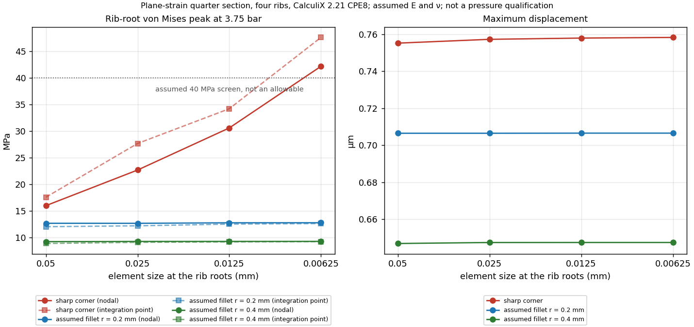

# Ribbed coupon — pressure and cost in the air passage

Continuation of the [ShapeKernel/LatticeLibrary comparison](../hot-weather/README.md),
merged by PR #207. The earlier files remain unchanged.
The smooth 0.8 mm hot passage failed the exploratory pressure check.
This step adds real longitudinal ribs and **twelve CalculiX runs executed
locally**, then checks the PicoGK geometry and its VDB fields.

## Comparison result

Exploratory pressure: **3.75 bar gauge**, assumed hot E **50 GPa**,
assumed ν **0.33**, exploratory threshold **40 MPa**, with no plastic law and no
certified AlSi10Mg allowable at 233 °C. The following results correspond to
0.1 mm target elements, **not to a converged stress solution**:

| Hot ribs | Nodal von Mises peak | Maximum displacement | Passage cross-section |
|---|---:|---:|---:|
| None | 210.2 MPa | 0.1771 mm | 67.2 mm² |
| Two | 44.2 MPa | 0.01143 mm | 62.4 mm² |
| Four | 12.0 MPa | 0.000753 mm | 57.6 mm² |

The two-rib variant exceeds the assumed threshold on the fine mesh.
Four ribs are the candidate to pursue, **without pressure
qualification**. The peaks increase with each refinement at the sharp corners: for
four ribs, 6.87 → 9.11 → 11.96 MPa at element sizes 0.4 → 0.2 → 0.1 mm.
The displacement varies by 0.82 % between the last two meshes, but this
does not demonstrate stress convergence at the rib roots.
The rib-free case exceeds our small-displacement check (10 % of the
thickness); its linear stresses do not predict a plastic response.


## Mechanical model, checks and load path

The model is a **plane-strain quarter of the transverse section**, with
quadratic CPE8 elements. Solver X corresponds to coupon Y, solver Y
to Z minus 2.3 mm; the longitudinal axis of the passage is out of plane. Two symmetry
planes impose only zero normal displacements. The pressure acts
on all internal faces, including both sides of the ribs. The load path
studied connects the top/bottom walls to the ribs and continuous side
walls; it provides no attachment to the engine or the test bench.

The mesh is independent of the STL, built on the analytical section:
0.8 mm walls, 3 mm high hot passage, 0.8 mm thick ribs,
centers at Y = ±3 and ±9 mm for the four-rib variant. The cross-sections and
pressure resultants are checked independently by the tests.
The slice omits the cold lattice, the fittings, the seals, the device
closing the ends, thermal stresses, fatigue and finite-length
effects. The coupon is only 24 mm long: plane strain
is a comparative approximation, not a complete solution of the part.

CalculiX **2.21**, a local image kept by its SHA-256 digest in the
[report](derived/study.json), executed:

- nine pressure cases: 0/2/4 ribs, three meshes;
- one element with prescribed uniform strain, compared against the elastic solution;
- one element under edge pressure, also checking sign and direction;
- the four-rib, 0.2 mm case under half pressure, verifying proportionality.

The analytical comparisons cover the stresses at the 27 integration
points of the expanded CPE8 element and the displacements. Nodal
extrapolation produces a small difference kept in the receipt; it is not
used to modify the native values. The fully prescribed case emits
the expected "no degrees of freedom" warning; the second check actually loads
free degrees of freedom. The inputs, FRD fields, DAT stresses
and logs of the twelve cases are kept in [fea](derived/fea/).
The `.frd.gz` and `.dat.gz` files must be decompressed before opening.

Formulation reference: [official CalculiX 2.23 manual](https://www.dhondt.de/ccx_2.23.pdf),
sections CPE8, `*DLOAD` and `OUTPUT=2D`. The solver executed remains version 2.21;
the two analytical checks concretely verify the functions used.
The download of the 2.21 manual timed out; reading it is not claimed.

## Exploratory hydraulic cost

At **identical total mass flow**, corresponding to 1 m/s in the smooth
passage, air at 506.47 K and 303,975 Pa absolute:

| Ribs | Pressure loss of the short comparison model |
|---|---:|
| None | 3.03 Pa |
| Two | 3.72 Pa |
| Four | 4.87 Pa |

Four ribs remove **14.3 % of the cross-section** and increase the computed loss
by about **60.4 %** in this model. The flow is split between five channels by
equal pressure, without artificially imposing the same flow per channel.
The free widths are 1.8 / 5.2 / 5.2 / 5.2 / 1.8 mm.

The calculation reuses the rectangular laminar resistance of the existing
sizing and adds an assumed K = 2. The 24 mm channels are short: entrance
effects, LPBF roughness, header losses and the real distribution are
not resolved. The estimated entrance lengths are kept per channel.
These figures are neither CFD nor a measurement and do not carry over to the
4.88 kg/s of the full-size exchanger. **No thermal gain is demonstrated yet.**

## Native geometry and VDB


ShapeKernel builds the shells and channels; LatticeLibrary keeps the
sixteen BCC cells on the cold side. The four-rib variant was generated at
**0.2 and 0.1 mm** voxels. The seven named VDB fields keep the three
domains and four initialization fields; their round trip is checked
as in the earlier study. The five hot channels are distinct in the
coupon; the headers that will join them are not modeled.

The independent check rejected a first export: two channels measured
1.8375 mm instead of 1.8 mm. The cause was an interpolation at the coincident
faces of the cutting tools and the fluid ends. The tools
are now extended beyond the fluid domain; the ±0.02 mm check
passes without changing that tolerance. The first export remains kept locally.

The [geometry receipt](derived/review.json) keeps the raw defects and the
cleanup of degenerate/duplicate faces with no significant change in volume.
The cleaned surfaces are closed: one solid component, five hot and
one cold. This topology proves neither real sealing nor the quality
of a future CFD mesh. The sum of the volumes differs from the analytical envelope
by about 0.021 % at 0.1 mm voxels.

- [Full STL, mm, compressed](derived/ribbed-solid.stl.gz)
- [VDB 0.1 mm](derived/ribbed-0.1-fields.vdb.gz), [VDB 0.2 mm](derived/ribbed-0.2-fields.vdb.gz)
- [PicoGK source](source/picogk/Program.cs), [FEA calculation and generation](source/study.py)
- [Versions, build and input checks](runtime.json)

PicoGK coordinates are in mm; temperatures in K and initial velocities
in m/s. The uniform 1 m/s velocity fields are not a fluid
solution. The rights and digests of the installed libraries are rechecked
against the receipt of the previous step; no binary dependency is published.

## Rib-root fillets and stress convergence

*Added 2026-10-14.* The twelve runs above leave the rib-root peak unconverged
because the roots are sharp. This step draws **assumed** root fillets on the
four-rib quarter section and refines the mesh at the roots until the peak
settles. The radii 0.2 and 0.4 mm are design proposals for the next geometry:
nothing was measured or printed, and no LPBF process has been shown to hold
them.



[fillet_convergence.py](source/fillet_convergence.py) reuses the section,
pressure, symmetry planes, assumed E and ν and CPE8 element of
[study.py](source/study.py), which is unchanged. gmsh 4.15.2 meshes the
section from an OpenCASCADE drawing in which each channel is cut with rounded
corners, so only the five wall-side root corners of the quarter receive a
fillet. All elements are 8-node quadrangles. CalculiX 2.21 runs single-threaded
in the `3dprinting993-cadsim` image (`sha256:7fd9720b…`); the 2.21 image of the
first twelve runs was not on this machine. Four levels halve the element size at
the roots, 0.05 → 0.00625 mm, and away from them, 0.2 → 0.025 mm.

| Root | Peak, finest mesh (nodal / integration point) | Richardson extrapolation | GCI, finest mesh |
|---|---:|---:|---:|
| Sharp | 42.2 / 47.6 MPa | none: the peak keeps growing | — |
| Assumed fillet r = 0.2 mm | 12.81 / 12.66 MPa | 12.81 / 12.72 MPa | 0.007 % / 0.6 % |
| Assumed fillet r = 0.4 mm | 9.31 / 9.27 MPa | 9.31 / 9.40 MPa | 0.03 % / 1.9 % |

- The sharp root grows by 1.35–1.42 per halving (16.0 → 22.7 → 30.6 → 42.2 MPa
  nodal). A 270° re-entrant corner has a Williams exponent near 0.545, which
  predicts about 2^0.455 ≈ 1.37 per halving: the growth is the expected
  singularity, so no sharp-root stress can be quoted.
- With either assumed fillet, the nodal and integration-point peaks converge to
  within 1 % of each other. The integration-point sequence at r = 0.4 mm has a
  low observed order (0.48), so its extrapolation is the least certain value in
  the table.
- The converged peaks sit below the assumed 40 MPa screen. That screen is not an
  allowable: hot AlSi10Mg properties at 233 °C, LPBF surface notches, fatigue,
  thermal stress and the 3D ends are not covered, and no catalogue source gives a
  hot allowable yet. **No pressure strength is qualified.**
- In this plane model the stress field does not depend on the assumed E; the
  displacements do.

Independent checks recorded per case: the pressure resultant of the loaded faces
equals 0.5625 and 3.6 N/mm (pressure × 1.5 mm and × 9.6 mm), the solver's
symmetry-plane reactions balance it, the drawn area equals the analytical area
including (1 − π/4) r² per fillet, and the sharp case reproduces the
displacement of the first study's 0.1 mm mesh to within 1 %. A first attempt that
loaded every edge reproduced a uniform hydrostatic state exactly before the
filter was corrected.

The fillets fill 0.17 mm² (r = 0.2) or 0.69 mm² (r = 0.4) of the 57.6 mm² full
hot section. The hydraulic proxy is re-run for them in the next section.

The [summary](derived/fillet-convergence/fillet-convergence.json), per-case
receipts and solver logs are committed. The decks, FRD and DAT files, about
240 MB, are identified by SHA-256 in the receipts and not committed; every deck
regenerates byte for byte. The 0.4 mm finest case was killed by a 3 GB memory cap,
then solved alone at 8 GB with `--resume`, which reuses the eleven finished cases
only after checking their digests and regenerating their decks; the summary
records this.

## Hydraulic proxy with the assumed fillets

*Added 2026-10-15.* [fillet_hydraulics.py](source/fillet_hydraulics.py) repeats the
equal-pressure split of the exploratory hydraulic cost above for the four-rib
section with the same assumed 0.2 and 0.4 mm root fillets, at the same total mass
flow, gas state and assumed K = 2. [study.py](source/study.py) is unchanged. Instead
of the rectangular-duct formula, each channel cross-section is meshed with gmsh
(6-node triangles, four sizes from 0.2 to 0.025 mm) and the fully developed laminar
problem is solved by finite elements; the flow resistance follows from the integral
of the solution. The sharp section reproduces the exact rectangular series to
better than 1e-6, so the study's 4.866 Pa is recovered as 4.865 Pa.

| Root | Open full section | fRe, 1.8 / 5.2 mm channel | Pressure loss | Change |
|---|---:|---:|---:|---:|
| Sharp | 57.60 mm² | 59.92 / 60.37 | 4.865 Pa | — |
| Assumed fillet r = 0.2 mm | 57.43 mm² | 63.31 / 62.58 | 4.881 Pa | +0.33 % |
| Assumed fillet r = 0.4 mm | 56.91 mm² | 65.18 / 64.18 | 4.937 Pa | +1.47 % |

- The fillets raise fRe, but they also raise the hydraulic diameter, so the
  friction loss per channel barely moves. Most of the increase comes from the
  assumed K = 2 acting on a slightly higher mean velocity.
- In this model the fillets cost far less than the ribs themselves (+60 % against
  the smooth passage).
- The model still assumes fully developed flow. The estimated laminar entrance
  length (0.05 Re Dh) is 0.7 to 0.8 channel lengths for the 1.8 mm channels and
  2.9 to 3.1 channel lengths for the 5.2 mm channels, so the wide channels never
  become fully developed in 24 mm. Roughness, headers and heat transfer are not
  modelled either. **This remains a proxy; no hydraulic performance is accepted.**

The [receipt](derived/fillet-hydraulics/fillet-hydraulics.json) keeps every
section, its mesh convergence (GCI below 1e-7), the split per channel and the
hashes of the inputs.

## Exploratory channel CFD

*Added 2026-10-15.* [channel_cfd.py](source/channel_cfd.py) is the first CFD case
of the ribbed hot passage. It is isothermal, incompressible and laminar, and runs
OpenFOAM 13 (`incompressibleFluid`, steady SIMPLE) in the `3dprinting993-cadsim`
image at the gas state of [study.py](source/study.py). Each distinct channel,
1.8 and 5.2 mm wide, 3 mm high and 24 mm long, is a quarter duct with two symmetry
planes. The sharp section and the assumed 0.2 and 0.4 mm fillets are meshed with
gmsh quadrangles extruded into hexahedra, with fine cells at the inlet.

- **Boundary conditions.** The inlet is a uniform total pressure, which stands
  for a quiescent upstream plenum. The outlet is a uniform static pressure and the
  walls are no-slip. The developing flow that the proxy leaves out is therefore
  resolved. Sharp-edge inlet separation, headers, roughness, compressibility and
  heat transfer are not.
- **Runs.** Every case runs at 0.95 times the proxy pressure drop on three meshes
  (0.141, 0.1 and 0.071 mm, up to 112,000 cells). The finest mesh also runs at
  1.05 times, and a two-term fit dp = a·m + b·m² per channel gives the
  equal-pressure split at the study's total mass flow.
- **Convergence.** All 24 cases reach the SIMPLE residual targets (p 1e-8,
  U 1e-9), with flow-rate drift below 1e-6 over the last 50 iterations and inlet
  and outlet flows balanced to 1e-9.

| Root | CFD pressure loss, finest mesh | Fully developed proxy | CFD / proxy |
|---|---:|---:|---:|
| Sharp | 4.99 Pa | 4.87 Pa | 1.026 |
| Assumed fillet r = 0.2 mm | 5.00 Pa | 4.88 Pa | 1.024 |
| Assumed fillet r = 0.4 mm | 5.02 Pa | 4.94 Pa | 1.016 |

- With developing flow, the loss is 2 to 3 % above the proxy, so the short-channel
  proxy with the assumed K = 2 holds within a few percent for this inlet
  condition. The flow split between the narrow and wide channels moves by less
  than 2 %.
- The fillet effect cannot be separated from mesh error here. Between the three
  meshes, the channel flow rate at fixed pressure varies by 0.3 to 1.2 %, and not
  monotonically in every channel. The CFD's +0.1 % (r = 0.2) and +0.5 % (r = 0.4)
  sit inside that band. Only the proxy's +0.33 % and +1.47 % above are resolved.
- **This is an exploratory calculation, not a measurement.** A sharp-edged or
  manifold-fed inlet would add losses that this case does not contain.
  No hydraulic performance and no thermal gain are claimed.

The [summary](derived/channel-cfd/channel-cfd.json) and the 24
[case folders](derived/channel-cfd/) keep the dictionaries, the compressed mesh
and solver logs, and per-case receipts. The gmsh meshes and the field results are
identified by SHA-256 and not committed; the generator rewrites them.

## Assumed fillets in the PicoGK geometry

*Added 2026-10-16.* [picogk-fillet/Program.cs](source/picogk-fillet/Program.cs)
regenerates the four-rib coupon with the **assumed** 0.2 and 0.4 mm root fillets on
every corner of the five hot channels. Each channel is an exact signed-distance
implicit (a rounded rectangle extruded over the 24 mm length) instead of the box
cutters of the Mac source. The envelope, cold box, BCC lattice and the seven VDB
fields follow [the Mac source](source/picogk/Program.cs). The radii are design
proposals from the stress study, not measured or printed values.

- **Runtime.** This runs on the Linux host stack in `~/picogk`, not on the Mac SDK:
  PicoGK `0e6cf6b` with the native runtime `0f26321` (PicoGK 26.2.0), ShapeKernel
  `554bce4` (newer than the `7b90978` pinned in `containers/m64-leap71/sources.lock`)
  and LatticeLibrary `81c3c7b`, which no lock pins. Each run records these commits.
  The Mac sources, [runtime.json](runtime.json) and [review.json](derived/review.json)
  are unchanged and remain the record of the Mac runs.
- **Runs.** Five runs, each under a 6 GB cap: sharp and r = 0.4 mm at 0.1 mm voxels,
  and sharp, r = 0.2 and r = 0.4 mm at 0.05 mm voxels. The program refuses a fillet
  narrower than four voxels.
- **Independent check.** [fillet_geometry_review.py](source/fillet_geometry_review.py)
  measures the exported STLs with trimesh in the cadsim image. All five runs keep one
  solid, five hot channels and one cold body, closed after removing degenerate and
  duplicate faces. Every channel measures 1.8 or 5.2 mm wide, 3 mm high and 24 mm long
  within ±0.02 mm. The three volumes sum to the envelope within 0.04 %. The sharp
  0.1 mm Linux run differs from the Mac 0.1 mm run by +0.04 % (solid), −0.14 % (hot)
  and below 1e-7 (cold).
- **Fillet area.** The area a fillet removes per corner is measured as the section
  lost against the sharp run at the same voxel size, and compared with the analytic
  (1 − π/4) r² (0.0086 mm² for r = 0.2, 0.0343 mm² for r = 0.4). The ±15 % tolerance
  was fixed before the runs.

| Run | r / voxel | Error per channel | Within ±15 % |
|---|---:|---|---|
| r = 0.4 mm, 0.05 mm voxels | 8 | −1.3 to −4.3 % | yes |
| r = 0.2 mm, 0.05 mm voxels | 4 | −3.6 % (outer four), −12.5 % (middle) | yes |
| r = 0.4 mm, 0.1 mm voxels | 4 | −4.9 to −16.5 % (middle) | **no** |

- The measured fillet is always slightly smaller than the analytic one, and the gap
  shrinks as the fillet spans more voxels. At four voxels the middle channel is the
  worst case. The failed 0.1 mm check is kept in the report as failed; the tolerance
  was not changed. Only the 0.05 mm runs represent the assumed fillets.
- **This is geometry only.** No solver ran on it. It says nothing about whether LPBF
  can hold a 0.2 to 0.4 mm root fillet, and it qualifies no pressure strength.

The [report](derived/fillet-geometry/fillet-geometry.json) keeps every native receipt
and runtime record, the per-part measurements and the hashes of the sources.
The [sections](derived/fillet-geometry/fillet-geometry-sections.png) show the hot
channels at mid-length. The STL and VDB outputs (up to 276 MB per file) are
identified by SHA-256 and not committed.

## Reproduction and next steps

```sh
python3 twins/993-intercooler/750-hp/pressure-coupon/source/study.py --output work/new-pressure
docker run --rm --network none --cpus 1 --memory 8g --memory-swap 8g -e OMP_NUM_THREADS=1 -v "$PWD":/repo:ro -v "$PWD/work":/out -w /tmp 3dprinting993-cadsim:dev \
  python3 -B /repo/twins/993-intercooler/750-hp/pressure-coupon/source/fillet_convergence.py --output /out/new-fillets \
  --image-id "$(docker image inspect 3dprinting993-cadsim:dev --format '{{.Id}}')"
python3 twins/993-intercooler/750-hp/pressure-coupon/source/fillet_review.py --output work/new-fillet-convergence.png
docker run --rm --network none --cpus 2 --memory 3g --memory-swap 3g -v "$PWD":/repo:ro -v "$PWD/work":/out -w /tmp 3dprinting993-cadsim:dev \
  python3 -B /repo/twins/993-intercooler/750-hp/pressure-coupon/source/fillet_hydraulics.py --output /out/new-fillet-hydraulics \
  --image-id "$(docker image inspect 3dprinting993-cadsim:dev --format '{{.Id}}')"
flock /tmp/porscheparts-heavy.lock docker run --rm --network none --cpus 4 --memory 6g --memory-swap 6g -e OMP_NUM_THREADS=1 -v "$PWD":/repo:ro -v "$PWD/work":/out -w /tmp 3dprinting993-cadsim:dev \
  python3 -B /repo/twins/993-intercooler/750-hp/pressure-coupon/source/channel_cfd.py --output /out/new-channel-cfd \
  --proxy /repo/twins/993-intercooler/750-hp/pressure-coupon/derived/fillet-hydraulics/fillet-hydraulics.json \
  --image-id "$(docker image inspect 3dprinting993-cadsim:dev --format '{{.Id}}')" --workers 4
for case in "0.1 0" "0.1 0.4" "0.05 0" "0.05 0.2" "0.05 0.4"; do set -- $case
  flock /tmp/porscheparts-heavy.lock twins/993-intercooler/750-hp/pressure-coupon/source/picogk-fillet/run.sh \
    "$PWD/work/picogk-fillet-build" "$PWD/work/picogk-fillet/r$2-v$1" "$1" "$2" 6G
done
flock /tmp/porscheparts-heavy.lock docker run --rm --network none --cpus 4 --memory 6g --memory-swap 6g --user "$(id -u):$(id -g)" \
  -v "$PWD":/repo:ro -v "$PWD/work/picogk-fillet":/native:ro -v "$PWD/work":/out -w /tmp 3dprinting993-cadsim:dev \
  python3 -B /repo/twins/993-intercooler/750-hp/pressure-coupon/source/fillet_geometry_review.py --native /native --output /out/new-fillet-geometry
python3 -m unittest discover -s tests -p test_993_intercooler_pressure_coupon.py -v
```

The first call uses only the pinned local Docker image, with the network
off, two CPUs and 2 GB maximum; it launches no paid remote computation.
The PicoGK generation uses the SDK `~/Developer/PicoGK/sdk/dotnet` and must
take the shared lock of `parts/picogk-catalog/tools/run_part.py`.

The fillet study runs on one CPU; its finest meshes need up to 8 GB.

The Mac PicoGK generation above uses the SDK `~/Developer/PicoGK/sdk/dotnet`. The
filleted Linux generation uses `~/picogk/env.sh` and the host stack; it needs the
native runtime in `~/picogk/native` and is not reproducible on the Mac SDK as is.

The assumed fillets are now drawn in the geometry. The next mechanical steps are to
choose a radius, confirm the process can hold it, and run a 3D study with fittings
and support conditions.
The passages will also have to be compared by CHT (the CFD above is hydraulic
only) or on a bench, then orientation, overhangs, depowdering, hot material and
sealing qualified.
**No authorization to print or to pressure-test is given.**
