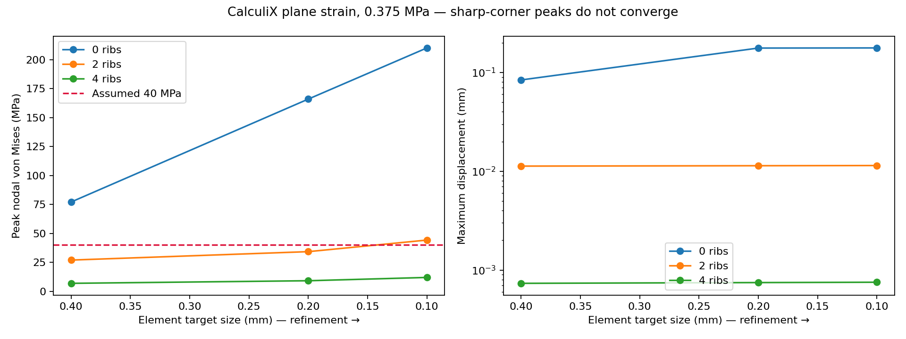
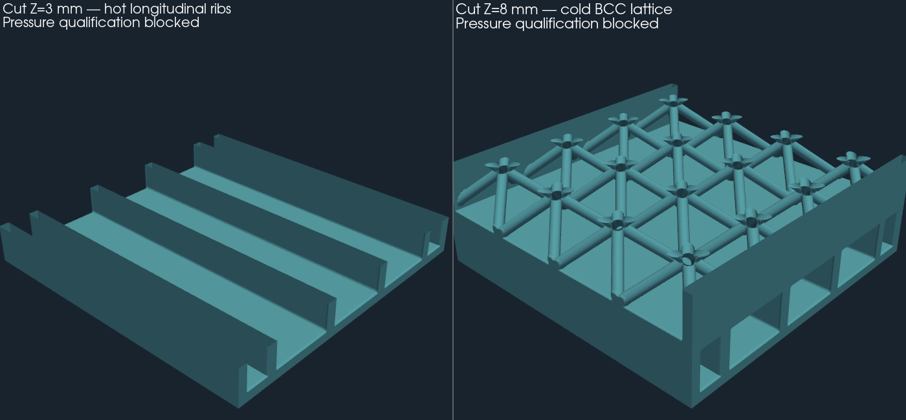

# Ribbed coupon — pressure and cost in the air passage

Continuation of the [ShapeKernel/LatticeLibrary comparison](../hot-weather/README.md),
merged by PR #207. The earlier files remain unchanged.
The smooth 0.8 mm hot passage failed the exploratory pressure check.
This step adds real longitudinal ribs and **twelve CalculiX runs executed
locally**, then checks the PicoGK geometry and its VDB fields.

## Comparison result

Exploratory pressure: **3.75 bar gauge**, assumed hot E **50 GPa**,
assumed ν **0.33**, exploratory threshold **40 MPa**, with no plastic law and no
certified AlSi10Mg allowable at 233 °C. The following results correspond to
0.1 mm target elements, **not to a converged stress solution**:

| Hot ribs | Nodal von Mises peak | Maximum displacement | Passage cross-section |
|---|---:|---:|---:|
| None | 210.2 MPa | 0.1771 mm | 67.2 mm² |
| Two | 44.2 MPa | 0.01143 mm | 62.4 mm² |
| Four | 12.0 MPa | 0.000753 mm | 57.6 mm² |

The two-rib variant exceeds the assumed threshold on the fine mesh.
Four ribs are the candidate to pursue, **without pressure
qualification**. The peaks increase with each refinement at the sharp corners: for
four ribs, 6.87 → 9.11 → 11.96 MPa at element sizes 0.4 → 0.2 → 0.1 mm.
The displacement varies by 0.82 % between the last two meshes, but this
does not demonstrate stress convergence at the rib roots.
The rib-free case exceeds our small-displacement check (10 % of the
thickness); its linear stresses do not predict a plastic response.



## Mechanical model, checks and load path

The model is a **plane-strain quarter of the transverse section**, with
quadratic CPE8 elements. Solver X corresponds to coupon Y, solver Y
to Z minus 2.3 mm; the longitudinal axis of the passage is out of plane. Two symmetry
planes impose only zero normal displacements. The pressure acts
on all internal faces, including both sides of the ribs. The load path
studied connects the top/bottom walls to the ribs and continuous side
walls; it provides no attachment to the engine or the test bench.

The mesh is independent of the STL, built on the analytical section:
0.8 mm walls, 3 mm high hot passage, 0.8 mm thick ribs,
centers at Y = ±3 and ±9 mm for the four-rib variant. The cross-sections and
pressure resultants are checked independently by the tests.
The slice omits the cold lattice, the fittings, the seals, the device
closing the ends, thermal stresses, fatigue and finite-length
effects. The coupon is only 24 mm long: plane strain
is a comparative approximation, not a complete solution of the part.

CalculiX **2.21**, a local image kept by its SHA-256 digest in the
[report](derived/study.json), executed:

- nine pressure cases: 0/2/4 ribs, three meshes;
- one element with prescribed uniform strain, compared against the elastic solution;
- one element under edge pressure, also checking sign and direction;
- the four-rib, 0.2 mm case under half pressure, verifying proportionality.

The analytical comparisons cover the stresses at the 27 integration
points of the expanded CPE8 element and the displacements. Nodal
extrapolation produces a small difference kept in the receipt; it is not
used to modify the native values. The fully prescribed case emits
the expected "no degrees of freedom" warning; the second check actually loads
free degrees of freedom. The inputs, FRD fields, DAT stresses
and logs of the twelve cases are kept in [fea](derived/fea/).
The `.frd.gz` and `.dat.gz` files must be decompressed before opening.

Formulation reference: [official CalculiX 2.23 manual](https://www.dhondt.de/ccx_2.23.pdf),
sections CPE8, `*DLOAD` and `OUTPUT=2D`. The solver executed remains version 2.21;
the two analytical checks concretely verify the functions used.
The download of the 2.21 manual timed out; reading it is not claimed.

## Exploratory hydraulic cost

At **identical total mass flow**, corresponding to 1 m/s in the smooth
passage, air at 506.47 K and 303,975 Pa absolute:

| Ribs | Pressure loss of the short comparison model |
|---|---:|
| None | 3.03 Pa |
| Two | 3.72 Pa |
| Four | 4.87 Pa |

Four ribs remove **14.3 % of the cross-section** and increase the computed loss
by about **60.4 %** in this model. The flow is split between five channels by
equal pressure, without artificially imposing the same flow per channel.
The free widths are 1.8 / 5.2 / 5.2 / 5.2 / 1.8 mm.

The calculation reuses the rectangular laminar resistance of the existing
sizing and adds an assumed K = 2. The 24 mm channels are short: entrance
effects, LPBF roughness, header losses and the real distribution are
not resolved. The estimated entrance lengths are kept per channel.
These figures are neither CFD nor a measurement and do not carry over to the
4.88 kg/s of the full-size exchanger. **No thermal gain is demonstrated yet.**

## Native geometry and VDB



ShapeKernel builds the shells and channels; LatticeLibrary keeps the
sixteen BCC cells on the cold side. The four-rib variant was generated at
**0.2 and 0.1 mm** voxels. The seven named VDB fields keep the three
domains and four initialization fields; their round trip is checked
as in the earlier study. The five hot channels are distinct in the
coupon; the headers that will join them are not modeled.

The independent check rejected a first export: two channels measured
1.8375 mm instead of 1.8 mm. The cause was an interpolation at the coincident
faces of the cutting tools and the fluid ends. The tools
are now extended beyond the fluid domain; the ±0.02 mm check
passes without changing that tolerance. The first export remains kept locally.

The [geometry receipt](derived/review.json) keeps the raw defects and the
cleanup of degenerate/duplicate faces with no significant change in volume.
The cleaned surfaces are closed: one solid component, five hot and
one cold. This topology proves neither real sealing nor the quality
of a future CFD mesh. The sum of the volumes differs from the analytical envelope
by about 0.021 % at 0.1 mm voxels.

- [Full STL, mm, compressed](derived/ribbed-solid.stl.gz)
- [VDB 0.1 mm](derived/ribbed-0.1-fields.vdb.gz), [VDB 0.2 mm](derived/ribbed-0.2-fields.vdb.gz)
- [PicoGK source](source/picogk/Program.cs), [FEA calculation and generation](source/study.py)
- [Versions, build and input checks](runtime.json)

PicoGK coordinates are in mm; temperatures in K and initial velocities
in m/s. The uniform 1 m/s velocity fields are not a fluid
solution. The rights and digests of the installed libraries are rechecked
against the receipt of the previous step; no binary dependency is published.

## Reproduction and next steps

```sh
python3 twins/993-intercooler/750-hp/pressure-coupon/source/study.py --output work/new-pressure
python3 -m unittest discover -s tests -p test_993_intercooler_pressure_coupon.py -v
```

The first call uses only the pinned local Docker image, with the network
off, two CPUs and 2 GB maximum; it launches no paid remote computation.
The PicoGK generation uses the SDK `~/Developer/PicoGK/sdk/dotnet` and must
take the shared lock of `parts/picogk-catalog/tools/run_part.py`.

The next mechanical step is to draw fillets at the rib roots,
mesh them conformally and run a 3D study with fittings and support conditions.
The passages will also have to be compared by CFD/CHT or on a bench, then
orientation, overhangs, depowdering, hot material and sealing qualified.
**No authorization to print or to pressure-test is given.**
