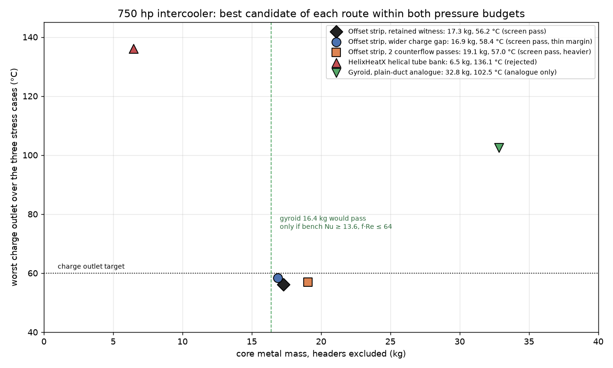
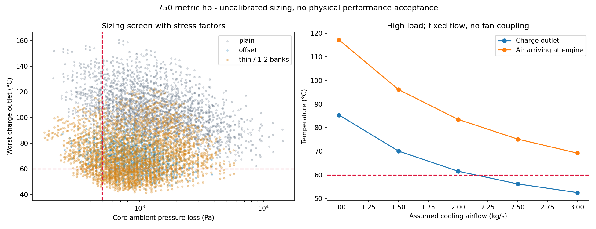
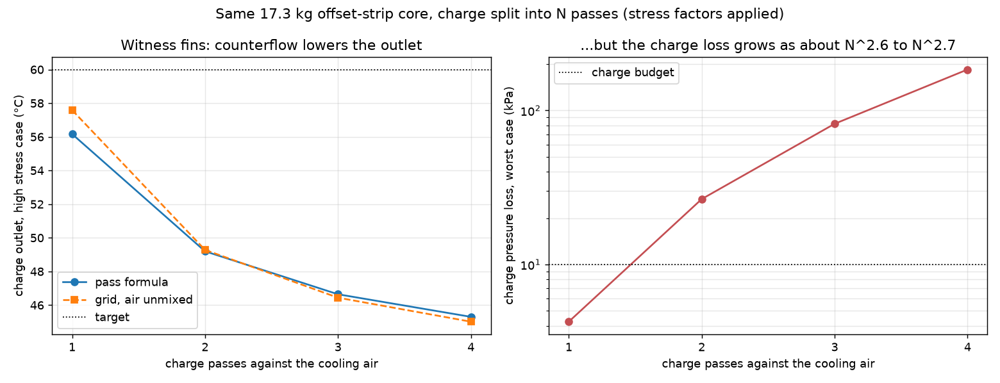
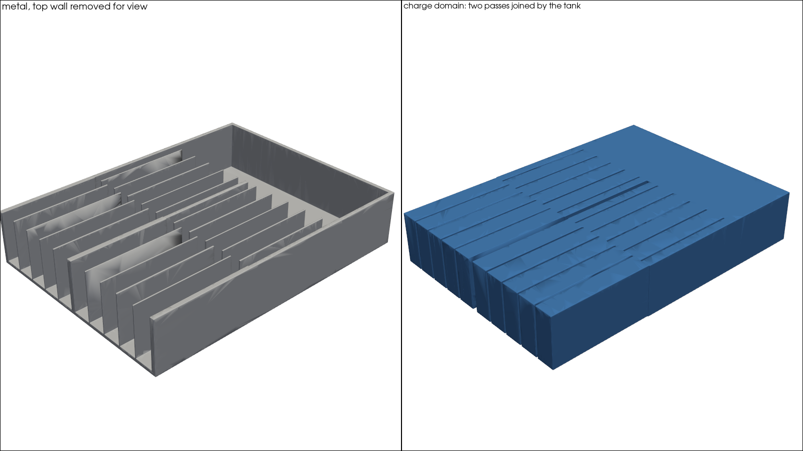
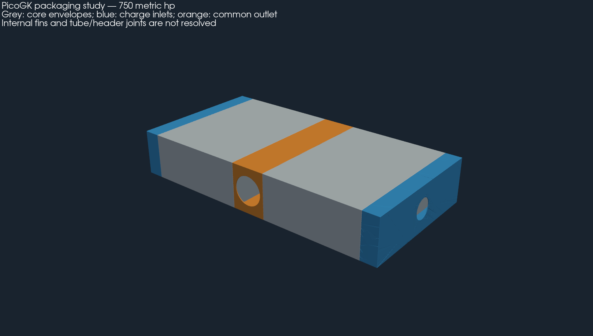

# 993 intercooler

This directory gathers the 993 intercooler work in one place. The engineering
studies live here. Catalogue parts and their source records must stay where the
catalogue expects them: `catalog/parts/*.json` is the source of truth and each
part keeps its own `parts/<part-id>/` directory. They are listed below.

Nothing here releases a part. Each page states its own fidelity level and limits.
The flanges, inlet and outlet axes and mounts of OEM part `993 110 330 53` are
not measured in this repository, and no study invents them.



## Studies in this directory

| Directory | What it is | Outcome |
|---|---|---|
| [750-hp/](750-hp/README.md) | thermal sizing of a horizontal 750 hp core under the wing, plain and offset-strip fins, PicoGK coupons (French) | 17.3 kg thin-fin offset-strip core retained as the screen witness |
| [750-hp/architecture/](750-hp/architecture/README.md) | fan operating point and PicoGK headers for packaging under user-authorized assumptions (French) | layout envelopes only |
| [750-hp/hot-weather/](750-hp/hot-weather/README.md) | 45 °C continuation, fan demand and stiffened headers, lattice coupons (French) | layout and coupons only |
| [750-hp/core-comparison/](750-hp/core-comparison/README.md) | offset strip against a HelixHeatX helical tube bank and a two-network gyroid | helical rejected; gyroid needs bench data |
| [750-hp/counterflow-passes/](750-hp/counterflow-passes/README.md) | charge in 1 to 4 passes against the cooling air, return-tank losses charged | counterflow passes are 2 kg heavier; not adopted |
| [750-hp/pressure-coupon/](750-hp/pressure-coupon/README.md) | hot-passage pressure coupon with 0, 2 and 4 longitudinal ribs: twelve local CalculiX plane-strain runs, PicoGK geometry and VDB fields, exploratory hydraulic cost (French) | four ribs is the candidate to pursue, not pressure-qualified; root stresses not converged |
| [bracket-ti-f0/](bracket-ti-f0/) | CalculiX screen of the titanium intercooler bracket (`TWIN-993-INTERCOOLER-BRACKET-TI-F0`) | `F1_envelope` |

The [overview figure](derived/overview.png) is drawn by
[source/overview.py](source/overview.py) from the retained results only. It
places the best candidate of each route within both pressure budgets.

|  |  |
|---|---|
|  |  |
|  |  |

## Catalogue parts kept in place

| Record | Part directory | Page |
|---|---|---|
| [993-eng-intercooler-bracket-ti-f0-0001](../../catalog/parts/993-eng-intercooler-bracket-ti-f0-0001.json) | [parts/…/](../../parts/993-eng-intercooler-bracket-ti-f0-0001/README.md) | [docs/993](../../docs/993/993_INTERCOOLER_BRACKET_TI_F0.md) |
| [993-eng-intercooler-end-tank-alsi10mg-f0-0001](../../catalog/parts/993-eng-intercooler-end-tank-alsi10mg-f0-0001.json) | [parts/…/](../../parts/993-eng-intercooler-end-tank-alsi10mg-f0-0001/README.md) | [docs/993](../../docs/993/993_INTERCOOLER_END_TANK_ALSI10MG_F0.md) |
| twin record [twin-993-intercooler-bracket-ti-f0](../../catalog/twins/twin-993-intercooler-bracket-ti-f0.json) | [bracket-ti-f0/](bracket-ti-f0/) | |
| related: M64 charge-air path concept | [parts/m64-charge-air-0001/](../../parts/m64-charge-air-0001/README.md) | |

## Related work elsewhere

- [993-installed-cooling-f1](../993-installed-cooling-f1/README.md) is the
  installed cooling twin. It holds the independent interface contract that every
  study here uses, and the provisional intercooler envelope in its assembly.
- Source records in `catalog/sources/` cover published intercooler dimensions
  and data: AKS Dasis, Albert Motorsport, Cargraphic, FVD (motorsport core,
  brackets, ducts, hoses, charge-air sensor), TA Technix, and a Porschefanatics
  end-tank candidate.
- Tests: `tests/test_993_intercooler_*.py` and
  `tests/test_993_installed_cooling_f1.py`.

## Moved paths

On 2026-10-13 two directories moved here, with their contents unchanged:

- `twins/993-installed-cooling-f1/intercooler-750/` became [750-hp/](750-hp/);
- `twins/993-intercooler-bracket-ti-f0/` became [bracket-ti-f0/](bracket-ti-f0/).

The depth of each file below `twins/` is unchanged, so relative project paths
and every pinned digest still hold. The `runtime.json` attestations keep the
paths under which those runs actually took place, and are not rewritten.

## Reproduction

```sh
python3 twins/993-intercooler/source/overview.py --output work/new-overview
```
