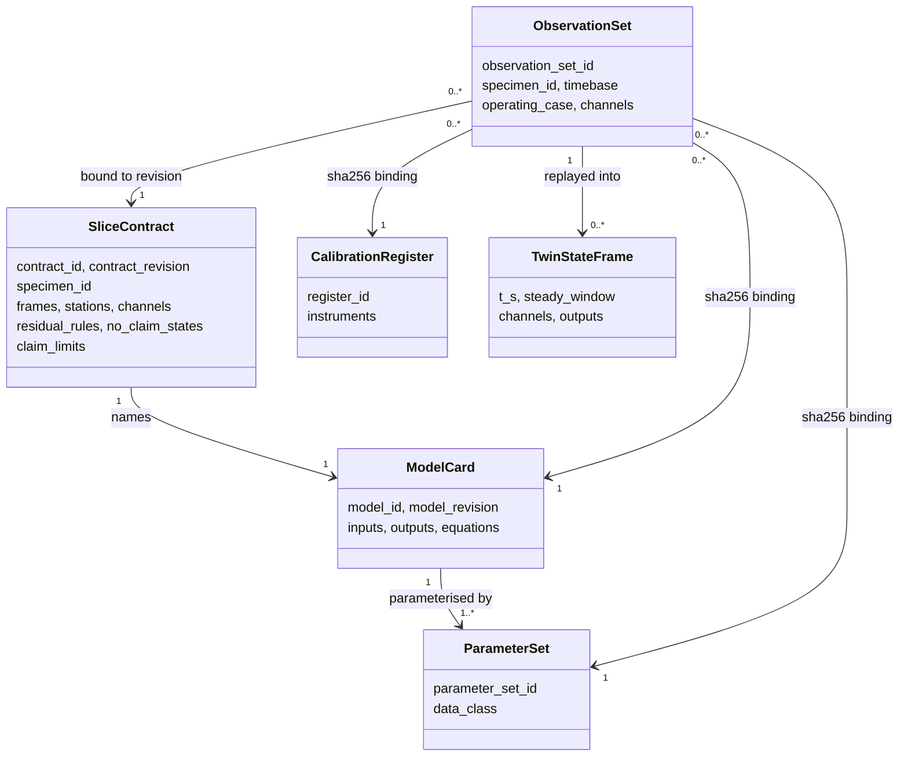

# 993 Turbo cooling fan: operational observation contract

**Status: contract and synthetic fixtures only. No physical specimen, no
measurement, no physical correlation and no live twin.** Every observation in
this directory is synthetic and labelled as such. The highest status any
software pass here can reach is `digitally_checked`.

This directory answers issue #510: one bounded operating slice of one 993
variant, with a versioned contract for specimen-linked, timestamped
observations and for the twin state they update. It does not extend the
static fidelity levels of [the digital twin](../../docs/DIGITAL_TWIN.md); it
adds the observation side those levels lacked.

## Slice

| Item | Value |
|---|---|
| Variant | 993 Turbo, M64/60, model years 1995–1998 ([M64 programme](../m64-engine-system/program.json), zone `M64-Z-CL`, acquisition contract `M64-ACQ-0005`) |
| Specimen | `SPEC-993T-FAN-SYN-0001`, a synthetic placeholder for one fitted cooling-fan assembly; anonymous by policy |
| Component frame | `F_FAN`: origin at the impeller front face on the axis, Z toward the rear of the engine, mm (axis convention of [TWIN-993-ENGINE-COOLING-FAN-SYSTEM-F0](../../catalog/twins/twin-993-engine-cooling-fan-system-f0.json), whose results are not used) |
| Operating case | `OC-STATIONARY-HOLDS`: engine warm, vehicle stationary, declared steady holds |
| Inputs | crankshaft speed `N_CRANK`, inlet air temperature `T_IN`, ambient pressure `P_AMB` |
| Predicted and observed | fan speed `N_FAN` (about +Z of `F_FAN`), fan static pressure rise `DP_FAN`, fan-outlet air temperature `T_OUT` |
| Model | [`MDL-993T-FAN-QS0D` 1.0.0](contract/model-card.json): belt drive, fan affinity laws on one system curve, fan work heating the air |
| Parameters | [`PAR-993T-FAN-SYN-0001`](contract/parameters-synthetic-0001.json): synthetic placeholders, none a Porsche value |
| Excluded | whole car and whole engine, cylinder and oil temperatures, air distribution, transients, structure |

The contract itself is [contract/slice.json](contract/slice.json), validated
against [catalog/schemas/operational-twin.schema.json](../../catalog/schemas/operational-twin.schema.json).

## What the contract fixes

- **Units.** Each quantity has one canonical SI unit and a closed list of
  accepted units with explicit scale and offset. The validator compares every
  factor with the physical constant (rpm to rad/s is π/30); uncertainties
  convert by the scale only.
- **Frames and stations.** Sensor mounts carry a proper rotation and a
  translation into `F_FAN`. The validator transforms each mount and checks it
  lies in its station (inlet, outlet) or senses about the fan axis.
- **Timebase.** One monotonic acquisition clock per observation set, with
  resolution, inter-channel skew and drift bounded by the contract; every
  channel must name that clock.
- **Calibration and uncertainty.** Each channel cites an instrument and a
  calibration record in a register bound by hash; the record gives the unit,
  range, validity window and standard uncertainty (absolute and relative).
- **Cadence and staleness.** Each channel has a nominal period and a maximum
  sample age.
- **Sample flags.** `ok`, `missing`, `source_outlier`, `sensor_fault`; late,
  duplicate and out-of-order samples have declared handling.
- **Residual rules, declared before any replay.** `r = observed − predicted`,
  `z = r / u_r`; consistent if |z| ≤ 2, discrepant if |z| > 3, otherwise
  indeterminate, with minimum frame counts and fractions per output.
- **No-claim states.** Eleven named reasons (missing, stale, late, sensor
  fault, source outlier, out of range, calibration invalid, outside envelope,
  transient, not steady, input unavailable).
- **Offline replay against live synchronisation.** Only offline replay is
  specified; live synchronisation is `not_implemented` and an observation set
  that declares it is refused.
- **Bindings.** Observations bind the contract revision, specimen, model card,
  parameter set and calibration register; the last three by canonical-JSON
  sha256.
- **Privacy and rights.** Anonymous specimen IDs only; VIN-shaped tokens and
  identifying field names are refused anywhere. Measured samples may not be
  stored in Git: they are referenced by `samples_ref` (hash and count) and need
  a consent reference and measured calibration certificates.



## Fixtures

- [fixtures/observations-synthetic-0001.json](fixtures/observations-synthetic-0001.json):
  170 s with holds at 800, 3000 and 4500 rpm, generated by
  [source/make_synthetic_observations.py](source/make_synthetic_observations.py)
  (seed 51011). It carries a missing value, a source outlier, a three-sample
  sensor fault, a four-second outlet-temperature gap, two late arrivals, an
  exact duplicate, an out-of-order arrival and an injected belt-slip change
  after 115 s that the model does not know.
- [fixtures/calibration-register-synthetic-0001.json](fixtures/calibration-register-synthetic-0001.json):
  six synthetic instruments with declared uncertainties and no certificate.
- [fixtures/invalid/](fixtures/invalid/): 25 negative fixtures. Each is a JSON
  patch of the valid bundle with the exact set of error codes it must produce.

```bash
python3 scripts/validate_operational_twin.py
python3 twins/993-turbo-cooling-fan-operational-f0/source/make_synthetic_observations.py --check
python3 -m unittest tests.test_993_operational_twin_contract
```

## What still blocks physical synchronisation

Under the [project charter](../../docs/PROJECT_CHARTER.md) nothing is measured
in-house, so each of these needs an outside contributor or a sourced document.
They are recorded as `open_blockers` in the contract.

1. A lawful observation set from an instrumented 993 Turbo, with recorded
   consent and rights.
2. The documented identity of the fitted impeller, fan housing and pulleys,
   held privately behind the anonymous specimen ID.
3. The sourced drive ratio and belt slip (`M64-ACQ-0005`).
4. A sourced fan pressure-rise characteristic and efficiency.
5. Traceable calibration certificates covering the session.
6. Measured sensor positions in `F_FAN`, and the `F_FAN` to engine-frame
   transform.
7. A measured skew and drift of the acquisition clock.
8. Independent human engineering review of the contract, thresholds and
   envelope. The checks in this directory are a software self-review, not that
   review.
9. A designed and measured live acquisition and latency path, before any live
   synchronisation claim.
