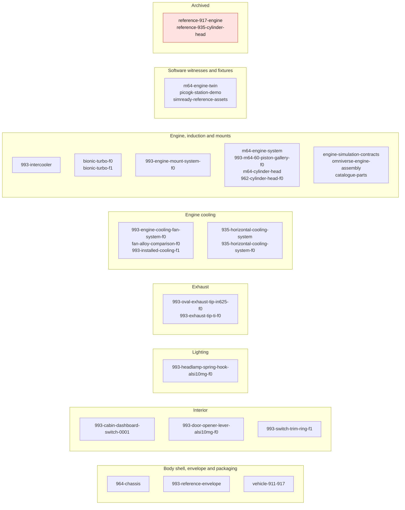

# Digital twins

Each directory below holds the code, contracts and evidence of one digital twin
or one twin workstream. Not every workstream is a part twin: some are numerical
studies, packaging studies, OpenUSD scenes, SimReady fixtures, software
witnesses or archived references. Records live in `catalog/twins/*.json` where
one exists; files under any `evidence/` directory are pinned by SHA-256 digest
and never edited. No twin here releases a part, and **no directory is a
physical twin**: no twin record has reached `physically_correlated`. The method,
the fidelity levels and the overall state are in
[docs/DIGITAL_TWIN.md](../docs/DIGITAL_TWIN.md); what is archived and why is in
[docs/ARCHIVE.md](../docs/ARCHIVE.md).

## How to read the index

The machine-readable cross-reference is [`index.json`](index.json). It restates
what each directory's own README and its catalogue records say; it promotes no
fidelity. The tables below are generated from it, and
[`scripts/validate_twins_index.py`](../scripts/validate_twins_index.py), run by
`make check`, fails when a directory, a twin record or a part record that cites
a directory is missing from the index, when a fidelity, validation status or
archived flag differs from its record, or when these tables are stale.

- **Kind** separates catalogue-backed F0/F1 proxies (`twin record`), evidence
  stores of a part record, design programmes, numerical and packaging studies,
  system registers, research registers, OpenUSD scenes, SimReady fixtures,
  software witnesses, reference envelopes and archived references. The
  definitions are in `index.json`. A USD scene, an F1 proxy, a synthetic case or
  an archived scan is never a physical twin.
- **Status** is `active` when an open issue targets the directory, `study` when
  it is retained and checked with no open issue, and `archived` when its README
  and docs/ARCHIVE.md declare it so. Issues were reviewed on 2026-11-06.
- **Achieved fidelity** is copied from the linked twin record. A directory
  without a twin record has none declared. Suffixes such as `-f0`, `-f1` or
  `F15` are iteration labels, not levels of the fidelity ladder.
- **Independent evidence** names what checks the model from outside it. None of
  it is a physical fit, a bench test or a material qualification.

The 962 head is governed by its own
[instructions](962-cylinder-head-f0/AGENTS.md),
[mandatory workflow](962-cylinder-head-f0/WORKFLOW.md) and
[19-phase contract](962-cylinder-head-f0/workflow-contract.json); read them
before any work there.

## Directories

<!-- twins-index:begin (generated by scripts/validate_twins_index.py --write; do not edit) -->

### Status, fidelity and records

| directory | kind | status | achieved fidelity | catalogue records | open issues |
|---|---|---|---|---|---|
| [`935-horizontal-cooling-system/`](935-horizontal-cooling-system/) | research register | active | none declared | no record | [#456](https://github.com/cluster2600/porscheparts/issues/456), [#534](https://github.com/cluster2600/porscheparts/issues/534) |
| [`935-horizontal-cooling-system-f0/`](935-horizontal-cooling-system-f0/) | system programme | active | none declared | no record | [#443](https://github.com/cluster2600/porscheparts/issues/443), [#532](https://github.com/cluster2600/porscheparts/issues/532), [#533](https://github.com/cluster2600/porscheparts/issues/533), [#534](https://github.com/cluster2600/porscheparts/issues/534), [#535](https://github.com/cluster2600/porscheparts/issues/535), [#536](https://github.com/cluster2600/porscheparts/issues/536), [#537](https://github.com/cluster2600/porscheparts/issues/537), [#538](https://github.com/cluster2600/porscheparts/issues/538), [#539](https://github.com/cluster2600/porscheparts/issues/539) |
| [`962-cylinder-head-f0/`](962-cylinder-head-f0/) | design programme | active | none declared | no record | [#445](https://github.com/cluster2600/porscheparts/issues/445), [#446](https://github.com/cluster2600/porscheparts/issues/446), [#447](https://github.com/cluster2600/porscheparts/issues/447), [#448](https://github.com/cluster2600/porscheparts/issues/448), [#449](https://github.com/cluster2600/porscheparts/issues/449), [#450](https://github.com/cluster2600/porscheparts/issues/450), [#451](https://github.com/cluster2600/porscheparts/issues/451), [#540](https://github.com/cluster2600/porscheparts/issues/540), [#541](https://github.com/cluster2600/porscheparts/issues/541), [#542](https://github.com/cluster2600/porscheparts/issues/542), [#543](https://github.com/cluster2600/porscheparts/issues/543), [#544](https://github.com/cluster2600/porscheparts/issues/544), [#545](https://github.com/cluster2600/porscheparts/issues/545), [#546](https://github.com/cluster2600/porscheparts/issues/546), [#547](https://github.com/cluster2600/porscheparts/issues/547) |
| [`964-chassis/`](964-chassis/) | twin record | active | `F1_envelope` | [`TWIN-964-CHASSIS-FLOOR-0001`](../catalog/twins/twin-964-chassis-floor-0001.json)<br>part [`964-CENTRAL-CELL-ASSUMED-F1`](../catalog/parts/964-central-cell-assumed-f1.json) | [#440](https://github.com/cluster2600/porscheparts/issues/440), [#441](https://github.com/cluster2600/porscheparts/issues/441), [#548](https://github.com/cluster2600/porscheparts/issues/548), [#549](https://github.com/cluster2600/porscheparts/issues/549), [#550](https://github.com/cluster2600/porscheparts/issues/550), [#551](https://github.com/cluster2600/porscheparts/issues/551), [#552](https://github.com/cluster2600/porscheparts/issues/552), [#553](https://github.com/cluster2600/porscheparts/issues/553), [#554](https://github.com/cluster2600/porscheparts/issues/554) |
| [`993-cabin-dashboard-switch-0001/`](993-cabin-dashboard-switch-0001/) | twin record | active | `F0_reference` | [`TWIN-993-CABIN-DASH-SWITCH-0001`](../catalog/twins/twin-993-cabin-dashboard-switch-0001.json)<br>part [`993-INT-SWITCH-BLANK-0001`](../catalog/parts/993-int-switch-blank-0001.json) | [#505](https://github.com/cluster2600/porscheparts/issues/505), [#506](https://github.com/cluster2600/porscheparts/issues/506), [#507](https://github.com/cluster2600/porscheparts/issues/507) |
| [`993-door-opener-lever-alsi10mg-f0/`](993-door-opener-lever-alsi10mg-f0/) | twin record | active | `F1_envelope` | [`TWIN-993-DOOR-OPENER-LEVER-ALSI10MG-F0`](../catalog/twins/twin-993-door-opener-lever-alsi10mg-f0.json)<br>part [`993-INT-DOOR-OPENER-LEVER-F0-0001`](../catalog/parts/993-int-door-opener-lever-f0-0001.json) | [#479](https://github.com/cluster2600/porscheparts/issues/479), [#527](https://github.com/cluster2600/porscheparts/issues/527) |
| [`993-engine-cooling-fan-system-f0/`](993-engine-cooling-fan-system-f0/) | design programme | active | `F1_envelope` | [`TWIN-993-ENGINE-COOLING-FAN-SYSTEM-F0`](../catalog/twins/twin-993-engine-cooling-fan-system-f0.json) (archived record)<br>part [`993-ENG-COOLING-IMPELLER-ALSI10MG-F0-0001`](../catalog/parts/993-eng-cooling-impeller-alsi10mg-f0-0001.json)<br>part [`993-ENG-COOLING-IMPELLER-WE43-F1-0001`](../catalog/parts/993-eng-cooling-impeller-we43-f1-0001.json)<br>part [`993-ENG-FAN-HOUSING-ALSI10MG-F0-0001`](../catalog/parts/993-eng-fan-housing-alsi10mg-f0-0001.json) | [#453](https://github.com/cluster2600/porscheparts/issues/453), [#454](https://github.com/cluster2600/porscheparts/issues/454) |
| [`993-engine-mount-system-f0/`](993-engine-mount-system-f0/) | design programme | active | none declared | part [`993-ENG-BRACKET-0001`](../catalog/parts/993-eng-bracket-0001.json)<br>part [`993-ENG-MOUNTING-0001`](../catalog/parts/993-eng-mounting-0001.json) | [#466](https://github.com/cluster2600/porscheparts/issues/466) |
| [`993-exhaust-tip-ti-f0/`](993-exhaust-tip-ti-f0/) | part evidence | active | none declared | part [`993-EXH-OVAL-TIP-TI-F1-0001`](../catalog/parts/993-exh-oval-tip-ti-f1-0001.json) | [#5](https://github.com/cluster2600/porscheparts/issues/5), [#6](https://github.com/cluster2600/porscheparts/issues/6), [#433](https://github.com/cluster2600/porscheparts/issues/433) |
| [`993-headlamp-spring-hook-alsi10mg-f0/`](993-headlamp-spring-hook-alsi10mg-f0/) | twin record | active | `F1_envelope` | [`TWIN-993-HEADLAMP-SPRING-HOOK-ALSI10MG-F0`](../catalog/twins/twin-993-headlamp-spring-hook-alsi10mg-f0.json)<br>part [`993-ELEC-HEADLAMP-SPRING-HOOK-F0-0001`](../catalog/parts/993-elec-headlamp-spring-hook-f0-0001.json) | [#468](https://github.com/cluster2600/porscheparts/issues/468), [#528](https://github.com/cluster2600/porscheparts/issues/528) |
| [`993-installed-cooling-f1/`](993-installed-cooling-f1/) | packaging study | active | none declared | no record | [#452](https://github.com/cluster2600/porscheparts/issues/452) |
| [`993-intercooler/`](993-intercooler/) | numerical study | active | `F1_envelope` | [`TWIN-993-INTERCOOLER-BRACKET-TI-F0`](../catalog/twins/twin-993-intercooler-bracket-ti-f0.json)<br>part [`993-ENG-INTERCOOLER-BRACKET-TI-F0-0001`](../catalog/parts/993-eng-intercooler-bracket-ti-f0-0001.json)<br>part [`993-ENG-INTERCOOLER-END-TANK-ALSI10MG-F0-0001`](../catalog/parts/993-eng-intercooler-end-tank-alsi10mg-f0-0001.json) | [#467](https://github.com/cluster2600/porscheparts/issues/467), [#481](https://github.com/cluster2600/porscheparts/issues/481) |
| [`993-m64-60-piston-gallery-f0/`](993-m64-60-piston-gallery-f0/) | twin record | active | `F1_envelope` | [`TWIN-993-M64-60-PISTON-GALLERY-F0`](../catalog/twins/twin-993-m64-60-piston-gallery-f0.json)<br>part [`993-ENG-PISTON-CP1-GALLERY-F0-0001`](../catalog/parts/993-eng-piston-cp1-gallery-f0-0001.json) | [#468](https://github.com/cluster2600/porscheparts/issues/468), [#529](https://github.com/cluster2600/porscheparts/issues/529) |
| [`993-oval-exhaust-tip-in625-f0/`](993-oval-exhaust-tip-in625-f0/) | twin record | active | `F1_envelope` | [`TWIN-993-OVAL-EXHAUST-TIP-IN625-F0`](../catalog/twins/twin-993-oval-exhaust-tip-in625-f0.json)<br>part [`993-EXH-OVAL-TIP-IN625-F0-0001`](../catalog/parts/993-exh-oval-tip-in625-f0-0001.json) | [#530](https://github.com/cluster2600/porscheparts/issues/530) |
| [`993-reference-envelope/`](993-reference-envelope/) | reference envelope | active | none declared | no record | [#465](https://github.com/cluster2600/porscheparts/issues/465), [#508](https://github.com/cluster2600/porscheparts/issues/508) |
| [`993-switch-trim-ring-f1/`](993-switch-trim-ring-f1/) | part evidence | active | none declared | part [`993-INT-SWITCH-TRIM-RING-F1-0001`](../catalog/parts/993-int-switch-trim-ring-f1-0001.json) | [#480](https://github.com/cluster2600/porscheparts/issues/480) |
| [`993-turbo-cooling-fan-operational-f0/`](993-turbo-cooling-fan-operational-f0/) | numerical study | active | none declared | no record | [#512](https://github.com/cluster2600/porscheparts/issues/512), [#513](https://github.com/cluster2600/porscheparts/issues/513), [#514](https://github.com/cluster2600/porscheparts/issues/514) |
| [`bionic-turbo-f0/`](bionic-turbo-f0/) | design programme | active | none declared | no record | [#393](https://github.com/cluster2600/porscheparts/issues/393), [#396](https://github.com/cluster2600/porscheparts/issues/396) |
| [`bionic-turbo-f1/`](bionic-turbo-f1/) | numerical study | active | none declared | no record | [#393](https://github.com/cluster2600/porscheparts/issues/393), [#394](https://github.com/cluster2600/porscheparts/issues/394), [#395](https://github.com/cluster2600/porscheparts/issues/395), [#397](https://github.com/cluster2600/porscheparts/issues/397), [#398](https://github.com/cluster2600/porscheparts/issues/398), [#399](https://github.com/cluster2600/porscheparts/issues/399), [#400](https://github.com/cluster2600/porscheparts/issues/400), [#401](https://github.com/cluster2600/porscheparts/issues/401), [#402](https://github.com/cluster2600/porscheparts/issues/402), [#403](https://github.com/cluster2600/porscheparts/issues/403) |
| [`catalogue-parts/`](catalogue-parts/) | usd scene | active | none declared | no record | [#556](https://github.com/cluster2600/porscheparts/issues/556) |
| [`engine-simulation-contracts/`](engine-simulation-contracts/) | system programme | active | none declared | no record | [#457](https://github.com/cluster2600/porscheparts/issues/457) |
| [`fan-alloy-comparison-f0/`](fan-alloy-comparison-f0/) | numerical study | active | none declared | no record | [#455](https://github.com/cluster2600/porscheparts/issues/455) |
| [`m64-cylinder-head/`](m64-cylinder-head/) | design programme | active | none declared | part [`993-ENG-CYLINDER-HEAD-4V-F0-0001`](../catalog/parts/993-eng-cylinder-head-4v-f0-0001.json) | [#458](https://github.com/cluster2600/porscheparts/issues/458) |
| [`m64-engine-system/`](m64-engine-system/) | system programme | active | `F0_reference` | [`TWIN-993-M64-ENGINE-SYSTEM-0001`](../catalog/twins/twin-993-m64-engine-system-0001.json) | [#434](https://github.com/cluster2600/porscheparts/issues/434), [#476](https://github.com/cluster2600/porscheparts/issues/476), [#526](https://github.com/cluster2600/porscheparts/issues/526), [#531](https://github.com/cluster2600/porscheparts/issues/531), [#556](https://github.com/cluster2600/porscheparts/issues/556) |
| [`m64-engine-twin/`](m64-engine-twin/) | software witness | study | none declared | no record | none open |
| [`omniverse-engine-assembly/`](omniverse-engine-assembly/) | usd scene | active | none declared | no record | [#459](https://github.com/cluster2600/porscheparts/issues/459), [#556](https://github.com/cluster2600/porscheparts/issues/556) |
| [`picogk-station-demo/`](picogk-station-demo/) | software witness | study | none declared | no record | none open |
| [`reference-917-engine/`](reference-917-engine/) | archived reference | archived | none declared | no record | [#426](https://github.com/cluster2600/porscheparts/issues/426), [#461](https://github.com/cluster2600/porscheparts/issues/461), [#462](https://github.com/cluster2600/porscheparts/issues/462) |
| [`reference-935-cylinder-head/`](reference-935-cylinder-head/) | archived reference | archived | none declared | part [`993-ENG-EXHAUST-VALVE-F1-0001`](../catalog/parts/993-eng-exhaust-valve-f1-0001.json)<br>part [`993-ENG-INTAKE-VALVE-F1-0001`](../catalog/parts/993-eng-intake-valve-f1-0001.json) | [#462](https://github.com/cluster2600/porscheparts/issues/462) |
| [`simready-reference-assets/`](simready-reference-assets/) | simready fixture | study | none declared | no record | none open |
| [`vehicle-911-917/`](vehicle-911-917/) | packaging study | active | none declared | no record | [#464](https://github.com/cluster2600/porscheparts/issues/464) |

### Scope, independent evidence and blockers

| directory | scope and variant | independent evidence | blockers | owner artefact |
|---|---|---|---|---|
| `935-horizontal-cooling-system/` | Porsche 935 horizontal cooling-fan system: 50-row input matrix with six variant templates; the target engine variant is unresolved. Planning and evidence package; the README claims no physical digital-twin validation | existing-evidence register with SHA-256 receipts separates local artefacts from physical claims about a particular 935; no 935 has been measured | engine-data coverage is partial; variant and scale are unresolved | [`twins/935-horizontal-cooling-system/README.md`](935-horizontal-cooling-system/README.md) |
| `935-horizontal-cooling-system-f0/` | 935 horizontal fan: private rotor and drive/mount scans, reconstruction campaign, 14-function registry and 17-interface contract; target engine variant unknown. Registry, OpenUSD graph and six reduced models; synthetic-case.json is a synthetic arithmetic fixture, not a 935 | admissibility verdict of 2026-10-29: the rotor analysis wall is inadmissible for CFD parameter studies | rotor-wall provenance unresolved; volume-mesh quality gates failed; no external operating or holdout data | [`twins/935-horizontal-cooling-system-f0/README.en.md`](935-horizontal-cooling-system-f0/README.en.md) |
| `962-cylinder-head-f0/` | water-cooled 3.0 L 962 C head as reference, bionic family up to 4.0 L; four valves and two ignition reservations; donor head unknown. PicoGK F0 candidate study geometry under the 19-phase workflow contract; read its AGENTS.md, WORKFLOW.md and workflow-contract.json before any work | independent arithmetic reviews of the material sensitivity and Exodus reconstruction; the END181 equilibrium check still fails 12 of 36 aggregate checks | 12 failing LPBF aggregate equilibrium checks; 24 poor metal-mesh cells; coolant mesh and CFD not admitted; donor head and M64 interfaces unmeasured; head strength and calibrated LPBF open | [`twins/962-cylinder-head-f0/README.md`](962-cylinder-head-f0/README.md) |
| `964-chassis/` | 964 Carrera 2 and Carrera 4, 1989-1994: steel floor pan and body datum frame, torsion shell FEA and monocoque interface work | source-only B/H pattern derived and independently checked; candidate fastener roles bound to original scan triangles; no donor-body measurement | qualified donor interfaces; inner tunnel and upper-cell geometry; B head/bearing seat and off-plane controls for registration | [`twins/964-chassis/README.md`](964-chassis/README.md) |
| `993-cabin-dashboard-switch-0001/` | 993, 1993-1998, variant pending measurement: dashboard switch opening and switch blank (slice DT-01) | none; no dimension of the real opening is recorded | opening and host measurements absent; fit checker incomplete; no physical trial | [`catalog/twins/twin-993-cabin-dashboard-switch-0001.json`](../catalog/twins/twin-993-cabin-dashboard-switch-0001.json) |
| `993-door-opener-lever-alsi10mg-f0/` | 993, 1994-1998, door trim variants to confirm: interior door opener lever in AlSi10Mg | none; LPBF, CalculiX and SimReady screens run on assumed geometry | pivot, linkage and travel unmeasured; LPBF gate inputs undefined | [`docs/993/993_DOOR_OPENER_LEVER_ALSI10MG_F0.md`](../docs/993/993_DOOR_OPENER_LEVER_ALSI10MG_F0.md) |
| `993-engine-cooling-fan-system-f0/` | 993 cooling fan programme: Turbo M64/60 rotor rebuild with a PMB/Classic Retrofit 240 A alternator target, WE43 F1 impeller; the Carrera F0 subassembly record is archived. The F1_envelope level belongs to the archived F0 subassembly record; the rebuild and the WE43 F1 impeller have part records only | none physical; the archived F0 integration fails tip clearance (-14 mm) and the FE blade-root peak diverges with refinement, so no root stress is quoted | specimen identity and measured interfaces; MRF cases not converged; alternator choice open | [`twins/993-engine-cooling-fan-system-f0/README.md`](993-engine-cooling-fan-system-f0/README.md) |
| `993-engine-mount-system-f0/` | 993 Turbo: centre console 993 115 103 52 and engine mounts 993 375 049 05 (two), PicoGK bionic study; Carrera and RS crossmembers identified, not modelled. Hypothetical bionic geometry with assumed hole positions; soft-mount envelope kept separate | interface contract kept separate from the CAD; acceptance stays blocked in engine-mount-study-check | crossmember, console and soft mounts unmeasured; isolator stiffness and damping unknown | [`twins/993-engine-mount-system-f0/README.md`](993-engine-mount-system-f0/README.md) |
| `993-exhaust-tip-ti-f0/` | titanium F1 variant of the 993 oval exhaust tip: Ti-6Al-4V and Ti-6242 route cards, LPBF geometry screen and PET titanium triage | none; the PET triage is lexical and derived from declared judgements, not measurement | first titanium candidate not selected; LPBF titanium supplier dossier not qualified | [`docs/993/993_EMBOUT_TITANE_F1.md`](../docs/993/993_EMBOUT_TITANE_F1.md) |
| `993-headlamp-spring-hook-alsi10mg-f0/` | 993, 1994-1998, vendor-declared application to confirm: low-beam bulb retainer spring repair hook in AlSi10Mg | none; screens run on assumed geometry | retention, heat and vibration interfaces unmeasured; output-mesh checks failing | [`docs/993/993_HEADLAMP_SPRING_HOOK_ALSI10MG_F0.md`](../docs/993/993_HEADLAMP_SPRING_HOOK_ALSI10MG_F0.md) |
| `993-installed-cooling-f1/` | 993 Turbo installed cooling: horizontal air-to-air charge cooler under the rear wing, intake and delivery shrouds, alternator envelope; local engine frame, not an OEM datum. The F1 suffix names the rotor section family reused from the fan programme | single-body, watertight and winding checks of 17 exported bodies; the 18-case network screen is not CFD | 5 mm baseline CFD mesh not admissible; fan datum, alternator, seals and wing clearance unmeasured | [`twins/993-installed-cooling-f1/README.md`](993-installed-cooling-f1/README.md) |
| `993-intercooler/` | 993 Turbo/GT2 intercooler work: 750 metric hp core sizing under user-authorised assumptions, core families, pressure coupon, and the titanium bracket twin under bracket-ti-f0/. The level belongs to the bracket record; the 750 hp core studies have no record | none physical; flanges, axes and mounts of OEM 993 110 330 53 are not measured | bracket interfaces IF-1 to IF-3 unmeasured; fillet radius and 3D study with fittings and CHT open | [`twins/993-intercooler/README.md`](993-intercooler/README.md) |
| `993-m64-60-piston-gallery-f0/` | 993 Turbo M64/60 research, 1995-1998: CP1 piston with closed oil gallery | none; PicoGK, CalculiX, LPBF and SimReady screens run on assumed geometry | five functional interfaces unmeasured; output-mesh checks failing | [`docs/993/993_PISTON_CP1_COOLING_GALLERY_F0.md`](../docs/993/993_PISTON_CP1_COOLING_GALLERY_F0.md) |
| `993-oval-exhaust-tip-in625-f0/` | 993 C2, C4 and RS narrow body, 1994-1998: oval exhaust tip in IN625, double wall | OpenFOAM evidence audit of the flow screen; no measured interface | inlet, bumper and thermal F2 interfaces unmeasured | [`docs/993/993_OVAL_EXHAUST_TIP_IN625_F0.md`](../docs/993/993_OVAL_EXHAUST_TIP_IN625_F0.md) |
| `993-reference-envelope/` | 993 USA profile: bounding and reference-mark cage from seven workshop-manual dimensions; ROW profile absent | each dimension mapped to a manual page in reference-envelope.json; no body measurement | ROW profile and a licensed body-shell source; no measured vehicle datum | [`twins/993-reference-envelope/README.md`](993-reference-envelope/README.md) |
| `993-switch-trim-ring-f1/` | 993 switch trim ring, F1 reconstruction: LPBF screen and supplier route, then a turned EN AW-6063 T6 route (decision 0006) | none; the inner profile is not measured | inner profile and tolerances unmeasured | [`docs/993/993_SWITCH_TRIM_RING_F1.md`](../docs/993/993_SWITCH_TRIM_RING_F1.md) |
| `993-turbo-cooling-fan-operational-f0/` | 993 Turbo M64/60 cooling fan: one bounded operating slice (stationary holds), observation/state contract and deterministic offline replay on synthetic observations; fan frame F_FAN, not an engine datum. Operational observation contract, not a static fidelity level; replay status capped at digitally_checked | byte-identical replay from a clean export; negative contract and replay fixtures; independent re-derivation of the predictions in the fixture generator | no lawful observation set from an instrumented 993 Turbo; drive ratio, belt slip and fan curve unsourced; calibration certificates, sensor positions and clock skew unmeasured | [`twins/993-turbo-cooling-fan-operational-f0/README.md`](993-turbo-cooling-fan-operational-f0/README.md) |
| `bionic-turbo-f0/` | concept PicoGK compressor housing with branched external ribs; parameters are drawing hypotheses and do not reproduce a K16 | none; the interface contract keeps every measurement null | no measured interfaces or sourced turbo comparison basis | [`twins/bionic-turbo-f0/README.md`](bionic-turbo-f0/README.md) |
| `bionic-turbo-f1/` | volute-only flow and power comparison against the F0 baseline, same wheel and conical chamber; the combined shroud variant is rejected (local wheel-housing distance below 0.4 mm). No flow or power gain is validated | geometry evidence: 39 parts inspected, 38 identical to F0; radial separation bound 1.7858 mm is not a qualified running clearance | baseline and software execution contract not frozen; mesh route and solver verification not qualified | [`twins/bionic-turbo-f1/README.md`](bionic-turbo-f1/README.md) |
| `catalogue-parts/` | 18 OpenUSD box proxies of existing catalogue parts and Fuchs components, labelled F1_documentary_proxy_not_simready, referenced by the M64 engine scene v1. Each stage carries documentationStatus F1_documentary_proxy_not_simready and no physics | none | box proxies sized from BOM envelopes; no measured interface or transform | [`twins/omniverse-engine-assembly/status.md`](omniverse-engine-assembly/status.md) |
| `engine-simulation-contracts/` | F1 register of engine components, interfaces, candidate materials and load cases over the 917 engine scan and the 935 head segmentation | none; segmentation labels are low-confidence candidates | four simulation cases blocked | [`twins/engine-simulation-contracts/README.md`](engine-simulation-contracts/README.md) |
| `fan-alloy-comparison-f0/` | AlSi10Mg, WE43 and Ti-6Al-4V on the parametric 993 visual reference rotor; not the 935 rotor | none; rotor dimensions and interfaces are unmeasured | roots and sections not iterated; mesh independence and critical speeds open | [`twins/fan-alloy-comparison-f0/README.en.md`](fan-alloy-comparison-f0/README.en.md) |
| `m64-cylinder-head/` | M64 four-valve head: finned FVD 993 GT2 Evo 3.8 reference 99310401188BF, then since 2026-10-12 a water-cooled four-valve direction | none; the scan is a morphology reference and photographs are not dimensional measurements | transition repairs unfinished; AM gates to re-run | [`twins/m64-cylinder-head/README.md`](m64-cylinder-head/README.md) |
| `m64-engine-system/` | 993 Turbo M64/60 3.6 L twin-turbo, 1995-1998: zone programme, 57-line bill of materials and metrology queue | none; no dimension is measured by the project | common engine datum and cross-zone transforms unmeasured; engine-mass scope unsettled | [`twins/m64-engine-system/program.json`](m64-engine-system/program.json) |
| `m64-engine-twin/` | GPU session manifest of 2026-09-15 for the agent-driven M64 engine design twin; status prepared_not_launched, manufacturing_authorized false | none | session not launched | [`twins/m64-engine-twin/session-20260915.json`](m64-engine-twin/session-20260915.json) |
| `omniverse-engine-assembly/` | F0 OpenUSD scenes: 917 scan payload, 993/935 valvetrain test rig, and the M64 engine scene v1 research layout | none | SimReady material and physics assignment fails (NIM Material Agent 403); no measured engine datum | [`twins/omniverse-engine-assembly/README.md`](omniverse-engine-assembly/README.md) |
| `picogk-station-demo/` | PicoGK lattice witness in designed millimetres and the Vast station qualification of 2026-09-28 | none physical; the qualification proves software execution only | none recorded | [`twins/picogk-station-demo/qualification/README.md`](picogk-station-demo/qualification/README.md) |
| `reference-917-engine/` | Porsche 917 engine reference twin, iterations F1 to F50; air-cooled cylinder head studies | none transferable to a real cylinder head | scan components unsegmented and datums unmeasured; licence identifier of the scan not archived | [`twins/reference-917-engine/README.md`](reference-917-engine/README.md) |
| `reference-935-cylinder-head/` | Wolfe Classics 935 cylinder-head scan, kept as a reference morphology | none | licence identifier of the scan not archived | [`twins/reference-935-cylinder-head/README.md`](reference-935-cylinder-head/README.md) |
| `simready-reference-assets/` | NVIDIA SimReady assets engineComponent_crankshaft_b01 and socket_b01 (CC BY 4.0), pinned by assets.lock.json; no Porsche part | upstream hashes of all 140 files pinned; inspection evidence covers the OpenUSD pipeline only | none recorded | [`twins/simready-reference-assets/README.md`](simready-reference-assets/README.md) |
| `vehicle-911-917/` | 911 packaging and driveline studies F0 to F16 with a 917-type engine; the scan does not establish an exact 917/30 or turbo-engine variant. F0 to F16 are iteration labels | native collision results; no suspension geometry or proven chassis attachment | packaging trade-off for F15 onwards undecided | [`twins/vehicle-911-917/README.md`](vehicle-911-917/README.md) |

### Directories without a twin record, and why

| directory | reason |
|---|---|
| `935-horizontal-cooling-system/` | Documentary input matrix and research ledger, not a part or zone twin; no dimensioned 935 part is admitted to the catalogue. |
| `935-horizontal-cooling-system-f0/` | The 17-interface contract keeps axes, holes, faces, tolerances, scale and engine variant unknown, so no dimensioned part is admitted for a twin record to carry. |
| `962-cylinder-head-f0/` | No catalogue record cites this directory: the head is a new design without measured donor interfaces. The related four-valve record 993-ENG-CYLINDER-HEAD-4V-F0-0001 cites only twins/m64-cylinder-head/. |
| `993-engine-mount-system-f0/` | Part records exist; a twin record needs the measured crossmember, console and soft-mount interfaces that are still null. |
| `993-exhaust-tip-ti-f0/` | Evidence store of the part record; the IN625 tip has the twin record (TWIN-993-OVAL-EXHAUST-TIP-IN625-F0), the titanium variant does not. |
| `993-installed-cooling-f1/` | Parametric packaging and airflow study; every interface-contract measurement is null and no part is admitted. |
| `993-reference-envelope/` | A bounding cage, not a body or part: it carries no interface for a twin record to state. |
| `993-switch-trim-ring-f1/` | Evidence store of the part record; the ring moved to a turned route and has no twin record. |
| `993-turbo-cooling-fan-operational-f0/` | Synthetic specimen SPEC-993T-FAN-SYN-0001 and synthetic parameters only; no physical specimen or admitted part geometry. |
| `bionic-turbo-f0/` | Original concept geometry, explicitly not a K16; the catalogue reference 993-TURBOCHARGER-K16-PAIR-0001 is deliberately left unmodified. |
| `bionic-turbo-f1/` | Comparison study of a concept housing; no part is proposed for the catalogue. |
| `catalogue-parts/` | Each proxy belongs to its source part or component record, not to a twin; the directory has no README of its own and is documented by its consumer. |
| `engine-simulation-contracts/` | Register over unsegmented reference scans; no component is admitted and every simulation case is blocked. |
| `fan-alloy-comparison-f0/` | Material comparison on an unmeasured parametric rotor; it proposes no part of its own. |
| `m64-cylinder-head/` | The part record carries the creation work; no validated head geometry or measured interface exists for a twin record. |
| `m64-engine-twin/` | Compute session manifest and FEA self-check; it defines no part or zone. |
| `omniverse-engine-assembly/` | Scene composition, not a single-engine assembly; positions are layout hypotheses and no interface, clearance or collision is asserted. |
| `picogk-station-demo/` | Software witness; the program states no Porsche fitment or strength claim. |
| `reference-917-engine/` | Retired as a product and kept as a numerical regression; metal printing and engine start remain prohibited. |
| `reference-935-cylinder-head/` | Archived scan reference; the valve part records cite it as morphology only. |
| `simready-reference-assets/` | External pipeline fixture; NVIDIA properties are not transferred into the catalogue. Provenance is in catalog/sources/src-nvidia-simready-reference-assets.json. |
| `vehicle-911-917/` | Research packaging software, not a released vehicle or a set of functional parts. |

### Twin records without a directory

| record | reason | open issues |
|---|---|---|
| [`TWIN-993-WHEEL-HUB-INTERFACES-0001`](../catalog/twins/twin-993-wheel-hub-interfaces-0001.json) | Its build123d master and four Fuchs STEP proxies live under components/wheels/fuchs/; the hubs are logical frames without geometry, so nothing belongs under twins/. | [#485](https://github.com/cluster2600/porscheparts/issues/485) |

<!-- twins-index:end -->

## Map by vehicle zone

Groupings follow the `scope.zone` of each record and what each README says it
covers. Archived lines are in red; software witnesses and fixtures carry no
vehicle zone.



*Diagram: where each directory sits by zone. It adds no claim beyond the tables
above.*

## Keeping the index current

Add or rename a directory under `twins/`, add a twin record, or make a part
record cite `twins/<dir>/`, and `make check` fails until `index.json` has the
matching entry. Then regenerate the tables:

```bash
python3 scripts/validate_twins_index.py --write
```

Change an entry only from what the directory's README, its record or the issue
backlog already states. A status, fidelity or correlation that no source states
is not added here.
