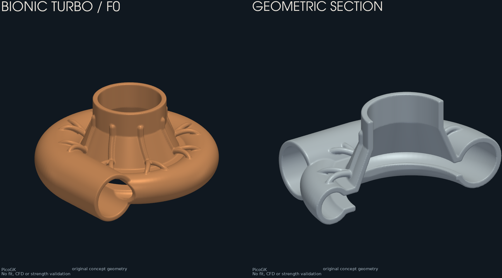

# Turbo bionique — carter de compresseur F0

Premier concept éditable PicoGK : entrée axiale, chambre ouverte à l'arrière,
diffuseur annulaire, volute croissante, sortie tangentielle et nervures externes
ramifiées. « Bionique » décrit ici la forme des nervures ; aucune optimisation
de masse, de rigidité ou de rendement n'est démontrée.

Toutes les valeurs de [parameters.json](parameters.json) sont des hypothèses de
dessin en millimètres. Elles ne reproduisent pas un K16. La
[fiche K16](../../catalog/parts/993-turbocharger-k16-pair-0001.json) reste la
référence catalogue ; elle n'est pas modifiée par cette étude.



La couleur est un choix de visualisation, sans sélection de matériau.

## Sources et périmètre

- Source éditable : [source/Program.cs](source/Program.cs) et paramètres JSON.
- Géométrie : [PicoGK 2.3.0](https://github.com/leap71/PicoGK), LEAP 71,
  licence Apache-2.0 ; dépendance NuGet épinglée, noyau natif 26.2.
- Réemploi interne : `parts/picogk-catalog/common/Sdf.cs` et
  `parts/picogk-catalog/rotating/RotKit.cs`, sans modifier les modèles existants.
- Géométrie originale du concept, sans scan, photo ou CAO fournisseur importés.
  La [licence du dépôt](../../LICENSE) s'applique au nouveau code et aux sorties.
- Aucun rotor, palier, circuit d'huile, carter de turbine ou boulonnage fictif.
  L'ouverture arrière représente un accès conceptuel au CHRA, sans définir
  son ajustement, son joint ou sa retenue.

Le [contrat d'interfaces](interface-contract.json) conserve les mesures absentes
à `null`. Le chemin de charge à établir passe des parois sous pression et des
embouts de durite vers la retenue du carter sur le CHRA, puis vers les supports.
Les nervures proposées ne constituent pas une justification de ce chemin.

## Reproduire

Depuis la racine du dépôt, avec .NET 9 et le paquet PicoGK pour macOS ARM64 ou
Windows x64. Le générateur s'exécute sans ouvrir le visualiseur PicoGK.
Ne lancer qu'un processus natif PicoGK à la fois sur la machine.

```sh
dotnet build twins/bionic-turbo-f0/source/BionicTurbo.csproj -c Release
dotnet twins/bionic-turbo-f0/source/bin/Release/net9.0/BionicTurbo.dll --self-test
dotnet twins/bionic-turbo-f0/source/bin/Release/net9.0/BionicTurbo.dll \
  twins/bionic-turbo-f0/parameters.json work/bionic-turbo-075
python twins/bionic-turbo-f0/inspect_mesh.py work/bionic-turbo-075
```

L'inspection utilise NumPy, Trimesh et PyVista, déjà employés dans le dépôt.
Elle vérifie les maillages exacts avant de produire un aperçu ; aucun lissage
ni aucune décimation ne sont appliqués après l'export STL. Le dossier de sortie
du générateur doit être neuf. Les erreurs et essais rejetés sont conservés.

| Fichier produit | Usage |
|---|---|
| `housing.stl` | Carter conceptuel entier |
| `flow-domain.stl` | Volume de passage abstrait, sans roue ni conditions de CFD |
| `section.stl` | Coupe géométrique réelle du carter |
| `report.json` | Paramètres, version du noyau et contrôles du générateur |
| `inspection.json` | Inspection indépendante des maillages et empreintes SHA-256 |
| `preview.png` | Vue du carter et de la coupe |

Le générateur régularise le carter au niveau voxel par `Smoothen(voxel_mm)`
avant son export et consigne cette opération. Elle peut modifier les détails
de taille inférieure à un voxel ; elle ne démontre aucune épaisseur minimale.
La coupe est légèrement décalée de X=0 pour éviter une coïncidence avec la
grille, et son plan exact figure dans `report.json`.
La longueur de sortie de 42,25 mm évite la coïncidence de sa face avec les deux
grilles vérifiées ; ce n'est pas une cote fournisseur. Toute modification de
paramètres ou de résolution doit repasser l'inspection, car des artefacts
peuvent réapparaître. L'aperçu interpole les normales pour l'éclairage seulement.

L'ouverture arrière laisse le domaine d'air ouvert au CHRA absent : il ne peut
donc pas être utilisé tel quel comme cas CFD de compresseur. Le C# et le JSON
sont les maîtres éditables ; un STL n'est pas un solide STEP paramétrique.
Le volume d'air exporté reste nominal, avant régularisation du carter : il
n'est pas une extraction exacte du vide final pour un solveur.

## Vérification locale du 10 octobre 2026

Les [résultats et empreintes](verification.json) consignent les deux exécutions
à 0,75 et 0,50 mm. Les trois maillages de chaque exécution ont une surface
connectée, un volume signé positif, zéro arête ouverte ou non-manifold, zéro
facette dégénérée et zéro doublon. Aucune facette n'a été retirée par
l'inspecteur. Douze sondes natives contrôlent les passages et une paroi.
La comparaison des deux résolutions est un contrôle géométrique limité, pas
une étude de convergence physique ni une mesure des interfaces réelles.

La compilation .NET, l'autotest du générateur, les cinq tests de l'inspecteur,
le rejet d'un paramètre inconnu et la protection contre l'écrasement passent.
Les sorties locales sont conservées sous `work/bionic-turbo-delivery-075/`
et `work/bionic-turbo-delivery-050/`. Les essais antérieurs rejetés restent
dans des dossiers séparés ; leurs petits défauts ne sont pas masqués par
une suppression de facettes.

`make check` a exécuté 3 614 tests, avec 162 ignorés, deux erreurs de dépendances
absentes (`rtree`, `networkx`) et deux échecs de comparaison flottante dans les
tests existants de ventilateur/stator. Aucun fichier concerné n'est modifié
par ce travail. Le contrôle global n'est donc pas déclaré réussi ; son journal
reste dans `work/bionic-validation/make-check.log`.

## Suite de l'étude

1. Choisir le donneur et relever indépendamment axes, portées, joint, retenue,
   interfaces de durite, roue, jeu de pointe, diffuseur et encombrement véhicule.
2. Fixer débit, rapport de pression, régime, températures, cycles et efforts
   des durites ; choisir matériau et procédé à partir de ces conditions.
3. Comparer le carter de référence et le concept à conditions égales : CFD,
   mécanique/thermique, sensibilité au maillage et corrélation expérimentale.
4. Qualifier la fabrication, le nettoyage et l'inspection, puis les essais
   d'étanchéité, de pression et de fatigue sous revue professionnelle.

Les contrôles logiciels ne valident ni le montage ni la tenue en service.
Cette livraison est une maquette de revue, sans autorisation de fabrication
fonctionnelle. Elle suit R-CAD/R-LOCAL et
[ADR 0012](../../docs/decisions/0012-local-compute-gpu-last.md) : génération et
inspection locales, paramètres traçables, qualification physique séparée.
