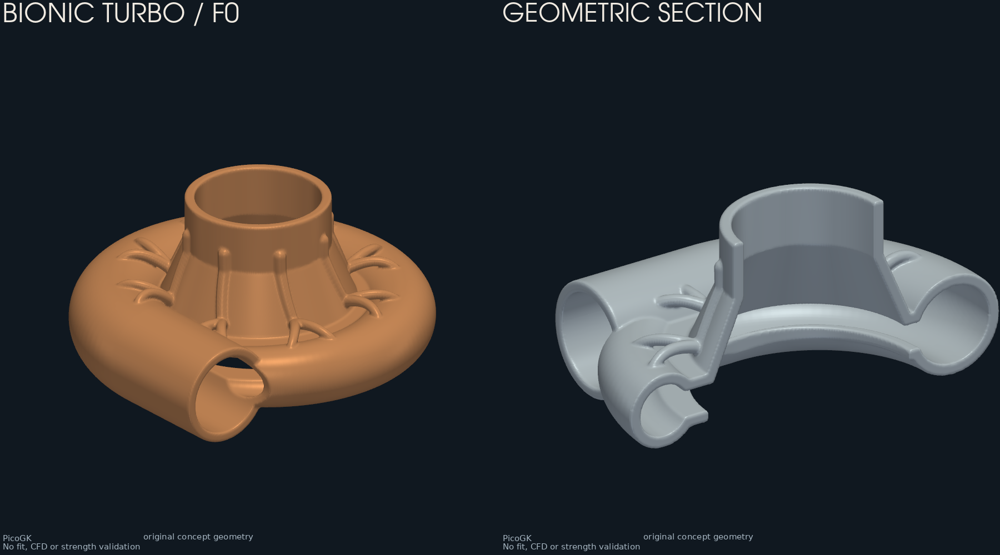

# Bionic turbo — compressor housing F0

First editable PicoGK concept: axial inlet, chamber open at the rear,
annular diffuser, growing volute, tangential outlet and branched external
ribs. "Bionic" here describes the shape of the ribs; no optimisation
of mass, stiffness or efficiency is demonstrated.

All values in [parameters.json](parameters.json) are drawing assumptions
in millimetres. They do not reproduce a K16. The
[K16 record](../../catalog/parts/993-turbocharger-k16-pair-0001.json) remains the
catalogue reference; it is not modified by this study.



The colour is a visualisation choice, with no material selection.

## Sources and scope

- Editable source: [source/Program.cs](source/Program.cs) and JSON parameters.
- Geometry: [PicoGK 2.3.0](https://github.com/leap71/PicoGK), LEAP 71,
  Apache-2.0 licence; pinned NuGet dependency, native kernel 26.2.
- Internal reuse: `parts/picogk-catalog/common/Sdf.cs` and
  `parts/picogk-catalog/rotating/RotKit.cs`, without modifying the existing models.
- Original concept geometry, with no imported scan, photo or supplier CAD.
  The [repository licence](../../LICENSE) applies to the new code and outputs.
- No fictitious rotor, bearing, oil circuit, turbine housing or bolting.
  The rear opening represents conceptual access to the CHRA, without defining
  its fit, its seal or its retention.

The [interface contract](interface-contract.json) keeps the missing measurements
at `null`. The load path to be established runs from the pressurised walls and
hose spigots to the retention of the housing on the CHRA, then to the brackets.
The proposed ribs do not constitute a justification of this path.

## Reproduce

From the repository root, with .NET 9 and the PicoGK package for macOS ARM64 or
Windows x64. The generator runs without opening the PicoGK viewer.
Run only one native PicoGK process at a time on the machine.

```sh
dotnet build twins/bionic-turbo-f0/source/BionicTurbo.csproj -c Release
dotnet twins/bionic-turbo-f0/source/bin/Release/net9.0/BionicTurbo.dll --self-test
dotnet twins/bionic-turbo-f0/source/bin/Release/net9.0/BionicTurbo.dll \
  twins/bionic-turbo-f0/parameters.json work/bionic-turbo-075
python twins/bionic-turbo-f0/inspect_mesh.py work/bionic-turbo-075
```

The inspection uses NumPy, Trimesh and PyVista, already used in the repository.
It checks the exact meshes before producing a preview; no smoothing
or decimation is applied after the STL export. The generator's output
directory must be new. Errors and rejected trials are kept.

| Output file | Use |
|---|---|
| `housing.stl` | Complete conceptual housing |
| `flow-domain.stl` | Abstract flow-passage volume, with no wheel or CFD conditions |
| `section.stl` | Real geometric section of the housing |
| `report.json` | Parameters, kernel version and generator checks |
| `inspection.json` | Independent inspection of the meshes and SHA-256 digests |
| `preview.png` | View of the housing and the section |

The generator regularises the housing at voxel level with `Smoothen(voxel_mm)`
before export and records this operation. It can modify details
smaller than one voxel; it demonstrates no minimum thickness.
The section is slightly offset from X=0 to avoid coinciding with the
grid, and its exact plane is given in `report.json`.
The outlet length of 42.25 mm keeps its face from coinciding with the two
verified grids; it is not a supplier dimension. Any change of
parameters or resolution must go through inspection again, because artefacts
can reappear. The preview interpolates normals for lighting only.

The rear opening leaves the air domain open to the absent CHRA: it therefore
cannot be used as is as a compressor CFD case. The C# and the JSON
are the editable masters; an STL is not a parametric STEP solid.
The exported air volume remains nominal, before regularisation of the housing: it
is not an exact extraction of the final void for a solver.

## Local verification of 10 October 2026

The [results and digests](verification.json) record the two runs
at 0.75 and 0.50 mm. The three meshes of each run have a connected
surface, a positive signed volume, zero open or non-manifold edges, zero
degenerate facets and zero duplicates. No facet was removed by
the inspector. Twelve native probes check the passages and a wall.
The comparison of the two resolutions is a limited geometric check, not
a physical convergence study nor a measurement of the real interfaces.

The .NET build, the generator self-test, the five inspector tests,
the rejection of an unknown parameter and the overwrite protection pass.
The local outputs are kept under `work/bionic-turbo-delivery-075/`
and `work/bionic-turbo-delivery-050/`. Earlier rejected trials remain
in separate directories; their small defects are not masked by
removing facets.

`make check` ran 3,614 tests, with 162 skipped, two errors from missing
dependencies (`rtree`, `networkx`) and two floating-point comparison failures in the
existing fan/stator tests. No affected file is modified
by this work. The global check is therefore not declared passed; its log
remains in `work/bionic-validation/make-check.log`.

## Next steps of the study

1. Choose the donor and independently record axes, bearing seats, seal, retention,
   hose interfaces, wheel, tip clearance, diffuser and vehicle packaging.
2. Set flow, pressure ratio, speed, temperatures, cycles and hose
   loads; choose material and process from these conditions.
3. Compare the reference housing and the concept under equal conditions: CFD,
   mechanical/thermal, mesh sensitivity and experimental correlation.
4. Qualify manufacturing, cleaning and inspection, then leak,
   pressure and fatigue tests under professional review.

Software checks validate neither the installation nor in-service durability.
This delivery is a review mock-up, with no authorisation for functional
manufacture. It follows R-CAD/R-LOCAL and
[ADR 0012](../../docs/decisions/0012-local-compute-gpu-last.md): local generation and
inspection, traceable parameters, separate physical qualification.
