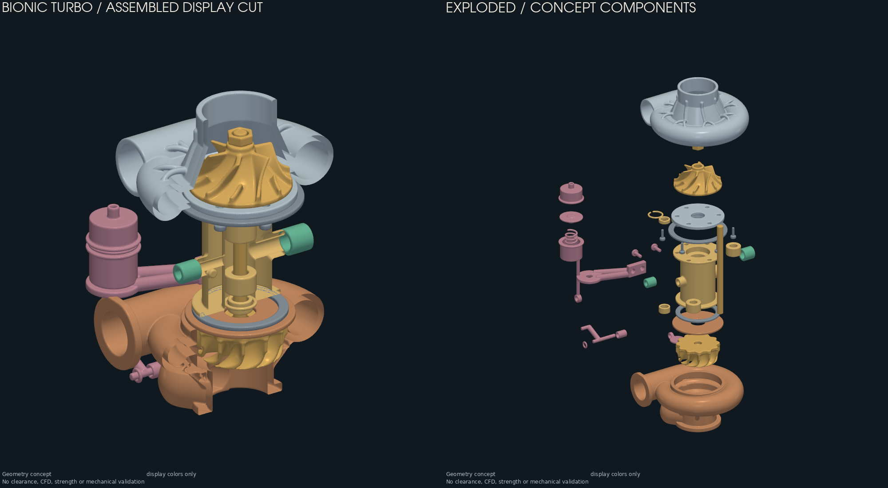

# Turbo bionique F0 — assemblage conceptuel

Cette extension représente **39 composants conceptuels** d'un turbo unique,
lubrifié à l'huile, avec deux paliers lisses et une wastegate interne. Elle
complète le [carter de compresseur F0](../README.md) pour examiner l'organisation
des pièces, leurs passages et leurs positions. Les nervures « bioniques » sont
des choix de dessin ; leur efficacité mécanique ou aérodynamique n'est pas
démontrée.

Le [contrat des composants](component-contract.json) fixe la liste attendue,
l'empreinte du carter repris, les groupes et les paires à contrôler. Ses
interfaces mesurées restent à `null`. Les 39 composants couvrent ce périmètre
de représentation ; **ils ne constituent pas une nomenclature de fabrication
complète**, ni une définition d'un K16 compatible avec une Porsche 993.

| Groupe | Composants conceptuels |
|---|---:|
| Carter et plaque arrière du compresseur | 2 |
| Deux roues, arbre et écrou du compresseur | 4 |
| Corps central, paliers, butée et éléments d'étanchéité | 9 |
| Raccords d'alimentation et de retour d'huile | 2 |
| Carter de turbine et écran thermique | 2 |
| Anneaux de retenue et six fixations de plaque arrière | 8 |
| Wastegate, actionneur, liaison et fixation | 12 |
| **Total** | **39** |

## Livraison locale du 10 octobre 2026



- [Atlas des 39 composants](media/component-atlas.png).
- [39 STL séparés](../../../work/bionic-turbo-assembly-final/), en millimètres,
  dans leur position assemblée.
- [Modèle 3D assemblé](../../../work/bionic-turbo-assembly-qa-final/assembled.glb)
  et [modèle 3D éclaté](../../../work/bionic-turbo-assembly-qa-final/exploded.glb).
- [Archive des STL, modèles 3D et dossier de preuve](../../../work/bionic-turbo-assembly-concept.zip).
- [Reçu de vérification](verification.json),
  [rapport de génération](evidence/generation.json) et
  [inspection indépendante des maillages](evidence/inspection.json).

Les 39 maillages finaux passent les contrôles de fermeture, connexion unique,
orientation et volume positif, sans triangle dégénéré ou doublon. Aucun
triangle exporté n'a été supprimé pour faire passer ces contrôles. Les huit
paires désignées présentent un volume d'intersection voxel nul au pas de
0,50 mm ; ce contrôle ne mesure pas le jeu minimal. La réouverture des deux
GLB retrouve exactement les sommets, triangles et transformations des 39 pièces.
Les vues ont été examinées visuellement ; cette observation n'est pas une
validation mécanique ni une approbation artistique de l'utilisateur.

Les 13 tests ciblés passent, y compris les refus d'entrée invalide et
d'écrasement. Le `make check` complet sous l'environnement Python de géométrie
exécute 3 627 tests et reste en échec : deux dépendances absentes (`rtree`,
`networkx`) dans des tests existants, deux comparaisons exactes de flottants
dans les modèles de ventilateur WE43 et de stator AlSi10Mg, et 162 tests
optionnels ignorés. Le premier passage avec le Python système a aussi
rencontré des problèmes SciPy/Python ; les deux résultats sont conservés dans
le reçu. Les fichiers du carter F0 déjà épinglés sont inchangés.

Les fichiers volumineux sous `work/` restent locaux et ne sont pas inclus dans
Git. Le code, les rapports, leurs empreintes et les aperçus sont conservés dans
cette extension. L'essai `assembly-001` a été rejeté pour défauts de maillage
du carter chaud ; son rapport est conservé. Le rayon hypothétique de sa chambre
de dérivation a été décalé de 0,125 mm pour éviter une coïncidence avec la grille
du noyau. L'essai `assembly-002` passe les contrôles ; la livraison finale
écarte davantage les carters dans la présentation éclatée.

## Sources éditables et repère

- [source/Program.cs](source/Program.cs) contrôle le contrat, reprend le carter
  identifié par SHA-256, exporte chaque composant et vérifie les intersections
  voxel des paires désignées dans le contrat.
- [source/Components.cs](source/Components.cs) contient les hypothèses de
  dimensions des roues, de l'arbre, du corps central, des paliers, des joints,
  des raccords et des fixations. Les paramètres des roues sont tous marqués
  `assumption`, y compris les valeurs proches de déclarations de catalogue.
- [source/HotSide.cs](source/HotSide.cs) contient le carter chaud, sa dérivation,
  le clapet, le pivot, la liaison et l'actionneur de wastegate.
- [source/Assembly.csproj](source/Assembly.csproj) épingle PicoGK 2.3.0 et
  réemploie les générateurs internes
  [CompressorWheel.cs](../../../parts/picogk-catalog/rotating/CompressorWheel.cs),
  [TurbineWheel.cs](../../../parts/picogk-catalog/rotating/TurbineWheel.cs),
  `Sdf.cs` et `RotKit.cs`. La [licence du dépôt](../../../LICENSE) s'applique
  aux nouvelles sources ; PicoGK est distribué par LEAP 71 sous Apache-2.0.
- [inspect_assembly.py](inspect_assembly.py) inspecte indépendamment les STL
  exportés puis produit les vues et les fichiers GLB si ses contrôles passent.

Les dimensions sont éditables directement dans les deux fichiers C# de
géométrie. L'assemblage utilise un pas voxel de **0,50 mm**. Les constantes
décrivent des hypothèses de dessin, sans mesures de pièce, de véhicule ou de
conditions de service. La
[fiche catalogue K16](../../../catalog/parts/993-turbocharger-k16-pair-0001.json)
et le [contrat d'interfaces du carter](../interface-contract.json) restent les
références pour distinguer les informations disponibles des inconnues.

Le repère est commun à toutes les pièces, en millimètres : l'arbre suit Z,
l'entrée du compresseur regarde vers +Z, et la turbine et son échappement vers
−Z. L'origine est un repère de dessin, sans datum métrologique réel. Les STL
sont enregistrés en position assemblée. Les décalages de la vue éclatée sont
uniquement des transformations de présentation ; les GLB convertissent les
millimètres en mètres. La coupe de visualisation ne remplace pas les STL.

## Reproduire localement

Depuis la racine du dépôt, utiliser un environnement .NET 9 avec le paquet et
le noyau natif PicoGK compatibles avec la machine. Activer un environnement
Python contenant NumPy, Trimesh, SciPy et PyVista ; placer `dotnet` et `python`
dans le `PATH`. Aucun chemin personnel de dépendance n'est requis par ces
commandes.

Le dossier du carter d'entrée doit contenir le `housing.stl` exact référencé
dans le contrat. Choisir **deux dossiers neufs**, un pour la génération et un
pour l'inspection ; les programmes refusent l'écrasement. Conserver les essais
rejetés pour pouvoir expliquer les corrections.

```sh
dotnet build twins/bionic-turbo-f0/assembly/source/Assembly.csproj -c Release

bionic_housing_run="/chemin/vers/carter-verifie-050"
bionic_output="work/bionic-turbo-assembly-essai-001"
bionic_inspection="work/bionic-turbo-assembly-essai-001-inspection"

python - "$bionic_housing_run" "$bionic_output" <<'PY'
import runpy
import subprocess
import sys

runner = runpy.run_path("parts/picogk-catalog/tools/run_part.py")
runner["acquire"]()
try:
    subprocess.run([
        "dotnet", "twins/bionic-turbo-f0/assembly/source/bin/Release/net9.0/Assembly.dll",
        "twins/bionic-turbo-f0/assembly/component-contract.json", sys.argv[1], sys.argv[2],
    ], check=True)
finally:
    runner["LOCK"].unlink(missing_ok=True)
PY

python twins/bionic-turbo-f0/assembly/inspect_assembly.py \
  "$bionic_output" "$bionic_inspection"
```

Le lancement réemploie le verrou machine de
[`run_part.py`](../../../parts/picogk-catalog/tools/run_part.py), pour conserver
un seul processus PicoGK natif à la fois. Son interface catalogue habituelle
ne prend pas les arguments de cet assemblage ; seul son mécanisme de verrou
est réutilisé ici.

Le générateur produit un STL par identifiant et `report.json`. Ce rapport
consigne les empreintes, le nombre de composants et les intersections voxel
sélectionnées ; il ne mesure pas les jeux minimums. L'inspecteur écrit dans
son dossier `inspection.json`, puis, si les contrôles passent,
`assembly-preview.png`, `component-atlas.png`, `assembled.glb` et
`exploded.glb`. Il conserve les triangles exportés. Les régularisations
PicoGK de 0,50 mm sont réalisées dans les générateurs, avant export.

## État de preuve et suite

Ce document décrit le protocole. Les rapports d'une exécution identifiée
attestent seuls les contrôles logiciels réalisés. Aucune mesure de rendement,
de débit, de régime admissible, de résistance ou de fonctionnement réel n'est
disponible pour cet assemblage. Une compilation, un maillage fermé et
l'absence d'intersection pour quelques paires ne prouvent ni les interfaces,
ni les jeux à chaud, ni la complétude d'un chemin de charge.

La métrologie, les interfaces indépendamment relevées, les tolérances,
filetages, couples de serrage, matériaux et procédés restent à définir. Les
retenues et joints sont schématiques : les anneaux de retenue représentés ne
capturent pas encore les carters et ne définissent aucun serrage. Aucun calcul thermo-CFD corrélé,
dimensionnement des films d'huile, contrôle de dynamique du rotor,
équilibrage, essai de survitesse ou validation de l'actionneur n'est acquis.

1. Identifier le donneur, relever ses interfaces et figer un contrat mesuré
   pour les roues, l'arbre, les paliers, les joints, les retenues et la wastegate.
2. Fixer les conditions de service, les matériaux et les procédés ; remplacer
   les hypothèses par une conception aérodynamique, thermique, mécanique et
   de lubrification vérifiable.
3. Qualifier les composants et l'assemblage par métrologie, équilibrage et
   essais encadrés, avec revue professionnelle et plan de validation approuvé.

Cette maquette sert à la revue du concept. Elle n'autorise aucune fabrication
fonctionnelle, installation sur moteur ou utilisation en service.
