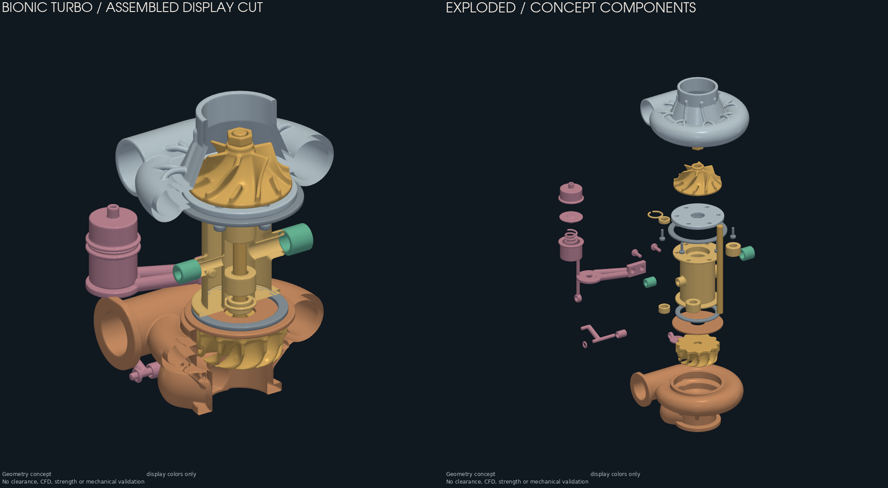
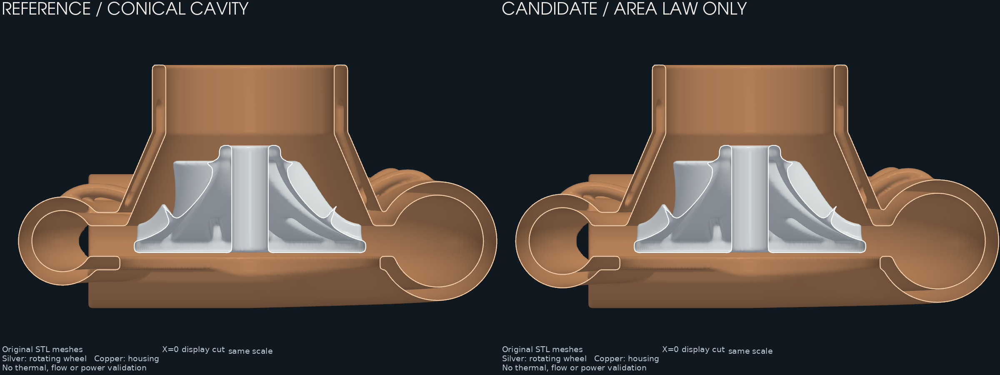

# Bionic turbo F1 — flow and power study

This revision implements two ideas from the
[PicoGK research](../bionic-turbo-f0/research-20261010/README.md): a volute
whose nominal section grows linearly, and a housing that follows the wheel
profile more closely. **No gain in flow or power is yet
validated.** The chosen objective is flow and maximum power.

The bulky F0/F1 outputs are also saved in
[the verified remote archive](REMOTE-ARCHIVE.md), with a manifest and restoration
instructions.

The variant with the tighter profile remains a rejected study for the current CFD:
a nominal radial clearance of 1.5 mm locally gives a
[wheel/housing distance below 0.4 mm](evidence/combined-003-clearance-upper-bound.json),
under the 0.5 mm voxel. The retained comparison therefore covers
**the volute alone**, with the same wheel and the same conical chamber.



The [geometric evidence](geometry-evidence.json) links the sources, STL,
reports and previews: **39 parts inspected, 38 identical to F0** and a
wheel/housing radial separation bound of **1.7858 mm** over 360°. This
bound does not constitute a qualified running clearance.



## Changes and references

| Parameters | Volute radius law, angular fraction `t` | Chamber | Use |
|---|---|---|---|
| [baseline.json](baseline.json) | `6 + 8t` mm | Conical F0 | Common reference |
| [candidate.json](candidate.json) | `sqrt(36 + 160t)` mm | Conical F0 | Volute candidate |
| [candidate-shroud.json](candidate-shroud.json) | `6 + 8t` mm | Wheel profile | Exploratory parameterisation, no standalone run |
| [candidate-combined.json](candidate-combined.json) | `sqrt(36 + 160t)` mm | Wheel profile | Geometry produced, passage under-resolved |

Both laws keep the end radii of 6 and 14 mm. The second makes
`πr²` affine with the angle; it is neither a measured hydraulic section
nor a calculated flow. The overlap at the volute junction and the absence
of a defined aerodynamic tongue remain limits of the concept.

The section-law principle comes from
[QUASAR Phy-CC, revision fd2b4f2](https://github.com/QU01/Quasar-Phy-CC/tree/fd2b4f2066176265d77bfaa860bda7030578ffc6)
(Apache-2.0). The assembly checks are also inspired by
[Phy-CT, revision fd9d78f](https://github.com/QU01/Quasar-Phy-CT/tree/fd9d78f6cccca0850273884e31faec7632810842).
The new code is original; no QUASAR code, no LEAP 71 wheel and
no Noyron model are imported. Their numerical results are
not transferred to our turbo.

The F0 sources and the 38 other components are preserved. The editable
master is [source/Program.cs](source/Program.cs), with
[WheelShroudProfile.cs](source/WheelShroudProfile.cs). The internal grid
offset `(0.173; 0.119; 0.071)` mm, common to the variants, avoids the
exact coincidences observed at export. The inverse transformation returns
the STLs to the initial frame. The native regularisation remains 0.5 mm;
no exported triangle is removed to make the checks pass.

## Verify the geometries

.NET 9, PicoGK 2.3.0 and its native kernel are required. The Python tools
use NumPy, Trimesh and PyVista, already used in this repository.

```sh
dotnet build twins/bionic-turbo-f1/source/BionicTurboF1.csproj -c Release
dotnet twins/bionic-turbo-f1/source/bin/Release/net9.0/BionicTurboF1.dll --self-test
python -m unittest discover -s tests -p 'test_bionic_turbo_f1*.py' -v
```

Each native run must take the existing machine lock. Example
from the repository root, with `dotnet` in the `PATH`:

```python
import runpy, subprocess
lock = runpy.run_path('parts/picogk-catalog/tools/run_part.py')
lock['acquire']()
try:
    for name in ('baseline', 'candidate'):
        subprocess.run([
            'dotnet', 'twins/bionic-turbo-f1/source/bin/Release/net9.0/BionicTurboF1.dll',
            f'twins/bionic-turbo-f1/{name}.json', f'work/f1-new/{name}'
        ], check=True)
finally:
    lock['LOCK'].unlink(missing_ok=True)
```

The directories must be new. The F0 inspector can check the STLs
without being modified; its previews however still carry the F0 title.
[compare_geometry.py](compare_geometry.py) then compares the housings
with the exact triangles of the wheel and verifies the digests of the reports.
Its radial bound by Z bands covers any rotation about the Z axis,
without angle sampling. A positive bound establishes the radial separation
of the meshes; an indeterminate bound does not establish a collision.
This calculation does not measure the normal, thermal or real clearance after manufacture.

The complete outputs remain under `work/bionic-f1-20261011/`:
`baseline-003/`, `candidate-volute-004/`, `assembly-volute-004/` and
`assembly-volute-004-inspection/`. The last contains the GLBs `assembled.glb`
and `exploded.glb`, each with 39 distinct components and a verified
millimetre/metre conversion. The rejected trials remain in their respective
directories. The small reports and previews are versioned here; the bulky
meshes remain reproducible local outputs.

## Aerodynamic comparison

The generator's `flow-domain.stl` is a nominal volume, before smoothing of the
housing and without subtraction of the rotor. It does not constitute a CFD domain.
The [CFD builder](cfd-geometry/README.md) subtracts the final housing and
the exact rotor, adds an ideal rear closure and extends the outlet.
[prepare_surface.py](prepare_surface.py) checks the facets, assigns
the four boundaries and converts millimetres to metres. These closures
are numerical hypotheses; they do not validate the sealing of the
39-component turbo.

The [CFD case](cfd/README.md) uses the compressible MRF solver
`rhoSimpleFoam` of OpenCFD 2406, whose energy equation includes the work
of the rotating frame. The ARM64 image is pinned by SHA-256; the calculations
remain local and their logs are kept.

The first common point is a hypothesis: 100,000 rpm, inlet total pressure
101,325 Pa, total temperature 298.15 K and outlet static pressure
121,590 Pa. **The flow rate is an output of the solver**, not a condition
imposed to obtain a better result. The sign of the torque must show
work supplied to the fluid; its absolute value does not mask an inversion.

A result must satisfy the mesh, continuity,
energy, backflow, residual and temporal-stability checks defined before
the calculation. Even a converged point does not demonstrate maximum flow: the
back-pressure must be swept at identical speed and the passages
near the walls resolved on several meshes. The power absorbed by the
compressor is not the useful power of the engine.

## Result of the local checks

The [verification summary](verification.json) links the checks, the digests
and the limits of this revision.

The meshing trials were actually run with OpenCFD; no
flow solver has yet been launched. The checks refuse concave cells
and the artificial closure of the rear passage of the wheel.
The three uniform resolutions tried give:

| Reference trial | Nominal cell size | Cells | Concave cells | Decision |
|---|---:|---:|---:|---|
| `coarse-004` | 0.80 mm | 457,137 | 35 | Rejected |
| `medium-001` | 0.60 mm | 1,079,657 | 13 | Rejected |
| `fine-001` | 0.45 mm | 2,543,835 | 45 | Rejected |

Refinement alone is therefore not enough. The
[source domain diagnostic](evidence/fluid-004-topology-diagnostic.json)
also reveals an artificial fusion between wheel and nut during
revoxelisation at 0.5 mm. The old domains are now refused by an
additional check of their passages and shells. Conversion at
0.25 mm, regularisation of 0.125 mm and a common phase restore the three
expected shells in both variants, without modifying the source parts.
The [corrected domains](evidence/fluid-006-paired-evidence.json) pass the
facet and topology checks.

The final preparations [reference](evidence/baseline-surface-009.json) and
[F1](evidence/candidate-volute-surface-009.json) also pass the proximity
and boundary checks. An independent check corrected the assignment
of 513 faces of the fixed rear seal, previously classified as rotating. The
[correction witnesses](evidence/rotor-label-witnesses-009.json) confirm
their unchanged coordinates and their new fixed label. This correction
avoids calculating a torque on a wall wrongly driven.

The new trial `medium-gap-002` uses these corrected surfaces and refines
the gaps down to a nominal cell size of 0.15 mm. The
[receipt of this trial](evidence/cfd/summary-medium-gap-002.json) keeps its
conditions and logs. It finishes in 527.7 seconds,
with **2,114,975 cells**, but the extended check finds **1,167 concave
cells**, 1,667 concave faces and one warped face. The mesh remains refused;
the solver is not launched. The independent check nevertheless keeps the
three expected shells and their Euler characteristics `[2, 0, 0]`: the
spurious wheel/housing connection of the old trials has disappeared. This does not measure
the thickness of all the gaps. Computation time and memory are
not the cause of the rejection. The thresholds were not lowered to obtain a result.
The localisation of the native set of concave cells places 1,156 on a
refinement transition, of which 568 also against a wall; the other 11
touch only a wall. None is at the finest level. This diagnostic
directs the next correction towards the transitions and their connection to the
walls; it does not requalify the refused cells.

The raw outputs, the exact
configurations and the earlier trials remain preserved; the small reports
appear in `evidence/cfd/`. No flow, shaft power or
efficiency result is deduced from these refused meshes. The F1 variant remains a
**candidate to be evaluated**, not a demonstrated aerodynamic improvement.

The **45 targeted tests** cover geometry, surfaces, CFD conditions,
balances and topology rejections; they pass, as do the two
C# self-checks. The last `make check` ran 3,654 tests: two errors
from missing dependencies (`rtree`, `networkx`) and two exact floating-point
comparison failures affect earlier fan studies. These files
remain unchanged. The global validation of the repository is therefore not green.

## Next step: digital twin

1. Resolve the observed mesh defects while preserving the passages and
   the four boundaries, then obtain paired, converged CFD points
   and a sensitivity study
   on the mesh, the walls and the closures. Reject any ranking smaller
   than the numerical uncertainty. Compare flow, total pressure ratio,
   temperature and shaft power at common conditions.
2. Establish a compressor map over several speeds and back-pressures.
   Qualify the flow limit and the stable zone; a steady MRF alone
   does not validate transient surge.
3. Do the same on the turbine side, wastegate included, then solve
   the balance `P_turbine = P_compresseur + pertes` and the engine matching.
   The thermal state, bearing losses, engine maps and admissible
   speed remain unknown; no maximum power is invented.
4. Add the dynamics with the measured rotor inertia and the identified
   losses, then link pressure, temperature, flow and speed to
   time-stamped bench measurements. An animated geometry is not enough to constitute
   a calibrated twin.

The interface measurements, materials/processes, expansions, balancing,
overspeed, fatigue and physical tests remain to be established. This revision
is a design study and releases no part for functional
manufacture.
