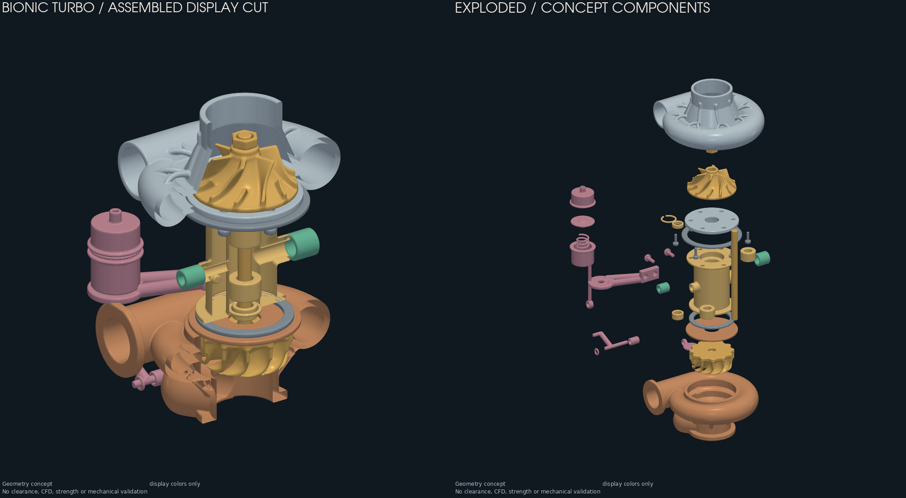
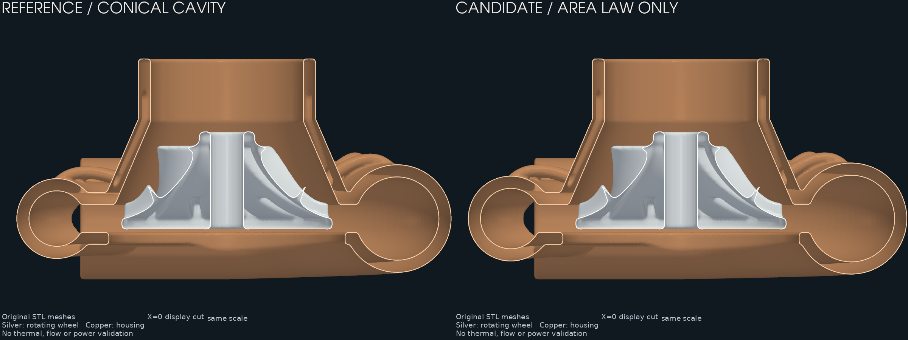

# Turbo bionique F1 — étude du débit et de la puissance

Cette révision implémente deux idées issues de la
[recherche PicoGK](../bionic-turbo-f0/research-20261010/README.md) : une volute
dont la section nominale croît linéairement, et un carter suivant davantage
le profil de la roue. **Aucun gain de débit ou de puissance n'est encore
validé.** L'objectif choisi est le débit et la puissance maximale.

Les sorties volumineuses F0/F1 sont aussi sauvegardées dans
[l’archive distante vérifiée](REMOTE-ARCHIVE.md), avec manifeste et instructions
de restauration.

La variante avec profil rapproché reste une étude rejetée pour la CFD actuelle :
un jeu nominal radial de 1,5 mm donne localement une
[distance roue/carter inférieure à 0,4 mm](evidence/combined-003-clearance-upper-bound.json),
sous le voxel de 0,5 mm. La comparaison retenue porte donc
sur **la volute seule**, avec la même roue et la même chambre conique.



Les [preuves géométriques](geometry-evidence.json) relient les sources, STL,
rapports et aperçus : **39 pièces inspectées, 38 identiques à F0** et une
borne de séparation radiale roue/carter de **1,7858 mm** sur 360°. Cette
borne ne constitue pas un jeu de fonctionnement qualifié.



## Changements et références

| Paramètres | Loi de rayon de volute, fraction angulaire `t` | Chambre | Usage |
|---|---|---|---|
| [baseline.json](baseline.json) | `6 + 8t` mm | Conique F0 | Référence commune |
| [candidate.json](candidate.json) | `sqrt(36 + 160t)` mm | Conique F0 | Candidat volute |
| [candidate-shroud.json](candidate-shroud.json) | `6 + 8t` mm | Profil de roue | Paramétrage exploratoire, pas de run autonome |
| [candidate-combined.json](candidate-combined.json) | `sqrt(36 + 160t)` mm | Profil de roue | Géométrie produite, passage sous-résolu |

Les deux lois gardent les rayons d'extrémité 6 et 14 mm. La deuxième rend
`πr²` affine avec l'angle ; ce n'est ni une section hydraulique mesurée
ni un débit calculé. Le chevauchement au raccord de la volute et l'absence
d'une langue aérodynamique définie restent des limites du concept.

Le principe de loi de section vient de
[QUASAR Phy-CC, révision fd2b4f2](https://github.com/QU01/Quasar-Phy-CC/tree/fd2b4f2066176265d77bfaa860bda7030578ffc6)
(Apache-2.0). Les contrôles d'assemblage sont aussi inspirés de
[Phy-CT, révision fd9d78f](https://github.com/QU01/Quasar-Phy-CT/tree/fd9d78f6cccca0850273884e31faec7632810842).
Le nouveau code est original ; aucun code QUASAR, aucune roue LEAP 71 et
aucun modèle Noyron ne sont importés. Leurs résultats numériques ne sont
pas transférés à notre turbo.

Les sources F0 et les 38 autres composants sont conservés. Le maître
éditable est [source/Program.cs](source/Program.cs), avec
[WheelShroudProfile.cs](source/WheelShroudProfile.cs). Le décalage interne
de grille `(0,173 ; 0,119 ; 0,071)` mm, commun aux variantes, évite les
coïncidences exactes observées à l'export. La transformation inverse remet
les STL dans le repère initial. La régularisation native reste de 0,5 mm ;
aucun triangle exporté n'est supprimé pour faire passer les contrôles.

## Vérifier les géométries

.NET 9, PicoGK 2.3.0 et son noyau natif sont nécessaires. Les outils Python
utilisent NumPy, Trimesh et PyVista déjà employés dans ce dépôt.

```sh
dotnet build twins/bionic-turbo-f1/source/BionicTurboF1.csproj -c Release
dotnet twins/bionic-turbo-f1/source/bin/Release/net9.0/BionicTurboF1.dll --self-test
python -m unittest discover -s tests -p 'test_bionic_turbo_f1*.py' -v
```

Chaque exécution native doit prendre le verrou machine existant. Exemple
depuis la racine du dépôt, avec `dotnet` dans le `PATH` :

```python
import runpy, subprocess
lock = runpy.run_path('parts/picogk-catalog/tools/run_part.py')
lock['acquire']()
try:
    for name in ('baseline', 'candidate'):
        subprocess.run([
            'dotnet', 'twins/bionic-turbo-f1/source/bin/Release/net9.0/BionicTurboF1.dll',
            f'twins/bionic-turbo-f1/{name}.json', f'work/f1-new/{name}'
        ], check=True)
finally:
    lock['LOCK'].unlink(missing_ok=True)
```

Les dossiers doivent être neufs. L'inspecteur F0 peut contrôler les STL
sans être modifié ; ses aperçus portent cependant encore le titre F0.
[compare_geometry.py](compare_geometry.py) compare ensuite les carters
aux triangles exacts de la roue et vérifie les empreintes des rapports.
Sa borne radiale par bandes Z couvre toute rotation autour de l'axe Z,
sans échantillonnage d'angles. Une borne positive établit la séparation
radiale des maillages ; une borne indéterminée n'établit pas une collision.
Ce calcul ne mesure pas le jeu normal, thermique ou réel après fabrication.

Les sorties complètes restent sous `work/bionic-f1-20261011/` :
`baseline-003/`, `candidate-volute-004/`, `assembly-volute-004/` et
`assembly-volute-004-inspection/`. Ce dernier contient les GLB `assembled.glb`
et `exploded.glb`, chacun avec 39 composants distincts et une conversion
millimètres/mètres vérifiée. Les essais rejetés restent dans leurs dossiers
respectifs. Les petits rapports et aperçus sont versionnés ici ; les maillages
volumineux restent des sorties locales reproductibles.

## Comparaison aérodynamique

Le `flow-domain.stl` du générateur est un volume nominal, avant lissage du
carter et sans soustraction du rotor. Il ne constitue pas un domaine CFD.
Le [constructeur CFD](cfd-geometry/README.md) soustrait le carter final et
le rotor exact, ajoute une fermeture arrière idéale et prolonge la sortie.
[prepare_surface.py](prepare_surface.py) contrôle les facettes, attribue
les quatre frontières et convertit les millimètres en mètres. Ces fermetures
sont des hypothèses numériques ; elles ne valident pas l'étanchéité du
turbo à 39 composants.

Le [cas CFD](cfd/README.md) utilise le solveur compressible MRF
`rhoSimpleFoam` d'OpenCFD 2406, dont l'équation d'énergie inclut le travail
du repère tournant. L'image ARM64 est épinglée par SHA-256 ; les calculs
restent locaux et leurs journaux sont conservés.

Le premier point commun est une hypothèse : 100 000 tr/min, pression totale
d'entrée 101 325 Pa, température totale 298,15 K et pression statique de
sortie 121 590 Pa. **Le débit est une sortie du solveur**, pas une condition
imposée pour obtenir un meilleur résultat. Le signe du couple doit montrer
un travail fourni au fluide ; sa valeur absolue ne masque pas une inversion.

Un résultat doit satisfaire les contrôles de maillage, de continuité,
d'énergie, de reflux, de résidus et de stabilité temporelle définis avant
calcul. Même un point convergé ne démontre pas le débit maximal : il faut
balayer la contre-pression à régime identique et résoudre les passages
près des parois sur plusieurs maillages. La puissance absorbée par le
compresseur n'est pas la puissance utile du moteur.

## Résultat des vérifications locales

Le [bilan de vérification](verification.json) relie les contrôles, les empreintes
et les limites de cette révision.

Les essais de maillage ont réellement été exécutés avec OpenCFD ; aucun
solveur d'écoulement n'a encore été lancé. Les contrôles refusent les cellules
concaves et la fermeture artificielle du passage arrière de la roue.
Les trois résolutions uniformes essayées donnent :

| Essai de référence | Maille nominale | Cellules | Cellules concaves | Décision |
|---|---:|---:|---:|---|
| `coarse-004` | 0,80 mm | 457 137 | 35 | Rejeté |
| `medium-001` | 0,60 mm | 1 079 657 | 13 | Rejeté |
| `fine-001` | 0,45 mm | 2 543 835 | 45 | Rejeté |

Le raffinement seul ne suffit donc pas. Le
[diagnostic du domaine source](evidence/fluid-004-topology-diagnostic.json)
révèle aussi une fusion artificielle entre roue et écrou lors de la
revoxelisation à 0,5 mm. Les anciens domaines sont désormais refusés par un
contrôle supplémentaire de leurs passages et coquilles. La conversion à
0,25 mm, régularisation de 0,125 mm et phase commune restitue les trois
coquilles attendues dans les deux variantes, sans modifier les pièces sources.
Les [domaines corrigés](evidence/fluid-006-paired-evidence.json) passent les
contrôles de facettes et de topologie.

Les préparations finales [référence](evidence/baseline-surface-009.json) et
[F1](evidence/candidate-volute-surface-009.json) passent aussi les contrôles
de proximité et de frontières. Un contrôle indépendant a corrigé l'attribution
de 513 faces du joint arrière fixe, auparavant classées rotatives. Les
[témoins de correction](evidence/rotor-label-witnesses-009.json) confirment
leurs coordonnées inchangées et leur nouveau label fixe. Cette correction
évite de calculer un couple sur une paroi entraînée à tort.

Le nouvel essai `medium-gap-002` utilise ces surfaces corrigées et raffine
les jeux jusqu'à une maille nominale de 0,15 mm. Le
[reçu de cet essai](evidence/cfd/summary-medium-gap-002.json) en conserve les
conditions et les journaux. Il termine en 527,7 secondes,
avec **2 114 975 cellules**, mais le contrôle étendu relève **1 167 cellules
concaves**, 1 667 faces concaves et une face voilée. Le maillage reste refusé ;
le solveur n'est pas lancé. Le contrôle indépendant conserve cependant les
trois coquilles attendues et leurs caractéristiques d'Euler `[2, 0, 0]` : le
raccord parasite roue/carter des anciens essais a disparu. Cela ne mesure
pas l'épaisseur de tous les jeux. Le temps de calcul et la mémoire ne sont
pas la cause du rejet. Les seuils n'ont pas été abaissés pour obtenir un résultat.
La localisation du jeu natif de cellules concaves en place 1 156 sur une
transition de raffinement, dont 568 également contre une paroi ; les 11 autres
touchent seulement une paroi. Aucune n'est au niveau le plus fin. Ce diagnostic
oriente la prochaine correction vers les transitions et leur raccord aux
parois ; il ne requalifie pas les cellules refusées.

Les sorties brutes, les configurations
exactes et les essais antérieurs restent conservés ; les petits rapports
figurent dans `evidence/cfd/`. Aucun résultat de débit, puissance d'arbre ou
rendement n'est déduit de ces maillages refusés. La variante F1 reste un
**candidat à évaluer**, pas une amélioration aérodynamique démontrée.

Les **45 tests ciblés** couvrent la géométrie, les surfaces, les conditions CFD,
les bilans et les rejets de topologie ; ils passent, ainsi que les deux
autocontrôles C#. Le dernier `make check` a exécuté 3 654 tests : deux erreurs
de dépendances absentes (`rtree`, `networkx`) et deux échecs de comparaison
flottante exacte touchent des études antérieures de ventilateur. Ces fichiers
restent inchangés. La validation globale du dépôt n'est donc pas verte.

## Étape suivante : jumeau numérique

1. Résoudre les défauts de maillage observés en conservant les passages et
   les quatre frontières, puis obtenir des points CFD appariés et convergés
   et une étude de sensibilité
   au maillage, aux parois et aux fermetures. Rejeter tout classement inférieur
   à l'incertitude numérique. Comparer débit, rapport de pression totale,
   température et puissance d'arbre à conditions communes.
2. Établir une carte compresseur sur plusieurs régimes et contre-pressions.
   Qualifier la limite de débit et la zone stable ; une MRF stationnaire seule
   ne valide pas le pompage transitoire.
3. Faire la même chose côté turbine, wastegate comprise, puis résoudre
   l'équilibre `P_turbine = P_compresseur + pertes` et l'appariement moteur.
   L'état thermique, les pertes de paliers, les cartes moteur et le régime
   admissible restent inconnus ; aucune puissance maximale n'est inventée.
4. Ajouter la dynamique avec l'inertie mesurée du rotor et les pertes
   identifiées, puis relier pression, température, débit et régime à des
   mesures de banc horodatées. Une géométrie animée ne suffit pas à constituer
   un jumeau calibré.

Les mesures d'interfaces, matériaux/procédés, dilatations, équilibrage,
survitesse, fatigue et essais physiques restent à établir. Cette révision
est une étude de conception et ne libère aucune pièce pour la fabrication
fonctionnelle.
