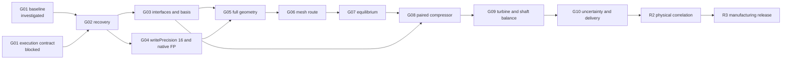

# Bionic turbo F1 baseline — 6 November 2026

This directory freezes the starting state of the bionic turbo for the roadmap in
[issue #393](https://github.com/cluster2600/porscheparts/issues/393), as asked by
[issue #394](https://github.com/cluster2600/porscheparts/issues/394). It is a
**read-only inventory**. To build it, no turbo case, mesher, solver, container or
paid compute was run. The PR229 `blockMeshDict` was not executed, case 084 was not
touched, and no PR238–256 traversal was replayed. No recurring automation was
enabled and nothing was deleted.

**No gate opens from this baseline.** No flow rate, shaft power or calibration is
validated, and no part is released.

| File | Content |
|---|---|
| [baseline-manifest.json](baseline-manifest.json) | Versioned manifest: Git anchors, PR254/PR256, the current 2026-10-14 reference package, unresolved obligations, running jobs, prohibitions and the next permitted action |
| [runtime-matrix.json](runtime-matrix.json) | Turbo tool/runtime matrix: variant, version, source commit, platform, digests, executable hashes, per-host availability, input/output contract, turbo role and qualification |
| [gate-ledger.json](gate-ledger.json) | Stage gates G01–G10, physical correlation R2 and manufacturing release R3, with the paired reference-versus-bionic comparison contract |
| [evidence-inventory.json](evidence-inventory.json) | Generated: the 63 evidence packages with archive receipts, their digests and live release matches, the PR-to-package map, and one aggregate digest over the 1689 tracked evidence files |
| [host-observations-20261106.json](host-observations-20261106.json) | Sanitised receipt of the read-only host, Docker, process, scheduling, SSH and GitHub checks |
| [baseline.py](baseline.py) | Validator and gate evaluator; [tests](../../../tests/test_bionic_turbo_f1_baseline.py) |

Every claim in these files either links to a committed receipt pinned by SHA-256, or
carries an explicit `unknown` with a reason. `baseline.py check` fails on any stale
receipt, changed evidence file, changed case generator or missing prohibition.

## What was verified on 6 November 2026

- **Git and GitHub.** PR254 and PR256 are merged. The English package
  `airflow-internal-contact-obligations-20261014` is the current reference; the French
  2026-10-13 package stays unchanged as the historical record. Between the issue
  snapshot `fcfdf5d1` and `483c62bb` only prose changed (British spelling), and
  `evidence/**` is unchanged. No open pull request touches the turbo.
- **Releases.** The committed `file-manifest.json` digest of all 63 packages matches a
  live release asset. Sixty archives are single matching assets; three are published as
  split parts. Nothing was downloaded or restored here; that is
  [issue #395](https://github.com/cluster2600/porscheparts/issues/395).
- **WSL host.** No OpenFOAM or turbo process runs, no container runs, and no crontab or
  turbo timer exists. The pinned OpenCFD image, the diagnostic build image and the
  `bionic-native-source-20261012` volume are **absent**. The only local OpenFOAM is
  Foundation 13 in `3dprinting993-cadsim:dev`, which is prohibited for the turbo.
- **Mac and Kali.** Unknown: neither host was reachable from the WSL host on 2026-11-06.
  Kali names do not resolve, and the 28 October link used a Mac-scoped Thunderbolt IPv6
  address. Nothing was changed on either host, and no claim is made that SALOME or
  CloudCompare ran natively on Kali.

## Runtime matrix summary

| Runtime | Identity | Turbo status |
|---|---|---|
| OpenCFD v2406, `linux/arm64` | image `opencfd/openfoam-run@sha256:1db0df06…`, source commit `be01ca78`, archive `8d1450fb…`; only `rhoPimpleFoam` has a binary hash (`85e40da3…`) | Historical evidence runtime, not qualified for turbo CFD. `rhoSimpleFoam`, `blockMesh`, `snappyHexMesh` and `checkMesh` hashes are unknown |
| OpenCFD v2406 rebuild | `rhoPimpleFoam` `08e208f5…`, Dockerfile `c5ca6ad9…` | Software-parity witness on the two-step 052/053 control only |
| OpenFOAM Foundation 13 (cadsim) and 14 (engine images) | local image `7fd9720b…`; F35 lock fail-closed | **Prohibited for turbo substitution** |
| PicoGK 2.3.0 / .NET 9 | project file `e1e0f485…` | Geometry generator, not an interface authority |
| DVC, SQLite FTS5, OpenTURNS, OpenMDAO, CloudCompare, SALOME | free-tools lock `245ceb27…` | Carrier and synthetic controls only; no turbo receipt |
| foamlib, CalculiX, meshio/PyVista/ParaView, USD, PhysicsNeMo | none | Not pinned |

`cfd/prepare_case.py` still writes `writePrecision 12`; later witnesses rewrite that
entry to 16. A new case must write 16 explicitly. This is recorded as a blocker of the
execution contract.

## Gates



| State | Gates |
|---|---|
| Passed | none |
| Investigated (blockers recorded) | G01 baseline: Mac and Kali state unknown |
| Blocked | G01 execution contract: pinned image absent here and unknown on the Mac, four executable hashes unknown, `writePrecision 12` in the case generator |
| Not started | G02–G10, R2, R3 |
| Inherited failures kept | medium-gap-002 mesh refused (G06); PR229 transition refused (G06); case 084 incomplete at budget (G07); tighter wheel-profile variant rejected (G05) |

A gate opens only through `evaluate_gate`. Every prerequisite must have passed, with no
open blocker. Each bound runtime row must be attested with the same variant, version
and platform. Every bound digest or executable hash must be pinned, never `unknown`,
and attested byte for byte. Every configuration pin must still match the repository
and be attested equal. At least one execution receipt must verify. Physical
correlation and manufacturing release also need a documented professional review
receipt. A stale or mismatched binary or configuration hash therefore refuses the gate.
The tests show this, with a positive control that an exact attestation opens a
synthetic gate.

## Paired comparison contract

The pair is the reference `baseline.json` (`6 + 8t` mm) against the volute-only
`candidate.json` (`sqrt(36 + 160t)` mm), with the same wheel, chamber, seals, closures,
extensions, mesh route, runtime, criteria and operating point. The operating point
(100,000 rpm, 101,325 Pa and 298.15 K total at inlet, 121,590 Pa static at outlet) is a
**hypothesis**. Measured conditions are unknown.

- **Flow** is the mass flow rate the solver produces at imposed back-pressure, measured
  on sections outside the MRF zone. A single point shows neither maximum flow nor
  choking.
- **Shaft power** is `P = -omega * M_z`, where `M_z` is the native fluid-on-rotor
  moment. It must equal the net total-enthalpy flux within the prescribed imbalance. It
  is the power absorbed by the compressor, not engine power and not turbine power.
- A ranking needs several prescribed meshes and a paired difference larger than the
  combined numerical uncertainty.

Numerical comparison (G08, G10), physical correlation (R2) and manufacturing release
(R3) are separate gates.

## Commands

```sh
python3 twins/bionic-turbo-f1/baseline-20261106/baseline.py check
python3 twins/bionic-turbo-f1/baseline-20261106/baseline.py check --history   # full clone only
python3 -m unittest discover -s tests -p 'test_bionic_turbo_f1_baseline.py'
python3 twins/bionic-turbo-f1/baseline-20261106/baseline.py evaluate \
  --gate G01-execution-contract --attestation <new-attestation.json>
```

To refresh the inventory after an authorised change, save
`gh api --paginate repos/cluster2600/porscheparts/releases` to a private file. Then run
`baseline.py inventory --releases <file> --write` and create a **new** baseline
revision; this one stays as the record of 2026-11-06.

## Next permitted action

The next step is a read-only readback on the Mac host by its owner or an authorised
session, changing nothing:

- `docker image inspect` of the pinned OpenCFD digest and of
  `bionic-openfoam2406-diagnostic-build:20261012`;
- `docker volume inspect bionic-native-source-20261012` and `docker ps`;
- the paused state of the recurring turbo automation;
- the SHA-256 of `rhoSimpleFoam`, `blockMesh`, `snappyHexMesh` and `checkMesh` inside
  the pinned image, without running a case.

Record the result as a new receipt in a new baseline revision. Only then may G01 be
reconsidered and issue #395 start.
