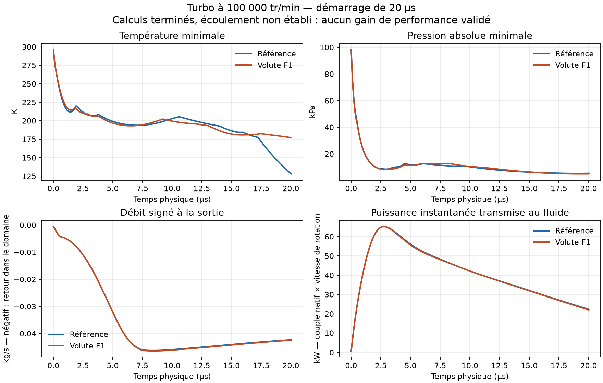

# Calculs 010 terminés et audit des repères

La PR #160 a été fusionnée dans `main` au commit `b90621264858ceae49fa96e56c76649dd087ba75` ; sa CI et la CI après fusion sont vertes.

Les deux solveurs natifs se sont terminés avec un code zéro et `End`. Cette réussite d'exécution n'établit pas un régime stationnaire ni un gain de performances.

| Observation native | Référence | Volute F1 |
|---|---:|---:|
| Cellules | 2 114 975 | 2 141 833 |
| Pas physiques complets | 272 | 247 |
| Temps physique final | 20,0183 µs | 20,0027 µs |
| Temps de calcul mural | 4 608 s | 4 305 s |
| Débit signé à la sortie, dernier pas | −0,042258 kg/s | −0,042408 kg/s |
| Température minimale, dernier pas | 128,082 K | 177,157 K |
| Pression minimale, dernier pas | 5 426,61 Pa | 4 960,25 Pa |
| Flux absolu total à travers le stator, dernier champ sauvegardé | 2,34 × 10⁻¹² kg/s | 2,38 × 10⁻¹² kg/s |

Le débit sortant négatif correspond à un retour d'air dans le domaine. Les ports n'ont pas atteint un écoulement établi ; les minima locaux très bas et les historiques encore évolutifs ne permettent pas de classer les volutes. La balance énergétique transitoire avec stockage n'est pas validée.

## Correction de l'interprétation du flux MRF

`phi` est un flux relatif dans la zone tournante. Sur les faces du stator appartenant à cette zone, le flux physique est `phi + rho * (Omega × Cf) · Sf`. Les sommes des valeurs absolues du flux relatif atteignent environ 1,04 kg/s, mais le flux physique est nul à l'arrondi numérique près. Comparer directement ce flux relatif à un critère de fuite de paroi était incorrect.

L'auditeur indépendant `cfd/audit_diagnostic.py` reconstruit ce changement de repère à partir des faces, propriétaires de cellules, zone MRF et champs natifs `rho`/`phi`. Il utilise les centres géométriques des rectangles : une simple moyenne des sommets est fausse lorsque la face comporte un point intermédiaire sur une arête. Un test couvre précisément ce cas.

Ce contrôle est effectué au dernier champ sauvegardé, vers 19,5 µs, et non à chaque pas ni exactement au temps terminal. Les fichiers `*-startup-audit.json` épinglent toutes les entrées par SHA-256. La qualification de performances y reste fausse, sans modification des anciennes preuves ni de l'ancien auditeur canonique.

Référence de formulation : [OpenCFD, MRFZoneTemplates](https://api.openfoam.com/2406/MRFZoneTemplates_8C_source.html).

## Reprises en recherche de régime établi

- 011 : reprise SIMPLE directe, rejetée sur erreur native au premier pas.
- 012 : pas locaux PIMPLE ; candidate rejetée sur température négative, référence arrêtée après identification d'une reprise incomplète.
- 013 : reprend aussi les champs natifs `phi` et `rho`, avec les sept champs primaires/turbulents. Sans `phi`, `compressibleCreatePhi.H` reconstruit un flux absolu à partir de `U`, différent du flux MRF natif enregistré. Le test vérifie la copie byte à byte et le refus d'une altération.

013 utilise des **itérations de pseudo-temps local**, pas des secondes physiques : Co local maximal 0,8, pas local maximal 1 µs, 600 itérations demandées, arrêt au plus tard après deux heures. Le maillage et les conditions physiques sont conservés. Chaque essai reste séparé, avec arrêt sur p/T non positives et reçu terminal natif.

Les maillages en escalier, l'absence de couches de paroi qualifiées, l'indépendance au maillage et les conditions de fonctionnement non mesurées restent des limites. Aucun gain de débit, rendement, puissance maximale ou jumeau numérique calibré n'est validé.
