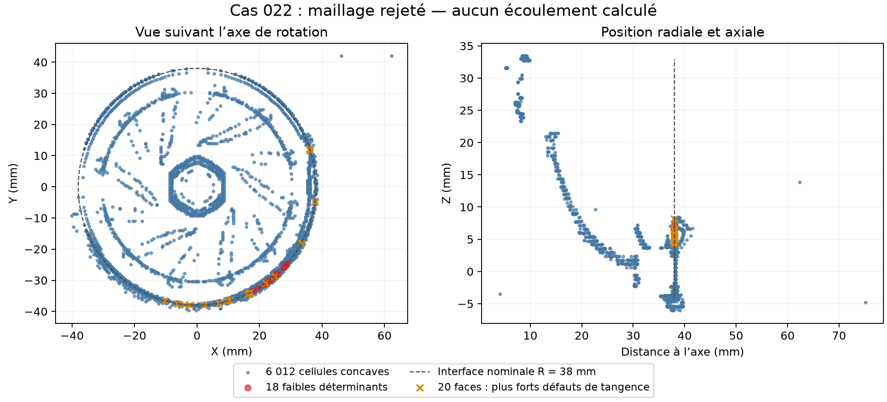

# Cas 022 : projection de l'interface sur le turbo, maillage rejeté

Le premier essai sur la géométrie complète conserve ses surfaces sources, les quatre patches, les trois coquilles et leurs invariants d'Euler. Il termine la construction native, mais **échoue au contrôle étendu du maillage**. Aucun solveur d'écoulement n'a été lancé et aucun gain de débit, puissance ou stabilité n'est établi.

## Résultats vérifiés

| Contrôle | Résultat |
|---|---|
| Cellules du maillage | 2 489 288 |
| Région fluide connectée | Une |
| Coquilles et provenance des patches | Trois, invariants conservés |
| Propriétaires de toutes les faces rotor dans la zone MRF | Oui |
| Ports hors zone MRF | Oui |
| Cellules dans la zone MRF | 1 627 533 |
| Faces internes séparant les repères | 34 372 |
| Contrôle étendu `checkMesh` | **Rejeté : deux contrôles échouent** |
| Cellules concaves | **6 012** |
| Cellules avec déterminant inférieur à 0,001 | **18** ; minimum 8,503e-7 |
| Calcul d'écoulement | Non lancé |

Les quatre programmes natifs (`blockMesh`, `snappyHexMesh`, `topoSet`, `checkMesh`) retournent zéro. Le reçu `run-mesh.json` rejette néanmoins le cas à cause du texte `Failed 2 mesh checks.` : un code de sortie nul ne suffit pas. La construction entière prend 723,34 secondes, sous une limite de 1 200 secondes, deux CPU et 8 Gio. `snappyHexMesh` annonce une fin sans erreur selon ses propres contrôles ; le contrôle étendu reste prioritaire.

## Modification isolée

`../../cfd/prepare_conformal_zone.py` repart des surfaces vérifiées de 015, SHA-256 `74bb941bcd3315b89ec65823c2fd22365b3f87a7db501f5b445dace6c877118b`. Le STL est copié sans modification. Le préparateur réutilise la recette canonique moyenne avec projection sur les surfaces et ajoute un cylindre analytique de rayon 38 mm, de z = −4 à +33 mm. `snappyHexMesh` crée directement sa zone de faces interne et la zone `rotorZone`. `topoSet` n'effectue aucune nouvelle sélection par centres de cellules.

La méthode utilise les entrées documentées [`searchableCylinder`](https://doc.openfoam.com/2306/tools/pre-processing/mesh/generation/snappyhexmesh/searchableObjects/searchablecylinder/) et [`faceZone`, `cellZone`, `faceType internal`](https://gitlab.com/openfoam/core/openfoam/-/raw/OpenFOAM-v2406/src/mesh/snappyHexMesh/refinementSurfaces/surfaceZonesInfo.C). Le raffinement des jeux et les seuils de qualité existants ne sont pas relâchés. La conservation du STL et de la topologie ne prouve pas encore la fidélité géométrique des surfaces maillées ni le respect quantifié des jeux.

## L'interface reste localement inadéquate

L'audit polygonal reprend la formule de centres et vecteurs d'aire du [code OpenCFD 2406](https://gitlab.com/openfoam/core/openfoam/-/raw/OpenFOAM-v2406/src/OpenFOAM/meshes/primitiveMesh/primitiveMeshCheck/primitiveMeshTools.C), lié par empreinte. Il retrouve les résultats analytiques sur les 640 faces du témoin radial 021. L'auditeur v2 corrige aussi le comptage des cellules lorsque le plus grand label n'apparaît que parmi les voisins ; le premier fichier et sa preuve restent inchangés.

| Indicateur géométrique | 015, interface en escalier à 38 mm | 022, projection sur le cylindre |
|---|---:|---:|
| Somme absolue de `(Ω × Cf) · Sf` | 0,517693 m³/s | 0,0219795 m³/s |
| Composante normale maximale de rotation | 396,728 m/s | **354,071 m/s** |

Ces valeurs décrivent la géométrie du changement de repère, **pas une fuite physique, un débit d'air ou un gain de performance**. Les maillages et nombres de faces diffèrent. Le total diminue fortement, mais des défauts locaux très importants subsistent. Aucun témoin d'équilibre n'est exécuté sur ce maillage rejeté.

La pire face est un triangle centré vers **(−2,231 ; −37,912 ; 4,543) mm**. Ses sommets s'écartent du rayon nominal de +15,9, +12,5 et −95,7 µm : créer une zone et projeter globalement sa surface ne garantit pas la tangence de chacune de ses faces.

## Localisation des défauts

Les centres natifs des 2 489 288 cellules ont été écrits par `postProcess -func writeCellCentres -time 0`, sous une limite de 120 secondes, sans solveur de flux. Les fichiers `C`, `Cx`, `Cy`, `Cz` sont relus entièrement : valeurs finies et composantes exactement identiques au champ vectoriel. Les empreintes prouvent que le maillage n'a pas changé pendant cette extraction.

- Les **18 cellules au déterminant trop faible** touchent toutes l'interface MRF **et** le stator. Leurs centres sont à moins de 0,15 mm du cylindre nominal, entre z = 6,039 et 6,946 mm.
- **3 834 des 6 012 cellules concaves** touchent l'interface MRF. Parmi les cellules concaves, 498 touchent le rotor et 493 le stator ; ces catégories ne sont pas nécessairement disjointes.
- Les identifiants et coordonnées de toutes les cellules rejetées sont conservés dans `defect-cell-centres.csv` ; les vingt pires faces d'interface sont également détaillées.



La prochaine correction doit reconstruire la jonction entre l'interface et le stator, puis les cellules adjacentes. Un témoin local de cette jonction avec une topologie structurée permettra de vérifier sa géométrie et son équilibre avant une autre reconstruction complète. Les défauts ailleurs dans le domaine devront aussi passer le contrôle natif. Ne pas corriger ce rejet par un changement arbitraire du solveur, un simple déplacement du rayon ou un assouplissement des seuils.

## Reproduction et conservation

Dans un espace de travail neuf, restaurer le parent 015 puis utiliser :

```sh
python twins/bionic-turbo-f1/cfd/prepare_conformal_zone.py PARENT_015 NEW_CASE
python twins/bionic-turbo-f1/cfd/run_case.py NEW_CASE --stage mesh --timeout 1200 --cpus 2 --memory-gb 8
python twins/bionic-turbo-f1/cfd/audit_frame_interface_v2.py NEW_CASE NEW_AUDIT.json
```

L'exécuteur de maillage doit refuser ce résultat. Ne pas lancer son étape `solve`. Les scripts d'extraction et de localisation de ce dossier précisent les chemins de cette campagne ; les rejouer dans une copie distincte avec des destinations neuves, sans écraser les preuves.

L'archive native contient **46 fichiers**, dont tous les champs de centres, les ensembles natifs de cellules/faces rejetées, le maillage, les entrées et les journaux. Ses **323 284 153 octets** ont été relus et chaque contenu vérifié ; SHA-256 `c3faa023b491356d651d16153da09e6f62b478b96ee71a4d372dd9c361218444`. Les éventuels liens physiques du TAR exigent une copie indépendante avant modification.

[Archive GitHub](https://github.com/cluster2600/porscheparts/releases/tag/bionic-turbo-conformal022-rejected-2026-10-12) ; `remote-verification.json` consigne les tailles et SHA-256 distants. La relecture complète est locale, sans second téléchargement intégral depuis GitHub.

Validation logicielle : 70 tests turbo réussis, un ignoré ; `make check` local découvre 3 754 tests et retrouve quatre problèmes hors turbo inchangés (deux dépendances optionnelles absentes et deux comparaisons flottantes exactes), avec 167 tests ignorés. Les journaux sont conservés. Les couches de paroi, l'indépendance au maillage, le régime établi et la calibration physique restent non validés.
