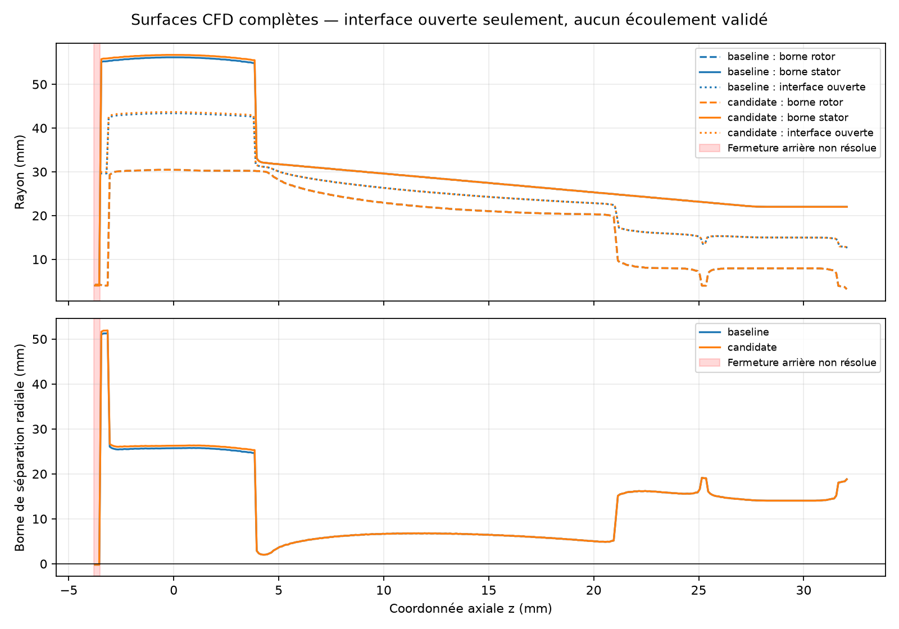

# Interface à rayon variable : passage partiel et témoin de repos

Les surfaces CFD complètes de la référence et de la candidate admettent le même **profil latéral ouvert**, de z = −3,5 à 32,1 mm. Un court segment de ce profil conserve ensuite le gaz au repos dans un témoin natif à 16 chiffres d'écriture. **La fermeture arrière, le maillage complet et les performances du turbo ne sont pas validés.**

## Bornes sur les surfaces réellement utilisées

`audit_interface_corridor.py` relit les quatre patches STL, leurs nombres de triangles et leur empreinte. La référence possède 516 216 triangles rotor et 1 540 619 triangles stator ; la candidate conserve le même nombre de triangles rotor et possède 1 577 503 triangles stator. Le patch rotor comprend les surfaces de la roue, de l'arbre et de l'écrou exposées au fluide.

La méthode réutilise `compare_geometry.projected_min_radius` : borne supérieure des rayons des facettes rotor et distance minimale à la projection **complète** des triangles stator, par bandes fermées de 0,1 mm. Elle ne remplace pas les facettes par leurs centres. Le patch stator est ouvert : le test d'enroulement d'un solide fermé ne lui est pas applicable et n'est pas utilisé.

- **356 bandes sur 359** offrent une intersection continue d'intervalles radiaux admissibles.
- Le même profil de référence, à 32 secteurs angulaires non subdivisés, reste séparé des deux variantes par une borne radiale minimale de **0,9056907 mm**. Le facteur `cos(π/32)` prend en compte le retrait radial des cordes des facettes.
- Les trois bandes entre **−3,8 et −3,5 mm** restent indéterminées au joint arrière. Leur borne minimale est **−0,204910 mm**. Ce signe n'est pas une preuve de collision : les bornes sont conservatives sur des facettes entières. Les triangles témoins sont conservés.
- Le profil est une construction de faisabilité latérale, pas une interface prête à mailler. Ses changements rapides de rayon doivent être traités sous les mêmes contraintes de séparation. Ni les fermetures, ni l'appartenance de tout le profil au volume fluide, ni les jeux euclidiens ou thermiques ne sont établis.



## Témoins natifs conservés

Le segment entre z = 6 et 7 mm reprend onze stations du profil de référence, aux hauteurs du défaut de 022. Deux couronnes synthétiques l'entourent, de demi-largeur **0,4528454 mm**. Toutes leurs parois sont fixes. Il n'y a ni pale, ni entraînement de paroi, ni différence de pression, ni chaleur. Ce témoin ne représente **pas** la jonction réelle avec le stator ni le joint arrière.

Les zones sont données directement aux blocs de `blockMesh`, suivant sa [syntaxe de zone de cellules](https://doc.openfoam.com/2606/tools/pre-processing/mesh/generation/blockMesh/). Aucun reclassement cylindrique par centre de cellule n'est appliqué. Les quadrilatères coniques sont tangents à la rotation à leur centre calculé par la formule native polygonale ; les fichiers réellement écrits sont audités indépendamment.

| Cas | Modification | Contrôle natif / résultat |
|---|---|---|
| 024 inertiel et tournant | 32 secteurs, 640 cellules | **Rejet avant solveur** : 512 cellules sous le déterminant 0,001 ; aucune cellule concave |
| 025 inertiel | 128 secteurs, 2 560 cellules, écriture 12 chiffres | `Mesh OK.`, 200 pas, vitesse maximale 5,676e-12 m/s |
| 025 tournant | Même maillage, Ω = 10 471,9755 rad/s | 200 pas terminés, **seuil de vitesse dépassé** : 1,3976e-8 m/s |
| 026 tournant | Même définition du maillage ; seule l'écriture passe de 12 à 16 chiffres | `Mesh OK.`, 200 pas, **trois seuils de repos respectés** |

Chaque paire de 024/025 ne diffère que par `constant/MRFProperties`. Entre 025 tournant et 026, le seul fichier d'entrée modifié est `system/controlDict`, et sa seule différence textuelle est `writePrecision 12` → `16`. Les paramètres physiques, pas de temps, schémas, tolérances et limites d'itérations restent identiques. Le raffinement angulaire de 024 à 025 modifie les facettes des parois synthétiques, tout en conservant les profils méridiens analytiques.

### Équilibre du témoin 026, 200 pas de 0,1 µs

| Grandeur | Maximum sur l'historique | Seuil fixé avant les essais |
|---|---:|---:|
| Écart de pression à 101 325 Pa | 1,9791e-9 Pa | 1e-3 Pa |
| Écart de température à 298,15 K | 6,9349e-11 K | 1e-6 K |
| Vitesse absolue | 9,0599e-12 m/s | 1e-8 m/s |

Les 1 280 faces de l'interface séparent 1 280 cellules tournantes de 1 280 cellules fixes. L'audit des coordonnées natives mesure une composante normale maximale de rotation passant de **1,7951e-8 m/s** dans 025 à **1,4779e-11 m/s** dans 026. Cette observation et le changement isolé soutiennent l'hypothèse d'une erreur liée à la sérialisation des coordonnées. Les flux géométriques sont des indicateurs de discrétisation, **pas des débits physiques ni des gains de performance**.

Le solveur de pression atteint sa limite de 1 000 itérations **800 fois** dans le contrôle inertiel 025, **546 fois** dans 025 tournant et **800 fois** dans 026. La conservation de l'état de repos est démontrée dans les seuils du témoin ; **la convergence linéaire n'est pas qualifiée**. Aucun seuil n'a été assoupli pour accepter 026.

## Reproduction et conservation

Depuis la racine du dépôt, restaurer les surfaces archivées de 014/015/022 dans des dossiers distincts. Les scripts refusent les destinations existantes et les sources déjà épinglées restent inchangées.

```sh
python twins/bionic-turbo-f1/cfd/audit_interface_corridor.py CASE NEW_PROFILE.json
```

Les scripts `run_witness.py`, `run_refined_witness.py` et `run_precision_witness.py` décrivent exactement les campagnes 024, 025 et 026. Ils utilisent OpenCFD 2406 épinglé, un CPU, 2 Gio, un budget natif de 600 secondes par cas et aucun réseau. Le contrôle étendu du maillage bloque le solveur même si `checkMesh` retourne zéro. `read_native.py` et `read_precision.py` relisent les empreintes de tous les fichiers, les faces polygonales et les champs finaux p/T/U de chaque calcul terminé. Les scripts conservent leurs chemins de campagne : adapter les destinations dans une nouvelle copie pour reproduire, sans écraser les preuves.

Les rapports `baseline-profile-023.json`, `candidate-profile-023.json` et `shared-corridor.json` conservent les bornes, coordonnées et empreintes. Les reçus d'archive et de publication complètent cette preuve. Les fichiers natifs restent tous conservés, y compris les deux rejets de 024 et l'échec au seuil de 025.

## Suite

Vérifier la géométrie exacte de la jonction arbre–joint arrière, sans transformer une borne négative en preuve de collision. Construire une fermeture et un profil régulier sous contraintes sur les surfaces actuelles ; ne pas envoyer directement les points médians à un mailleur. Tester ensuite la jonction réelle, puis un maillage complet avec ses patches, connexions, pales et jeux préservés. Adopter une précision native suffisante dans les nouveaux cas, sans réécrire les preuves antérieures.

Restent à vérifier : admission du maillage complet, couches de paroi, équilibre global, convergence, indépendance au maillage, comparaison de débit et de puissance et calibration physique. Aucun débit maximal, gain de puissance ou jumeau numérique calibré n'est établi.

Validation logicielle : **79 tests turbo réussis, un ignoré**. `make check` découvre 3 763 tests : 3 592 réussis, 167 ignorés et les quatre problèmes locaux hors turbo déjà connus (rtree/networkx absents et deux comparaisons flottantes exactes). Les deux journaux sont conservés ; la CI de la PR reste nécessaire avant fusion.

[Archive native GitHub](https://github.com/cluster2600/porscheparts/releases/tag/bionic-turbo-profile-interface-2026-10-12) : **152 fichiers**, 1 219 802 octets, SHA-256 `bfc22f76eeb49a8e5574a60c72e7d6d26405a7a568af87f29d91bea584a76e73`. Tous les contenus et liens physiques du TAR sont relus localement. Copier indépendamment avant modification. `remote-verification.json` consigne les tailles et empreintes distantes ; aucun second téléchargement intégral n'est présenté comme effectué.
