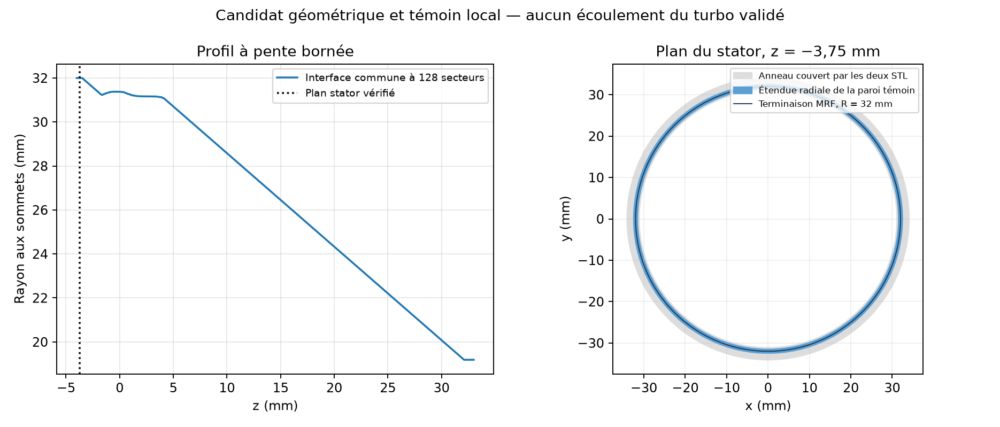

# Terminaison arrière vérifiée et témoin natif 028

L'interface peut aboutir à une portion **exactement plane du stator existant**, sans déplacer les surfaces du turbo. Un profil commun à pente bornée conserve les séparations radiales et englobe toutes les facettes rotor des deux variantes. Le témoin local de cette terminaison passe le contrôle natif et conserve le gaz au repos. **Aucun maillage complet ni gain de débit ou de puissance n'est validé.**

## Géométrie vérifiée sur les deux variantes

L'audit 027 relit les STL CFD épinglés de 022 et 014. Il reprend les bornes de 023 et vérifie les empreintes de leurs sources, rapports et manifestes.

| Contrôle | Résultat |
|---|---|
| Plan réel du stator | z = −3,75 mm, égalité exacte des coordonnées |
| Anneau entièrement couvert sur 360° | Rayons strictement entre 31,14553545 et 34,05413896 mm |
| Rayon de terminaison étudié | 32 mm, 128 secteurs ; cordes incluses dans l'anneau |
| Facettes sources pouvant toucher l'extension arrière | 1 813 stator par variante, toutes dans le plan ; aucune rotor ou port |
| Disque de fermeture à z = −4 mm | Sans intersection de surface, à l'extérieur du fluide |
| Disque de fermeture à z = +33 mm | Sans intersection de surface, à l'intérieur du fluide |
| Pente radiale maximale du profil | 0,424950359 mm/mm |
| Séparation radiale conservative conservée | 0,90569001 mm |
| Rotor dans la zone proposée | Les 516 216 facettes des deux variantes sont bornées à l'intérieur |
| Identité des tableaux rotor entre variantes | SHA-256 identiques après lecture, coordonnées en mm |

La couverture angulaire n'est pas déduite de quelques rayons échantillonnés. Toutes les facettes planes sont orientées vers le bas, les arêtes intérieures s'annulent et aucune arête de bord ne traverse l'anneau. Un point strictement couvert une seule fois établit alors la même couverture sur tout l'anneau connecté. Les comptes sont de 108 827 facettes planes pour la référence et 108 832 pour la candidate.

Une première version de l'auditeur exigeait que chaque sommet de bord de **toute** la portion plane ait degré deux. Elle s'est arrêtée : 39 sommets relient des boucles qui se touchent, tous en dehors de l'anneau utile. Le script et le journal sont conservés. La preuve finale contrôle la fermeture des chaînes orientées et l'absence de tout bord dans l'anneau ; elle ne prétend pas que ces 39 sommets ont disparu. Un test couvre explicitement les boucles qui se touchent à l'extérieur. Aucun seuil de qualité du maillage ou du solveur n'est modifié.

Le profil est obtenu par programmation linéaire sous les bornes des **deux** variantes : minimiser la pente maximale, avec le rayon arrière fixé à 32 mm. La séparation déjà démontrée est arrondie vers le bas à 1e-6 mm, soit 0,905690 mm, puis chaque bande est revérifiée indépendamment. Il s'agit d'un profil continu par morceaux, pas d'une preuve de continuité de courbure. Les versions de Python, NumPy et SciPy sont conservées.

Les tests d'appartenance utilisent le nombre d'enroulement de la **frontière fluide fermée complète**, jamais celui du seul patch stator ouvert. L'absence d'intersection étend les résultats des points témoins aux disques et surfaces connectés considérés. `rotor-enclosure.json` complète l'audit en bornant chaque facette rotor entière, y compris dans la prolongation arrière. Les jeux euclidiens, thermiques et les interfaces physiques mesurées restent hors de cette preuve.



## Témoin local 028

Le cas utilise le profil entre z = −3,75 et −3,0 mm. Sa paroi inférieure porte le patch `stator` et coïncide avec l'anneau source vérifié. Les autres parois sont des troncatures synthétiques fixes. Il n'y a ni rotor, ni ports, ni différence de pression, ni apport thermique. Le témoin conserve les équations, le pas et les seuils précédents, avec 16 chiffres d'écriture native.

- **1 536 cellules**, dont **768 tournantes**, séparées par **768 faces** ; `Mesh OK.` et fin native zéro.
- **256 faces stator**, aire 0,000182026658 m². Leurs facettes entières sont couvertes par l'anneau source des deux variantes. Leurs rayons s'étendent de 31,53765358 à 32,45284500 mm.
- **200 pas de 0,1 µs** terminés. Écarts maximaux : pression **5,0641e-9 Pa**, température **5,4570e-11 K**, vitesse **1,1338e-11 m/s**. Les seuils préalables restent 1e-3 Pa, 1e-6 K et 1e-8 m/s.
- Composante normale maximale de rotation aux faces d'interface : **1,4738e-11 m/s**. C'est un indicateur géométrique, pas un débit d'air.
- Flux massique natif à la paroi stator : nul à la précision écrite. Les champs finaux p/T/U et tous les fichiers natifs sont relus et vérifiés par empreintes.

Le solveur de pression atteint encore **800 fois sa limite de 1 000 itérations linéaires**. Le témoin respecte l'équilibre discret attendu, mais **ne qualifie pas la convergence linéaire**. Il ne représente pas encore la roue ni le turbo complet.

## Reproduction, tests et conservation

Depuis la racine du dépôt, restaurer les sources 014/015/022 dans des dossiers séparés. Les destinations doivent être neuves :

```sh
python twins/bionic-turbo-f1/cfd/audit_rear_interface.py BASELINE_CASE CANDIDATE_CASE BASELINE_PROFILE_023.json CANDIDATE_PROFILE_023.json NEW_GEOMETRY.json
```

`run_witness.py` conserve les chemins exacts de la campagne 028, l'image OpenCFD 2406 épinglée, un CPU, 2 Gio et un budget natif de 600 secondes. Il refuse de lancer le solveur si le texte du contrôle étendu rejette le maillage. `read_native.py` relit la géométrie, les champs et le flux du stator ; `check_rotor_enclosure.py` relit les STL complets. Rejouer dans une copie avec des destinations neuves, sans modifier les preuves existantes.

**86 tests turbo réussis, un ignoré.** `make check` découvre 3 770 tests : 3 599 réussis, 167 ignorés et les quatre problèmes hors turbo connus (rtree/networkx absents et deux comparaisons flottantes exactes). Les journaux sont conservés. La CI reste nécessaire avant fusion.

[Archive native](https://github.com/cluster2600/porscheparts/releases/tag/bionic-turbo-rear-interface-2026-10-12) : **35 fichiers**, **407 529 octets**, SHA-256 `0dc828b8fc452038f6c2552be337b7c81d38472c96907f90e8281c3e08d49b8e`. Tous les contenus du TAR sont relus localement. Copier indépendamment les éventuels liens physiques avant modification. `remote-verification.json` consigne tailles et empreintes GitHub, sans prétendre à un second téléchargement intégral.

## Suite nécessaire

Construire le maillage complet en conservant cette interface, son raccord plan et toutes les surfaces physiques. Les faces de l'interface doivent rester tangentes à la rotation après raffinement et projection : une subdivision angulaire de cordes ou une triangulation arbitraire peut perdre cette propriété. Vérifier la géométrie native, les propriétaires des faces rotor, les ports, les connexions et les couches de paroi avant le témoin global sans forçage. Ensuite seulement, rechercher un régime établi puis une comparaison débit/puissance. L'indépendance au maillage et la calibration physique restent à démontrer.
