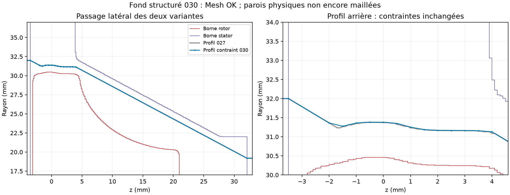

# Fond structuré autour de l’interface profilée

Le fond structuré 030 passe le contrôle natif complet et conserve la tangence de l’interface MRF. Il prépare le découpage des surfaces physiques du turbo ; **il ne constitue pas encore un maillage du fluide réel ni une validation de débit ou de puissance**.

## Profil et provenance

Les STL CFD, pales, jeux et patches existants ne sont pas modifiés. Les sources 023 et 027 et leurs empreintes sont vérifiées avant préparation. Le rayon de terminaison arrière reste 32 mm, le plan réel du stator −3,75 mm, les fermetures −4 et +33 mm ; le rayon de fermeture avant reste celui de 027. La zone est attribuée directement aux blocs et n’est pas reconstruite par sélection des centres de cellules.

Le premier fond 029 supprime uniquement les stations collinéaires du profil 027, avec erreur inférieure ou égale à 1e−12 mm, puis revérifie chaque bande des deux variantes. Les 360 stations deviennent 56. Le fond comprend un cœur carré sans axe dégénéré, quatre secteurs circulaires subdivisés en 128 secteurs angulaires, deux couronnes autour de l’interface et une enveloppe englobant les surfaces sources. Les dimensions du fond sont des paramètres de discrétisation, jamais de nouvelles dimensions de pièces.

Le contrôle natif **rejette 029** : 5 760 cellules de déterminant inférieur à 0,001, minimum 0,0002935458. La relecture des sommets de toutes ces cellules les situe hors zone tournante, à des rayons de milieu de boîte compris entre 104,745 et 104,759 mm, dans les tranches axiales de 0,1 mm entre z = −1,7 et +4,2 mm. Les cellules, journaux et sources de cet essai sont conservés. Aucun solveur n’est lancé.

Le fond 030 utilise une **nouvelle** programmation linéaire avec stations autorisées tous les 0,5 mm, sous les mêmes bornes de séparation. La pente maximale est minimisée ; les contraintes portent sur les deux extrémités de chaque bande source de 0,1 mm. Une vérification indépendante contrôle aussi les éventuels points intérieurs du profil dans chaque bande. Les stations collinéaires sont ensuite supprimées. La séparation radiale vérifiée est 0,90569001 mm, cordes comprises ; le seuil conservé reste 0,905690 mm. Ni les surfaces physiques, ni les seuils de qualité natifs ne sont assouplis.

## Relecture native des fonds

| Contrôle | 029 | 030 |
|---|---:|---:|
| Cellules | 1 882 368 | 1 313 280 |
| Cellules tournantes | 488 064 | 283 392 |
| Faces internes entre repères | 22 400 | 17 408 |
| Dont faces latérales | 11 904 | 6 912 |
| Dont faces de fermeture | 10 496 | 10 496 |
| Composante normale maximale de rotation | 1,0491e−11 m/s | 8,2338e−12 m/s |
| Erreur radiale maximale des sommets latéraux | 6,3949e−14 mm | 6,0396e−14 mm |
| Déterminant minimal natif | 0,000293546 | 0,006749184 |
| Contrôle étendu | Rejet : 5 760 petits déterminants | `Mesh OK.` |

La vitesse normale de rotation et le flux géométrique ne sont **pas** des débits physiques. Aucun champ de pression, température ou vitesse d’écoulement n’est calculé dans ces essais de maillage. Les fichiers natifs, indices de cellules et surfaces polygonales sont relus, avec empreintes concordantes. L’équilibre global du gaz reste à tester sur un maillage physique admis.

## Découpage physique 031

Le préparateur exige le reçu natif admis de 030, sa relecture et ses empreintes. Il utilise le dictionnaire de blocs exact et les surfaces de la référence octet pour octet. Le raffinement global automatique est placé au niveau zéro puisque le fond résout déjà l’interface ; les surfaces au niveau un et la détection des jeux `gapLevel (4 1 3)` sont conservées. Il ne réalise aucune projection ou réparation après le maillage natif. Les couches de paroi restent absentes à cette étape. Le calcul est borné à 1 800 secondes, deux CPU et 8 Gio, sans réseau, et ne lance aucun solveur d’écoulement.

031 termine nativement en **222,15 secondes**, avec **718 456 cellules**, mais est **rejeté** :

- Une face mal orientée, quatre faces à décomposition tétraédrique défectueuse et 1 036 cellules concaves. Le déterminant minimal vaut 0,00182885 et passe son seuil inchangé. Aucun de ces ensembles de défauts ne touche l’interface MRF ; la face mal orientée appartient au stator.
- Les quatre patches existent, tous les propriétaires rotor sont dans la zone et les ports restent hors zone. Cependant, la frontière ne compte plus que **deux coquilles au lieu de trois** : une composante rotor de caractéristique d’Euler nulle manque. Le total d’Euler reste deux, ce qui montre pourquoi ce total seul ne suffit pas.
- Les 12 416 faces d’interface ont une composante normale géométrique maximale de **10,9922 m/s**, contre 8,2338e−12 m/s avant découpage. Le flux géométrique absolu vaut 0,00355015 m³/s ; ce n’est pas un débit physique. La tangence du fond n’est donc pas conservée par cette chaîne de raffinement/projection.

Les champs natifs de centres `C/Cx/Cy/Cz` sont écrits sans solveur de flux, puis relus : 718 456 cellules finies, composantes exactement concordantes. Les cellules et faces rejetées sont localisées dans `localization-031.json` ; les sommets des pires faces d’interface sont conservés. Aucun équilibre global ni calcul forcé n’est lancé sur ce cas rejeté.

La prochaine correction doit traiter séparément la conservation de l’interface pendant le découpage et la disparition d’une coquille rotor. Identifier la composante source perdue et isoler les étapes de raffinement/projection sur un cas neuf avant de reconstruire le turbo complet. Ne pas simplement réutiliser 031, déplacer les surfaces ou assouplir les seuils.

## Reproduction et limites

`run_background.py`, `run_background_v2.py` et `run_physical_mesh.py` conservent les entrées exactes, l’image OpenCFD 2406 épinglée et les budgets de cette campagne. `read_background.py` relit les maillages et localise les cellules rejetées. Restaurer les sources et rejouer dans des destinations neuves ; ne pas écraser les cas ou les preuves. Les conteneurs propres à cette campagne sont conservés après terminaison.

Les géométries restent des concepts CFD : jeux euclidiens/thermiques, interfaces physiques mesurées, indépendance au maillage, convergence et calibration restent à établir. Aucun gain de performance n’est autorisé par ces résultats.

## Vérifications du dépôt

92 tests turbo réussis, un ignoré. `make check` exécuté : 3 802 tests, 170 ignorés, deux échecs de comparaison flottante et trois erreurs hors turbo. L’erreur supplémentaire depuis la campagne précédente concerne le test thermique WE43 ajouté sur main, qui requiert `rtree` absent localement ; les autres dépendent de `rtree`/`networkx` ou des comparaisons flottantes déjà connues. Les journaux complets sont conservés. La CI doit être verte avant fusion.

## Archive native

[Archive 029–031](https://github.com/cluster2600/porscheparts/releases/tag/bionic-turbo-structured-background-2026-10-12) : **84 fichiers**, **348 531 698 octets**, SHA-256 `8562fc002de1a1d8a9fd48127a53f66d5e00f890def0bd0749b1f8f7bf9f1c37`. Tous les payloads du TAR sont relus localement. Le manifeste inclut les entrées, maillages rejetés, champs géométriques et reçus terminaux. Copier indépendamment les éventuels liens physiques du TAR avant modification. `remote-verification.json` compare tailles et SHA-256 des actifs GitHub aux fichiers locaux ; il ne prétend pas à un second téléchargement intégral.
