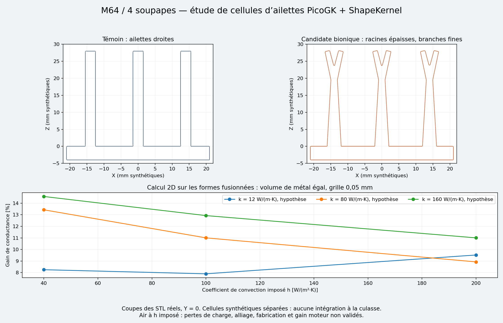

# Bionic fins — first PicoGK / ShapeKernel study

This iteration produces **synthetic fin cells**, three-fin coupons and a
reproducible thermal comparison. It does not replace the M64/993 four-valve
cylinder head and is not its complete optimization. The owner confirmed the
target on October 11, 2026.

The reference body remains intact. It comes from the 935 scan used for the M64
work; the absolute scale, the interfaces of the 993 variant and
manufacturability are not certified. The dimensions below are **study**
dimensions, never Porsche measurements.

## Geometry and limited result

The retained bionic cell is a tapered rib with a bifurcation: a thick root
conducts heat toward two thinner branches. The baseline is a straight fin;
simply tapered baselines are also compared. The sheets are extruded along Y,
the assumed air direction. This shape does not derive from a mechanical
topology optimization, from Murray's law or from a flow calculation.

| Study parameter | Value |
| --- | --- |
| Axis height | 28 mm |
| Depth along the assumed air direction | 60 mm |
| Repeat pitch | 14 mm |
| Volume of one fin, merged junctions | 5,040 mm³ |
| Candidate root / junction / tip | 4.145 / 1.884 / 1.413 mm |
| Bifurcation height | 19.6 mm |
| Offset of each tip | ±2 mm |
| Common coupon base thickness | 4 mm |

The best cell in the sampled domain is `leaf-0.7-2.0-2.2-0.75`. On the fine
0.05 mm thermal grid, its conductance `Q / (T_root − T_air)` exceeds that of
the straight fin by **7.90 to 14.58%**, at equal continuous metal volume. The
change in its conductance between 0.10 and 0.05 mm stays below **0.379%**. The
energy-balance error is checked at each resolution and must stay below `1e-8`.
This result proves neither a global optimum nor a gain on the engine.
The ranking of the 51 admissible cells uses the 0.20 mm grid; only the three
cells of the convergence check are then refined.

The nine scenarios combine `k = 12, 80, 160 W/(m·K)` and
`h = 40, 100, 200 W/(m²·K)`. These are imposed sensitivities; no real alloy,
process or convection coefficient is selected.



## Method and independent checks

1. [study.py](study.py) compares 112 proposals at equal **nominal** volume.
   61 are rejected by the exploratory thickness or envelope constraints. The 1D
   thermal network is checked against an independent formula for a straight fin
   with a convective tip, and by subdividing the sections. Its ideal junctions
   overestimate the surfaces available near the branches.
2. [countercheck.py](countercheck.py) merges the trapezoids and restores a
   **truly equal** metal volume, without counting the junction twice. It solves
   2D conduction in the complete section and imposed convection on the exposed
   surfaces only. Stair-stepped faces use a surface correction along the normal
   of the geometric boundary. The corrected surface is checked against the
   independent Euclidean perimeter. Temperature is still assumed uniform along
   Y; the air is not resolved.
3. [Program.cs](Program.cs) actually uses ShapeKernel's `BaseBox`, `LocalFrame`
   and `LineModulation`, then PicoGK's native unions. Exports are computed at
   steps of 0.30 and 0.15 mm. A common grid phase is canceled at export. No
   smoothing or repair is applied to the STL files.
4. The existing inspector
   [audit_surface_topology.py](../picogk-local-junction/audit_surface_topology.py)
   checks the raw triangles: exact indexing, components, vertex links,
   orientation and exactly degenerate triangles. A closed surface does not
   prove the absence of self-intersection nor manufacturability.
5. [render.py](render.py) draws the Y = 0 sections of the **STL files actually
   produced**, after a digest check. The image is not an artistic generation.

The proposals of the 1D network and of the 2D check differ: the first prefers
a bifurcation at 7 mm; the second retains 19.6 mm. The 1D ranking is therefore
not adopted as evidence. The first calculations without surface correction of
the oblique faces, then with a baseline misaligned on the grid, are kept
locally and **discarded**. The published result comes from the corrected
calculation `fv-004`.

The files [baseline.json](baseline.json) and [candidate.json](candidate.json)
are the editable parameters; the C# remains the geometry generator.
The [complete results](results/countercheck.json), the
[first screening](results/screen.json) and the
[verification receipt](results/verification.json) keep the digests and the
limits. Private or scan-derived STL/VDB files are not added to Git.
The synthetic coupon exports are available in the local calculation folder
identified in the delivery reply.

## Reproduction

Use the versions already locked in
[sources.lock](../../../../containers/m64-leap71/sources.lock): ShapeKernel
`7b9097842446a28bb5d49203724622e594ce7510` and the matching PicoGK runtime.
Check the ShapeKernel checkout before compiling. The receipt also contains the
digest of the PicoGK DLL actually used, native version `26.2.0`.
This needs .NET 9, NumPy, a working SciPy and Matplotlib, already available in
the project's local environments. No package is installed implicitly.

From this folder, with new output paths:

```sh
python study.py /private/fin-screen
python countercheck.py /private/fin-screen/study.json /private/fin-fv
dotnet build BionicFins.csproj -c Release \
  -p:PicoGKPath=/runtime/PicoGK.dll \
  -p:ShapeKernelRoot=/upstream/LEAP71_ShapeKernel -o /private/fin-bin
dotnet /private/fin-bin/BionicFins.dll --self-test
```

The native libraries must be reachable by the loader. Each native run takes
the **existing machine lock**; from the repository root, with `dotnet` in the
PATH:

```python
import runpy, subprocess
lock = runpy.run_path('parts/picogk-catalog/tools/run_part.py')
lock['acquire']()
try:
    for name in ('baseline', 'candidate'):
        for step in ('0.3', '0.15'):
            subprocess.run([
                'dotnet', '/private/fin-bin/BionicFins.dll',
                f'twins/m64-cylinder-head/source/bionic-fins/{name}.json',
                f'/private/fin-{name}-{step}', step
            ], check=True)
finally:
    lock['LOCK'].unlink(missing_ok=True)
```

```sh
python render.py /private/fin-fv/countercheck.json \
  /private/fin-baseline-0.15 /private/fin-candidate-0.15 /private/fin-review.png
python -m unittest discover -s tests -p 'test_m64_bionic_fins.py' -v
```

The last command runs from the repository root. Without a working SciPy, the
three finite-volume tests are explicitly skipped; the four 1D tests remain
runnable. The seven tests pass in the local virtualenv.
The global `make check` run with system Python does not pass: 3,635 tests,
2 failures, 23 errors and 205 skipped tests. The problems lie in the existing
checks for SciPy, Python 3.10 (`hashlib.file_digest` missing) and two exact
floating-point comparisons in the fan studies. No merge proposed.

## Moving to the complete cylinder head

| Step | Required data and expected result |
| --- | --- |
| 1. Define the modifiable domain | Calibrated frame and scale; interfaces of cylinder, studs, cam carriers, ports, spark plugs and baffles. Independent mask protecting the chamber, seats, guides, valve bridges, bearing faces and load paths. No hollowing of the current body is authorized by this study. |
| 2. Define the thermal loading | Chamber and exhaust flux maps, seat/guide conduction, oil and contact temperatures, idle/load/transient cases, `k(T)` properties of the retained material. These values remain unknown. |
| 3. Define the installed air | Pressure–flow curve and speed of the fan, flow per cylinder head, inlet temperature, ducts/baffles, recirculation and roughness. Surface area alone is not enough. |
| 4. Compare in 3D CHT | Conjugate body and air; retained baseline and PicoGK variants. Minimize exhaust-seat and bridge temperatures at comparable fan power, with mass and pressure-loss limits. Study three meshes and the energy balance. |
| 5. Qualify the bionic geometry | Roots and branches sized by the local fluxes, measured air clearances, powder removal/cleaning, thickness/process, distortion and thermomechanical fatigue. Coupon test, then cylinder-head bench, professional review before functional manufacturing. |

The intended heat path is chamber/exhaust → bridges, seats and guides →
conducting roots → branches → air. Combustion loads, stud clamping and
valvetrain keep their own load path. The missing interfaces, loads and process
prevent claiming that the complete cylinder head is optimized or printable.

Sources: [PicoGK / LEAP 71](https://leap71.com/PicoGK/),
[ShapeKernel documentation](https://github.com/leap71/LEAP71_ShapeKernel/blob/7b9097842446a28bb5d49203724622e594ce7510/Documentation/README-GettingStarted.md),
[MIT heat transfer course notes](https://web.mit.edu/snively/www/2_005%20Coursenotes-1.pdf),
[OpenFOAM conjugate heat transfer solver](https://api.openfoam.com/2506/chtMultiRegionFoam_8C.html).
