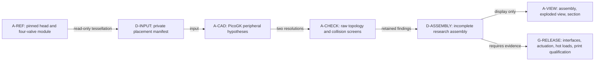

# PicoGK peripherals and research assembly — 11 October 2026

**First research subset, not all the functional parts.**
The generator produces 28 placements: 24 represented bodies and 4 volumes
reserved for the springs. Neither actuation, nor fasteners, nor sealing
is complete. No file authorises printing or starting.

The body of 2 October is kept without modification or oval substitute:
BRep SHA256 `9c40df1642d5eb47a3c1a1aae68c761b23b77e3f7e02e0818294e88ee0322598`.
It comes from the 935 scan; its compatibility with a specific M64 variant and
the absolute scale are not certified. The 118 rejected tetrahedra of its
latest mesh are neither recomputed nor validated by this work.

## Scope and load paths

| Family | Modelling present | Interfaces and function not established |
|---|---|---|
| Body | 1 BRep reference, tessellation only | Engine interfaces, variant, tolerances and hot material |
| Seats and guides | 4 + 4 references from the existing STEP module | Hot interference fit, tribology, conduction into the cylinder head |
| Valves | 4 PicoGK variants with extended stem | Original stems at 82; variant at 106.5 axial units. Voxelisation of the functional surfaces: **not supplier CAD nor a qualified part**. No internal drilling or titanium assumption added. |
| Spring seats | 4 distinct rings | Spring load → seat → body. Contact and seat stresses not accepted. |
| Retainers | 4 study rings | Spring load → retainer → collets → stem. Collets, groove, contact and strength absent: load chain incomplete. |
| Springs | 4 **annular envelopes** | No wire, coils, preload, stiffness, moving mass, resonance, retained supplier or dynamic validation. |
| Covers | 2 rectangular shells open underneath, leaf-vein ribs | No flange, gasket or screws. Local space reservation for one cylinder, not a valve cover for a bank of three cylinders. |
| Oil | 1 branched external manifold and 1 diagnostic fluid volume outside the parts list | Inlet and four outlets geometrically open; fittings, supply, targeted jets, return, sealing and pressure missing. **Does not yet cool the valve bridges inside the body.** |
| Cam carriers, bearings and caps | **Not created** | Cam axes, measured attachments, preloads, load path to the case and neighbouring cylinder heads required. |
| Cams, drive, rockers/tappets | **Not created** | Retained architecture, profiles, lift law, timing, clearances, interfaces and full-cycle collisions required. |
| Spark plugs and gaskets | **Not created** | Seat, thread, projection, spanner clearance and thermal resistance required. |
| Intake, exhaust, air deflectors | **Not created** | Installed flanges and envelopes, air path, boundary conditions and pressure-drop budget required. |
| Fasteners, gaskets and fittings | **Not created** | Fasteners and sealing cannot be replaced by plausible shapes. |

The 2-valve parts of `m64-valvetrain-0001` are not imported: their
diameters and their architecture are not those of the four-valve module.
The quantities of the undefined families remain unknown; they are not
counted as present or "finished".

## Kept references and new creation

- [prepare.py](prepare.py) reads three private sources bound by digest,
  verifies the four axes and the twelve identities, then tessellates. It adds
  no shape, no hole, no blend to the BRep.
- The module `closed.step`, SHA256 `fac380b277add2e3d265d7fa8265baeb0ce460b9f69075730d14ece555e76a76`,
  is placed **once**: rotation Z −90°, translation Z +3. This kept
  registration is an assumption, not an engine measurement.
- [Program.cs](Program.cs) and [Design.cs](Design.cs) create all the new
  shapes in PicoGK, in this same frame. The original valves are
  kept apart; the extended variants do not replace them on disk.
- The private manifest `assembly.json` keeps the identity, role, digest, box,
  reference status, collisions and list of gaps of each subset.
  No merged global STL turns the moving parts into a single block.

### What is actually bio-inspired

The covers use a main rib and secondary branches,
like leaf venation. This is **not** a topology optimisation
derived from computed stresses. No stiffness, mass or fatigue gain
is claimed without comparison against a witness shell.

The manifold applies `r_parent³ = Σ r_fille³` as a **starting assumption**:
inner radii of 2.000, 2.519842 and 3.174802 units, nominal wall 2.
The rule is inspired by the vascular model of
[Murray, PNAS 1926](https://doi.org/10.1073/pnas.12.3.207).
Its flow and cost assumptions prove neither the hydraulic optimum nor the
resistance of a hot, pulsed or aerated engine oil network. Bend losses,
LPBF roughness, viscosity, flow rate and cavitation remain to be computed.
The implicit blends do not demonstrate a minimum thickness of 2.

The primitives are compiled from the [shared catalogue](../../../../parts/picogk-catalog/common/Sdf.cs)
and [EngineSdf](../../../../parts/picogk-catalog/engine/EngineSdf.cs), without copying.
No bone network or gyroid in a highly loaded part without
proof of load path and depowdering. The [previous transfer](../picogk-protected-junction/README.md)
remains a separate witness, not a validation of this cylinder head.



## Trials run and corrections

Local run on Mac ARM64, .NET 9.0.317 and the already available PicoGK 26.2.0 kernel.
No Vast purchase. No GPU, PhysicsNeMo, CFD, FEA or Omniverse launched to
pass this geometric check off as a physical test.

1. First variant, steps 0.4 and 0.2: seats at 56.6–59.6 and stems at 105.
   At 0.2, each of the four seats overlaps about 910 units³ of the body.
   The oil also overlaps two spring reservations (~25.8 each) and the
   covers (~618.4 / 80.7). This variant is kept as a rejection.
2. Corrected variant: seats at 58.1–61.1, retainers at 101.5–104.5,
   stems at 106.5. The nominal height reserved for the spring stays 40.4.
   The manifold is recentred between the two covers; **no cut of the
   body and no suppression of collisions in the reports**.
3. Two identical repetitions, at steps 0.4 and 0.2: 342 pairs examined
   per resolution, of which 56 require a native intersection after box
   filtering. Reference/reference pairs are not rechecked.

The oil no longer shows a positive intersection with the covers or the
spring reservations at either step. **This is not proof of hot clearance.**
At 0.2 two small seat overlaps remain (0.273778 and 0.335549 units³),
and two negative native results (−0.737845 and −0.461708), kept as
unresolved anomalies. These values are never artificially brought back
to zero. The placement is therefore still rejected for a functional assembly.

The nominal reserve before coil bind is 6.2 / 8.1 for lifts
11.5 / 9.6 and the solid height 22.7 inherited from the
[packaging work](../wholebody/spring_packaging.py). This scalar calculation
includes neither tolerances, nor expansion, nor coil motion, nor dynamics.

[audit.py](audit.py) cross-checks the raw STLs without repair: face
connectivity, vertex links, orientation, exactly degenerate triangles, non-finite
normals, signed volume and comparison at two resolutions. The rings are
also compared with `π (R² − r²) H`. The 2 % volume-variation threshold
is an **exploratory filter**, not a guarantee of 0.040 mm. The audit's memory
limit is two million faces per file; the first run,
limited to one million, rejected the thin covers, without producing an acceptance.

The [execution summary and digests](execution-summary.json) keeps the
four completed computations. All volume deviations between the two steps stay
under 2 %: maximum **0.70493 %**, on the diagnostic fluid volume. The maximum
deviation of the fine rings from the independent formula is **0.21487 %**.
However, the fine intake cover contains **28 exactly
degenerate triangles and 28 non-finite STL normals**: the combined raw check fails.
The 39 other new audited files (20 per resolution, fluid volume
included) pass this combinatorial check with one component. This does not prove
the absence of geometric self-intersection or manufacturability. The cover
defect remains a point to correct, not an acceptance by its render.

## Images and retention

[render.py](render.py) produces three images from the real triangles:
`assembled.png`, `exploded.png` and `section.png`. The exploded view applies only
display translations; the assembled view and the X = 22.5 section keep
the actual positions. Orange = **spring envelopes**, not coils.
The raw triangles stay intact; the STL normals are not used
to display files containing degenerate triangles. A successful render
does not repair them. No smoothing, decimation or generative imagery.

The scan-derived geometries and these assembly views are kept in
the private computation directory and delivered locally, in line with the policy
of the [cylinder head twin](../../README.md). Git contains the sources, tests,
method and non-geometric summaries; not the scan nor its derived STLs.

## Reproduction and limits

Supply the three private files whose digests are imposed, in
an OCP 7.9.3.1 environment. All output directories must be new.

```sh
python3 prepare.py --head candidate-private.brep --module closed.step \
  --registration registration.json --output /prive/inputs
dotnet build Peripherals.csproj -c Release \
  -p:PicoGKPath=/runtime/qualifie/PicoGK.dll -o /prive/bin
dotnet /prive/bin/Peripherals.dll --self-test
dotnet /prive/bin/Peripherals.dll /prive/inputs /prive/coarse 0.4
dotnet /prive/bin/Peripherals.dll /prive/inputs /prive/fine 0.2
python3 audit.py --inputs /prive/inputs --coarse /prive/coarse \
  --fine /prive/fine --output /prive/counter-audit.json
python3 render.py --inputs /prive/inputs --directory /prive/fine \
  --output /prive/views
```

The corresponding native libraries must be accessible to the system
loader. NumPy is required for the audit; VTK and Matplotlib for the views. No
new package is installed automatically. Audit exit code 3 = numerical rejection
kept. Generator exit code 0 = files produced, **not acceptance**.

Targeted tests: nine Python contract tests, C# self-tests and compilation without
warnings. Before creating the missing parts as functional parts,
the attachments, actuation axes, contacts and load paths must be accepted
independently of the generator. The hot material, flows,
full kinematics and the printing process are not qualified here.
