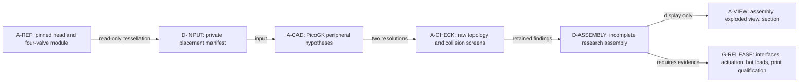

# Périphériques PicoGK et assemblage de recherche — 11 octobre 2026

**Premier sous-ensemble de recherche, pas toutes les pièces fonctionnelles.**
Le générateur produit 28 placements : 24 corps représentés et 4 volumes
réservés aux ressorts. Ni la commande, ni les fixations, ni l'étanchéité ne
sont complètes. Aucun fichier n'autorise l'impression ou le démarrage.

Le corps du 2 octobre est conservé sans modification ni substitut ovale :
BRep SHA256 `9c40df1642d5eb47a3c1a1aae68c761b23b77e3f7e02e0818294e88ee0322598`.
Il provient du scan 935 ; sa compatibilité avec une variante M64 précise et
l'échelle absolue ne sont pas certifiées. Les 118 tétraèdres rejetés de son
dernier maillage ne sont pas recalculés ou validés par ce travail.

## Portée et chemins de charge

| Famille | Modélisation présente | Interfaces et fonction non établies |
|---|---|---|
| Corps | 1 référence BRep, tessellation seule | Interfaces moteur, variante, tolérances et matériau à chaud |
| Sièges et guides | 4 + 4 références du module STEP existant | Serrage à chaud, tribologie, conduction vers la culasse |
| Soupapes | 4 variantes PicoGK avec tige prolongée | Tiges originales à 82 ; variante à 106,5 unités axiales. Voxelisation des surfaces fonctionnelles : **pas une CAO fournisseur ni une pièce qualifiée**. Aucun perçage interne ni hypothèse de titane ajoutés. |
| Appuis de ressort | 4 anneaux distincts | Effort ressort → appui → corps. Contact et contraintes d'appui non acceptés. |
| Coupelles | 4 anneaux d'étude | Effort ressort → coupelle → clavettes → tige. Clavettes, gorge, contact et résistance absents : chaîne de charge incomplète. |
| Ressorts | 4 **enveloppes annulaires** | Pas de fil, spires, précharge, raideur, masse mobile, résonance, fournisseur retenu ou validation dynamique. |
| Capots | 2 coques rectangulaires ouvertes dessous, nervures foliaires | Sans bride, joint ni vis. Réserve de place locale d'un cylindre, pas un couvre-culasse pour une rangée de trois cylindres. |
| Huile | 1 distributeur extérieur ramifié et 1 volume fluide diagnostic hors nomenclature | Entrée et quatre sorties ouvertes géométriquement ; raccords, alimentation, jets ciblés, retour, étanchéité et pression manquants. **Ne refroidit pas encore les ponts de soupapes à l'intérieur du corps.** |
| Porte-arbres, paliers et chapeaux | **Non créés** | Axes de came, attaches mesurées, précharges, chemin de charge vers le carter et les culasses voisines requis. |
| Cames, entraînement, culbuteurs/poussoirs | **Non créés** | Architecture retenue, profils, loi de levée, calage, jeux, interfaces et collisions sur cycle complet requis. |
| Bougies et joints | **Non créés** | Portée, filetage, saillie, dégagement de clé et tenue thermique requis. |
| Admission, échappement, déflecteurs d'air | **Non créés** | Brides et enveloppes installées, chemin de l'air, conditions limites et budget de pertes de charge requis. |
| Visserie, joints et raccords | **Non créés** | Fixations et étanchéité ne peuvent être remplacées par des formes plausibles. |

Les pièces 2 soupapes de `m64-valvetrain-0001` ne sont pas importées : leurs
diamètres et leur architecture ne sont pas ceux du module quatre soupapes.
Les quantités des familles non définies restent inconnues ; elles ne sont pas
comptées comme présentes ou « terminées ».

## Références conservées et création neuve

- [prepare.py](prepare.py) relit trois sources privées liées par empreinte,
  vérifie les quatre axes et les douze identités, puis tesselle. Il n'ajoute
  aucune forme, aucun trou, aucun raccord au BRep.
- Le module `closed.step`, SHA256 `fac380b277add2e3d265d7fa8265baeb0ce460b9f69075730d14ece555e76a76`,
  est placé **une fois** : rotation Z −90°, translation Z +3. Cette inscription
  conservée est une hypothèse, pas une mesure moteur.
- [Program.cs](Program.cs) et [Design.cs](Design.cs) créent toutes les formes
  nouvelles dans PicoGK, dans ce même repère. Les soupapes originales sont
  gardées à part ; les variantes prolongées ne les remplacent pas sur disque.
- Le manifeste privé `assembly.json` garde identité, rôle, empreinte, boîte,
  statut de référence, collisions et liste des manques de chaque sous-ensemble.
  Aucun STL global fusionné ne transforme les pièces mobiles en monobloc.

### Ce qui est réellement bio-inspiré

Les capots utilisent une nervure principale et des branches secondaires,
comme une nervation foliaire. Ce n'est **pas** une optimisation topologique
issue de contraintes calculées. Aucun gain de rigidité, masse ou fatigue
n'est annoncé sans comparaison avec une coque témoin.

Le distributeur applique `r_parent³ = Σ r_fille³` comme **hypothèse de départ** :
rayons intérieurs de 2,000, 2,519842 et 3,174802 unités, paroi nominale 2.
La règle s'inspire du modèle vasculaire de
[Murray, PNAS 1926](https://doi.org/10.1073/pnas.12.3.207).
Ses hypothèses de débit et coût ne prouvent ni l'optimum hydraulique ni la
tenue d'un réseau d'huile moteur chaud, pulsé ou aéré. Les pertes aux coudes,
la rugosité LPBF, la viscosité, le débit et la cavitation restent à calculer.
Les mélanges implicites ne démontrent pas une épaisseur minimale de 2.

Les primitives sont compilées depuis le [catalogue partagé](../../../../parts/picogk-catalog/common/Sdf.cs)
et [EngineSdf](../../../../parts/picogk-catalog/engine/EngineSdf.cs), sans copie.
Pas de réseau osseux ou de gyrode dans une pièce fortement chargée sans
preuve de chemin de charge et de dépoudrage. Le [transfert précédent](../picogk-protected-junction/README.md)
reste un témoin séparé, pas une validation de cette culasse.



## Essais exécutés et corrections

Exécution locale Mac ARM64, .NET 9.0.317 et noyau PicoGK 26.2.0 déjà disponible.
Aucun achat Vast. Pas de GPU, PhysicsNeMo, CFD, FEA ni Omniverse lancé pour
faire passer ce contrôle géométrique pour un essai physique.

1. Première variante, pas 0,4 et 0,2 : appuis à 56,6–59,6 et tiges à 105.
   À 0,2, chacun des quatre appuis recoupe environ 910 unités³ du corps.
   L'huile recoupe aussi deux réserves de ressort (~25,8 chacune) et les
   capots (~618,4 / 80,7). Cette variante est conservée comme rejet.
2. Variante corrigée : appuis à 58,1–61,1, coupelles à 101,5–104,5,
   tiges à 106,5. La hauteur nominale réservée au ressort reste 40,4.
   Le distributeur est recentré entre les deux capots ; **aucune coupe du
   corps ni suppression de collision dans les rapports**.
3. Deux répétitions identiques, aux pas 0,4 et 0,2 : 342 paires examinées
   par résolution, dont 56 nécessitent une intersection native après filtrage
   par boîte. Les couples référence/référence ne sont pas revérifiés.

L'huile ne présente plus d'intersection positive avec les capots ou les
réserves de ressort aux deux pas. **Ce n'est pas une preuve de jeu à chaud.**
À 0,2 restent deux petits recouvrements d'appui (0,273778 et 0,335549 unités³),
et deux résultats natifs négatifs (−0,737845 et −0,461708), conservés comme
anomalies non résolues. Ces valeurs ne sont jamais ramenées artificiellement
à zéro. Le placement est donc toujours rejeté pour un assemblage fonctionnel.

La réserve nominale avant spires jointives vaut 6,2 / 8,1 pour les levées
11,5 / 9,6 et la hauteur à bloc 22,7 héritées du
[travail d'encombrement](../wholebody/spring_packaging.py). Ce calcul scalaire
n'inclut ni tolérances, ni dilatation, ni mouvement des spires, ni dynamique.

[audit.py](audit.py) contre-vérifie les STL bruts sans réparation : connectivité
des faces, liens de sommets, orientation, triangles dégénérés exacts, normales
non finies, volume signé et comparaison à deux résolutions. Les anneaux sont
aussi confrontés à `π (R² − r²) H`. Le seuil de variation volumique de 2 %
est un **filtre exploratoire**, pas une garantie de 0,040 mm. La limite mémoire
de l'audit est de deux millions de faces par fichier ; le premier lancement
limité à un million a refusé les capots fins, sans produire d'acceptation.

Le [résumé d'exécution et les empreintes](execution-summary.json) conserve les
quatre calculs terminés. Tous les écarts de volume entre les deux pas restent
sous 2 % : maximum **0,70493 %**, sur le volume fluide diagnostic. L'écart
maximal des anneaux fins à la formule indépendante est **0,21487 %**.
Cependant, le capot d'admission fin comporte **28 triangles exactement
dégénérés et 28 normales STL non finies** : le contrôle brut combiné échoue.
Les 39 autres fichiers nouveaux audités (20 par résolution, volume fluide
compris) passent ce contrôle combinatoire à une composante. Cela ne prouve
pas l'absence d'auto-intersection géométrique ni la fabricabilité. Le défaut
du capot reste un point de correction, pas une acceptation par son rendu.

## Images et conservation

[render.py](render.py) produit trois images à partir des triangles réels :
`assembled.png`, `exploded.png` et `section.png`. L'éclaté applique uniquement
des translations d'affichage ; la vue assemblée et la coupe X = 22,5 gardent
les positions effectives. Orange = **enveloppes de ressort**, pas spires.
Les triangles bruts restent intacts ; les normales STL ne sont pas utilisées
pour afficher les fichiers contenant des triangles dégénérés. Un rendu réussi
ne les répare pas. Aucun lissage, décimation ou image générative.

Les géométries dérivées du scan et ces vues d'assemblage sont conservées dans
le dossier privé de calcul et livrées localement, conformément à la politique
du [jumeau de culasse](../../README.md). Git contient les sources, tests,
méthode et résumés non géométriques ; pas le scan ni ses STL dérivés.

## Reproduction et limites

Fournir les trois fichiers privés dont les empreintes sont imposées, dans
un environnement OCP 7.9.3.1. Tous les dossiers de sortie doivent être neufs.

```sh
python3 prepare.py --head candidate-private.brep --module closed.step \
  --registration registration.json --output /prive/inputs
dotnet build Peripherals.csproj -c Release \
  -p:PicoGKPath=/runtime/qualifie/PicoGK.dll -o /prive/bin
dotnet /prive/bin/Peripherals.dll --self-test
dotnet /prive/bin/Peripherals.dll /prive/inputs /prive/coarse 0.4
dotnet /prive/bin/Peripherals.dll /prive/inputs /prive/fine 0.2
python3 audit.py --inputs /prive/inputs --coarse /prive/coarse \
  --fine /prive/fine --output /prive/counter-audit.json
python3 render.py --inputs /prive/inputs --directory /prive/fine \
  --output /prive/views
```

Les bibliothèques natives correspondantes doivent être accessibles au chargeur
système. NumPy est nécessaire à l'audit ; VTK et Matplotlib aux vues. Aucun
nouveau paquet n'est installé automatiquement. Code 3 de l'audit = rejet
numérique conservé. Code 0 du générateur = fichiers produits, **pas acceptation**.

Tests ciblés : neuf tests de contrats Python, autotests C# et compilation sans
avertissement. Avant de créer les pièces manquantes comme pièces fonctionnelles,
il faut accepter les attaches, les axes de commande, les contacts et les chemins
de charge indépendamment du générateur. Le matériau chaud, les écoulements,
la cinématique complète et le procédé d'impression ne sont pas qualifiés ici.
