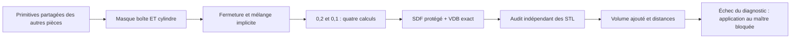
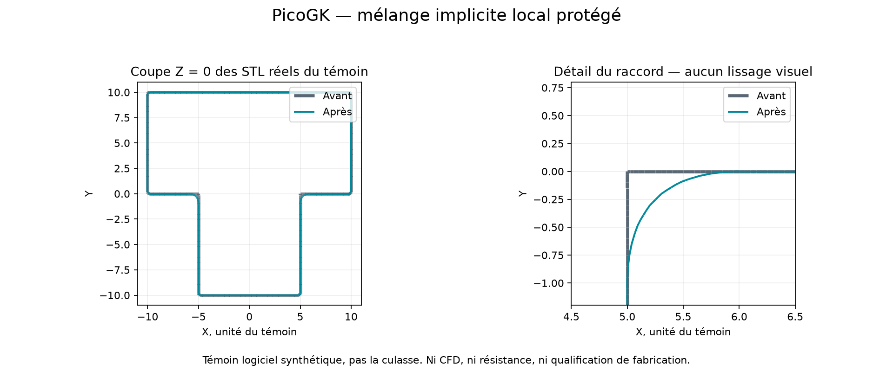

# Transfert PicoGK vers la culasse M64 — 11 octobre 2026

Le code commun des autres pièces est intégré et exécuté, **pas leur géométrie**.
Le maître de culasse, sa forme extérieure, ses interfaces et les anciens reçus
restent inchangés. Il s'agit d'un témoin de raccord de conduit avant application
à la pièce, pas d'une nouvelle culasse ni d'une qualification physique.

## Ce qui est repris

| Apport des autres pièces | Intégration et limite |
|---|---|
| Catalogue moteur : `Sdf.Box/Vox`, `Es.Cyl/SMin` | Compilation directe des [sources communes](../../../../parts/picogk-catalog/common/Sdf.cs) et [moteur](../../../../parts/picogk-catalog/engine/EngineSdf.cs), sans copie des primitives. Masque radial et mélange local réellement exécutés. |
| Conduits courbes : `CubicPts/Tube` | Autotests numériques des extrémités, d'un point de la courbe et d'un segment répété. Aucun circuit d'huile fonctionnel n'est encore dessiné ou qualifié par ce témoin. |
| Reconstruction 935 : comparaison multirésolution, zones observées séparées des hypothèses | Deux pas, géométrie monde fixe, reçus séparés ; les méthodes existantes de la culasse sont conservées. Pas de transfert des cotes du ventilateur. |
| Monocoque 964 : comparaisons contrôlées de variantes | Deux méthodes de raccord comparées au même original, avec le même masque, runtime et critères. Aucune conclusion mécanique transférée du châssis. |
| Correction ABI `bIsInside` | Déjà présente dans [picogk-cooling](../picogk-cooling/README.md). Ici lecture des tranches SDF et deux conventions de zéro, sans appel au booléen défectueux ni modification globale du runtime. |
| BCC, gyroides, galeries du piston et allègement | Non appliqués à la culasse : connectivité, extraction de poudre, chemins de charge et CHT doivent être démontrés. Un réseau ouvert avant découpe n'est pas une preuve de dépoudrage après découpe. |
| Générateur d'enveloppe M64 du catalogue | Ne remplace pas le maître issu du scan : ce bloc conceptuel ne démontre pas les interfaces moteur. |

Références Git : catalogue partagé `cddf9750`, reconstruction 935 `06072b80`,
comparaison des architectures 964 `38468d47`, ablation des renforts `da55ba74`.
Base de l'intégration : `0e7958a5`. Aucun achat Vast, changement de noyau,
nouvelle dépendance ou modification d'une recette figée.

## Défaut ciblé et expérience

L'[ancien témoin](../picogk-local-junction-buffered-v2/README.md) touchait
24 points protégés au pas 0,1 : les coins de son masque rectangulaire
atteignaient un rayon de 10,465, au-delà de la couronne de rayon 10.

Le nouveau masque intersecte cette boîte avec un cylindre de rayon **8,8**,
constant aux deux résolutions. Cette valeur ne concerne que le témoin
synthétique ; ce n'est pas une cote ou une marge de sécurité de la culasse.
Les anciens points protégés et leurs critères ne sont pas supprimés.

Deux constructions sont conservées :

1. `closing` : fermeture morphologique PicoGK, paramètre 1 ;
2. `smooth-union` : mélange polynomial `Es.SMin`, paramètre 1, limité par le
   masque protégé. Ce paramètre **n'est pas un rayon de congé géométrique**.

Dans les deux cas, le candidat est l'union de l'original avec la proposition
masquée. Le volume différentiel exporté est seulement un diagnostic, jamais
l'opérande qui fabrique le candidat. La restriction analytique du diagnostic
au support du mélange a aussi été essayée : elle ne supprime pas son défaut
de convergence aux pas testés.



## Résultats réels

[Reçu agrégé et empreintes](../../../../docs/media/m64-picogk-transfer-20261011/result-summary.json).
Mac ARM64, SDK .NET 9.0.317, PicoGK natif 26.2.0. Ces exécutions ne qualifient
pas une nouvelle version Linux ou une image de station GPU.

| Contrôle | Fermeture protégée | Mélange implicite protégé |
|---|---:|---:|
| Points protégés modifiés, deux conventions et deux pas | 0 | 0 |
| Valeurs SDF modifiées hors région / aux protections | 0 / 0 | 0 / 0 |
| Six champs VDB relus identiques bit à bit | oui | oui |
| Écart du volume réellement ajouté, seuil 5 % | 16,093 % : échec | 3,226 % : passe |
| Distance bidirectionnelle échantillonnée du candidat, seuil 0,2 | 0,081927 | 0,082308 |
| Distance du diagnostic d'ajout, seuil 0,2 | 0,365160 : échec | 0,473432 : échec |
| Triangles exactement dégénérés du diagnostic fin | 40 | 24 |
| Décision combinée | rejet | rejet |

Les champs sont comparés sur 1 157 625 puis 8 615 125 nœuds. Les deux STL
du candidat implicite sont combinatoirement fermés/orientés sans triangle
exactement dégénéré. Cela n'efface pas les 24 triangles nuls du diagnostic fin.
L'audit distingue fichiers bruts et suppression **en mémoire seulement** des
faces d'aire exactement nulle. Aucun sommet ou triangle non nul n'est retouché.

Le volume réellement ajouté est `V(après) − V(avant)`, pas le volume du
diagnostic. Pour le mélange : **5,666643 → 5,489569 unités³**. Le résidu
avec ce diagnostic reste **3,644585 → 1,205682 unités³**, inexpliqué ici.
Les distances portent sur au plus 20 000 sommets/centroïdes par direction,
pas une borne continue de Hausdorff ni une convergence asymptotique.



Image produite par coupe VTK des STL vérifiés par SHA256, sans génération
d'image, décimation ou lissage visuel. **Ce n'est pas la culasse réelle.**

## Reproduire

Utiliser le SDK .NET 9 et le DLL PicoGK du runtime déjà qualifié ; fournir
`PicoGKPath` au build. Les bibliothèques natives correspondantes doivent
être accessibles au chargeur système. Garder les résultats dans un dossier
privé neuf ; aucun ancien reçu n'est écrasé.

```sh
dotnet build ProtectedJunction.csproj -c Release \
  -p:PicoGKPath=/chemin/qualifie/PicoGK.dll -o /sortie/neuve/bin
dotnet /sortie/neuve/bin/ProtectedJunction.dll --witness criteria.json \
  /sortie/neuve/coarse 0.2 smooth-union
dotnet /sortie/neuve/bin/ProtectedJunction.dll --witness criteria.json \
  /sortie/neuve/fine 0.1 smooth-union
python3 audit.py --coarse /sortie/neuve/coarse --fine /sortie/neuve/fine \
  --output /sortie/privee/comparison.json
python3 render.py --directory /sortie/neuve/fine --output /sortie/neuve/section.png
```

Répéter dans deux autres dossiers avec `closing`. Le code 3 de l'audit est
un **rejet conservé**, pas un succès à masquer. NumPy est requis pour l'audit,
VTK pour les distances/coupes, Matplotlib pour l'image ; aucune installation
automatique. Les anciens scripts d'audit sont importés sans les modifier.
Les tests `test_picogk_protected_junction.py` rejettent tout contrat incomplet,
changement de masque, confusion de résolution ou promotion d'autorité.

Vérification locale : build sans avertissement, **23 tests de raccord dont un
ignoré** (dépendance trimesh absente), quatre calculs natifs, deux audits de
comparaison, et refus natif d'une sortie existante, d'un pas non fini et d'une
méthode inconnue. Aucun reçu existant n'a été écrasé. Le contrôle des liens
documentaires ne trouve aucun lien cassé. La suite complète du dépôt et les
essais physiques ne sont pas remplacés par ces contrôles ciblés.

## Suite et limites

Le défaut de protection du témoin est corrigé ; le mélange améliore le critère
de volume mais **l'ensemble du contrôle reste rejeté**. Prochaine expérience :
localiser l'écart du diagnostic fin et définir une comparaison plus fine avec
limites de ressources, en conservant la géométrie et les seuils.

Aucun nouveau canal n'est soustrait à la culasse tant que région autorisée,
interfaces et contrôle géométrique ne passent pas. Les **118 tétraèdres rejetés**
du dernier calcul de culasse ne sont pas recalculés ici. Ni le 0,040 mm,
ni la résistance, la thermique, le dépoudrage, l'impression ou les essais
physiques ne sont validés par ce transfert logiciel.
