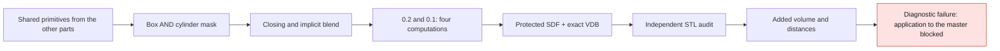
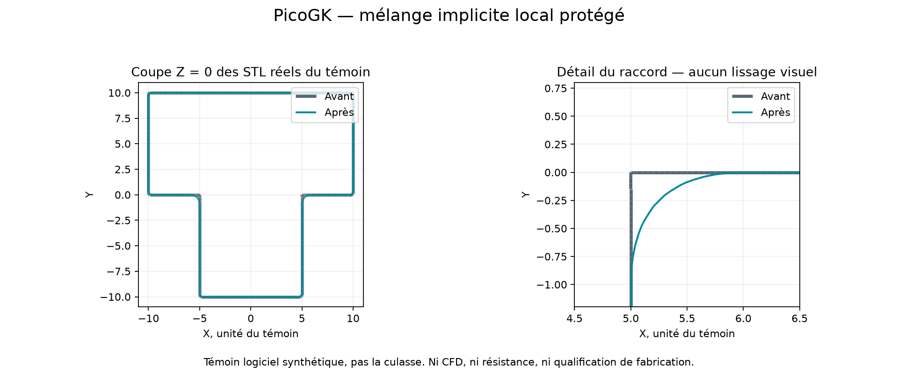

# PicoGK transfer to the M64 cylinder head — 11 October 2026

The shared code of the other parts is integrated and run, **not their geometry**.
The cylinder head master, its external shape, its interfaces and the old receipts
remain unchanged. This is a duct-junction witness before application
to the part, not a new cylinder head nor a physical qualification.

## What is reused

| Contribution from the other parts | Integration and limit |
|---|---|
| Engine catalogue: `Sdf.Box/Vox`, `Es.Cyl/SMin` | Direct compilation of the [common](../../../../parts/picogk-catalog/common/Sdf.cs) and [engine](../../../../parts/picogk-catalog/engine/EngineSdf.cs) sources, without copying the primitives. Radial mask and local blend actually run. |
| Curved ducts: `CubicPts/Tube` | Numerical self-tests of the ends, of a point on the curve and of a repeated segment. No functional oil circuit is yet drawn or qualified by this witness. |
| 935 reconstruction: multi-resolution comparison, observed zones separated from assumptions | Two steps, fixed world geometry, separate receipts; the existing methods of the cylinder head are kept. No transfer of the fan dimensions. |
| 964 monocoque: controlled comparisons of variants | Two junction methods compared with the same original, with the same mask, runtime and criteria. No mechanical conclusion transferred from the chassis. |
| `bIsInside` ABI fix | Already present in [picogk-cooling](../picogk-cooling/README.md). Here, reading of SDF slices and two zero conventions, without calling the defective Boolean or modifying the runtime globally. |
| BCC, gyroids, piston galleries and lightening | Not applied to the cylinder head: connectivity, powder extraction, load paths and CHT must be demonstrated. A network open before cutting is not proof of depowdering after cutting. |
| Catalogue M64 envelope generator | Does not replace the scan-derived master: this conceptual block does not demonstrate the engine interfaces. |

Git references: shared catalogue `cddf9750`, 935 reconstruction `06072b80`,
964 architecture comparison `38468d47`, reinforcement ablation `da55ba74`.
Integration base: `0e7958a5`. No Vast purchase, kernel change,
new dependency or modification of a frozen recipe.

## Targeted defect and experiment

The [old witness](../picogk-local-junction-buffered-v2/README.md) touched
24 protected points at step 0.1: the corners of its rectangular mask
reached a radius of 10.465, beyond the ring of radius 10.

The new mask intersects this box with a cylinder of radius **8.8**,
constant at both resolutions. This value concerns only the synthetic
witness; it is not a dimension or a safety margin of the cylinder head.
The old protected points and their criteria are not removed.

Two constructions are kept:

1. `closing`: PicoGK morphological closing, parameter 1;
2. `smooth-union`: polynomial blend `Es.SMin`, parameter 1, limited by the
   protected mask. This parameter **is not a geometric fillet radius**.

In both cases, the candidate is the union of the original with the masked
proposal. The exported differential volume is only a diagnostic, never
the operand that builds the candidate. Analytically restricting the diagnostic
to the support of the blend was also tried: it does not remove its convergence
defect at the tested steps.



## Actual results

[Aggregated receipt and digests](../../../../docs/media/m64-picogk-transfer-20261011/result-summary.json).
Mac ARM64, .NET SDK 9.0.317, native PicoGK 26.2.0. These runs do not qualify
a new Linux version or a GPU station image.

| Check | Protected closing | Protected implicit blend |
|---|---:|---:|
| Protected points modified, two conventions and two steps | 0 | 0 |
| SDF values modified outside the region / at the protections | 0 / 0 | 0 / 0 |
| Six VDB fields read back bit-for-bit identical | yes | yes |
| Deviation of the volume actually added, threshold 5 % | 16.093 %: fail | 3.226 %: pass |
| Sampled bidirectional distance of the candidate, threshold 0.2 | 0.081927 | 0.082308 |
| Distance of the addition diagnostic, threshold 0.2 | 0.365160: fail | 0.473432: fail |
| Exactly degenerate triangles of the fine diagnostic | 40 | 24 |
| Combined decision | reject | reject |

The fields are compared over 1,157,625 then 8,615,125 nodes. The two STLs
of the implicit candidate are combinatorially closed/oriented with no exactly
degenerate triangle. That does not erase the 24 null triangles of the fine diagnostic.
The audit distinguishes raw files from removal, **in memory only**, of
faces of exactly zero area. No vertex or non-zero triangle is touched.

The volume actually added is `V(après) − V(avant)` (after − before), not the volume of the
diagnostic. For the blend: **5.666643 → 5.489569 units³**. The residual
with this diagnostic remains **3.644585 → 1.205682 units³**, unexplained here.
The distances cover at most 20,000 vertices/centroids per direction,
not a continuous Hausdorff bound nor asymptotic convergence.



Image produced by a VTK section of the STLs verified by SHA256, with no image
generation, decimation or visual smoothing. **This is not the real cylinder head.**

## Reproduce

Use the .NET 9 SDK and the PicoGK DLL of the already qualified runtime; supply
`PicoGKPath` to the build. The corresponding native libraries must
be accessible to the system loader. Keep the results in a new private
directory; no old receipt is overwritten.

```sh
dotnet build ProtectedJunction.csproj -c Release \
  -p:PicoGKPath=/chemin/qualifie/PicoGK.dll -o /sortie/neuve/bin
dotnet /sortie/neuve/bin/ProtectedJunction.dll --witness criteria.json \
  /sortie/neuve/coarse 0.2 smooth-union
dotnet /sortie/neuve/bin/ProtectedJunction.dll --witness criteria.json \
  /sortie/neuve/fine 0.1 smooth-union
python3 audit.py --coarse /sortie/neuve/coarse --fine /sortie/neuve/fine \
  --output /sortie/privee/comparison.json
python3 render.py --directory /sortie/neuve/fine --output /sortie/neuve/section.png
```

Repeat in two other directories with `closing`. Audit exit code 3 is
a **kept rejection**, not a success to be hidden. NumPy is required for the audit,
VTK for distances/sections, Matplotlib for the image; nothing is installed
automatically. The old audit scripts are imported without modification.
The tests `test_picogk_protected_junction.py` reject any incomplete contract,
mask change, resolution mix-up or authority promotion.

Local check: build without warnings, **23 junction tests, one of them
skipped** (trimesh dependency absent), four native computations, two comparison
audits, and native refusal of an existing output, a non-finite step and an
unknown method. No existing receipt was overwritten. The documentation link
check finds no broken link. The full repository suite and physical
tests are not replaced by these targeted checks.

## Next steps and limits

The witness's protection defect is corrected; the blend improves the volume
criterion but **the check as a whole remains rejected**. Next experiment:
locate the deviation of the fine diagnostic and define a finer comparison with
resource limits, keeping the geometry and the thresholds.

No new channel is subtracted from the cylinder head until the authorised region,
interfaces and geometric check pass. The **118 rejected tetrahedra**
of the latest cylinder head computation are not recomputed here. Neither the 0.040 mm,
nor strength, thermal behaviour, depowdering, printing or physical
tests are validated by this software transfer.
