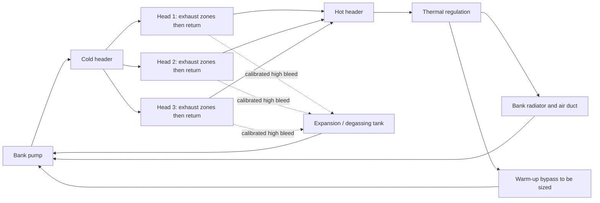

# M64 four-valve water-cooled cylinder head — active direction

Owner decision of **October 12, 2026**: replace the development of primary
oil/air cooling for the new cylinder head with a liquid circuit inspired by the
956/962 C. The conclusion that oil is insufficient is a program choice, not the
result of a simulation presented here.

The [catalogue](../../../../catalog/parts/993-eng-cylinder-head-4v-f0-0001.json)
carries the part identity, and the [engine program](../../../m64-engine-system/program.json)
carries this target separately from the historical M64/60. The earlier
[fins](../bionic-fins/README.md) and their
[integration](../bionic-fin-integration/README.md) are retained; their coupon
conductance gains are not transferred to water cooling.
The bionic form becomes a network of branched passages and of material
distributed according to the heat flows and loads. The first routing is not
optimized.

## What Porsche documents

| Primary reference, consulted October 12, 2026 | Fact and scope |
|---|---|
| [Porsche, 40 Years Group C, p. 18](https://newsroom.porsche.com/dam/jcr:a6f33b52-c47d-47b4-98c1-7e963661f587/40%20Years%20Group%20C.pdf) | 956: four valves, water-cooled cylinder heads, air-cooled cylinders. |
| Same dossier, p. 19 | Water passages close to the exhaust ports; independent circuits with one pump per bank. Porsche also describes welding the cylinder head to the cylinder to address gasket preload losses during thermal transients. |
| [Porsche, Turbo technology in motorsport](https://newsroom.porsche.com/en/press-kits/50-years-porsche-turbo/Porsche-and-turbo-technology-in-motorsport--from-pioneer-to-world-champion.html), 956/962 section | The initial 962 IMSA uses an air-cooled engine; the 962 C also receives a fully water-cooled 3.0 liter. "962" therefore does not define a single engine. |
| [Porsche, Staying Power](https://newsroom.porsche.com/en/2024/products/porsche-911-carrera-gts-drive-technology-christophorus-411-36736.html), water-cooling section | Porsche reports the difficulties of its air-cooled four-valve experiment and cites the water-cooled cylinder heads of the 962 and 959. This does not qualify our design. |

The principles come from the Group C family; Porsche attributes the details of
the p. 19 dossier to the Type 935/76 engine of the 956. They are not presented
as the drawing of a specific 962. The sources remain copyrighted references:
no Porsche drawing, image, full text or model is imported.
See the [source record](../../../../catalog/sources/src-porsche-group-c-water-cooling.json).

## Proposed circuit and scope

First scope: **the six water-cooled cylinder heads**, cylinders still air-cooled,
oil retained for lubrication and its heat balance. This limit is an initial
choice of our project; it does not copy the fully water-cooled 962 C. The engine
heat balance may require the scope to be extended.

Two independent hydraulic loops, left and right, are proposed.
Each loop has its pump, its heat exchanger and its degassing tank; there is no
liquid connection between the banks in this first architecture. For **each bank**:



The three cylinder heads in parallel and the cold supply directed first to the
exhaust are **our assumptions**, not verified hydraulic details of the 962. The
return aims for a high collection point; the true high point depends on the
engine position in the vehicle, not yet established. The bleed branches must
evacuate air without short-circuiting the hot zones. Filling, low draining and
access to the fittings are part of the packaging still to be defined.

The heat exchangers, hoses, pumps and tanks are not yet placed in the 993.
Pump curves, pressure losses, regulation, cap pressure, fitting diameters and
expansion volumes remain to be sized. Required measurements: flow of each bank,
inlet/outlet temperatures and hot spots, pressure and level. The responses to a
loss of flow or level remain to be defined.

## First executable geometric work

[Program.cs](Program.cs) and [contract.json](contract.json) reuse the private
thirteen-part module and its four existing axes. The original body and the
twelve valve/seat/guide references are bound by SHA-256 and remain intact.
Generation uses the PicoGK and ShapeKernel of the
[existing lock](../../../../containers/m64-leap71/sources.lock), without Noyron.

The research network contains a cold supply, two branches around the exhaust
axes, a common return and a bleed. The bifurcations join PicoGK ducts with
ShapeKernel plenums. The radii, heights and positions in the contract are
assumptions in the **uncalibrated units of the 935 scan**, not M64 or 962
manufacturing dimensions. The STL format carries mm for the software only.
The intake ports, the bridge between seats and the spark plugs will have to be
covered in the next water jacket according to the measured heat flows.

Private exports:

- `coolant-routing.stl`: proposed water volume, with rounded terminations;
- `routing-plus-wall-margin.stl`: diagnostic envelope around the routing;
- `outside-eroded-head.stl`: water leaving the body shrunk by a wall margin.

The margin of 3 units is a packaging test, **not an allowable thickness**.
The last diagnostic includes the external pipes, deliberately outside the body,
and any internal leaks: it does not tell them apart and must not be read as a
physical leak volume. No passage is subtracted from the metal.
A finned envelope does not automatically form a pressure enclosure.
A new closed water jacket and its walls will have to be created, not just
channels drilled into the current proxy.

[audit.py](audit.py) reuses the existing independent inspector to check the raw
surface and connectivity. Intersections with the twelve references and their
margin are kept, including collisions. The gas, oil, stud and spark-plug domains
and the complete seating faces are missing; even a result without collision of
the twelve parts does not allow a water jacket to be accepted. There is neither
a structural mask nor an authorization to remove material in this dossier.
[render.py](render.py) shows the real routing triangles with the cylinder head
transparent and the containment diagnostic, without touching the master.

### Local reproduction

With the .NET 9 SDK and the locked sources already installed:

```sh
dotnet build WaterHead.csproj -c Release -o PRIVATE_BIN \
  -p:PicoGKPath=PINNED_PICOGK_DLL -p:ShapeKernelRoot=PINNED_SHAPE_KERNEL_ROOT
# Run the native step under the machine lock of parts/picogk-catalog/tools/run_part.py.
dotnet PRIVATE_BIN/WaterHead.dll PRIVATE_INPUTS contract.json NEW_PRIVATE_OUTPUT 0.3
python audit.py --inputs PRIVATE_INPUTS --directory NEW_PRIVATE_OUTPUT --output NEW_PRIVATE_AUDIT.json
python render.py --inputs PRIVATE_INPUTS --directory NEW_PRIVATE_OUTPUT --output NEW_PRIVATE_VIEW.png
```

The input directory is the retained private module, not another scan.
Outputs must be new; a modified input or a contract that authorizes
manufacturing is refused. Inspection requires NumPy and SciPy, rendering
requires VTK. No private scan or derivative is published in Git.

## Next work and criteria

1. **Interfaces and sealing**: measure cylinder/head seating faces, studs,
   planes and preloads, valvetrain, oil, spark plugs and gas outlets. Define
   the water fittings, their seals, access and hose loads. Load path:
   combustion pressure → cylinder head → cylinder seat/studs → case; water
   pressure → jacket/walls/fittings; valvetrain forces → guides/seats/supports.
   Porsche's welding is not automatically adopted on an M64.
2. **Closed bionic water jacket**: keep the load-bearing zones; cool the
   exhaust, seat bridges and spark-plug zones; avoid air pockets, restrictions
   and stagnant volumes. Set thicknesses, radii, cleaning and internal inspection
   according to the alloy and process actually chosen.
3. **Heat balance and hydraulics**: establish the heat transferred to the
   cylinder heads per operating point. Use `Q = mass_flow × cp × ΔT`; engine
   mechanical power does not directly give Q. Balance the three branches; check
   cavitation, local pressure, expansion and radiators with their real air.
4. **CHT and mechanics**: named water/metal/gas domains, converged mesh,
   temperature-dependent liquid and metal properties, possible boiling,
   seat/bridge temperatures and pressure losses. Then check combustion/water
   pressure, preloads, transients and thermal fatigue together.
5. **Coupons and bench**: approved process/alloy, cleanability, CT/NDT,
   pressure test defined by engineering review, then a thermal bench and an
   instrumented engine. No manufacturing or assembly start at this stage.

The limit temperatures, test pressure, required flow and thermal gain remain
unknown. The [software results of this iteration](verification.json) close none
of these physical criteria.
