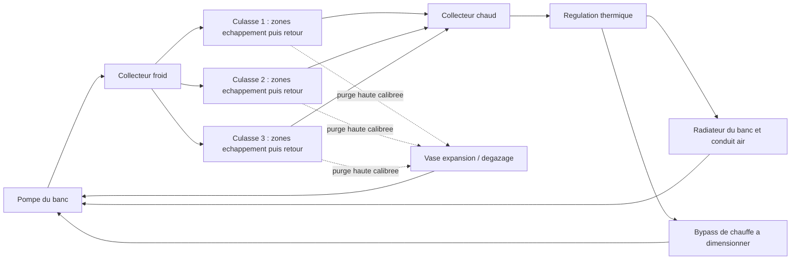

# Culasse M64 quatre soupapes à eau — direction active

Décision utilisateur du **12 octobre 2026** : remplacer le développement du
refroidissement primaire par huile/air de la nouvelle culasse par un circuit
liquide inspiré des 956/962 C. La conclusion sur l'insuffisance de l'huile est
un choix de programme, pas le résultat d'une simulation présentée ici.

Le [catalogue](../../../../catalog/parts/993-eng-cylinder-head-4v-f0-0001.json)
porte l'identité de la pièce et le [programme moteur](../../../m64-engine-system/program.json)
porte cette cible séparément du M64/60 historique. Les anciennes
[ailettes](../bionic-fins/README.md) et leur
[intégration](../bionic-fin-integration/README.md) sont conservées ; leurs gains
de conductance sur coupon ne sont pas transférés au refroidissement par eau.
La forme bionique devient un réseau de passages ramifiés et de matière
répartie selon les flux et les charges. Le premier routage n'est pas optimisé.

## Ce que Porsche documente

| Référence primaire, consultée le 12 octobre 2026 | Fait et portée |
|---|---|
| [Porsche, 40 Years Group C, p. 18](https://newsroom.porsche.com/dam/jcr:a6f33b52-c47d-47b4-98c1-7e963661f587/40%20Years%20Group%20C.pdf) | 956 : quatre soupapes, culasses à eau, cylindres à air. |
| Même dossier, p. 19 | Conduites d'eau proches des passages échappement ; circuits indépendants avec pompe par banc. Porsche décrit aussi le soudage culasse/cylindre pour répondre aux pertes de précharge des joints en transitoire thermique. |
| [Porsche, Turbo technology in motorsport](https://newsroom.porsche.com/en/press-kits/50-years-porsche-turbo/Porsche-and-turbo-technology-in-motorsport--from-pioneer-to-world-champion.html), section 956/962 | La 962 IMSA initiale utilise un moteur à air ; la 962 C reçoit aussi un 3,0 litres entièrement refroidi par eau. « 962 » ne définit donc pas un moteur unique. |
| [Porsche, Staying Power](https://newsroom.porsche.com/en/2024/products/porsche-911-carrera-gts-drive-technology-christophorus-411-36736.html), section water-cooling | Porsche rapporte les difficultés de son expérimentation quatre soupapes à air et cite les culasses à eau des 962 et 959. Cela ne qualifie pas notre dessin. |

Les principes proviennent de la famille Group C ; les détails du dossier p. 19
sont attribués par Porsche au moteur Type 935/76 de la 956. Ils ne sont pas
présentés comme le plan d'une 962 précise. Les sources restent des références
sous copyright : aucun plan, image, texte intégral ni modèle Porsche importé.
Voir le [registre de source](../../../../catalog/sources/src-porsche-group-c-water-cooling.json).

## Circuit proposé et périmètre

Premier périmètre : **les six culasses à eau**, cylindres encore refroidis par
air, huile conservée pour la lubrification et son bilan thermique. Cette limite
est un choix initial de notre projet ; elle ne copie pas la 962 C entièrement
refroidie par eau. Le bilan moteur pourra imposer d'étendre le périmètre.

Deux boucles hydrauliques indépendantes, gauche et droite, sont proposées.
Chaque boucle a sa pompe, son échangeur et son vase de dégazage ; aucune liaison
liquide entre les bancs dans cette première architecture. Pour **chaque banc** :



Les trois culasses en parallèle et l'arrivée froide prioritaire vers
l'échappement sont **nos hypothèses**, pas des détails hydrauliques vérifiés de
la 962. Le retour vise une collecte haute ; le vrai point haut dépend de la
position du moteur dans le véhicule, encore non établie. Les branches de purge
doivent évacuer l'air sans court-circuiter les zones chaudes. Le remplissage,
la vidange basse et l'accès aux raccords font partie de l'implantation à définir.

Les échangeurs, durites, pompes et vases ne sont pas encore placés dans la 993.
Les courbes de pompe, pertes de charge, régulation, pression du bouchon,
diamètres de raccords et volumes d'expansion restent à dimensionner. Mesures
requises : débit de chaque banc, températures entrée/sortie et points chauds,
pression et niveau. Les réactions à une perte de débit/niveau restent à définir.

## Premier travail géométrique exécutable

[Program.cs](Program.cs) et [contract.json](contract.json) reprennent le module
privé à treize pièces et ses quatre axes existants. Le corps d'origine et les
douze références soupapes/sièges/guides sont liés par SHA-256 et restent intacts.
La génération utilise le PicoGK et le ShapeKernel du
[verrou existant](../../../../containers/m64-leap71/sources.lock), sans Noyron.

Le réseau de recherche contient une arrivée froide, deux branches autour des
axes échappement, un retour commun et une purge. Les bifurcations réunissent des
conduits PicoGK avec des plénums ShapeKernel. Les rayons, hauteurs et positions
du contrat sont des hypothèses dans les **unités non étalonnées du scan 935**,
pas des cotes de fabrication M64 ou 962. Le format STL porte mm pour le logiciel
seulement. Les passages admission, le pont entre sièges et les bougies devront
être couverts dans la prochaine chemise selon les flux thermiques mesurés.

Exports privés :

- `coolant-routing.stl` : volume d'eau proposé, avec terminaisons arrondies ;
- `routing-plus-wall-margin.stl` : enveloppe diagnostic autour du routage ;
- `outside-eroded-head.stl` : eau qui sort du corps réduit d'une marge de paroi.

La marge de 3 unités est un test d'encombrement, **pas une épaisseur admissible**.
Le dernier diagnostic inclut les tuyaux externes volontairement hors du corps
et d'éventuelles fuites internes : il ne les distingue pas et ne doit pas être
lu comme un volume de fuite physique. Aucun passage n'est soustrait au métal.
Une enveloppe à ailettes ne forme pas automatiquement une enceinte sous pression.
Il faudra créer une nouvelle chemise fermée et ses parois, pas seulement percer
des canaux dans le proxy actuel.

[audit.py](audit.py) réutilise l'inspecteur indépendant existant pour vérifier
la surface brute et la connexité. Les intersections avec les douze références
et leur marge sont conservées, y compris les collisions. Les domaines gaz,
huile, goujons, bougies et les appuis complets manquent ; même un résultat sans
collision des douze pièces ne permet pas d'accepter une chemise. Ni masque
structurel ni autorisation d'enlèvement de matière dans ce dossier.
[render.py](render.py) montre les triangles réels du routage avec la culasse
transparente et le diagnostic de confinement, sans retoucher le maître.

### Reproduction locale

Avec le SDK .NET 9 et les sources verrouillées déjà installés :

```sh
dotnet build WaterHead.csproj -c Release -o PRIVATE_BIN \
  -p:PicoGKPath=PINNED_PICOGK_DLL -p:ShapeKernelRoot=PINNED_SHAPE_KERNEL_ROOT
# Exécuter le natif sous le verrou machine de parts/picogk-catalog/tools/run_part.py.
dotnet PRIVATE_BIN/WaterHead.dll PRIVATE_INPUTS contract.json NEW_PRIVATE_OUTPUT 0.3
python audit.py --inputs PRIVATE_INPUTS --directory NEW_PRIVATE_OUTPUT --output NEW_PRIVATE_AUDIT.json
python render.py --inputs PRIVATE_INPUTS --directory NEW_PRIVATE_OUTPUT --output NEW_PRIVATE_VIEW.png
```

Le répertoire d'entrées est le module privé retenu, pas un autre scan.
Les sorties doivent être nouvelles ; une entrée modifiée ou un contrat qui
autorise la fabrication est refusé. L'inspection exige NumPy et SciPy, le rendu
VTK. Aucun scan ou dérivé privé n'est publié dans Git.

## Travail suivant et critères

1. **Interfaces et étanchéité** : mesurer appuis cylindre/culasse, goujons,
   plans et précharges, distribution, huile, bougies et sorties gaz. Définir
   les raccords eau, leurs joints, accès et efforts des tuyaux. Chemin de charge :
   pression combustion → culasse → appui cylindre/goujons → carter ; pression
   eau → chemise/parois/raccords ; forces distribution → guides/sièges/supports.
   Le soudage Porsche n'est pas adopté automatiquement sur un M64.
2. **Chemise bionique fermée** : conserver les zones porteuses, refroidir
   échappement, ponts de sièges et zones bougies ; éviter poches d'air, étranglements
   et volumes stagnants. Fixer épaisseurs, rayons, nettoyage et contrôle interne
   selon l'alliage et le procédé réellement choisis.
3. **Bilan et hydraulique** : établir la chaleur transmise aux culasses par
   point de fonctionnement. Utiliser `Q = débit_massique × cp × ΔT` ; la puissance
   mécanique moteur ne donne pas directement Q. Équilibrer les trois branches,
   vérifier cavitation, pression locale, expansion et radiateurs avec leur air réel.
4. **CHT et mécanique** : domaines eau/métal/gaz nommés, maillage convergé,
   propriétés du liquide et du métal en température, ébullition éventuelle,
   températures des sièges/ponts et pertes de charge. Vérifier ensuite pression
   combustion/eau, précharges, transitoires et fatigue thermique ensemble.
5. **Coupons et banc** : procédé/alliage approuvés, nettoyabilité, CT/CND,
   épreuve de pression définie par revue d'ingénierie puis banc thermique et
   moteur instrumenté. Aucun lancement fabrication ou montage à ce stade.

Les températures limites, pression d'épreuve, débit requis et gain thermique
restent inconnus. Les [résultats logiciels de cette itération](verification.json)
ne ferment aucun de ces critères physiques.
