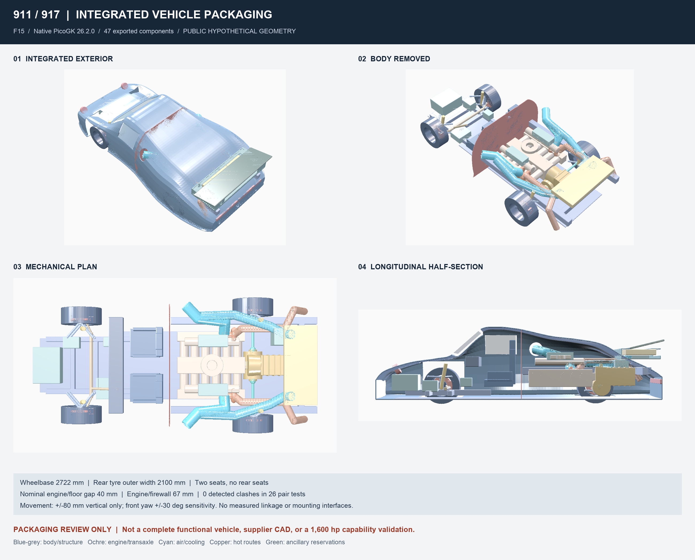

# F15: integrated PicoGK vehicle packaging

This is a whole-vehicle **packaging assembly**, not a complete functional
automotive design. It contains 47 separate hypothetical geometries (48 with
the optional private, uncalibrated engine scan). No manufacturing or road-use
gate is opened. No catalogue part is released.



## Requirements and scope

| Owner requirement | Representation | Verification boundary |
|---|---|---|
| Extended 911, engine ahead of rear axle | 2,722 mm wheelbase, engine X=1,472–2,622, axle X=2,722 | Geometric placement, not mass distribution |
| Vehicle in PicoGK | Body, floor, frame corridors, two seats, engine, transaxle, two turbos, halfshafts, four wheels, brake/suspension/steering/equipment reservations | Exact component inventory, six views, separate STL/VDB and combined inspection assembly |
| No rear seats, straight firewall | Two front seats only; constant-X plane at X=1,400 | Rear wall face X=1,405; seat extents checked against X=1,365 |
| Quarter-window air intakes | Two ducts and body apertures | Not measured engine ports or flow calculations |
| Fixed 930-style tail with radiator | Raised lip, hollow plenum, exchanger reservation, feed openings | No heat rejection or downforce result |
| Use the engine scan | Optional F13 alignment and checksum verification | Cylinder-row alignment, not calibrated scale/output datum |

R-CAD, R-PROVENANCE and R-CHANGE from the
[engineering architecture](../../docs/architecture/migration-verification.md)
apply. Editable masters are [C#](picogk/FullVehicleStudy.cs) and
[JSON](full-vehicle-study-f15.json). Meshes have no parametric STEP history.

## Integration decisions

F14's 1,840 mm rear track and 260 mm tyre width remain a trial: **2,100 mm tyre
outer width**. Body stations reach 2,200 mm nominal width; interpolation and
shell extend beyond them. Export bounds are recorded per component. Neither
width nor this geometry establishes traction at 1,600 ch.

The engine envelope remains an unmeasured F1 reservation of 1,150 × 1,200 ×
800 mm. The floor top moves to Z=140, giving **40 mm** nominal engine gap.
The firewall plane moves to X=1,400, giving **67 mm** to its rear face,
including wall thickness. At 5 mm voxels the native tests expand the engine
by 20+10 mm for floor/body and 50+10 mm for the firewall. This numerical guard
does not replace a tolerance stack, mount-motion study or fire qualification.

The front floor narrows to 880 mm ahead of X=500. Exhausts pass outside the
rear crossmember. Engine-bay roof stations at X=2,320/2,722 rise to Z=1,110/1,030
to cover the engine reservation; cabin roof stations are unchanged. These are
proposals, not recovered 930 dimensions. The documentary base reference is a
993; no measured body surface is available for either vehicle here.

Wheel motion is prescribed as ±80 mm vertical travel and front yaw ±30°,
including interior extrema of the rotated tyre bounding rectangle. Displayed
links **do not determine this motion**. Toe, camber, caster, roll centres, bump
steer and actual joint travel are unknown. Wheel-arch and duct apertures are
construction rules, not independent clearance evidence. Tyre bottom is Z=10,
not zero; no ride-height claim is made.

## Reproduction

From the root, with .NET 9, PicoGK 2.3.0 native runtime, a compatible graphical
session, NumPy and Pillow already available:

```sh
REPOSITORY_ROOT="$PWD" PICOGK_VEHICLE_F15=1 \
  dotnet run --project twins/vehicle-911-917/picogk/Vehicle911917Packaging.csproj
python3 twins/vehicle-911-917/source/report_full_vehicle_f15.py
python3 -m unittest discover -s tests -p 'test_911_917_*.py' -v
```

Default output: `work/911-917-picogk-f15/`. A completed native report blocks
overwriting; retain it and set `PICOGK_OUTPUT_DIR` for another run. Pass the
same directory to the reporter with `--output`. Do not enable F14 and F15
together. The reused F12 wheel dimensions must match the F15 configuration.

For the **private** overlay, additionally set `PICOGK_INPUT_DIR` to the folder
containing `917-engine-oriented-f10.stl` and `PICOGK_F13_ALIGNMENT` to the
existing `scan-alignment-f13.json` receipt. Use a separate output directory.
The scan hash must match the receipt. It replaces the topology proxy in views,
not the full-engine clearance envelope. No private scan, derived mesh or
private image is published. The public proxy is authored hypothetical geometry.

The reporter verifies current source hashes, exact component/check/view sets,
STL/VDB/image hashes, finite positive geometry and closed release gates before
arranging native captures, without painting geometry. The DLL hash and native
runtime are recorded. Optional preflight tests use `DOTNET_TEST_EXECUTABLE`;
CI skips compiled/native tests when their runtime or outputs are absent.

## Execution checkpoint, 12 October 2026

Native PicoGK 26.2.0 ran at 5 mm: 47 public components and 26 pair checks;
48 components and 28 checks with the local scan. None of those pairs intersect
in the revised model. Source, mesh and capture hashes were verified. Three
earlier local iterations are retained, including the rejected floor/exhaust
and engine-cover/duct intersections. The figures are native captures.

C# compilation passed without warnings. The focused suite ran 39 tests with
four intentional skips for absent earlier private inputs. F14 was rerun at
2 mm after the shared entry-point change, preserving its baseline and trial
results. These are software/geometry checks only, not independent automotive
qualification. The full repository check is reported separately in the PR.

## Remaining engineering

The native report lists the exact collision pairs. Zero intersections on those
pairs is not an all-pairs clearance certificate. No beam sizing, FEA, fatigue,
tyre/load transfer, braking, CFD or aero balance is calculated.

Functional completion needs measured body/suspension datums, calibrated engine
scale/output interface and complete-engine envelope; a supplier transaxle
drawing and accepted torque duty cycle; actual steering/brake/fuel/cooling
equipment; masses/centres of gravity; and an approved load/validation plan.
Mounts, fasteners, restraints, wiring, services, seals and tolerances are not
fully modelled. Visual corridor coordinates must not substitute for these data.

All new public geometry is authored for this study. It does not copy supplier
meshes or the owner's reference photograph. Restricted scans remain local.
