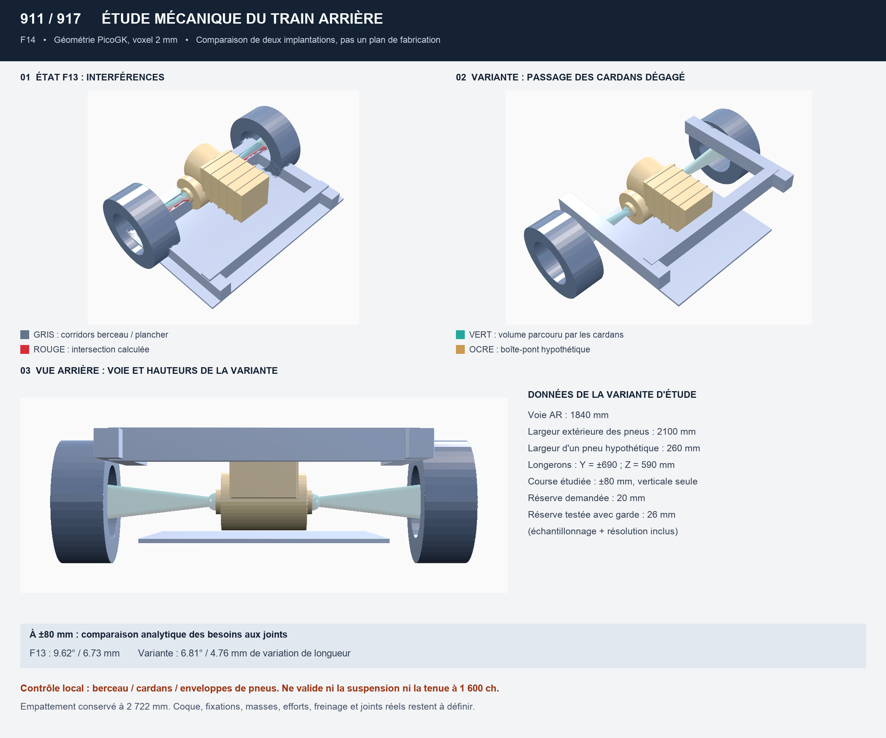

# F0–F14 integration and next engineering gate

This is a software/research checkpoint. It does not release a chassis,
suspension, driveline or functional engine component.



The preview was generated from this repository's hypothetical solids. It does
not contain the private engine scan or the owner's reference photograph.
Gray shapes are structural space reservations, not verified beam sections;
the ochre gearbox is not a selected supplier product. French annotations are
retained from the original study.

## Reproduced result

Native PicoGK 26.2.0, package 2.3.0, .NET 9, 2 mm voxels. The scan-free F14
preparation and native calculation were rerun in an isolated checkout of
current `origin/main` on 12 October 2026.

| Check | Previous layout | F14 trial |
|---|---:|---:|
| Rear track, hypothetical installation (mm) | 1,444 | 1,840 |
| Tire outer width with 260 mm tire reservation (mm) | 1,704 | 2,100 |
| Joint angle at ±80 mm vertical travel (degrees) | 9.620 | 6.809 |
| Joint-distance increase from neutral (mm) | 6.732 | 4.759 |
| Nominal shafts intersect frame | Yes | No |
| Continuous-motion 20 mm clearance reservation intersects frame | Yes | No |
| Conservative swept tire boxes intersect frame | Yes | No |
| Gearbox surrogate intersects frame | Yes | No |

These results apply only inside the rear inspection domain, X 2,500–3,600 mm.
The clearance test adds 2 mm for sample coverage and 4 mm for numerical guard.
Independent conservative analytic shaft/frame separation bounds are 34 mm
at the floor, 69 mm at the rails and 627 mm at the rear crossmember.
They bound the assumed vertical-only motion, not a real suspension trajectory.

**The trial is not selected.** Its tire envelope exceeds the documentary
1,735 mm body width. The engine reservation has only 10 mm clearance above
the proposed floor. Neither a longer shaft nor a wider track proves traction.

## Reproduction

From the repository root, with NumPy/Pillow and .NET 9 available:

```sh
python3 twins/vehicle-911-917/source/study_rear_driveline_f14.py
PICOGK_STUDY_F14=1 REPOSITORY_ROOT="$PWD" \
  dotnet run --project twins/vehicle-911-917/picogk/Vehicle911917Packaging.csproj
python3 twins/vehicle-911-917/source/report_rear_driveline_f14.py
python3 -m unittest discover -s tests -p 'test_911_917_*.py' -v
```

Native rendering needs the PicoGK native runtime and a compatible graphical
session. The Python preparation and analytic tests do not require either.
Private outputs are under `work/911-917-picogk-f14/`; F0–F13 require the private
inputs named in their configurations and intentionally skip those tests when
the data is absent. No scan is added to make CI pass.

## Next automotive-engineering work

1. Compare rail placements and floor heights jointly with track width; reject
   cases that trade a shaft clearance for an engine, tire or body collision.
2. Treat wheel motion as an envelope until measured suspension hardpoints
   permit a linkage model including camber, toe and hub migration.
3. Obtain a manufacturer transaxle drawing and accepted input-torque spectrum
   before fixing gearbox size, input axis, output spacing or mount interfaces.
4. Measure the engine output datum separately from the fitted cylinder-row
   direction. Scan alignment is not a bellhousing-interface measurement.
5. Build load cases from measured masses/centers of gravity, tire limits,
   ratios, torque transients and duty cycle before sizing structure or shafts.

No unsupported attachment coordinates, material allowables or tire-friction
values are supplied by this checkpoint. Strength, fatigue, cooling,
aerodynamics and physical fit remain unverified.
